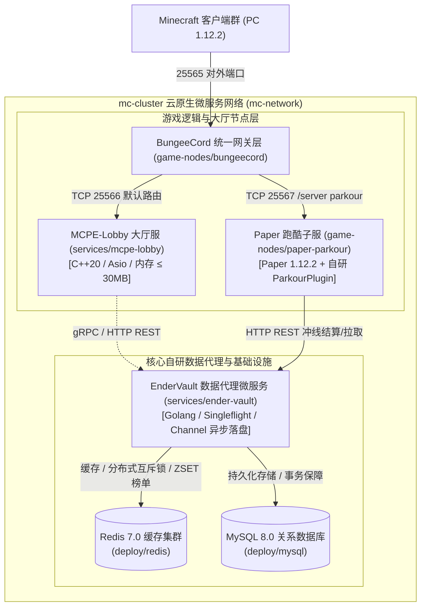

# Minecraft Cluster (mc-cluster) 🎮⚡

> **面向超高并发场景的分布式 Minecraft 微服务混合集群架构**  
> 结合 **C++20 异步轻量大厅引擎**、**Golang 分布式数据代理服**、**Paper 业务子服** 与 **BungeeCord 路由网关**，实现从百兆级极简内存到跨服数据强一致性的一体化云原生解决方案。

---

## 🌟 全局架构设计 (Architecture Overview)



---

## 🚀 项目核心亮点 (Key Highlights)

1. **极致轻量且高并发的 C++20 大厅微服务 (`mcpe-lobby`)**
   - 彻底摒弃传统 Java 大厅笨重的 JVM 启动与垃圾回收机制，单服基础内存占用 **≤ 30MB**（仅为传统 Paper 的 1/20）。
   - 基于现代 C++20 协程与 Asio 异步事件驱动模型，轻松支撑万级 Bot 登录与高频心跳包并发打流。
2. **高吞吐抗击穿的 Go 分布式数据代理 (`ender-vault`)**
   - **防缓存击穿与雪崩**：集成 `singleflight.Group`，将同一玩家的高并发冷读合并为单次 MySQL 回源，并配合带随机扰动的 Redis 动态 TTL。
   - **异步 Channel 批处理与写合并**：高频数值变动（金币、经验）进入 Go 内存缓冲通道，后台 Worker 定时批量合并后事务落盘，削峰填谷降低数据库 IOPS 达 90% 以上。
   - **分布式原子互斥锁**：基于 Redis `SET key token NX EX` 与 Lua 原子脚本实现防误删安全释放，支撑跨服资产安全转移。
   - **实时榜单毫秒级刷新**：利用 Redis `ZSET` 维护全服跑酷天梯榜，查询耗时控制在 1ms 以内。
3. **无缝对接传统生态与一键容器化 (`game-nodes`)**
   - 采用 BungeeCord 作为外部统一七层反向代理网关，透明代理 C++ 大厅服与 Java Paper 子服。
   - 跑酷服配备自研轻量级 Bukkit 插件（`ParkourPlugin`），踩踏金/铁压力板自动触发微秒级计时与异步上报。
4. **统一契约驱动开发 (`api/`)**
   - 包含 Protobuf (`vault.proto`)、OpenAPI 3.0 (`openapi.yaml`) 及关系数据库模型（`schema.sql`），跨语言通信规范严格、文档自解释。

---

## 📂 项目目录结构 (Directory Layout)

```text
mc-cluster/                          # 仓库根目录
├── docker-compose.yml               # 【核心】一键编排：MySQL + Redis + EnderVault(Go) + MCPE(C++) + Paper + Bungee
├── README.md                        # 全局架构图、项目亮点、压测与部署指南
├── .gitignore                       # 统一工程忽略规则
│
├── api/                             # 【跨语言契约层】所有微服务共享的接口规范
│   ├── proto/
│   │   └── vault.proto              # gRPC 跨语言通信协议定义 (C++ / Go / Java)
│   ├── openapi.yaml                 # RESTful HTTP 接口文档
│   └── schema.sql                   # MySQL 核心建表与索引设计
│
├── services/                        # 【核心自研微服务层】
│   ├── mcpe-lobby/                  # [C++20/Asio] 极轻量高性能大厅服务引擎
│   │   ├── CMakeLists.txt           # 现代 CMake 编译配置
│   │   ├── Dockerfile               # 多阶段极致压缩构建镜像
│   │   ├── assets/                  # 地图预渲染二进制与区块缓存
│   │   ├── cmake/                   # 依赖工具链
│   │   ├── src/                     # C++ 核心源码
│   │   ├── tests/                   # 单元与集成测试套件
│   │   └── tools/                   # 地图烘焙与协议解析工具
│   │
│   └── ender-vault/                 # [Golang] 分布式数据代理微服务
│       ├── Dockerfile               # Go 多阶段极小镜像构建
│       ├── go.mod                   # 模块依赖
│       ├── cmd/server/main.go       # 微服务启动入口与优雅停机
│       ├── internal/
│       │   ├── handler/             # HTTP 路由与参数校验
│       │   ├── service/             # 业务逻辑 (Singleflight, Channel 批处理, 分布式锁)
│       │   ├── repository/          # GORM 操作 MySQL + go-redis 缓存操作
│       │   └── model/               # 结构体实体与 DTO 定义
│       └── config/config.yaml       # 运行时连接与参数配置
│
├── game-nodes/                      # 【第三方游戏服与插件层】
│   ├── bungeecord/                  # 网关层反向代理
│   │   ├── Dockerfile               # 自动拉取官方最新稳定构建
│   │   └── config.yml               # 路由表定义 (lobby:25566, parkour:25567)
│   │
│   └── paper-parkour/               # Paper 1.12.2 跑酷业务服
│       ├── Dockerfile               # 自动拉取 Paper 构建
│       ├── config/                  # server.properties, spigot.yml, paper.yml (开启 bungeecord)
│       └── parkour-plugin/          # [Java] 自研跑酷跨服同步插件
│           ├── pom.xml              # Maven 构建配置
│           └── src/                 # 监听冲线事件并异步向 ender-vault 上报
│
├── deploy/                          # 【基础设施与初始化】
│   ├── mysql/
│   │   └── init.sql                 # 容器启动时自动初始化的建库建表与预置种子数据
│   └── redis/
│       └── redis.conf               # 持久化与 volatile-lru 淘汰策略配置
│
├── scripts/                         # 【压测与自动化测试套件】
│   ├── benchmark_swarm.py           # 百/千级虚拟 Bot 并发冲击压测
│   ├── run_comparative_benchmark.py # 对比压测基准套件
│   ├── monitor_collector.py         # 资源利用率采样监视器
│   └── test_*.py                    # 协议、分块与大厅跨服集成验证脚本
│
└── doc/                             # 【架构设计文档与面试 QA】
    ├── 01_PRD_业务约定.md
    ├── 02_选型与系统架构.md
    ├── 03_网络通信与协议规范.md
    ├── 04_数据存储与缓存架构.md
    ├── 05_玩家状态与跨服同步.md
    ├── 06_多维度高并发压测方案.md
    ├── 07_项目学习资源与技术图谱.md
    └── QA/                          # 核心技术攻坚与面试问答库
```

---

## 🛠️ 快速启动指南 (Quick Start)

### 1. 前置依赖
- [Docker](https://www.docker.com/) 20.10+
- [Docker Compose](https://docs.docker.com/compose/) v2+

### 2. 一键构建与集群启动
在 `mc-cluster` 根目录下执行：
```bash
docker-compose up -d --build
```

查看各容器启动健康状态：
```bash
docker-compose ps
```

预期正常输出：
```text
NAME                IMAGE                        COMMAND                  SERVICE             STATUS
bungeecord-proxy    mc-cluster-bungeecord        "java -Xms256M -Xmx5…"   bungeecord          running (healthy)
mc-ender-vault      mc-cluster-ender-vault       "/app/ender-vault"       ender-vault         running (healthy)
mc-mysql            mysql:8.0                    "docker-entrypoint.s…"   mysql               running (healthy)
mc-paper-parkour    mc-cluster-paper-parkour     "java -Xms512M -Xmx1…"   paper-parkour       running (healthy)
mc-redis            redis:7.0-alpine             "docker-entrypoint.s…"   redis               running (healthy)
mcpe-lobby          mc-cluster-mcpe-lobby        "/app/bin/server"        mcpe-lobby          running
```

### 3. 连接游戏与测试
- 打开 Minecraft 客户端 (版本: **1.12.2**)。
- 多人游戏添加服务器地址：`127.0.0.1:25565`。
- 默认将直连进入 **C++20 高性能大厅 (`mcpe-lobby`)**。
- 输入 `/server parkour` 即可无缝跨服至 **Paper 跑酷服**，踩下铁压力板计时开始，踩下金压力板通关并向 `ender-vault` 结算成绩！

---

## 📊 压测与监控入口 (Benchmarking)

集群自带成熟的 Python 高并发压测客户端驱动：

- **百级 Bot 阶梯涌入压测**：
  ```bash
  python scripts/benchmark_swarm.py --host 127.0.0.1 --port 25565 --bots 200
  ```
- **资源监控采集**：
  ```bash
  python scripts/monitor_collector.py
  ```
- **网关连通性与穿透验证**：
  ```bash
  python scripts/test_sprint5_gateway.py
  ```

---

## 📚 详细设计与面试文档索引
详见 [doc/](doc/) 目录：
- [数据存储与缓存架构设计 (MySQL + Redis + Singleflight)](doc/04_数据存储与缓存架构.md)
- [网络通信协议规范与序列化](doc/03_网络通信与协议规范.md)
- [高频技术面试 QA 精选](doc/QA/)
