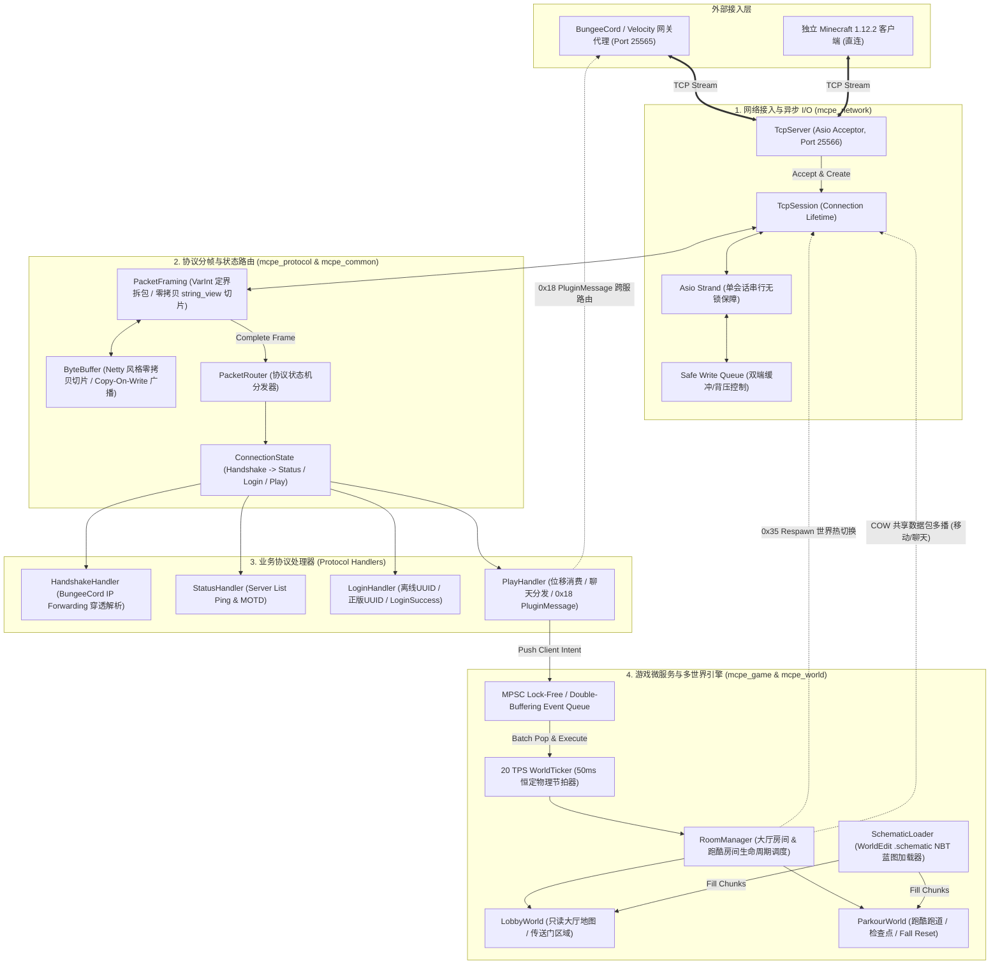

# 02_技术选型与系统架构设计 (Architecture & Technology Selection)

> **文档标识**：`MCPE-DOC-ARCH-02`  
> **版本**：v2.0.0 (微服务大厅与跑酷引擎转型版)  
> **更新日期**：2026-10-07  
> **目标系统**：MCPE (C++23 高性能 Minecraft 集群大厅与多地图跑酷微服务引擎)

---

## 一、 系统总体架构拓扑 (System Architecture)

MCPE 采用**分层解耦、职责单一、读写分离、网络 I/O 与房间调度隔离**的工业级高性能单进程多世界微服务架构。



---

## 二、 核心技术选型与深度权衡论证 (Technology Selection & Trade-Offs)

### 2.1 编程语言选型：现代 C++23 的碾压级优势
| 评估维度 | 现代 C++23 (本项目) | Java (Paper/Spigot) | Go |
| :--- | :--- | :--- | :--- |
| **内存底噪** | **$\le 30\text{MB}$**（直接编译为机器码，无运行时膨胀） | 常驻 **1GB ~ 2GB**（JVM 基础堆开销沉重） | ~50MB（Runtime 开销） |
| **冷启动时间** | **$\le 50\text{ms}$**（秒级容器化弹性扩缩容） | **15 ~ 30 秒**（庞杂的类加载与反射） | ~200ms |
| **GC 停顿 (STW)** | **完全为零**（确定性 RAII 内存释放） | 频繁 Young GC，偶发 Full GC 导致卡帧 | 存在三色标记 GC，瞬时延迟不可控 |
| **现代语言特性** | `std::expected` 错误传递、`std::span` 零拷贝视图、Concepts 约束、Ranges | 语法冗余、原始类型与包装类型装箱开销 | 缺少编译期计算与高性能泛型特化 |

### 2.2 网络模型选型：Standalone Asio + 会话级 Strand
* **选型依据**：采用 Header-only 的 Standalone Asio，彻底解除对庞大 Boost 库的依赖。
* **并发安全**：通过 `asio::strand` 绑定每一个 `TcpSession`，保证单连接读写回调绝对串行，彻底消除会话内部加锁开销。
* **背压控制**：写入端采用双端队列（`Safe Write Queue`），仅在无活跃发送时触发 `async_write_some`，避免高并发广播导致发送队列内存无限堆积。

### 2.3 零拷贝广播管线：COW (Copy-On-Write) `ByteBuffer`
* 当大厅中有 500 名玩家同屏时，一名玩家移动所产生的位置包（约 10 字节）需要广播给其他 499 名玩家。
* **传统低效做法**：为每个玩家分配内存并序列化一次，共执行 499 次内存分配与数据拷贝。
* **本项目优化**：单个数据包在主线程只序列化一次，封装为 `std::shared_ptr<ByteBuffer>`。由于内部具有写时复制（COW）语义，499 次发送操作全部为引用计数浅拷贝（零内存分配），吞吐量提升一个数量级。

---

## 三、 多世界与房间生命周期设计 (Multi-World & Room Management)

传统 Minecraft 架构若要实现“选图去玩小游戏”，必须通过 BungeeCord 切换到另一个服务器进程。
本项目创新采用**单进程同服世界热切换模型**：

```
                    [ 玩家连接进服 ]
                           │
                           ▼
                 ┌───────────────────┐
                 │    LobbyWorld     │ (大厅待机 / 聊天 / 浏览地图)
                 └─────────┬─────────┘
                           │ 踩中跑酷门 / 输入 /join <map>
                           ▼
                 ┌───────────────────┐
                 │   ParkourRoom     │ (房间生命周期管理)
                 │  [State: WAITING] │
                 └─────────┬─────────┘
                           │ 人数就绪 -> [State: COUNTDOWN] -> [State: PLAYING]
                           ▼
                 ┌───────────────────┐
                 │  0x35 无缝切世界   │ (下发 0x35 Respawn + 目标地图 0x20 Chunks)
                 └─────────┬─────────┘
                           │
                           ▼
                 ┌───────────────────┐
                 │   ParkourWorld    │ (毫秒计时 / Checkpoint / 胜负结算)
                 └─────────┬─────────┘
                           │ 挑战完成 / 放弃返回
                           ▼
                 ┌───────────────────┐
                 │  0x35 切回大厅    │ (下发 0x35 Respawn + Lobby Chunks)
                 └───────────────────┘
```

1. **单连接复用**：玩家在世界间穿梭无需断开 TCP 连接，消除重新握手认证的延迟；
2. **Schematic 动态载入**：游戏地图文件解耦，跑酷地图使用 WorldEdit `.schematic` 格式打包存储，按需加载，内存按需分配；
3. **隔离性保障**：不同世界/房间间的聊天、移动广播天然隔离，互不干扰。

---

## 四、 工业级集群网关集成 (BungeeCord / Velocity Integration)

为了支持“即插即用”接入主流大型服务器网络，引擎原生支持两项关键规范：

### 4.1 BungeeCord IP Forwarding 穿透解析
网关反向代理将玩家路由给本项目时，握手包 `server_address` 遵循特殊格式：
```text
"localhost\0<client_ip>\0<client_uuid>\0<skin_json_properties>"
```
`HandshakeHandler` 通过空字符（`\0`）分割提取玩家真实公网 IP 与 UUID，保证封禁系统与皮肤系统的完整性。

### 4.2 Plugin Message 跨服传送门
当玩家在大厅中选择前往外部商业服（如生存一区）时，服务端向客户端发送：
- **Packet ID**：`0x18 Plugin Message (Clientbound)`
- **Channel**：`"BungeeCord"`
- **Payload**：`writeString("Connect")` + `writeString("survival-1")`

外层代理截获该包后自动将玩家无缝切走，本项目安全回收该玩家资源。
