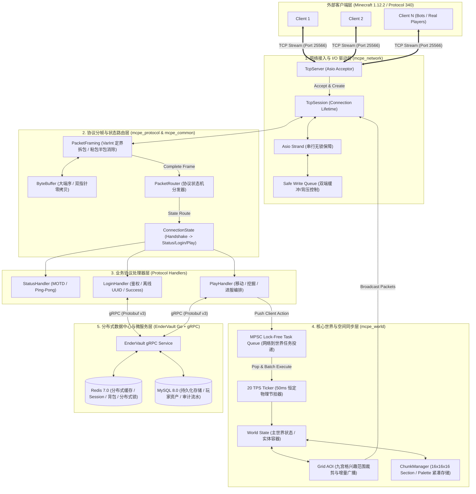

# 02_技术选型与系统架构设计 (Architecture & Technology Selection)

> **文档标识**：`MCPE-DOC-ARCH-02`  
> **版本**：v1.0.0  
> **更新日期**：2026-09-21  
> **目标系统**：MCPE (C++23 游戏网关与世界同步引擎) & EnderVault (Go 分布式数据中心)

---

## 一、 系统总体架构拓扑 (System Architecture)

MCPE 采用**分层解耦、职责单一、读写分离、网络与世界计算隔离**的工业级高性能服务端架构。系统由主网关节点（C++23）与伴生分布式数据中心（Go + gRPC Monorepo）构成。



---

## 二、 核心技术选型与深度权衡论证 (Technology Selection & Trade-Offs)

### 2.1 编程语言选型：为什么选择现代 C++23？
在游戏引擎底层与高性能网络网关领域，候选语言包括 C++23、Rust、Go、Java：

| 评估维度 | 现代 C++23 (本项目选型) | Rust | Go | Java (官方/Spigot) |
| :--- | :--- | :--- | :--- | :--- |
| **运行时开销** | **零开销**，直接编译为机器码 | **零开销**，直接编译为机器码 | 轻量运行时，但存在 GC 停顿与栈伸缩 | 极重 JVM，存在频繁 GC 停顿 (STW) |
| **内存确定性** | **严格 RAII**，无垃圾回收，确定性析构 | 严格所有权，无垃圾回收 | 动态标记清除 GC，瞬时内存膨胀 | 垃圾回收器开销大，内存利用率低 |
| **语言现代化特性** | **`std::expected`**（优雅无异常错误流）、**`std::span`**（零拷贝切片）、**Concepts**（编译期类型约束）、**Ranges** 管道操作 | 借用检查器极为安全，但宏与异步生态学习曲线极陡 | 语言语法简单，但缺乏泛型特化与编译期计算 | 语法冗余，对象内存对齐填充开销大 |
| **高性能网络生态** | **Boost.Asio / Standalone Asio**，经受十数年全球工业级验证 | Tokio 优秀，但多线程调度复杂 | 原生 Goroutine 极适合 Web，但不适合空间高精物理节拍 | Netty 优秀但面临堆外内存泄漏排查难题 |
| **工业界认可度** | 游戏大厂（腾讯、网易、米哈游、育碧）服务端核心唯一基石 | 云原生/区块链热门，游戏生态尚在摸索 | 业务后端主力，但难以胜任 20 TPS 物理帧 | 传统 Minecraft 生态主流，但性能已至天花板 |

* **决策结论**：采用 **现代 C++23** 编写核心网关与世界物理引擎，消灭一切 GC 停顿，实现确定性微秒级延迟；利用 `std::expected` 代替沉重的 C++ 异常处理，使控制流清晰高效。

### 2.2 网络库选型：为什么选择 Standalone Asio？
网络通信是网关的最底层基石。对比主流 C++ 网络库：

| 候选库 | 优势 | 劣势 | 本项目评定 |
| :--- | :--- | :--- | :---: |
| **Standalone Asio** (本项目) | **Header-only 无臃肿依赖**；提供 Reactor 与 Proactor 优雅抽象；**Strand 机制**原生解决并发回调竞态；跨平台（Linux epoll / macOS kqueue / Windows IOCP） | 模板报错信息较长 | **采纳 (最优解)** |
| **Boost.Asio** | 功能全面，工业级稳定 | 绑定庞大的 Boost 全家桶，编译极慢，体积庞大 | 放弃（转用 Standalone 版） |
| **Muduo (陈硕)** | 经典的 Reactor 教学实现，代码直观易读 | 仅支持 Linux (epoll)；缺乏现代 C++ 演进支持；维护停滞 | 放弃（吸收其 Buffer 设计理念） |
| **手写原生 Linux Epoll** | 极致轻量，掌控一切细节 | 重复造轮子，缺乏高层异步抽象，跨平台扩展性差 | 放弃（仅供原理对照） |

### 2.3 架构解耦选型：为什么引入 Go + gRPC (EnderVault)？
* **职责隔离原则**：
  * **C++23 网关与世界引擎（MCPE）**：专注于**微秒级网络分帧、状态机路由、20 TPS 空间碰撞与九宫格 AOI 状态广播**，必须保持纯内存、零 GC、绝对不发生任何阻塞 I/O。
  * **Go 微服务中心（EnderVault）**：专注于**玩家持久化资产、离线数据结算、MySQL 数据库读写、Redis 缓存一致性维护与 HTTP/gRPC 鉴权**。
* **收益**：
  * 数据库与缓存的慢 I/O 哪怕发生网络抖动，也绝不卡死 C++ 游戏主世界的 20 TPS 节拍。
  * 简历天然覆盖 **C++ 高性能系统底层 + Go 分布式微服务** 两大企业级核心技术栈。

---

## 三、 并发与线程模型设计 (Concurrency & Threading Model)

MCPE 摒弃了导致死锁和性能瓶颈的“全服大粗锁”设计，采用 **混合 Reactor + 会话级 Strand + 单写入者游戏主循环（Single-Writer Loop）** 模型。

```
                       [网络 I/O 线程池 (Asio io_context)]
                                    │
    ┌───────────────────────────────┴───────────────────────────────┐
    ▼                                                               ▼
[Session 1 Strand]                                          [Session 2 Strand]
  ├─ Async Read (PacketFraming)                               ├─ Async Read (PacketFraming)
  ├─ Safe Write Queue                                         ├─ Safe Write Queue
  └─ Push Move/Dig Intent                                     └─ Push Move/Dig Intent
           │                                                               │
           └───────────────────────┬───────────────────────────────────────┘
                                   │ (MPSC Task Queue: Lock-Free)
                                   ▼
                   [世界主循环线程 (20 TPS Ticker Thread)]
                     ├─ 1. Batch Pop Network Tasks
                     ├─ 2. Update World & Entities (Single-Threaded, No Lock!)
                     ├─ 3. Grid AOI Spatial Calculations
                     └─ 4. Post Broadcast Packets Back to Sessions' Strands
```

### 3.1 会话级 Strand 消除数据竞争
* **问题**：在多线程 Asio 场景下，同一 TCP 连接的读完成回调、写完成回调和上层主动发包可能在不同线程并发触发，极易引发缓冲区分块冲突。
* **解决方案**：为每个 `TcpSession` 绑定一个独立的 `asio::strand<asio::io_context::executor_type>`。
* **效果**：所有对该连接缓冲区的读写操作均通过 `asio::post(strand_, ...)` 投递，由 Asio 运行时保证严格顺序执行，**业务层无需加任何互斥锁（std::mutex）**，兼顾高并发与纯天然线程安全。

### 3.2 单写入者世界主循环 (Single-Writer World Loop)
* **网络与世界逻辑解耦**：
  * 网络 I/O 线程解析完客户端数据包后，**不直接修改世界和实体状态**，而是将玩家的操作意图（Intent，如移动意图、挖掘意图）封装为闭包任务，推入单消费者多生产者（MPSC）无锁任务队列。
  * 世界主循环线程（World Ticker）以严格的 50ms (20 TPS) 节拍醒来，一次性批量抽取队列任务，单线程统一执行位置结算、物理碰撞与方块变更。
* **核心优势**：
  * 世界状态计算全程**零锁竞争**，彻底杜绝多线程读写世界导致的死锁与内存脏读。
  * 状态变更具有确定性（Deterministic），便于实现状态快照、回放及断线重连。

---

## 四、 模块划分与工程分层结构

整个 Monorepo 遵循清晰的模块化分层：

```
mcpe/
├── include/mcpe/               # 对外暴露的公共头文件规范
│   ├── common/                 # 核心通用叶子组件 (ByteBuffer, VarInt)
│   ├── network/                # 网络 I/O 组件 (TcpServer, TcpSession, PacketFraming)
│   ├── protocol/               # 协议与状态机 (ConnectionState, PacketRouter, Handlers)
│   └── world/                  # 世界物理与空间同步 (World, Chunk, Entity, AOI)
├── src/                        # 对应模块的 C++23 实现源文件
├── tests/                      # 严谨的独立单元测试套件
├── services/
│   └── endervault/             # Go + gRPC 伴生分布式数据中心微服务
├── proto/                      # 跨语言共享的 Protocol Buffers v3 契约定义
└── docs/                       # 项目系统工程设计规范文档体系
```

### 4.1 核心组件职责矩阵

| 模块名称 | 核心类 / 结构体 | 设计模式 / 核心技术 | 职责边界与规范 |
| :--- | :--- | :--- | :--- |
| **`mcpe_common`** | `ByteBuffer`, `VarInt` | 双指针环形视图、LEB128、`std::expected` | 底层二进制编解码基座，无异常设计，大端序转换 |
| **`mcpe_network`** | `TcpServer`, `TcpSession`, `PacketFraming` | Reactor 模式、Strand 串行化、滑动切包 | 管理 TCP 监听、会话生命周期、定界拆包与粘包消除 |
| **`mcpe_protocol`**| `ConnectionState`, `PacketRouter`, 各 `Handler` | 状态机模式、策略模式、表驱动分发 | 维护客户端连接状态跃迁，按 State + PacketID 分发数据包 |
| **`mcpe_world`**   | `World`, `ChunkSection`, `GridAOI`, `Ticker` | 固定步长节拍器、空间网格分区、数据驱动 | 20 TPS 物理更新循环、区块内存管理、九宫格兴趣范围同步 |
| **`endervault`**   | `VaultServer`, `RedisManager`, `MySQLGorm` | Clean Architecture、Cache-Aside | 跨服资产中心、多级缓存一致性保障、防重刷分布式锁 |

---

## 五、 内存模型与零拷贝策略

1. **动态 `ByteBuffer` 紧凑内存设计**：
   - 内部维护连续内存块 `std::vector<uint8_t>`，通过 `reader_index_` 和 `writer_index_` 隔离已读、待读与空闲空间。
   - 提供 `kPrependPadding` 预留前置空间，使发送网络封包时可以在原缓冲区头部以 $O(1)$ 代价追加 `VarInt` 长度头，消除二次内存分配与数据拷贝。
2. **切片视图与生命周期绑定**：
   - 拆包解析时广泛采用 `std::span<const uint8_t>` 与 `std::string_view`，直接引用底层网络接收缓冲区，仅在必要时执行深拷贝。
3. **定长块内存池预分配（Sprint 5 演进）**：
   - 为高频的 2KB ~ 16KB 网络包和 ChunkSection 分配定长对象池（Slab Allocator），规避频繁向 glibc 申请小内存碎片引发的锁竞争与内存外碎片。
