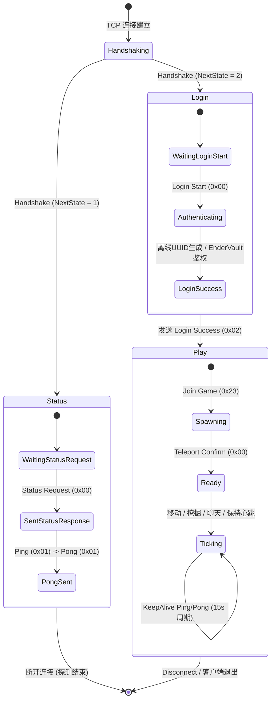

# 03_网络通信与通信协议规范 (Network Protocol Specification)

> **文档标识**：`MCPE-DOC-NET-03`  
> **版本**：v1.0.0  
> **更新日期**：2026-09-21  
> **目标协议**：**Minecraft Java Edition 1.12.2（Protocol Version: 340）**  
> **权威参考**：wiki.vg 官方协议镜像 [`docs/protocol/protocol_340_cheatsheet.md`](protocol/protocol_340_cheatsheet.md) 与网卡抓包 [`docs/protocol/packets_hex_dump.md`](protocol/packets_hex_dump.md)

---

## 一、 网络分帧与封包定界模型 (Packet Framing)

### 1.1 TCP 流式传输与粘包/半包成因
TCP 是基于字节流（Byte Stream）的面向连接可靠传输协议，**在传输层不存在“消息”或“数据包”的边界**。
* **粘包（Packet Aggregation）**：发送端开启 Nagle 算法或短时间内发送多个小包，TCP 底层将其合并为一个 TCP Segment 发送；或者接收端读取不及时，一次 `read()` 读出多个逻辑包。
* **半包（Packet Fragmentation）**：逻辑包体超过 MTU/MSS 分片发送；或者接收缓冲区容量限制，一次 `read()` 仅读出逻辑包的前半部分。

### 1.2 Minecraft 协议的定界帧格式
Minecraft 协议采用 **变长整型长度前缀（Length-Delimited Framing）** 的方式划分应用层封包：

```
+──────────────────────+──────────────────────+─────────────────────────────────────────+
| Packet Length:VarInt |  Packet ID : VarInt  |           Data Payload: Bytes           |
+──────────────────────+──────────────────────+─────────────────────────────────────────+
|<──── 帧头定界 ──────>|<───────────────────── 包体载荷 ────────────────────────────────>|
```

* **`Packet Length`**：使用 `VarInt` 编码，表示该长度字段之后**所有数据**的总字节数（即 `sizeof(Packet ID) + sizeof(Payload)`）。
* **`Packet ID`**：使用 `VarInt` 编码，表示当前协议状态下的具体包命令号。
* **`Data Payload`**：具体包体字段的二进制序列（采用大端序网络编码）。

### 1.3 定界拆包算法流水线 (PacketFraming)

```
        [TCP 接收缓冲区 (Socket Async Read)]
                         │
                         ▼
        [mcpe::ByteBuffer 连续累积读写缓冲]
                         │
        ┌────────────────┴────────────────┐
        ▼                                 ▼
   [尝试解码 VarInt 长度头]             [数据不足]
        │                                 │
   (成功解析出 packet_len)                 │
        │                                 │
   ┌────┴──────────────────────────┐      │
   ▼                               ▼      │
[readable_bytes >= packet_len]   [半包]   │
   │                               │      │
   ▼                               └──────┴───> (挂起，等待下一次 async_read)
[完整逻辑包: slicePacket]
   │
   ├─ 1. 弹出 packet_len 字节
   ├─ 2. 解析 Packet ID (VarInt)
   └─ 3. 投递给 PacketRouter 分发
```

* **异常安全与攻击防御**：
  1. **VarInt 长度超限检测**：VarInt 最多由 5 个字节构成（存储 32 位整型）。若连续读取 5 字节其最高延续位仍为 `1`，判定为畸形攻击，返回 `kVarIntTooLong` 并断开连接。
  2. **包体超大防御（Max Packet Size）**：限制单个数据包最大长度为 **`2MB`（`2 * 1024 * 1024` 字节）**。任何声称超过 2MB 的包直接返回 `kPacketTooLarge` 并断开会话。
  3. **非正长度拦截**：`packet_len <= 0` 判定为协议非法，拒绝处理。

---

## 二、 基础数据类型二进制编码标准 (Data Types)

Minecraft 协议全部整型与浮点型基本类型严格遵循 **网络大端字节序（Big-Endian / MSB First）**。

| 类型名称 | 占用空间 | 编码细节与规约 | C++23 对应表示 |
| :--- | :--- | :--- | :--- |
| **`Boolean`** | 1 字节 | `0x01` 为 `true`，`0x00` 为 `false` | `bool` |
| **`Byte`** | 1 字节 | 8 位有符号整型（-128 ~ 127） | `int8_t` |
| **`Unsigned Byte`**| 1 字节 | 8 位无符号整型（0 ~ 255） | `uint8_t` |
| **`Short`** | 2 字节 | 16 位有符号大端整型（-32768 ~ 32767） | `int16_t` |
| **`Unsigned Short`**| 2 字节 | 16 位无符号大端整型（0 ~ 65535） | `uint16_t` |
| **`Int`** | 4 字节 | 32 位有符号大端整型 | `int32_t` |
| **`Long`** | 8 字节 | 64 位有符号大端整型（KeepAlive 载荷） | `int64_t` |
| **`Float`** | 4 字节 | IEEE 754 32 位单精度浮点数（大端序） | `float` |
| **`Double`** | 8 字节 | IEEE 754 64 位双精度浮点数（大端序） | `double` |
| **`VarInt`** | 1~5 字节 | LEB128 变长有符号 32 位整型 | `int32_t` |
| **`VarLong`** | 1~10 字节 | LEB128 变长有符号 64 位整型 | `int64_t` |
| **`String`** | 变长 | 前缀 `VarInt(长度)` + UTF-8 编码字符串 | `std::string` / `std::string_view` |
| **`Position`** | 8 字节 | 64 位压缩整型：`x: 26 bits`, `z: 26 bits`, `y: 12 bits` | `uint64_t` |

### 2.1 VarInt (LEB128) 编解码算法规范
每个字节的最高位（第 7 位，`0x80`）为**延续位（Continuation Bit）**，低 7 位（`0x7F`）为**有效载荷位（Value Bits）**：
* 若延续位为 `1`，表示后续字节仍属于当前数值的一部分；
* 若延续位为 `0`，表示这是该数值的最后一个字节。

```cpp
// 核心解码逻辑 (参考 include/mcpe/common/VarInt.h)
inline std::expected<std::pair<int32_t, size_t>, VarIntError>
decode(std::span<const uint8_t> bytes) {
    int32_t result = 0;
    size_t shift = 0;
    for (size_t i = 0; i < bytes.size(); ++i) {
        uint8_t byte = bytes[i];
        result |= static_cast<int32_t>(byte & 0x7F) << shift;
        if ((byte & 0x80) == 0) {
            return std::pair{result, i + 1};
        }
        shift += 7;
        if (shift >= 35) return std::unexpected(VarIntError::kTooLong);
    }
    return std::unexpected(VarIntError::kNeedMoreData);
}
```

### 2.2 Position (三维方块坐标) 打包规范
三维世界坐标 $(X, Y, Z)$ 紧凑打包为一个 64 位长整型：
* $X$ 轴（26 位有符号整型）：`(val >> 38)`
* $Y$ 轴（12 位有符号整型）：`(val << 52) >> 52`
* $Z$ 轴（26 位有符号整型）：`(val << 26) >> 38`
* 打包公式：`((x & 0x3FFFFFF) << 38) | ((z & 0x3FFFFFF) << 12) | (y & 0xFFF)`

---

## 三、 协议状态机拓扑与跃迁规约 (Connection States)

Minecraft 会话生命周期由 **4 个互斥状态（Connection State）** 构成：



---

## 四、 核心数据包协议详表 (Protocol 340 权威规约)

### 4.1 Handshaking 阶段数据包

#### 0x00: Handshake（客户端 -> 服务端）
* 客户端发起连接后的**首个必须数据包**，告知服务端协议版本与意图。

| 字段名称 | 字段类型 | 含义与规约说明 |
| :--- | :--- | :--- |
| `protocol_version` | `VarInt` | 客户端协议版本号（1.12.2 对应 **`340`**） |
| `server_address` | `String` | 客户端输入的服务器域名或 IP（最大 255 字符） |
| `server_port` | `Unsigned Short`| 服务器端口号（默认 25565） |
| `next_state` | `VarInt` | 目标跃迁状态：**`1 = Status`**，**`2 = Login`** |

---

### 4.2 Status 阶段数据包 (Server List Ping)

#### 0x00: Status Request（客户端 -> 服务端）
* 空包体（无 Payload 字段），表示请求当前服务器的状态与 MOTD。

#### 0x00: Status Response（服务端 -> 客户端）
* 回传服务器基本信息 JSON 字符串。

| 字段名称 | 字段类型 | 含义与格式示例 |
| :--- | :--- | :--- |
| `json_response` | `String` | 标准 JSON 字符串（格式如下） |

```json
{
  "version": {
    "name": "1.12.2",
    "protocol": 340
  },
  "players": {
    "max": 100,
    "online": 1,
    "sample": [
      {
        "name": "Steve",
        "id": "4566e69f-c907-348b-8a85-4db99e6d7247"
      }
    ]
  },
  "description": {
    "text": "MCPE High-Performance C++23 Server Engine"
  }
}
```

#### 0x01: Ping（客户端 -> 服务端）
| 字段名称 | 字段类型 | 说明 |
| :--- | :--- | :--- |
| `payload` | `Long` (8 字节) | 客户端发送时间戳 |

#### 0x01: Pong（服务端 -> 客户端）
| 字段名称 | 字段类型 | 说明 |
| :--- | :--- | :--- |
| `payload` | `Long` (8 字节) | 原样回传 Ping 中的时间戳，用于客户端计算网络 RTT |

---

### 4.3 Login 阶段数据包

#### 0x00: Login Start（客户端 -> 服务端）
| 字段名称 | 字段类型 | 说明 |
| :--- | :--- | :--- |
| `name` | `String` (1~16 字符) | 玩家登录名（例如 `"Steve"`） |

#### 0x02: Login Success（服务端 -> 客户端）
* 下发鉴权成功通知，标志着登录阶段结束，会话正式进入 `Play` 状态。

| 字段名称 | 字段类型 | 说明 |
| :--- | :--- | :--- |
| `uuid` | `String` (36 字符) | 带连字符的标准 UUID 字符串（如 `"c061be92-..."`） |
| `username` | `String` | 最终确定的玩家用户名 |

---

### 4.4 Play 阶段核心交互数据包

#### 0x23: Join Game（服务端 -> 客户端）
* **Protocol 340 关键特性**：`Dimension` 为 4 字节 `Int`（此前版本为 1 字节 Byte）。

| 字段名称 | 字段类型 | 含义与值设定 |
| :--- | :--- | :--- |
| `entity_id` | `Int` (4 字节) | 玩家在游戏内的唯一实体 ID（EID） |
| `gamemode` | `Unsigned Byte` | `0 = Survival`, `1 = Creative`, `2 = Adventure` |
| `dimension` | `Int` (4 字节) | `0 = Overworld (主世界)`, `-1 = Nether`, `1 = End` |
| `difficulty` | `Unsigned Byte` | `0 = Peaceful`, `1 = Easy`, `2 = Normal`, `3 = Hard` |
| `max_players` | `Unsigned Byte` | 客户端渲染显示的在线玩家上限 |
| `level_type` | `String` | 世界生成类型（如 `"default"`, `"flat"`） |
| `reduced_debug_info`| `Boolean` | 是否隐藏 F3 调试界面的精确坐标信息（默认 `false`） |

#### 0x2F: Player Position And Look（服务端 -> 客户端）
* 服务端主动更新或下发玩家坐标。

| 字段名称 | 字段类型 | 说明 |
| :--- | :--- | :--- |
| `x` | `Double` (8 字节) | 绝对/相对 X 坐标 |
| `y` | `Double` (8 字节) | 绝对/相对 Y 坐标（脚底高度） |
| `z` | `Double` (8 字节) | 绝对/相对 Z 坐标 |
| `yaw` | `Float` (4 字节) | 水平偏航角（度） |
| `pitch` | `Float` (4 字节) | 垂直俯仰角（度） |
| `flags` | `Byte` (1 字节) | 位掩码：指定上述哪些字段为相对增量（`0x00` 表示全部为绝对值） |
| `teleport_id`| `VarInt` | **服务端下发的传送确认序列号**（必须回传闭环） |

#### 0x00: Teleport Confirm（客户端 -> 服务端）
| 字段名称 | 字段类型 | 说明 |
| :--- | :--- | :--- |
| `teleport_id` | `VarInt` | 确认已就位的传送序列号，与服务端的 `0x2F` 严格匹配 |

#### 0x1F: Keep Alive（服务端 -> 客户端）
* **Protocol 340 关键特性**：载荷为 **`Long`（8 字节）**，不再是变长 VarInt。

| 字段名称 | 字段类型 | 说明 |
| :--- | :--- | :--- |
| `keep_alive_id` | `Long` (8 字节) | 服务端生成的 64 位心跳探测标识 |

#### 0x0B: Keep Alive（客户端 -> 服务端）
| 字段名称 | 字段类型 | 说明 |
| :--- | :--- | :--- |
| `keep_alive_id` | `Long` (8 字节) | 客户端原样回传的心跳标识 |

#### 0x20: Chunk Data（服务端 -> 客户端）
* 向客户端下发指定区块列的所有方块与光照数据。

| 字段名称 | 字段类型 | 说明 |
| :--- | :--- | :--- |
| `chunk_x` | `Int` (4 字节) | 区块 X 坐标 |
| `chunk_z` | `Int` (4 字节) | 区块 Z 坐标 |
| `ground_up_continuous` | `Boolean` | 是否包含全高度完整区块（初始化加载为 `true`） |
| `primary_bit_mask` | `VarInt` | 16 位掩码，标明本次数据包含了哪些垂直 ChunkSection (0~15) |
| `size` | `VarInt` | 数据缓冲区字节数 |
| `data` | `Byte Array` | 紧凑编码的 Section 数据块（Palette + Block States + Light） |
| `number_of_block_entities` | `VarInt` | 区块内方块实体数量（默认 0） |
