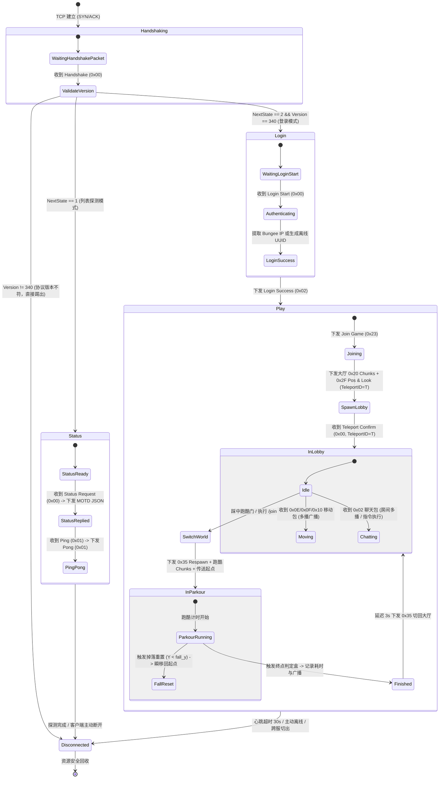
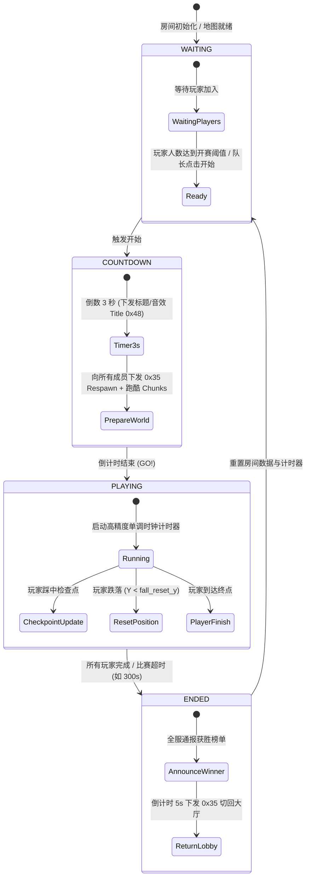
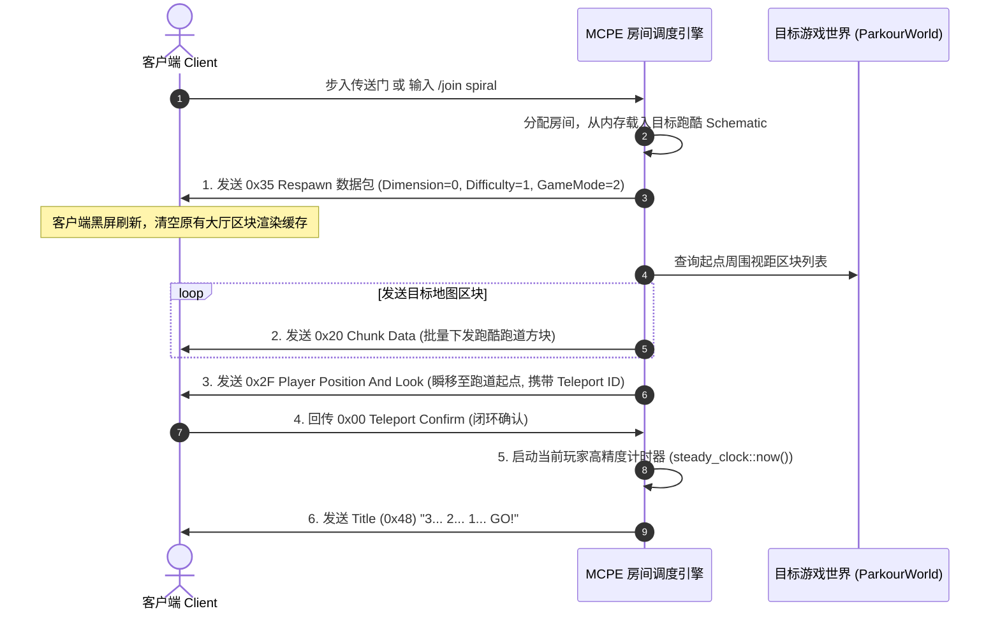

# 05_房间状态机与状态同步设计 (State Machine & Synchronization Design)

> **文档标识**：`MCPE-DOC-SYNC-05`  
> **版本**：v2.0.0 (微服务大厅与跑酷房间设计版)  
> **更新日期**：2026-10-07  
> **关联系统**：MCPE 协议状态机、房间生命周期管理器、跑酷游戏引擎与实体同步系统  
> **设计纲要**：涵盖连接生命周期状态机、跑酷房间状态机、0x35 无缝世界切换、20 TPS 节拍器与位置同步算法。

---

## 一、 连接生命周期有限状态机 (Connection State Machine)

客户端与服务端的连接生命周期由严密的底层状态机驱动：



---

## 二、 游戏房间状态机 (Room State Machine)

跑酷小游戏支持**单人竞速练习**与**多人同屏竞速**两种模式。每个房间运行独立的生命周期状态机：



---

## 三、 0x35 无缝切世界时序 (World Transition Sequence)

客户端无需断开连接，即可在微秒级完成大厅与跑酷地图之间的平滑过渡：



---

## 四、 跑酷游戏判定核心算法

### 4.1 掉落安全熔断 (Fall Reset)
跑酷地图均为浮空跑道。为避免玩家掉入虚空卡死或死亡掉落等待：
- 服务端在每次消费客户端 `Player Position (0x0E/0x10)` 时，提取 $Y$ 轴坐标；
- 若 $Y < \text{fall\_reset\_y}$（配置项，如 $Y < 35.0$）：
  - 服务端立即向客户端强制下发 `0x2F Player Position And Look`，坐标重置为起点（或最近激活的 Checkpoint）；
  - 客户端瞬间被拉回跑道，不扣血、不死亡、计时不中断，体验极佳。

### 4.2 终点包围盒检测 (AABB Collision)
终点设置一个三维空间包围盒（Axis-Aligned Bounding Box）：
$$\text{Box} = [X_{\min}, X_{\max}] \times [Y_{\min}, Y_{\max}] \times [Z_{\min}, Z_{\max}]$$
当玩家坐标 $(x, y, z)$ 满足：
$$X_{\min} \le x \le X_{\max} \land Y_{\min} \le y \le Y_{\max} \land Z_{\min} \le z \le Z_{\max}$$
判定为触碰终点：
1. 记录完成时间戳：$\Delta t = \text{now}() - t_{\text{start}}$（精确到毫秒）；
2. 格式化通报消息：“§a[跑酷] 恭喜玩家 §e%s §a通关！用时: §b%.2f 秒！”；
3. 将成绩插入本地排行榜（内存有序集合 `std::set` / SQLite / Redis）。

---

## 五、 20 TPS 物理主循环与节拍器模型 (Fixed Timestep Loop)

主世界采用基于单调时钟与时间累加器（Accumulator）的高精度补偿算法，维持恒定 20 TPS（每 Tick 50ms）：

```cpp
void WorldTicker::run() {
    using namespace std::chrono;
    constexpr nanoseconds kTickInterval(50'000'000); // 50ms
    constexpr nanoseconds kMaxAccumulator(250'000'000); // 防死亡螺旋阈值: 250ms (5 Ticks)

    auto last_time = steady_clock::now();
    nanoseconds accumulator(0);

    while (running_.load(std::memory_order_relaxed)) {
        auto current_time = steady_clock::now();
        accumulator += (current_time - last_time);
        last_time = current_time;

        if (accumulator > kMaxAccumulator) {
            accumulator = kMaxAccumulator;
        }

        while (accumulator >= kTickInterval) {
            tick(); // 消费 MPSC 队列任务，更新房间倒计时与位置校验
            accumulator -= kTickInterval;
        }

        auto elapsed = steady_clock::now() - current_time;
        if (elapsed < kTickInterval) {
            std::this_thread::sleep_for(kTickInterval - elapsed);
        }
    }
}
```
