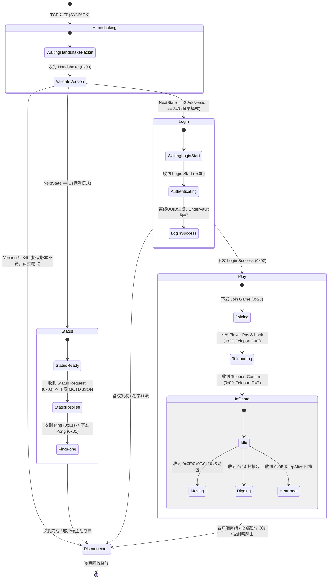

# 05_房间状态机与状态同步设计 (State Machine & Synchronization Design)

> **文档标识**：`MCPE-DOC-SYNC-05`  
> **版本**：v1.0.0  
> **更新日期**：2026-09-21  
> **关联系统**：MCPE 协议状态机、空间世界引擎与实体同步系统  
> **设计纲要**：涵盖 Minecraft 连接会话状态机、20 TPS 物理节拍器调度流水线、九宫格 AOI 空间索引与增量网络状态同步算法。

---

## 一、 连接生命周期有限状态机 (Connection State Machine)

### 1.1 状态转移全景图与守卫条件
客户端与服务端的整个生命周期由严密的有限状态机（FSM）驱动。任何未按规范流转的非预期数据包都将被严格阻断：



### 1.2 严格安全守卫策略 (State Guard)
1. **非法包即时熔断**：
   - 若处于 `Handshaking` 状态时收到任何非 `0x00` 的包，立即强制销毁连接。
   - 若在未进入 `Play` 状态前收到 `Player Position`、`Chat`、`Player Digging` 等游戏世界包，判定为恶意越权发包，直接切断会话并记入防护日志。
2. **Teleport ID 闭环锁定**：
   - 当服务端发送 `0x2F Player Position And Look` 时，分配自增的 `teleport_id` 并进入锁定状态。
   - 处于锁定状态期间，服务端**丢弃客户端发来的所有常规自主移动包**，直到收到携带匹配 `teleport_id` 的 `0x00 Teleport Confirm`，彻底杜绝客户端利用移动发包掩盖服务端强制位移的漏洞。

---

## 二、 20 TPS 物理主循环与节拍器模型 (Fixed Timestep Loop)

### 2.1 为什么必须锁定 20 TPS（50ms / Tick）？
Minecraft 的核心游戏逻辑、红石传导、方块重力、生物 AI 与网络同步全部以 **20 TPS（Tick Per Second，即每秒 20 刻，每 Tick 刚好 50ms）** 为基本度量衡。
* **脱离 20 TPS 的危害**：若帧率过快，红石时序加速崩溃，玩家跑动如飞；若帧率过慢（如掉到 10 TPS），世界将产生明显的“慢动作”与卡顿。

### 2.2 高精度时钟与漂移消除算法 (Drift Compensation)
由于操作系统的休眠（`sleep_for`）存在调度开销与时间片抖动，简单 `sleep(50ms)` 会导致累积时间向后大幅漂移。MCPE 采用**基于单调时钟与时间累加器（Accumulator）的高精度补偿算法**：

```cpp
void WorldTicker::run() {
    using namespace std::chrono;
    constexpr nanoseconds kTickInterval(50'000'000); // 50ms
    constexpr nanoseconds kMaxAccumulator(250'000'000); // 防死亡螺旋阈值: 250ms (5 Ticks)

    auto last_time = steady_clock::now();
    nanoseconds accumulator(0);

    while (running_.load(std::memory_order_relaxed)) {
        auto current_time = steady_clock::now();
        accumulator += (current_time - last_time);
        last_time = current_time;

        // 避免单帧严重卡顿后无限追帧导致的“死亡螺旋”
        if (accumulator > kMaxAccumulator) {
            accumulator = kMaxAccumulator;
        }

        // 恒定步长循环结算
        while (accumulator >= kTickInterval) {
            tick(); // 执行单个单 Tick 完整流水线
            accumulator -= kTickInterval;
        }

        // 动态计算剩余可休眠时间
        auto elapsed = steady_clock::now() - current_time;
        if (elapsed < kTickInterval) {
            std::this_thread::sleep_for(kTickInterval - elapsed);
        }
    }
}
```

### 2.3 单 Tick 核心五阶段执行流水线 (Tick Pipeline)

```
┌─────────────────────────────────────────────────────────────────────────────┐
│                       单 Tick 执行流水线 (每 50ms 一次)                       │
├─────────────────────────────────────────────────────────────────────────────┤
│ Phase 1: 消费 MPSC 任务队列                                                  │
│   - 一次性抽取网络 I/O 线程提交的全部玩家操作意图 (移动、挖掘、放置、聊天)           │
├─────────────────────────────────────────────────────────────────────────────┤
│ Phase 2: 实体行为更新与物理位移结算                                          │
│   - 计算重力加速、下落碰撞判定、速度衰减、瞬移确认校验                           │
├─────────────────────────────────────────────────────────────────────────────┤
│ Phase 3: 世界方块与环境事件更新                                              │
│   - 砂砾/沙子下落物理、水与岩浆流动计算、作物生长随机刻                        │
├─────────────────────────────────────────────────────────────────────────────┤
│ Phase 4: AOI 空间索引更新与可视集合划分                                      │
│   - 更新玩家所处九宫格网格、计算跨格 Enter/Leave/Move 事件                     │
├─────────────────────────────────────────────────────────────────────────────┤
│ Phase 5: 增量网络数据包构造与异步写分发                                      │
│   - 构造 0x26/0x28 增量同步包，投递回各 TcpSession 的 Strand 异步发送队列     │
└─────────────────────────────────────────────────────────────────────────────┘
```

---

## 三、 空间索引与九宫格 AOI 广播机制 (Area of Interest)

### 3.1 为什么需要空间分区（AOI）？
在没有 AOI 优化的朴素实现中，任何玩家移动都需要向全服所有在线玩家广播。当在线人数为 $N$ 时，全服每秒的网络广播量达到 $O(N^2)$。当 $N=1000$ 时，每秒需要发送数百万数据包，网络带宽与 CPU 将瞬间崩溃。

### 3.2 基于 Chunk 的九宫格网格划分
MCPE 将无限世界在 $X-Z$ 平面上划分为以 **Chunk（16x16 方块）** 为基准的空间网格：
* 设玩家的真实方块坐标为 $(x, y, z)$，其所在的网格索引为：
  $$ChunkX = \lfloor x / 16 \rfloor, \quad ChunkZ = \lfloor z / 16 \rfloor$$
* 设玩家的观察视距半径为 $R$（默认为 8 个 Chunk），其**兴趣范围（AOI Window）**为以 $(ChunkX, ChunkZ)$ 为中心的 $(2R+1) \times (2R+1)$ 矩阵。

```
     Z-1      Z      Z+1
   ┌──────┬──────┬──────┐
X-1│ 网格 │ 网格 │ 网格 │
   ├──────┼──────┼──────┤
X  │ 网格 │ 玩家 │ 网格 │  (3x3 九宫格 / 扩展 RxR 视野矩形)
   ├──────┼──────┼──────┤
X+1│ 网格 │ 网格 │ 网格 │
   └──────┴──────┴──────┘
```

### 3.3 玩家跨网格移动时的事件派发算法
当玩家从旧网格 $Grid_{old}$ 移动到新网格 $Grid_{new}$ 时，计算两个视野集合的差集：
* **进入视野集合（Enter Set）**：$S_{enter} = AOI(Grid_{new}) \setminus AOI(Grid_{old})$
* **离开视野集合（Leave Set）**：$S_{leave} = AOI(Grid_{old}) \setminus AOI(Grid_{new})$
* **持续保持集合（Stay Set）**：$S_{stay} = AOI(Grid_{new}) \cap AOI(Grid_{old})$

```
[集合差集计算结果]
  ├── 对 S_enter 内的所有观察者：
  │     1. 向观察者发送 Spawn Player (0x05)（在对方屏幕上生成当前玩家模型）
  │     2. 向当前玩家发送 Spawn Player（在自己屏幕上生成对方模型）
  ├── 对 S_leave 内的所有观察者：
  │     1. 向观察者发送 Destroy Entities (0x32)（销毁当前玩家模型）
  │     2. 向当前玩家发送 Destroy Entities（销毁对方模型）
  └── 对 S_stay 内的所有观察者：
        1. 仅广播轻量级的相对位移包 Entity Relative Move (0x26) 或 朝向包 (0x28)
```

---

## 四、 状态同步模型与抗抖动机制

### 4.1 增量同步（Delta Sync）与紧凑编码
对于已经在视野内的实体移动，严禁反复下发包含完整 UUID、皮肤属性和全量绝对坐标的重型数据包。
* **Protocol 340 增量移动包规范**：
  * **`Entity Relative Move (0x26)`**：
    - 相对位移计算公式：$\Delta X = (X_{new} \times 32 - X_{old} \times 32) \times 128$
    - 数据类型仅为 2 字节短整型（`Short`），整包仅占用数个字节。
  * **`Entity Look (0x28)`**：
    - 仅当偏航角（Yaw）或俯仰角（Pitch）变动时下发，各占 1 个字节（`Byte`）。
* **收益**：相比全量绝对坐标同步，网络带宽消耗**骤降 85% 以上**。

### 4.2 迟滞死区（Hysteresis Window）防边缘抖动
* **现象**：当玩家在两个 Chunk 网格交界处微小来回晃动时，差集计算会频繁触发 `Spawn Player` 与 `Destroy Entities` 的交替广播，导致客户端实体剧烈闪烁并引发网络风暴。
* **迟滞算法**：
  - 引入边界死区缓冲区（如 $\pm 2.0$ 格方块容差）。
  - 只有当玩家深入新网格内部超过死区阈值时，才执行网格迁移与 AOI 差集重算；在死区范围内的微小震荡不触发跨格事件。

### 4.3 客户端预测与服务端权威校准 (Reconciliation)
* **服务端权威原则（Server Authoritative）**：服务端保留物理世界的最终解释权。
* **位置拉回校准**：
  - 若客户端因物理穿模、高延迟或者使用飞行外挂导致坐标与服务端仿真结果产生严重分歧（偏差 $> 1.5$ 格）：
  - 服务端在下一个 Tick 强制下发包含当前合法物理坐标的 `0x2F Player Position And Look`，并携带全新的 `Teleport ID`，将客户端强制“拉回”正确坐标点。
