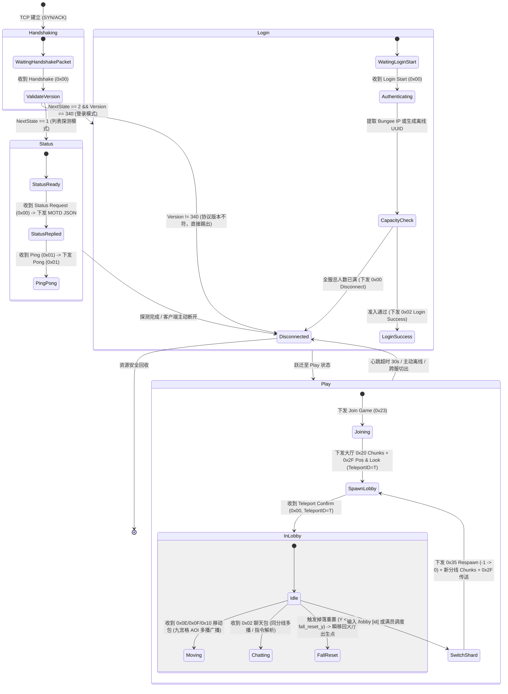
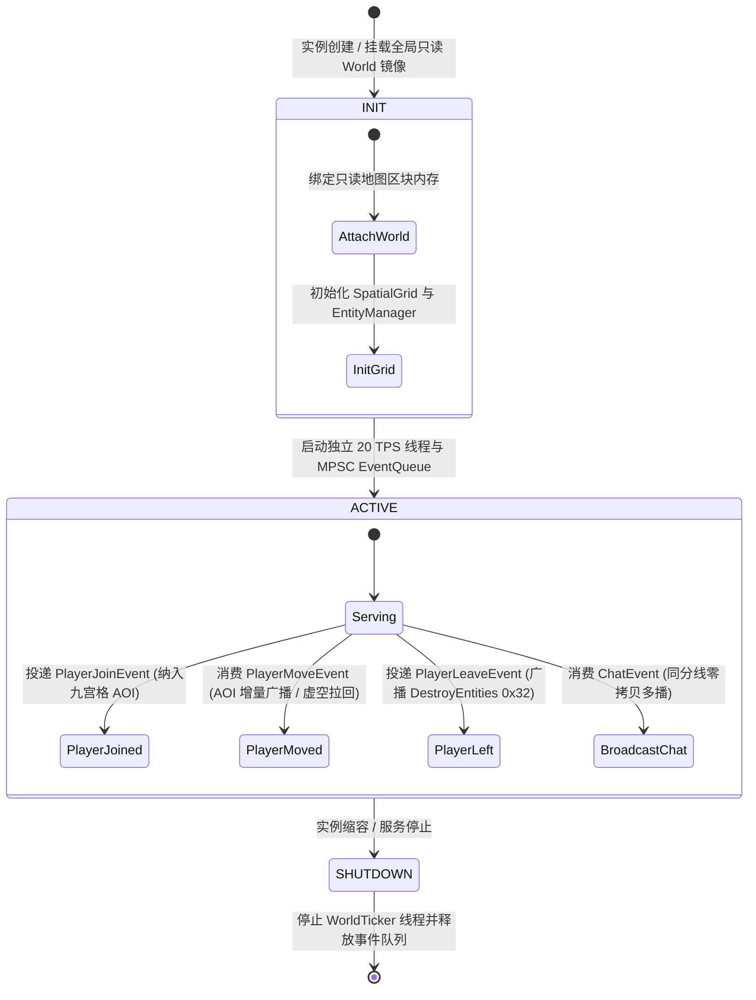
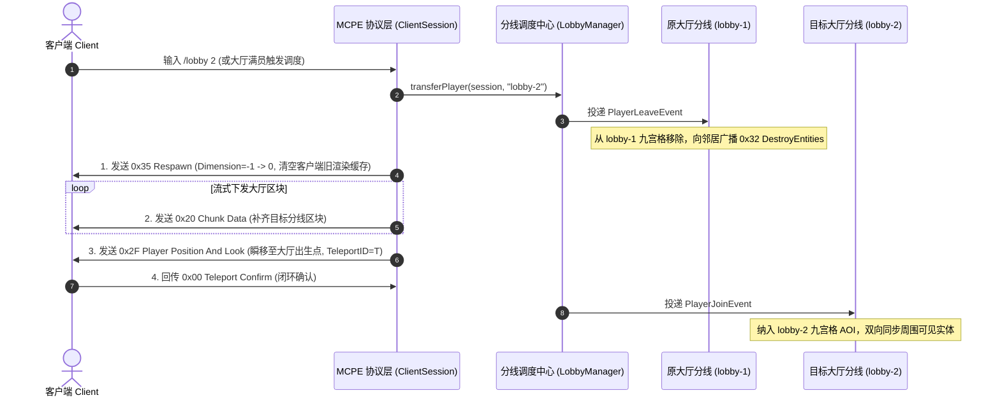

# 05_房间状态机与状态同步设计 (State Machine & Synchronization Design)

> **文档标识**：`MCPE-DOC-SYNC-05`  
> **文档标识**：`MCPE-DOC-SYNC-05`  
> **版本**：v2.1.0 (微服务大厅多实例分线与状态同步设计版)  
> **更新日期**：2026-10-18  
> **关联系统**：MCPE 协议状态机、大厅分线生命周期管理器、跨分线切换与实体同步系统  
> **设计纲要**：涵盖连接生命周期状态机、大厅分线 Actor 状态机、0x35 无缝跨分线切换、20 TPS 节拍器与 AOI 位置同步算法。

---

## 一、 连接生命周期有限状态机 (Connection State Machine)

客户端与服务端的连接生命周期由严密的底层状态机驱动：



---

## 二、 多实例大厅分线状态机 (Lobby Sharding State Machine)

引擎采用 Actor 模型实现大厅实例隔离。每个分线实例（`lobby-1`, `lobby-2`...）拥有独立的生命周期：



> [!NOTE]
> 早期规划的跑酷小游戏因强依赖原版复杂的红石电路、压力板与活塞等原版生存物理，违背轻量大厅微服务架构原则，已解耦并归档至 `archive/parkour/`。

---

## 三、 0x35 无缝跨分线切换时序 (Cross-Instance Transition Sequence)

客户端无需断开 TCP 连接，即可在微秒级完成不同大厅分线之间的平滑过渡：



---

## 四、 大厅空间安全与位置判定核心算法 (Lobby Spatial Safety)

### 4.1 掉落安全熔断 (Fall Reset)
大厅地图通常包含边界或浮空岛屿。为避免玩家意外跌落虚空死亡卡死：
- 服务端在每次消费客户端 `Player Position (0x0E/0x10)` 时，提取 $Y$ 轴坐标；
- 若 $Y < \text{fall\_reset\_y}$（来自 `assets/maps/<map>.ini`，默认 $Y < 30.0$）：
  - 实例主线程立即向客户端下发 `0x2F Player Position And Look`，坐标重置为大厅出生点；
  - 同时当场修改内部 `PlayerMoveEvent` 坐标，确保 `SpatialGrid` 九宫格归属立即被同步矫正；
  - 客户端瞬间被拉回出生点，不扣血、不死亡，保持丝滑体验。

### 4.2 跨服传送门包围盒检测 (Portal AABB Detection)
大厅支持配置传送门三维空间包围盒（Axis-Aligned Bounding Box）：
$$\text{Box} = [X_{\min}, X_{\max}] \times [Y_{\min}, Y_{\max}] \times [Z_{\min}, Z_{\max}]$$
当玩家坐标 $(x, y, z)$ 满足：
$$X_{\min} \le x \le X_{\max} \land Y_{\min} \le y \le Y_{\max} \land Z_{\min} \le z \le Z_{\max}$$
判定为步入传送门：
1. 检查传送门防抖冷却时间戳（如 5 秒冷却），防止高频触发；
2. 构造并发送 `0x18 Plugin Message`（通道 `"BungeeCord"`，内容 `"Connect"` + 目标子服名）；
3. 外部 BungeeCord / Velocity 网关自动完成跨服路由。

---

## 五、 20 TPS 物理主循环与节拍器模型 (Fixed Timestep Loop)

主世界采用基于单调时钟与时间累加器（Accumulator）的高精度补偿算法，维持恒定 20 TPS（每 Tick 50ms）：

```cpp
void WorldTicker::run() {
    using namespace std::chrono;
    constexpr nanoseconds kTickInterval(50'000'000); // 50ms
    constexpr nanoseconds kMaxAccumulator(250'000'000); // 防死亡螺旋阈值: 250ms (5 Ticks)

    auto last_time = steady_clock::now();
    nanoseconds accumulator(0);

    while (running_.load(std::memory_order_relaxed)) {
        auto current_time = steady_clock::now();
        accumulator += (current_time - last_time);
        last_time = current_time;

        if (accumulator > kMaxAccumulator) {
            accumulator = kMaxAccumulator;
        }

        while (accumulator >= kTickInterval) {
            tick(); // 消费 MPSC 队列任务，更新房间倒计时与位置校验
            accumulator -= kTickInterval;
        }

        auto elapsed = steady_clock::now() - current_time;
        if (elapsed < kTickInterval) {
            std::this_thread::sleep_for(kTickInterval - elapsed);
        }
    }
}
```
