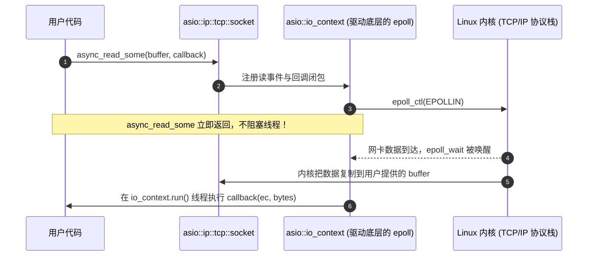
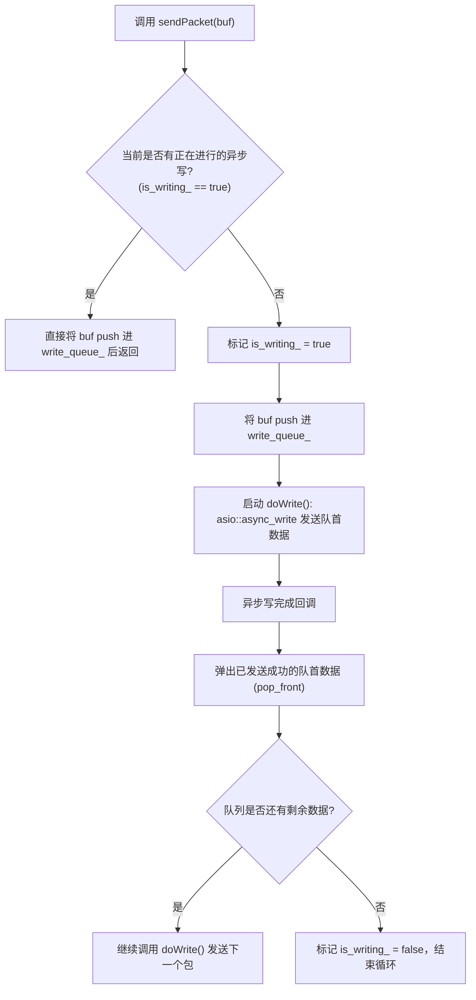

# Asio 网络库从零入门与核心接口全景指南

> 适用于从未接触过 Asio 的现代 C++ 开发者。涵盖 Asio 运行机制、核心接口、内存模型、写队列设计与生命周期陷阱。

---

## 目录

1. [心智模型：Asio 是如何运行的？](#1-心智模型asio-是如何运行的)
   - 1.1 同步 I/O vs 异步 I/O (Proactor 模式)
   - 1.2 核心三大件：I/O Object、io_context 与 Completion Handler
   - 1.3 `io_context.run()` 事件循环的生命周期
2. [灵魂核心：`asio::buffer` 内存视图模型](#2-灵魂核心asiobuffer-内存视图模型)
   - 2.1 为什么说 `asio::buffer` 绝不拷贝内存？
   - 2.2 致命陷阱：临时变量悬空 (Dangling Pointer)
   - 2.3 常见的缓冲区适配类型
3. [核心组件与常用接口速查](#3-核心组件与常用接口速查)
   - 3.1 `asio::io_context`（事件调度中枢）
   - 3.2 `asio::ip::tcp::socket`（套接字传输通道）
   - 3.3 `asio::ip::tcp::acceptor`（连接监听器）
   - 3.4 `asio::steady_timer`（定时器与心跳）
4. [读写函数深度辨析（初学必踩的大坑）](#4-读写函数深度辨析初学必踩的大坑)
   - 4.1 成员函数 `_some` vs 全局自由函数
   - 4.2 为什么不能并发调用 `async_write`？
   - 4.3 工业级写队列模式 (Write Queue Pattern)
5. [生命周期管理：为什么必须继承 `std::enable_shared_from_this`？](#5-生命周期管理为什么必须继承-stdenable_shared_from_this)
6. [错误处理最佳实践](#6-错误处理最佳实践)
7. [完整生产级范例：Asio 异步 TCP Echo 服务端](#7-完整生产级范例asio-异步-tcp-echo-服务端)
8. [Asio 避坑与常见反模式 (Anti-Patterns)](#8-asio-避坑与常见反模式-anti-patterns)

---

## 1. 心智模型：Asio 是如何运行的？

### 1.1 同步 I/O vs 异步 I/O (Proactor 模式)

在传统网络编程（同步阻塞）中：
```cpp
// 同步模型：线程停在这里死等，直到收到 100 字节，否则 CPU 无法干别的事
char buf[100];
size_t len = socket.read_some(asio::buffer(buf)); 
```

而在 Asio 的**异步 Proactor 模式**中：
- **你发起任务**：“操作系统，请帮我把网卡收到的数据写进我的 `buf` 中；完成后请调用我的 Lambda 函数。”
- **Asio 执行**：立即返回，调用线程可以去处理其他事情。
- **完成通知**：当操作系统真的把数据塞进 `buf` 时，Asio 唤醒你的回调函数，告诉你“已经读好了 `bytes_transferred` 字节”。



> **对比 Muduo (Reactor)**：
> - **Reactor** 通知你：“Socket 可读了，**你自己**调用 `read()` 去读吧。”
> - **Proactor (Asio)** 通知你：“**我已经帮你读完并放进 buffer 了**，你直接拿来消费吧。”

---

### 1.2 核心三大件

使用 Asio 编写网络程序，始终围绕三个核心角色：

1. **I/O 调度引擎 (`asio::io_context`)**：
   - 核心事件循环，它封装了底层操作系统的多路复用 API（Linux 下是 `epoll`，macOS 下是 `kqueue`，Windows 下是 `IOCP`）。
2. **I/O 对象 (`I/O Object`)**：
   - 代表网络套接字、定时器或文件描述符，如 `tcp::socket`、`tcp::acceptor`、`steady_timer`。
   - 它们的构造函数**必须绑定一个 `io_context&`**。
3. **完成处理者 (`Completion Handler`)**：
   - 任务完成后的回调。在现代 C++ 中通常是 **Lambda 表达式**，标准签名一般包含错误码和传输字节数：
     ```cpp
     [](const asio::error_code& ec, std::size_t bytes_transferred) { ... }
     ```

---

### 1.3 `io_context.run()` 事件循环的生命周期

```cpp
asio::io_context io_context;
// ... 投递异步任务 ...
io_context.run(); // 阻塞运行！
```

* **`run()` 什么时候阻塞？**
  只要 `io_context` 中还有**未完成的异步任务**（如正在监听的 `acceptor`、正在等待读取的 `socket`、未超时的 `timer`），`run()` 就会一直阻塞等待事件发生并派发回调。
* **`run()` 什么时候退出？**
  当所有的异步操作都已完成，并且队列中没有任何待执行任务时，`run()` 会认为“所有事情都做完了”，从而**正常退出**！
* **为什么有时 `run()` 立即退出了？**
  如果你只写了 `asio::io_context io_context; io_context.run();`，由于此时没有任何监听或待处理任务，它会瞬间退出。必须先向它挂载操作（如 `server.start()`），再调用 `run()`。

---

## 2. 灵魂核心：`asio::buffer` 内存视图模型

### 2.1 为什么说 `asio::buffer` 绝不拷贝内存？

这是所有刚接触 Asio 的人最容易误解的地方：
> ❌ **误解**：`asio::buffer(my_data)` 把 `my_data` 复制了一份放进内部缓存区。
> 
>  **真相**：`asio::buffer` **零分配、零拷贝**！它仅仅是一个**包装器（Wrapper）**，内部只有一个指向原内存的裸指针 `void*` 和一个长度 `size_t`，完全类似于现代 C++ 的 `std::span` 或 `std::string_view`。

```cpp
std::string text = "Hello World";
auto buf = asio::buffer(text); 
// buf 内部实际上只是：{ data: text.data(), size: text.size() }
```

### 2.2 致命陷阱：临时变量悬空 (Dangling Pointer)

正因为 `asio::buffer` 不持有内存所有权，下面这种代码是**致命的内存崩溃（Use-After-Free）**：

```cpp
// ❌ 极度危险的错误写法！
void sendGreeting(asio::ip::tcp::socket& socket) {
    std::string msg = "Welcome to MCPE Server!\n";
    asio::async_write(socket, asio::buffer(msg),
        [](const asio::error_code& ec, std::size_t bytes) {
            // ...
        });
    // 函数执行结束，局部变量 msg 立即被析构摧毁！
    // 异步写操作在内核传输时，读取的是一块已经被释放的野指针内存！
}
```

**正确的写法**：
1. 让缓冲区成为类的成员变量（生命周期随对象延续）。
2. 或将数据存储在 `std::shared_ptr` 中，并通过 Lambda 传值捕获延长生命周期。

### 2.3 常见的缓冲区适配类型

Asio 能够自动把以下容器包装为 `asio::buffer`：

```cpp
// 1. 固定大小数组（最常用作底层的从网卡读入的临时 buffer）
std::array<char, 4096> read_buf;
asio::buffer(read_buf);

// 2. 传统 C 数组
char c_buf[1024];
asio::buffer(c_buf, 1024);

// 3. std::vector 或 std::string
std::vector<uint8_t> bytes(512);
asio::buffer(bytes);

// 4. 只读常量切片（指定偏移和长度）
asio::buffer(bytes.data() + 10, 100);
```

---

## 3. 核心组件与常用接口速查

### 3.1 `asio::io_context`（事件调度中枢）

| 接口 | 作用说明 | 典型场景 |
| :--- | :--- | :--- |
| `run()` | 阻塞执行事件循环，直到无任务或被 `stop()` | 服务端启动主线程 |
| `stop()` | 强制终止事件循环，正在等待的事件被取消 | 收到 SIGINT/SIGTERM 优雅关停 |
| `restart()` | 重置状态（当 `run()` 退出后想再次 `run()` 时） | 多轮重连逻辑 |
| `asio::post(ctx, handler)` | 向 `io_context` 派发一个任务（稍后异步执行） | 跨线程向网络主线程投递数据 |
| `asio::dispatch(ctx, handler)`| 若当前就在该 context 线程则立即执行，否则投递 | 避免不必要的线程切换 |

#### 跨线程投递示例：
```cpp
// 游戏逻辑主线程把计算好的报文投递给网络线程发送
asio::post(io_context, [session, packet_data = std::move(data)]() {
    session->sendPacket(packet_data);
});
```

---

### 3.2 `asio::ip::tcp::socket`（套接字传输通道）

| 接口 | 说明 |
| :--- | :--- |
| `socket.async_read_some(buf, cb)` | 异步读取部分字节（有任意数据到达即回调） |
| `socket.set_option(...)` | 设置套接字选项，例如禁用 Nagle 算法（`tcp::no_delay(true)`） |
| `socket.remote_endpoint(ec)` | 获取对端 `IP:Port`（建议带 `ec` 避免未连接时抛异常） |
| `socket.close(ec)` | 立即关闭套接字并释放文件描述符 |
| `socket.shutdown(...)` | 优雅关闭读/写通道（`socket_base::shutdown_both`） |

```cpp
// 关键配置：对低延迟游戏服务器，必须关闭 Nagle 算法！
asio::error_code ec;
socket.set_option(asio::ip::tcp::no_delay(true), ec);
```

---

### 3.3 `asio::ip::tcp::acceptor`（连接监听器）

用于服务端监听指定端口并接收客户端连接。

```cpp
namespace ip = asio::ip;

// 1. 初始化并监听 IPv4 的 25565 端口
ip::tcp::acceptor acceptor(io_context, ip::tcp::endpoint(ip::tcp::v4(), 25565));

// 2. 异步接收新连接标准范式（递归调用自身形成持续监听循环）
void doAccept() {
    acceptor_.async_accept([this](const asio::error_code& ec, ip::tcp::socket socket) {
        if (!ec) {
            // 连接成功，创建会话并启动
            auto session = std::make_shared<TcpSession>(std::move(socket));
            session->start();
        } else {
            spdlog::error("Accept failed: {}", ec.message());
        }
        
        // 关键：继续投递下一个监听！否则处理完一个连接后监听就停止了
        doAccept();
    });
}
```

---

### 3.4 `asio::steady_timer`（高精度定时器）

常用于心跳保活检测、超时踢出连接。

```cpp
class KeepAliveTimer {
    asio::steady_timer timer_;
    
public:
    KeepAliveTimer(asio::io_context& ctx) : timer_(ctx) {}

    void start() {
        // 设置 10 秒后超时
        timer_.expires_after(std::chrono::seconds(10));
        timer_.async_wait([this](const asio::error_code& ec) {
            if (ec == asio::error::operation_aborted) {
                // 定时器被外部主动 cancel() 取消了，正常退出
                return;
            }
            // 定时到期，执行业务检查
            sendKeepAlivePing();
            
            // 重新开始下一轮定时
            start();
        });
    }

    void stop() {
        timer_.cancel(); // 唤醒回调并附带 operation_aborted 错误码
    }
};
```

---

## 4. 读写函数深度辨析（初学必踩的大坑）

### 4.1 成员函数 `_some` vs 全局自由函数

这是刚用 Asio 最容易混乱的概念之一：

| 类别 | 函数签名 | 核心行为 |
| :--- | :--- | :--- |
| **底层成员函数** | `socket.async_read_some(buf, cb)` | **“只要有数据就返回”**：读到 1 字节也会立刻触发回调，绝不保证填满 buffer。 |
| **复合操作（推荐）** | `asio::async_read(socket, buf, cb)` | **“必须读满指定长度才返回”**：内部会自动多次循环调用 `async_read_some`，直到指定的 buffer 完全填满才触发回调。 |
| **底层成员函数** | `socket.async_write_some(buf, cb)` | **“写了多少算多少”**：可能只发送了一部分（例如大包只写了网卡缓冲能容纳的 1460 字节）。 |
| **复合操作（推荐）** | `asio::async_write(socket, buf, cb)`| **“保证把全部数据写完才返回”**：内部会自动处理分片重写，直到用户 buffer 全部送入内核。 |

>  **开发铁律**：
> - **发送数据时，始终使用 `asio::async_write`**，永远不要用 `socket.async_write_some`，否则未发完的数据会直接丢失或错位！
> - **拆包解协议时，使用 `socket.async_read_some`** 读入一个 4KB 临时接收区，再追加给应用层的环形流缓冲区（如 `ByteBuffer`）中进行变长解析。

---

### 4.2 为什么不能并发调用 `async_write`？

假设有两个线程或者连续两次调用 `async_write`：
```cpp
// ❌ 并发写大忌！
asio::async_write(socket, asio::buffer(packet1), cb1);
asio::async_write(socket, asio::buffer(packet2), cb2);
```
**为什么这是非法的？**
`asio::async_write` 是复合操作。如果 `packet1` 没有一次性写完，Asio 底层会继续等待内核可写并继续写剩余部分。如果此时第二个 `async_write` 也插入进来，两个数据流的字节就会在 TCP 流中**彻底交叉（Interleaving 混乱交错）**！接收端会解析出不可逆的垃圾数据。

---

### 4.3 工业级写队列模式 (Write Queue Pattern)

解决并发写冲突的标准模式：**单连接内部维护写队列**。



```cpp
class TcpSession : public std::enable_shared_from_this<TcpSession> {
    asio::ip::tcp::socket socket_;
    std::deque<std::vector<uint8_t>> write_queue_; // 待发队列
    bool is_writing_{false};                       // 正在写状态标志

public:
    void sendPacket(std::vector<uint8_t> data) {
        // 保证在 io_context 线程内执行
        asio::post(socket_.get_executor(), [this, self = shared_from_this(), data = std::move(data)]() mutable {
            write_queue_.push_back(std::move(data));
            if (!is_writing_) {
                is_writing_ = true;
                doWrite();
            }
        });
    }

private:
    void doWrite() {
        auto self = shared_from_this();
        // 仅发送队首数据
        asio::async_write(
            socket_,
            asio::buffer(write_queue_.front()),
            [this, self](const asio::error_code& ec, std::size_t /*bytes*/) {
                if (!ec) {
                    write_queue_.pop_front(); // 确认完全送达，弹出队首
                    if (!write_queue_.empty()) {
                        doWrite(); // 队列非空，继续发送下一个包
                    } else {
                        is_writing_ = false; // 队列清空，重置状态
                    }
                } else {
                    stop(); // 发送出错，断开连接
                }
            });
    }
};
```

---

## 5. 生命周期管理：为什么必须继承 `std::enable_shared_from_this`？

这是 Asio 网络编程中**最核心、最重要的设计法则**！

### 惨痛的崩溃场景（UAF: Use-After-Free）：
1. 客户端发起连接，服务端创建了一个 `TcpSession` 对象。
2. `TcpSession` 发起异步读取：`socket_.async_read_some(..., [this](...) { ... });`。
3. 突然，客户端暴力拔掉网线或发送 RST 断开！
4. 外部管理容器把指向这个 `TcpSession` 的 `std::shared_ptr` 删除了，此时该 Session 的引用计数归零，**Session 对象被立即 `delete` 销毁**！
5. 然而，操作系统内核刚刚完成了对读取失败的通知，Asio 唤醒了刚才注册的 Lambda 回调。
6. 回调内部访问了已被释放的 `this->remote_address_` 或 `this->socket_` —— **程序直接 Segmentation Fault 崩溃！**

### 解决方案：智能指针保活机制
```cpp
// 继承 enable_shared_from_this
class TcpSession : public std::enable_shared_from_this<TcpSession> {
    void doRead() {
        // 必须显式捕获 self 保活！
        auto self = shared_from_this();
        socket_.async_read_some(
            asio::buffer(read_buffer_),
            [this, self](const asio::error_code& ec, std::size_t bytes) {
                // 此时 self 作为一个副本被闭包持有。
                // 即使外部所有的 shared_ptr 全都释放了，
                // 闭包内的 self 也会保证当前 Session 的引用计数至少为 1！
                // 绝对不会发生野指针访问！
                if (!ec) {
                    doRead();
                }
            });
    }
};
```

---

## 6. 错误处理最佳实践

Asio 的所有 I/O 函数通常有两种重载版本：
1. **异常版（Exception）**：`socket.connect(ep);`（失败抛出 `asio::system_error`）。
2. **错误码版（Error Code）**：`socket.connect(ep, ec);`（失败将信息填入 `ec`）。

### 为什么在网络开发中一律推荐 `asio::error_code`？
网络环境中，客户端断开、超时、网络闪断是家常便饭。如果用异常，C++ 抛出和捕获异常需要解开调用栈（Stack Unwinding），CPU 开销是普通条件判断的几十倍，容易引发性能风暴。

```cpp
asio::error_code ec;
auto endpoint = socket_.remote_endpoint(ec);
if (ec) {
    // 优雅处理，绝不崩溃
    spdlog::warn("Cannot fetch endpoint: {}", ec.message());
}
```

### 必须认识的核心错误码：
- `asio::error::eof`：对端正常主动关闭了连接（发来了 TCP FIN 包）。
- `asio::error::connection_reset`：对端进程崩溃、被强制关闭或网线断开（收到 TCP RST 包）。
- `asio::error::operation_aborted`：操作被取消（例如你调用了 `socket.close()` 或 `timer.cancel()`）。

---

## 7. 完整生产级范例：Asio 异步 TCP Echo 服务端

下面是一个可以独立编译运行的现代 C++23 范例，集成了前述所有设计原则：

```cpp
#include <asio.hpp>
#include <iostream>
#include <memory>
#include <array>
#include <deque>

namespace ip = asio::ip;

// ==========================================
// 会话类：管理单条 TCP 连接
// ==========================================
class EchoSession : public std::enable_shared_from_this<EchoSession> {
public:
    explicit EchoSession(ip::tcp::socket socket) 
        : socket_(std::move(socket)) {}

    ~EchoSession() {
        std::cout << "[Session] Destroyed: " << remote_addr_ << "\n";
    }

    void start() {
        asio::error_code ec;
        auto ep = socket_.remote_endpoint(ec);
        remote_addr_ = ec ? "unknown" : ep.address().to_string() + ":" + std::to_string(ep.port());
        std::cout << "[Session] Connected: " << remote_addr_ << "\n";
        doRead();
    }

    void deliver(std::string msg) {
        auto self = shared_from_this();
        asio::post(socket_.get_executor(), [this, self, msg = std::move(msg)]() mutable {
            write_queue_.push_back(std::move(msg));
            if (!is_writing_) {
                is_writing_ = true;
                doWrite();
            }
        });
    }

private:
    void doRead() {
        auto self = shared_from_this();
        socket_.async_read_some(
            asio::buffer(read_buffer_),
            [this, self](const asio::error_code& ec, std::size_t bytes_transferred) {
                if (!ec) {
                    // 将收到的数据原样 Echo 发回
                    deliver(std::string(read_buffer_.data(), bytes_transferred));
                    doRead(); // 循环投递读
                } else {
                    if (ec != asio::error::eof && ec != asio::error::connection_reset) {
                        std::cerr << "[Session] Read error: " << ec.message() << "\n";
                    }
                    socket_.close();
                }
            });
    }

    void doWrite() {
        auto self = shared_from_this();
        asio::async_write(
            socket_,
            asio::buffer(write_queue_.front()),
            [this, self](const asio::error_code& ec, std::size_t /*bytes*/) {
                if (!ec) {
                    write_queue_.pop_front();
                    if (!write_queue_.empty()) {
                        doWrite();
                    } else {
                        is_writing_ = false;
                    }
                } else {
                    socket_.close();
                }
            });
    }

    ip::tcp::socket socket_;
    std::string remote_addr_;
    std::array<char, 4096> read_buffer_;
    std::deque<std::string> write_queue_;
    bool is_writing_{false};
};

// ==========================================
// 服务端类：监听新连接
// ==========================================
class EchoServer {
public:
    EchoServer(asio::io_context& ctx, uint16_t port)
        : acceptor_(ctx, ip::tcp::endpoint(ip::tcp::v4(), port)) {
        std::cout << "[Server] Listening on port " << port << "...\n";
        doAccept();
    }

private:
    void doAccept() {
        acceptor_.async_accept([this](const asio::error_code& ec, ip::tcp::socket socket) {
            if (!ec) {
                std::make_shared<EchoSession>(std::move(socket))->start();
            }
            doAccept(); // 持续监听
        });
    }

    ip::tcp::acceptor acceptor_;
};

// ==========================================
// 入口函数
// ==========================================
int main() {
    try {
        asio::io_context io_context;
        EchoServer server(io_context, 8080);
        io_context.run(); // 阻塞运行事件循环
    } catch (const std::exception& e) {
        std::cerr << "Fatal: " << e.what() << "\n";
    }
    return 0;
}
```

---

## 8. Asio 避坑与常见反模式 (Anti-Patterns)

1. **绝对不要向多个 `async_write` 同时投递同一套接字**：
   - 必须通过 `std::deque` 缓冲与原子/串行消费。
2. **在异步回调 Lambda 里永远不要漏掉 `auto self = shared_from_this();`**：
   - 只要漏写一次，连接断开时就可能产生难以捉摸的 Core Dump。
3. **不要在 `asio::buffer()` 中传临时右值**：
   - 比如 `asio::buffer(std::string("hello"))`，必须确保其依托的内存在异步完成前持续有效。
4. **长耗时计算切忌在 Asio 循环线程中执行**：
   - 如果你在 Asio 的读回调中执行了耗时 200ms 的复杂加密/寻路逻辑，由于该单线程被霸占，**整台服务器的所有其他连接的收发都会卡顿 200ms**！
   - 耗时逻辑必须分发（`std::thread` 或专用计算线程池）处理，计算完后通过 `asio::post(io_context, ...)` 将结果送回网络线程发送。
