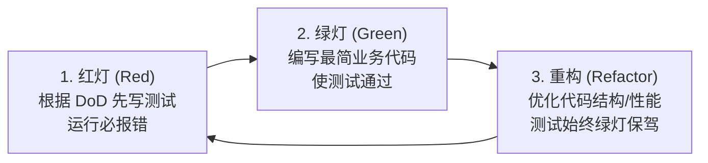

# C++ 企业级单元测试与 DoD 驱动开发全景指南

> **文档定位**：针对本项目（Minecraft 1.12.2 高性能 C++ 异步服务端）的测试体系从零扫盲，深度剖析 `tests/` 目录下全部现有测试代码，总结优秀测试的设计哲学，详解如何将敏捷开发中的 **DoD（Definition of Done）** 转化为自动化测试，并全景还原工业界一线大厂的测试体系与工程落地标准。

---

## 目录

- [一、 测试扫盲：为什么我们需要写测试？](#一-测试扫盲为什么我们需要写测试)
- [二、 GoogleTest (GTest) 快速入门指南](#二-googletest-gtest-快速入门指南)
- [三、 深入拆解 `tests/` 下的现存测试用例](#三-深入拆解-tests-下的现存测试用例)
  - [3.1 `test_varint.cc`：协议编解码与契约边界测试（630+ 行企业级典范）](#31-test_varintcc协议编解码与契约边界测试630-行企业级典范)
  - [3.2 `test_bytebuffer.cc`：高性能底层缓冲区的内存行为测试](#32-test_bytebuffercc高性能底层缓冲区的内存行为测试)
  - [3.3 `test_framing.cc`：网络拆包器的粘包与半包测试](#33-test_framingcc网络拆包器的粘包与半包测试)
  - [3.4 `test_tcp_session.cc`：异步 IO、发送队列与高并发稳定性测试](#34-test_tcp_sessioncc异步-io发送队列与高并发稳定性测试)
  - [3.5 `test_packet_router.cc`：协议状态机路由与日志断言测试](#35-test_packet_routercc协议状态机路由与日志断言测试)
- [四、 优秀的测试程序应该怎么写？（设计哲学与模式）](#四-优秀的测试程序应该怎么写设计哲学与模式)
  - [4.1 测试核心原则：FIRST 原则](#41-测试核心原则first-原则)
  - [4.2 黄金三段式：AAA 模式（Arrange - Act - Assert）](#42-黄金三段式aaa-模式arrange---act---assert)
  - [4.3 测试代码的坏味道（Anti-Patterns）](#43-测试代码的坏味道anti-patterns)
- [五、 实战教学：如何根据 DoD 写出高质量测试？](#五-实战教学如何根据-dod-写出高质量测试)
  - [5.1 什么是 DoD？为什么测试是 DoD 的唯一裁决者？](#51-什么是-dod为什么测试是-dod-的唯一裁决者)
  - [5.2 需求翻译四步法（DoD -> Test Case）](#52-需求翻译四步法dod---test-case)
  - [5.3 Sprint 1 真实案例全流程推导](#53-sprint-1-真实案例全流程推导)
    - [案例 A：TASK-1.4 拆包器 DoD 落地](#案例-atask-14-拆包器-dod-落地)
    - [案例 B：TASK-1.3 发送队列 100 次高频连发 DoD 落地](#案例-btask-13-发送队列-100-次高频连发-dod-落地)
    - [案例 C：TASK-1.6 Handshake DoD 落地实战（TDD 现场演练）](#案例-ctask-16-handshake-dod-落地实战tdd-现场演练)
- [六、 企业一线开发中的测试体系与流水线](#六-企业一线开发中的测试体系与流水线)
  - [6.1 经典测试金字塔（Test Pyramid）](#61-经典测试金字塔test-pyramid)
  - [6.2 TDD（测试驱动开发）工作流实战](#62-tdd测试驱动开发工作流实战)
  - [6.3 Mocking 与测试打桩（Test Doubles）](#63-mocking-与测试打桩test-doubles)
  - [6.4 CI/CD 质量门禁与 Sanitizers（内存与竞态扫描）](#64-cicd-质量门禁与-sanitizers内存与竞态扫描)
  - [6.5 协议解析的安全重器：模糊测试（Fuzz Testing）](#65-协议解析的安全重器模糊测试fuzz-testing)
- [七、 结语与新手自练路线](#七-结语与新手自练路线)

---

## 一、 测试扫盲：为什么我们需要写测试？

很多刚接触编程或习惯用 `main()` 函数加 `printf` / `cout` 调试的同学，通常会对“单元测试”产生以下疑惑：
1. *“我自己开个客户端点一下、或者用 nc 发个包看一下控制台输出不就好了，为什么费劲写几百行测试代码？”*
2. *“测试代码本身会不会也有 bug？写测试是不是让工作量翻倍了？”*

### 1.1 手动测试 vs 自动化单元测试

| 维度 | 手工测试（运行程序 + 手动验证） | 自动化单元测试（GTest 等） |
| :--- | :--- | :--- |
| **反馈速度** | 启动服务、开客户端、点鼠标，耗时 10~60 秒 | 执行命令，**几毫秒~几秒**跑完上百个测试 |
| **覆盖全面性** | 很难手动模拟网络半包（如发半个字节）、高并发竞态、边界极限值 | 可精确构造任意畸形字节流、微秒级多线程并发 |
| **回归安全感** | 修改底层 `ByteBuffer` 时，完全不知道是否搞崩了上层的 `PacketRouter` | 一键 `ctest`，130+ 测试全部绿色，立刻确认重构未破坏已有功能 |
| **契约确定性** | 靠人眼肉眼看 log，极易遗漏微小字节错误（如少跳了 1 个字节游标） | 计算机精准比对，差 1 个 bit 都会立刻报错（红色） |

> **核心结论**：测试不是负担，而是**开发者的安全网**。它让你在修改任何核心架构时，拥有敢于大刀阔斧重构的底气。

---

## 二、 GoogleTest (GTest) 快速入门指南

本项目使用业内工业标准的 C++ 测试框架 **GoogleTest (gtest)**。在看懂 `tests/` 代码前，先掌握以下最关键的 GTest 概念：

### 2.1 断言宏：`EXPECT_*` vs `ASSERT_*`

- `EXPECT_EQ(a, b)` / `EXPECT_TRUE(cond)`：**非致命断言**。如果失败，记录错误并继续执行当前测试的后续代码。
- `ASSERT_EQ(a, b)` / `ASSERT_TRUE(cond)`：**致命断言**。如果失败，**立即终止当前测试用例**并返回，常用于空指针检查或关键前提条件（若指针为空，后续解引用会导致测试崩溃 core dump，所以必须用 ASSERT）。
- **自定义报错信息**：通过 `<<` 流式追加描述，如 `EXPECT_EQ(val, 128) << "游标消费错误，当前值不符";`。

### 2.2 测试分类宏

#### ① 普通测试：`TEST(TestSuiteName, TestName)`
适用于独立的、不需要繁复初始化环境的测试函数。
```cpp
TEST(MyMathTest, AddTwoNumbers) {
  int result = add(1, 2);
  EXPECT_EQ(result, 3);
}
```

#### ② 夹具测试：`TEST_F(FixtureClass, TestName)`
`F` 代表 **Fixture**（夹具）。当多个测试需要共享相同的初始化配置（如每次测试前创建 Socket、启动 IO 线程、测试完关闭连接）时，定义一个继承自 `::testing::Test` 的类，实现 `SetUp()` 和 `TearDown()`。
- 每个 `TEST_F` 执行前，都会**全新实例化**一个 Fixture 对象并执行 `SetUp()`；
- 测试结束后自动执行 `TearDown()` 并析构。保证测试之间完全独立、互不污染。

#### ③ 参数化测试：`TEST_P(ParamFixture, TestName)`
`P` 代表 **Parameterized**。当你有一套相同的测试逻辑，需要跑几百组不同的输入/期望输出（测试向量）时使用。避免写大量重复的 copy-paste 代码。配合 `INSTANTIATE_TEST_SUITE_P` 使用。

---

## 三、 深入拆解 `tests/` 下的现存测试用例

本项目 `tests/` 目录下的测试覆盖了底层基础库、拆包协议层、网络会话层和状态路由层。下面逐个拆解它们的架构意图与核心实现。

---

### 3.1 `test_varint.cc`：协议编解码与契约边界测试（630+ 行企业级典范）

这是整个项目中编写最严密、设计最规范的测试之一。

#### ① 测试背后的协议背景
Minecraft 协议广泛使用变长整型（VarInt，1~5 字节）和变长长整型（VarLong，1~10 字节），每个字节最高位（MSB，0x80）为继续位（Continuation bit），低 7 位为有效负载。如果解码器写错，会导致整个 TCP 字节流对齐错位，服务器瞬间崩溃。

#### ② 关键测试设计拆解
1. **测试输出美化（`PrintTo`）**：
   ```cpp
   void PrintTo(DecodeError e, std::ostream* os) { *os << mcpe::toString(e); }
   ```
   **作用**：当 `std::expected<int, DecodeError>` 发生错误时，GTest 默认打印 1 字节整数（看不懂），重载 `PrintTo` 后控制台直接显示人类可读的字符串 `kIncomplete` 或 `kMalformed`。
2. **官方测试向量参数化（`OfficialVarIntVector`）**：
   Minecraft 官方 wiki（wiki.vg）给出了标准输入输出示例（如 `0 -> 0x00`, `2147483647 -> ff ff ff ff 07`, `-1 -> ff ff ff ff 0f`）。
   测试通过 `TEST_P` 将所有官方向量驱动测试，确保编码与解码 100% 符合官方标准。
3. **关键网络防御测试：半包（`kIncomplete`）的“零副作用”契约**：
   ```cpp
   TEST(VarIntErrorTest, HalfPacketThenRemainderArrives) {
     ByteBuffer buf;
     buf.appendByte(0x80);  // 只喂入半个 VarInt
     expectErr(buf.readVarInt(), DecodeError::kIncomplete, "半包");
     EXPECT_EQ(buf.readableBytes(), 1u) << "半包时不得消费任何字节！";

     buf.appendByte(0x01);  // 后半截到达
     expectOk(buf.readVarInt(), 128, "补齐后原地重试");
     EXPECT_EQ(buf.readableBytes(), 0u);
   }
   ```
   **作用**：严格验证当 TCP 数据只到了前半截时，`readVarInt` **绝不能悄悄移动读游标**。如果半包消费了字节，等下次真实数据来时就彻底乱码了。
4. **畸形包防御测试（`kMalformed`）**：
   当遇到连续 5 个字节都带有 0x80 继续位的数据时，如果继续读就会超出 32 位整型上限。测试验证此时必须返回 `DecodeError::kMalformed`，通知外层安全模块切断恶意连接，防止 CPU 陷入死循环或整型溢出漏洞。

---

### 3.2 `test_bytebuffer.cc`：高性能底层缓冲区的内存行为测试

#### ① 测试背后的设计
`ByteBuffer` 是仿照 Muduo 设计的高性能双游标环形/线性缓冲区（拥有 `readableBytes`、`writableBytes`、`prependableBytes`）。

#### ② 关键测试用例
1. **大端序读写（Big-Endian）验证**：
   Minecraft 协议规定多字节数字全部按大端序（高位在左）。测试构造 `0x1234`，断言内存中第一个字节必定是 `0x12`，第二个字节必定是 `0x34`。
2. **读游标滑动与空间回收（`reclaim / shift`）**：
   验证经过多次 `append` 和 `retrieve`（消费）之后，当缓冲区空间不足时，是否能正确将已有数据平移到最前方，避免无限扩容导致内存浪费。
3. **零拷贝视图安全**：
   验证 `toStringView()` 和 `toSpan()` 返回的只读视图是否精准指向有效内存区间。

---

### 3.3 `test_framing.cc`：网络拆包器的粘包与半包测试

这篇测试代码直击网络编程中最经典、最棘手的 **TCP 粘包与半包** 难题。

```cpp
// 测试 2：TCP 粘包（两个包拼在一起，连续切出 2 个包）
TEST(PacketFramingTest, StickingPackets) {
  ByteBuffer buf;
  // 包 1：Length=2, Payload="P1"
  buf.appendVarInt(2);
  buf.append("P1", 2);
  // 包 2：Length=2, Payload="P2"
  buf.appendVarInt(2);
  buf.append("P2", 2);

  auto p1 = PacketFraming::slicePacket(buf);
  ASSERT_TRUE(p1.has_value());
  EXPECT_EQ(p1->retrieveAllAsString(), "P1");

  auto p2 = PacketFraming::slicePacket(buf);
  ASSERT_TRUE(p2.has_value());
  EXPECT_EQ(p2->retrieveAllAsString(), "P2");

  EXPECT_EQ(buf.readableBytes(), 0);
}
```
- **粘包测试**：直接往 buffer 里塞入两个完整的包，连续调用两次 `slicePacket`，验证是否能准确分离，不互相干扰。
- **半包测试**：模拟真实网络卡顿，将一个 5 字节的包分成 1 字节（只有 VarInt 包长）、2 字节载荷、2 字节尾巴分批喂入，验证前两次返回 `kIncomplete` 且游标不被破坏，第 3 次成功返回完整包。

---

### 3.4 `test_tcp_session.cc`：异步 IO、发送队列与高并发稳定性测试

很多初学者认为：“网络代码必须要在两台机器上跑起来才能测”。`test_tcp_session.cc` 示范了工业级网络测试如何闭环。

#### ① 测试夹具（`TestTcpFixture`）的设计巧思
```cpp
struct TestTcpFixture {
  asio::io_context io_context;
  asio::executor_work_guard<...> work_guard;
  asio::ip::tcp::acceptor acceptor;
  asio::ip::tcp::socket client_socket;
  std::shared_ptr<TcpSession> session;
  std::jthread io_thread;
  ...
};
```
- 在本机利用 `loopback`（127.0.0.1）监听端口 `0`（操作系统自动分配未被占用的空闲随机端口，杜绝端口冲突）。
- 在后台 `std::jthread` 启动 `io_context.run()`。
- 模拟一个真正的客户端 socket（`client_socket`）发起连接，服务端 `acceptor` 接收并封装成 `TcpSession`。
- **整个过程完全在内存与操作系统 Loopback 网络栈中完成，耗时不到 10 毫秒！**

#### ② 为什么这个测试能捕获并发 Bug？
Asio 的 `async_write` 有严格约束：**在一个异步写尚未回调完成前，绝对不能发起第二个 async_write**，否则在 Asio 内部会触发断言崩溃或数据交叉错乱。
- **测试 1（`Send100PacketsSequentialAndSafe`）**：在紧凑循环中同一微秒内连续调用 100 次 `session->sendPacket(...)`。验证底层的 `write_queue_` 发送队列机制是否正确将后续数据排队，由回调函数按序链式泵送。客户端读出 400 字节，逐个解出递增序号 0~99，证明**保序且无崩溃**。
- **测试 2（`MultiThreadedConcurrentSendNoAssertion`）**：开 4 个线程同时用 `sendPacket` 轰炸 Session，验证内部锁与线程安全。

---

### 3.5 `test_packet_router.cc`：协议状态机路由与日志断言测试

此文件测试的是协议分发路由器 `PacketRouter`。

#### ① 日志拦截测试黑科技（Spdlog Interception）
很多时候，业务的判定条件是“遇到恶意数据包，服务端必须打印一条 Warning 日志并主动断开连接”。代码中是如何自动验证日志是否被打印出来的呢？
```cpp
// 挂载一个 ostream_sink，将全局日志实时写入到一个 std::ostringstream 内存流中
log_stream_ = std::make_shared<std::ostringstream>();
test_sink_ = std::make_shared<spdlog::sinks::ostream_sink_mt>(*log_stream_);
spdlog::default_logger()->sinks().push_back(test_sink_);
```
测试执行后，直接断言：
```cpp
EXPECT_NE(log_stream_->str().find("[warning]"), std::string::npos) << "必须触发警告日志！";
```
这样连“是否按预期记录了告警日志”都实现了 100% 自动化测试。

#### ② 参数化白名单测试（`RoutinePacketTest`）
Minecraft 1.12.2 客户端刚进服时，会主动向服务端下发大量例行包（如 `0x04 Client Settings`、`0x13 Player Abilities` 等）。如果服务端没实现这些包又当成非法包切断，客户端就会闪退。
- 测试使用 `INSTANTIATE_TEST_SUITE_P`，将 8 个例行包 ID 参数化注入。
- 逐一断言：收到这些包后，连接**不得断开**，且不得产生 warning 日志。

---

## 四、 优秀的测试程序应该怎么写？（设计哲学与模式）

### 4.1 测试核心原则：FIRST 原则

| 原则 | 含义 | 反面典型 | 正确姿势 |
| :--- | :--- | :--- | :--- |
| **F - Fast (快)** | 测试必须在毫秒级完成 | 每个测试里 `sleep(1)`，跑完要几分钟 | 异步使用条件变量或内存通知，100+ 单测秒级跑完 |
| **I - Independent (独立)** | 测试之间绝不能互相依赖 | 必须先跑 TestA 写入数据库，TestB 才能读 | 每个测试在 `SetUp` 中创建独立状态，用完在 `TearDown` 清理 |
| **R - Repeatable (可重复)** | 无论在本地、CI 还是异地，结果始终一致 | 依赖网络外网 ping 某个真实网址 | 使用本地 mock / 本机 loopback 模拟网络 |
| **S - Self-validating (自验证)** | 执行完毕直接绿灯或红灯 | 控制台打印一大堆文字，让人眼肉眼看对不对 | 全部用 `EXPECT_*` / `ASSERT_*` 自动断言 |
| **T - Timely (及时)** | 测试与代码同步甚至先行编写（TDD） | 整个项目全部写完，上线前才应付补测试 | 边定 DoD，边写测试用例 |

---

### 4.2 黄金三段式：AAA 模式（Arrange - Act - Assert）

任何一个结构清晰的单元测试，都必须严格遵守 **3A 模式**：

```cpp
TEST(CalculatorTest, AddPositiveNumbers) {
  // 1. Arrange（准备）：构建测试所需的数据、对象与前置条件
  Calculator calc;
  int a = 10;
  int b = 20;

  // 2. Act（执行）：调用被测试的目标方法（只测这一个动作）
  int result = calc.add(a, b);

  // 3. Assert（断言）：检查结果是否符合预期
  EXPECT_EQ(result, 30);
}
```

---

### 4.3 测试代码的坏味道（Anti-Patterns）

1. **写了超长测试函数**：一个测试函数塞了 200 行，里面包含了 10 种不同的业务场景。一旦第 10 行挂了，后面 190 行的场景根本没机会跑。
   - *重构建议*：一个测试只测一个特定分支/场景，细粒度拆分。
2. **盲目使用 `sleep`**：
   - 看到异步操作就写 `std::this_thread::sleep_for(std::chrono::seconds(1))`。如果机器卡顿，1 秒可能不够导致偶尔挂掉（Flaky Test）；如果机器很快，1 秒就是极大的浪费。
   - *重构建议*：使用原子标志位循环轮询 + 超时退出，或使用 `std::promise / std::future` 事件通知。
3. **断言不足或假断言**：
   - 比如测一个函数，只断言了 `EXPECT_TRUE(res != nullptr)`，却不检查里面的具体数据值。

---

## 五、 实战教学：如何根据 DoD 写出高质量测试？

在敏捷开发和本项目各 Sprint 文档中，每一个任务都有明确的 **DoD（Definition of Done，完成定义）**。很多初学者最大的障碍是：**“文字版的 DoD 我读懂了，但我怎么把它变成可执行的代码？”**

### 5.1 什么是 DoD？为什么测试是 DoD 的唯一裁决者？

DoD 是软件工程中对“这个功能做到什么程度算做完了”的唯一契约。
- 如果没有自动化测试，DoD 就只是一句空话：“我觉得我做完了，但没验证”。
- **“DoD 驱动开发”的核心逻辑：把 DoD 里的每一句话，一对一翻译成 GTest 中的一个 `TEST()` 用例。当且仅当所有用例全部跑通，这个任务才算真正 Done！**

---

### 5.2 需求翻译四步法（DoD -> Test Case）

当你拿到一份任务文档中的 DoD 时，按照以下四步即可推导测试代码：

```
[第一步：提炼裁决指标] ---> 寻找 DoD 中的“动词与期望结果”（如：切断连接、按序到达、返回 2 个包）
         ↓
[第二步：设计输入边界] ---> 构造怎样的输入（合法输入、临界输入、畸形输入、并发输入）
         ↓
[第三步：构造测试环境] ---> 决定用普通 TEST、Fixture 建立环境、还是参数化注入
         ↓
[第四步：编写断言组合] ---> 用 ASSERT 守住安全前提，用 EXPECT 校验细节指标
```

---

### 5.3 Sprint 1 真实案例全流程推导

打开 `doc/sprints/02_sprint1_network_ping.md`，我们来逐个对照本项目已有的任务与未完成任务：

#### 案例 A：TASK-1.4 拆包器 DoD 落地

> **TASK-1.4 原文 DoD**：
> *“编写单元测试验证：人为将一个包含 20 字节的数据包切成 3 字节、7 字节、10 字节分批喂入，拆包器能精准在最后一次返回完整包；将两个包拼接一次喂入，能连续返回 2 个包。”*

**翻译推导过程**：
1. **裁决指标**：半包时不返回且游标不乱；粘包时连续提取且无残留。
2. **输入边界**：
   - 粘包场景：构造 `[Len:2][Payload:P1]` + `[Len:2][Payload:P2]` 连续拼接。
   - 半包场景：构造一个长度为 4 的包，分 3 次调用 `append`（第一次 1 字节，第二次 2 字节，第三次 2 字节）。
3. **最终代码**：完全对应了 `tests/test_framing.cc` 中的 `StickingPackets` 和 `TruncatedHalfPacket`！

---

#### 案例 B：TASK-1.3 发送队列 100 次高频连发 DoD 落地

> **TASK-1.3 原文 DoD**：
> *“模拟在同一微秒内连续调用 100 次 send_packet，数据包按顺序被完整发送到对端，不会抛出 Asio 内部并发写断言异常。”*

**翻译推导过程**：
1. **裁决指标**：无 crash / assertion 崩溃、接收方收到完整 100 个包、每个包顺序与发出顺序一致。
2. **输入边界**：构造 100 个递增编号的包（0, 1, 2, ..., 99）。
3. **测试环境**：需要真实的异步网络对端 -> 设计 `TestTcpFixture`。
4. **最终代码**：完全对应了 `tests/test_tcp_session.cc` 中的 `Send100PacketsSequentialAndSafe`。

---

#### 案例 C：TASK-1.6 Handshake DoD 落地实战（TDD 现场演练）

看 `doc/sprints/02_sprint1_network_ping.md` 中尚未实现的 **TASK-1.6**：

> **TASK-1.6 原文设计与 DoD**：
> - 状态：在 `HANDSHAKING` 状态收到 `0x00 Handshake`。
> - 字段：`Protocol Version` (VarInt 340), `Server Address` (String), `Server Port` (uint16_t), `Next State` (VarInt 1 为 STATUS，2 为 LOGIN)。
> - **DoD**：
>   1. 当 `Next State == 1` 时，将 Session 状态原子切换为 `ConnectionState::STATUS`。
>   2. 打印并记录客户端上报的 `Protocol Version`。
>   3. 对非 340 的登录请求（`Next State == 2`）回断连包说明版本不符。

**我们如何自己写出这个测试？**
打开 `tests/test_packet_router.cc` 第 184 行，正是根据这个 DoD 写出的测试用例：

```cpp
TEST_F(PacketRouterTest, LegalHandshakeTransitionToStatus) {
  // 1. Arrange：根据 Minecraft 协议规范打包真实的 Handshake 报文
  ByteBuffer packet;
  packet.appendVarInt(0x00);         // Packet ID = 0x00
  packet.appendVarInt(340);          // Protocol Version = 340
  packet.appendString("127.0.0.1");  // Server Address
  packet.writeBe<uint16_t>(25565);   // Server Port
  packet.appendVarInt(1);            // Next State = 1 (STATUS)

  // 2. Act：调用分发器路由该报文
  PacketRouter::dispatch(session_, ConnectionState::HANDSHAKING, std::move(packet));

  // 3. Assert：DoD 明确要求 Session 状态必须切换为 STATUS
  EXPECT_TRUE(session_->socket().is_open());
  EXPECT_FALSE(session_->isStopped());
  EXPECT_EQ(session_->state(), ConnectionState::STATUS); // 核心 DoD 验证
}
```

> **注意！** 当你在终端执行 `ctest` 时，当前正是这个测试报红失败：
> ```text
> Expected equality of these values:
>   session_->state()           Which is: 0 (HANDSHAKING)
>   ConnectionState::STATUS     Which is: 1 (STATUS)
> ```
> **这就是经典的 TDD（测试驱动开发）红灯阶段（Red Phase）！**
> 测试先于实现存在，它清晰地告诉你：当前 `StatusHandler::handleHandshake` 是一个空桩函数 `{}`，一旦你把解析代码写好并执行 `session->setState(ConnectionState::STATUS)`，这个测试就会变绿！

---

## 六、 企业一线开发中的测试体系与流水线

在阿里巴巴、腾讯、Google、字节跳动等一线互联网大厂的 C++ 高性能服务研发中，测试体系是工程质量的绝对基石。

### 6.1 经典测试金字塔（Test Pyramid）

```
        / \
       /   \        10% E2E 端到端测试 (真实 Minecraft 客户端联调)
      /-----\
     /       \      20% 集成测试 (Loopback Socket 对, 状态机流转)
    /---------\
   /           \    70% 单元测试 (ByteBuffer, VarInt, Framing 纯内存纯算法)
  /-------------\
```
- **底层（单元测试，70%）**：执行速度极快（微秒级），不依赖任何网络 IO、数据库或操作系统外部状态。例如 `test_varint.cc` 和 `test_bytebuffer.cc`。
- **中层（集成测试，20%）**：验证多个模块协同工作。本项目中使用 Loopback 内存网络对的 `test_tcp_session.cc` 和 `test_packet_router.cc` 即属于此类。
- **顶层（端到端测试，10%）**：TASK-1.9 用真实原版客户端连接联调，验证最终用户体验。

---

### 6.2 TDD（测试驱动开发）工作流实战

大厂推崇的敏捷开发流程往往遵循 **红 - 绿 - 重构（Red-Green-Refactor）循环**：



1. **Red**：还没写业务代码前，先把 DoD 变成测试用例。此时编译可能缺符号，或者断言失败（如当前的 TASK-1.6 测试）。
2. **Green**：用最快、最直接的方式编写业务代码（哪怕写得不够优雅），直到 `ctest` 全部跑通。
3. **Refactor**：在有一整套自动化测试全绿的护航下，放心大胆地提取公共函数、优化内存分配、提升性能。每改一步敲一下 `ctest`，只要依然全绿，就证明重构绝没有引入 Regression（功能倒退）！

---

### 6.3 Mocking 与测试打桩（Test Doubles）

在复杂企业系统中，业务往往依赖数据库（MySQL）、分布式缓存（Redis）或上游 RPC 接口。
- **问题**：跑单测的时候，如果必须连真实的 MySQL，一旦网络抖动或测试库脏数据，单测就会挂掉。
- **企业解法（依赖注入与 Mock）**：
  - 核心接口面向抽象（Interface）编程，如 `class DatabaseInterface`；
  - 生产环境注入 `RealMysqlDatabase`；
  - 单元测试中使用 **Google Mock (gmock)** 生成虚拟桩对象 `MockDatabase`，通过宏 `EXPECT_CALL(mock_db, getUserById(123)).WillOnce(Return(user));` 瞬间返回模拟数据，完全脱离外部网络环境。

---

### 6.4 CI/CD 质量门禁与 Sanitizers（内存与竞态扫描）

大厂的 Git 提交（Pull Request / Merge Request）绝不允许直接合入主干，必须通过 **CI 自动化门禁**：

1. **自动化构建与 CTest**：每次提交自动触发编译并跑完所有测试。
2. **Sanitizers（内存/并发检测大杀器）**：
   - **ASan (AddressSanitizer)**：检测内存越界访问（Buffer Overflow）、野指针解引用（Use-After-Free）、内存泄漏。
   - **TSan (ThreadSanitizer)**：在多线程高并发测试（如 `test_tcp_session.cc`）中，实时监控是否有未加锁的数据竞争（Data Race）。
   - **UBSan (UndefinedBehaviorSanitizer)**：监控整型溢出、空指针隐式转换等未定义行为。
3. **代码覆盖率红线（Coverage Gate）**：
   - 使用 `gcov / lcov` 统计代码覆盖率；
   - 核心基础库通常强制要求 **行覆盖率（Line Coverage）>= 90%**，**分支覆盖率（Branch Coverage）>= 80%**。未达标直接禁止合入代码库！

---

### 6.5 协议解析的安全重器：模糊测试（Fuzz Testing）

对于对外暴露端口的公网服务（如 Minecraft 服务器），黑客经常会发送各种畸形二进制报文尝试攻击（DoS、远程代码执行）。
- 企业界标准做法：对 `readVarInt`、`slicePacket` 等入口函数引入 **LLVM libFuzzer** 或 **AFL**。
- 模糊测试工具会在短时间内随机变异生成数百亿个恶意的无序字节流狂轰滥炸解析器，一旦程序发生 crash 或无响应，立刻记录 PoC 样本，帮助开发者在上线前排查全部安全隐患。

---

## 七、 结语与新手自练路线

你现在手上的这套 `tests/` 代码，是一套标准现代 C++23、设计极为讲究的工业级代码范本：
1. **第一步（读懂）**：结合本文对 `test_framing.cc`（拆包）和 `test_varint.cc`（数据类型）的讲解，对照看源码，感受 AAA 模式与半包/粘包断言。
2. **第二步（改动）**：去实现 `StatusHandler.cc` 中的 `handleHandshake` 函数，让当前唯一的失败用例 `PacketRouterTest.LegalHandshakeTransitionToStatus` 变绿！
3. **第三步（手写）**：参照本文第 5.3 节的指引，看 Sprint 1 中的 TASK-1.7（Status JSON 响应）和 TASK-1.8（Ping/Pong 8 字节大端长整型），尝试为它们在 `test_packet_router.cc` 中手写一条新的 `TEST_F` 用例！
