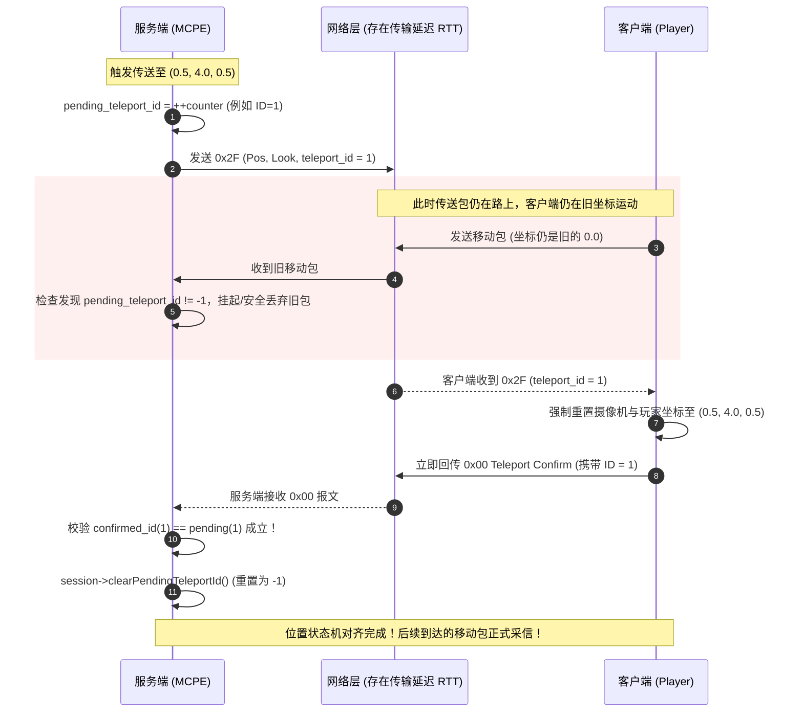

# 通信协议、数据切片与业务状态机 (Protocol, Framing & State Machine)

> 本专题覆盖 Minecraft 协议封包与拆包机制、VarInt 编解码、Cheap Prepend 预留前向缓冲区零拷贝设计、有限状态机（FSM）架构选型、实机联调掉线复盘，以及防网络幽灵拉回的 teleport_id 两阶段确认握手机制。

---

## 目录

1. [Q1: PacketFraming::slicePacket 中为什么 packet_len <= 0 也返回 kPacketTooLarge？](#q1-packetframingslicepacket-中为什么-packet_len--0-也返回-kpackettoolarge)
2. [Q2: ByteBuffer.h 中的 kValueMask 和 kContinuationBit 放在类内更好还是 mcpe 命名空间更好？有其他方案吗？](#q2-bytebufferh-中的-kvaluemask-和-kcontinuationbit-放在类内更好还是-mcpe-命名空间更好有其他方案吗)
3. [Q3: PacketFraming 拆包时不是也需要用到 kContinuationBit (0x80) 吗？为什么会有这种代码？如何优雅解决？](#q3-packetframing-拆包时不是也需要用到-kcontinuationbit-0x80-吗为什么会有这种代码如何优雅解决)
4. [Q4: TASK-1.5 中什么叫状态机？为什么 Minecraft 协议必须用状态机？为什么有人说 Boost.MSM 状态机实现最优雅？](#q4-task-15-中什么叫状态机为什么-minecraft-协议必须用状态机为什么有人说-boostmsm-状态机实现最优雅)
5. [Q5: 那什么项目适合 Boost.MSM 或 boost-ext/sml？现代工业界在什么场景下会使用状态机库？](#q5-那什么项目适合-boostmsm-或-boost-extsml现代工业界在什么场景下会使用状态机库)
6. [Q6: 组装 Status Response 为什么用 `std::format` 字符串模板而不用三方 JSON 库？后续开发还用不用 JSON 库？](#q6-组装-status-response-为什么用-stdformat-字符串模板而不用三方-json-库后续开发还用不用-json-库)
7. [Q7: 构造数据包时为什么要先写内层 `body` 再封装进外层 `packet`？为什么不能直接从外往里写？如何利用 `prepend` 零拷贝封装？](#q7-构造数据包时为什么要先写内层-body-再封装进外层-packet为什么不能直接从外往里写如何利用-prepend-零拷贝封装)
8. [Q8: `PacketFraming::slicePacket` 拆包时将数据拷贝进新 `ByteBuffer` 是必要的吗？能否实现零拷贝（Zero-Copy）？](#q8-packetframingslicepacket-拆包时将数据拷贝进新-bytebuffer-是必要的吗能否实现零拷贝zero-copy)
9. [Q9: Minecraft 客户端与服务端交互的所有数据包都是「包长 + ID + 载荷」格式吗？](#q9-minecraft-客户端与服务端交互的所有数据包都是包长--id--载荷格式吗)
10. [Q10: 真实客户端联调实测复盘：为什么客户端刚确认 Teleport ID (0x00) 就瞬间掉线？Protocol 340 移动包 (0x0E) 机制与路由防御反思](#q10-真实客户端联调实测复盘为什么客户端刚确认-teleport-id-0x00-就瞬间掉线protocol-340-移动包-0x0e-机制与路由防御反思)
11. [Q11: 什么是 Entity ID（实体 ID）？它与方块有何区别？既然已经有了 UUID，为什么协议层还必须使用 Entity ID？](#q11-什么是-entity-id实体-id它与方块有何区别既然已经有了-uuid为什么协议层还必须使用-entity-id)
12. [Q12: 什么是 teleport_id（传送流水号）？为什么需要它？底层两阶段确认机制是如何防御网络幽灵拉回与竞态的？](#q12-什么是-teleport_id传送流水号为什么需要它底层两阶段确认机制是如何防御网络幽灵拉回与竞态的)

---

### Q1: PacketFraming::slicePacket 中为什么 packet_len <= 0 也返回 kPacketTooLarge？

#### 📍 代码位置
* 源文件：[`src/network/PacketFraming.cc`](file:///home/ubu/dev/my/mcpe/src/network/PacketFraming.cc) / 教程 [`doc/tutorial/sprint1_network_ping.md`](file:///home/ubu/dev/my/mcpe/doc/tutorial/sprint1_network_ping.md#task-14-定界拆包器packetframing与粘包半包消除)
* 上下文：
  ```cpp
  const int32_t packet_len = *length_res;
  // 👉 这里的 packet_len <= 0 为什么也返回 kPacketTooLarge？
  if (packet_len <= 0 || static_cast<size_t>(packet_len) > kMaxPacketSize) {
    return std::unexpected(FramingError::kPacketTooLarge);
  }
  ```

---

#### 💡 核心结论（直击灵魂）

你的直觉非常敏锐，**一针见血地指出了代码在语义命名上的妥协**：
* **从字面语义上看**：小于等于 0 显然不属于“TooLarge（太大了）”，这里确实存在**语义命名不完全精确（Misnomer）**的瑕疵。
* **从工程防御与底层机制上看**：
  1. **为什么必须拦截 `<= 0`？** 在 Minecraft 协议中，即使最空的数据包也必须至少包含 1 字节的 Packet ID，**`packet_len == 0` 绝对是协议违规**；而 `packet_len < 0` 若被转为 `size_t` 会发生**无符号整型下溢（变成 1800 亿亿的超大正数）**，是典型的整型溢出攻击！
  2. **为什么没有单独造一个错误码？** 面向“处置行为”的设计思想——在服务端看来，无论是 `packet_len <= 0` 还是 `packet_len > 2MB`，都属于**不可恢复的致命攻击行为，处置动作 100% 相同：立即打日志并强制掐线（`stop()`）**！作者在此将“超出合法区间 `[1, 2097151]` 的尺寸错误”合并进了同一个枚举项中。

---

#### 深度剖析 1：为什么 `packet_len <= 0` 是绝对致命的非法数据？

在 Minecraft 协议规范中，每一个数据包的格式如下：
```
┌────────────────────────┬──────────────────────────┬────────────────────────┐
│  Packet Length (VarInt)│     Packet ID (VarInt)   │     Data (Payload)     │
│   (整包长度: ID + Data) │     (至少占用 1 个字节)   │     (可能为 0 字节)    │
└────────────────────────┴──────────────────────────┴────────────────────────┘
```

##### 1. 为什么 `packet_len == 0` 非法？
* `Packet Length` 记录的是它后面跟随的 `[Packet ID + Data]` 的总字节数。
* 哪怕是一个没有任何业务载荷的最简包（例如 0x00 的 Status Request），它也**必须包含至少 1 个字节的 Packet ID（0x00）**，因此合法的最小包长是 **1**。
* 如果客户端发来一个 `packet_len == 0` 的包，意味着它后面连包 ID 都没有，这完全违反了 Minecraft 协议规范，属于非法畸形报文。

##### 2. 为什么 `packet_len < 0` 极度危险？（C++ 整型溢出漏洞防御）
* `peekVarInt()` 反序列化得到的是一个带符号的 32 位整数 `int32_t`。
* 恶意黑客可以故意发送一个恶意的 5 字节 VarInt，将其解码为一个负数（例如 `-1`）。
* 如果代码没有判断 `packet_len <= 0`，直接执行后续的无符号类型转换：
  ```cpp
  size_t len = static_cast<size_t>(packet_len);
  // 在 64 位系统下，(size_t)(-1) 会发生整型回绕（Underflow）！
  // 它的值会变成：18446744073709551615（约 1800 亿亿字节！）
  ```
  如果紧接着拿这个长度去向堆申请内存 `malloc(len)`，系统会瞬间崩溃或内存爆掉！
* 因此，`packet_len <= 0` 是防止整型溢出和空包攻击的**核心防御红线**。

---

#### 深度剖析 2：为什么统一返回 `FramingError::kPacketTooLarge`？

既然 `<= 0` 是非法的，为什么不单独建一个 `kPacketTooSmall` 或 `kPacketNegative` 呢？

##### 1. 面向“处置策略”的错误分类法（Action-Oriented Error Design）
在编写网络协议层时，拆包错误本质上只有两大类：
```
拆包错误 (FramingError)
  │
  ├─► ① 可恢复的正常控制流: kIncomplete (半包)
  │     • 处置动作: 零副作用，不移动游标，不断开连接，静默等待下一次网络 read。
  │
  └─► ② 不可恢复的致命协议违规 / 攻击:
        ├─ VarInt 字节数超过 5 字节 (kMalformedLength)
        ├─ 包长超过 2MB 的 OOM 攻击 (kPacketTooLarge)
        └─ 包长 <= 0 的非法协议数据 (packet_len <= 0)
        • 处置动作: 100% 相同 ──► 立即警告日志，当场掐断连接 (stop())！
```
对于上层业务（`TcpSession`）而言，只要不是 `kIncomplete`，其他所有情况都是**“恶意连接，直接斩首”**。过细地区分 `TooSmall`、`Negative`、`Zero` 对业务处置毫无额外意义，反而增加了枚举的复杂性。

##### 2. 工业界名著的传承（Muduo 源码同款写法）
在陈硕老师的经典网络库 `muduo`（`examples/protobuf/codec/codec.cc`）中，也是把这两个边界合并在同一个判断中的：
```cpp
// muduo 的经典长度检查：
int32_t len = sockets::networkToHost32(be32);
if (len > kMaxMessageLen || len <= 0) { // 👈 超过最大值 或 小于等于0 一并视为攻击！
    conn->shutdown(); // 立即掐断连接！
    break;
}
```
作者在编写本项目时，沿袭了这一工业级网络库最常见的边界防御合并写法。

---

#### 深度剖析 3：架构探讨——更 Clean 的设计应该是什么样？

作为追求代码极致优雅的开发者，你的直觉是完全正确的。如果想让代码的“语义表达（Self-explanatory Code）”达到无可挑剔的境地，有以下两种更优雅的重构方案：

##### 方案 A（推荐）：重命名枚举项为“非法尺寸”
把 `kPacketTooLarge` 重命名为更宽泛、更精准的 **`kInvalidPacketSize`（非法包长）**：
```cpp
enum class FramingError {
  kIncomplete,        // 半包：数据未齐，等待更多
  kMalformedLength,   // 畸形：VarInt 自身超过 5 字节
  kInvalidPacketSize  // 非法包长：不在合法区间 [1, 2097151] 内 (<=0 或 >2MB)
};
```
这样不管是负数、0、还是超大数，都名正言顺地属于 `kInvalidPacketSize`！

##### 方案 B：将 `<= 0` 归入 `kMalformedLength`（畸形长度）
```cpp
if (packet_len <= 0) {
  return std::unexpected(FramingError::kMalformedLength); // 格式畸形
}
if (static_cast<size_t>(packet_len) > kMaxPacketSize) {
  return std::unexpected(FramingError::kPacketTooLarge);   // 真正意义上的尺寸超限
}
```

---

#### 📌 本题总结记忆卡片

| 追问维度 | 权威解答 |
| :--- | :--- |
| **为什么 `packet_len <= 0` 非法？** | Minecraft 包必须包含至少 1 字节的 Packet ID，长度为 0 违规；负数强转 `size_t` 会发生整型下溢变成 1800 亿亿超大数，属于典型整型溢出攻击。 |
| **为什么归入 `kPacketTooLarge`？** | 边界检查习惯与处置行为合并：合法区间为 `[1, kMaxPacketSize]`，区间外的所有致命错误处置动作完全相同（掐线断连），避免枚举爆炸。 |
| **这算不算命名不当？** | **确实存在语义瑕疵**。字面上 `<=0` 不是 TooLarge。重命名为 **`kInvalidPacketSize`（非法包长）** 或归入 `kMalformedLength` 会更加 Clean。 |


---

### Q2: ByteBuffer.h 中的 kValueMask 和 kContinuationBit 放在类内更好还是 mcpe 命名空间更好？有其他方案吗？

#### 📍 代码位置
* 头文件：[`include/mcpe/common/ByteBuffer.h`](file:///home/ubu/dev/my/mcpe/include/mcpe/common/ByteBuffer.h#L35-L36)
  ```cpp
  class ByteBuffer {
   public:
    static constexpr size_t kCheapPrepend = 8;
    static constexpr size_t kInitialSize = 1024;
    static constexpr size_t kMaxVarIntBytes = 5;
    static constexpr size_t kMaxVarLongBytes = 10;

    // 👉 这两个常量的归属问题：
    static constexpr uint8_t kValueMask = 0x7F;       // 0b01111111
    static constexpr uint8_t kContinuationBit = 0x80; // 0b10000000
    ...
  };
  ```

---

#### 💡 核心结论（架构设计定性）

1. **直接回答**：
   * **放在 `mcpe` 顶级命名空间最差**（严重污染顶层命名空间，名称太通用容易冲突）；
   * **当前放在 `ByteBuffer` 的 `public` 区次差**（违反面向对象封装性，泄露了内部实现细节）；
   * **最佳极简解法（方案 A）**：如果代码结构不变，**直接移入 `ByteBuffer` 的 `private:` 域**（或者直接塞进 `ByteBuffer.cc` 的匿名命名空间）；
   * **工业级最佳实践（方案 B，推荐）**：**抽离出独立的 `mcpe::varint` 或 `mcpe::common::varint` 编解码模块**，彻底解耦“容器”与“算法”。

---

#### 深度剖析 1：这两个常量到底属于什么领域？

要回答“放在哪里最好”，必须先看清楚这两个常量的**本质职责**：
* `0x7F`（`0b01111111`）：每个字节只取低 7 位作为有效载荷数据。
* `0x80`（`0b10000000`）：最高位（MSB）作为续标志位，1 代表后续还有字节，0 代表当前是最后一个字节。
👉 **它们是 LEB128（Little-Endian Base 128 / VarInt）变长整数编码算法的数学常量！**

* 而 `ByteBuffer` 的核心职责是什么？
  * `ByteBuffer` 本质是一个**通用的底层 I/O 字节容器**（类似于 Muduo 的 `Buffer`、Netty 的 `ByteBuf`、Linux 内核的 `sk_buff`）；
  * 它的职责是管理动态内存、指针游标（`readerIndex_` / `writerIndex_`）、内存扩容和头部预留（`prepend`）。
* **冲突点产生**：
  让一个**底层通用内存容器**的 `public` 接口，去直接暴露某种**高层序列化算法的位掩码细节**，违背了软件工程的**单一职责原则（SRP）**与**迪米特法则（最少知识原则）**。

---

#### 深度剖析 2：四大设计方案全方位横向对比

| 方案 | 组织形式 | 优点 | 缺点 | 推荐指数 |
| :--- | :--- | :--- | :--- | :--- |
| **方案 1：现状（`ByteBuffer::public`）** | 作为 `ByteBuffer` 的公有静态成员 | 内部调用方便，有类作用域限定不污染全局 | **暴露实现细节**。外部调用者只想调 `readVarInt()`，不该看到位掩码 | ⭐⭐ |
| **方案 2：移入 `mcpe` 顶级命名空间** | `namespace mcpe { constexpr uint8_t kValueMask = 0x7F; }` | 在 `mcpe` 下到处可用 | **污染严重**。`kValueMask` 名字太通用，将来若有其他掩码极易冲突 | ❌ 不推荐 |
| **方案 3：移入 `ByteBuffer::private` 或 `.cc` 匿名命名空间** | 作为私有成员，或在 `ByteBuffer.cc` 的 `namespace { }` 中定义 | **0 成本重构**。立即实现 100% 封装，外部黑盒不可见 | `ByteBuffer` 依然揉合了 VarInt 的实现逻辑 | ⭐⭐⭐⭐<br>(中小型项目极佳) |
| **方案 4：独立 `mcpe::common::varint` 算法模块** | 建立独立的 `VarInt.h` / `namespace mcpe::varint` | **极致职责分离**。容器纯净，算法可多处复用（零拷贝探测） | 增加了一个细粒度头文件 | ⭐⭐⭐⭐⭐<br>(大型工业级规范) |

---

#### 深度剖析 3：工业级标杆项目是怎么做的？

如果你翻阅 **Google Protobuf**、**Facebook folly**、**ClickHouse** 等世界顶级 C++ 项目源码，你会发现它们普遍采用 **方案 3** 或 **方案 4**：

##### 做法 ①：极简修复（方案 3 —— 移入 `private`）
如果项目不想拆分太多细碎头文件，最纯粹的 OOP 做法是**信息隐藏**：
```cpp
// include/mcpe/common/ByteBuffer.h
class ByteBuffer {
 public:
  // 外部只能看到业务接口：
  void appendVarInt(int32_t value);
  std::expected<int32_t, DecodeError> readVarInt();

 private:
  // ⭐️ 内部实现细节，外部连名字都看不到：
  static constexpr uint8_t kValueMask = 0x7F;
  static constexpr uint8_t kContinuationBit = 0x80;
};
```
*外部使用者只能使用功能，无法误用这两个底层位常量，头文件极其清爽干净。*

##### 做法 ②：高内聚低耦合（方案 4 —— 独立 `varint` 工具）
在许多大型协议网关中，VarInt 的编解码不仅用于 `ByteBuffer`，还会用于零拷贝的 `std::span<const uint8_t>`、裸指针流或文件压缩：
```cpp
// include/mcpe/common/VarInt.h
namespace mcpe::varint {
  inline constexpr uint8_t kValueMask = 0x7F;
  inline constexpr uint8_t kContinuationBit = 0x80;
  inline constexpr size_t kMaxBytes32 = 5;
  inline constexpr size_t kMaxBytes64 = 10;

  // 纯算法函数，支持任意内存区间：
  std::expected<int32_t, DecodeError> decode(std::span<const uint8_t> data, size_t& consumed);
  size_t encode(int32_t value, uint8_t* out);
}
```
此时 `ByteBuffer` 只需要组合调用 `varint::encode`，容器是容器，算法是算法，职责彻底解耦！

---

#### 📌 本题总结记忆卡片

| 疑问点 | 权威解答 |
| :--- | :--- |
| **放 `mcpe` 命名空间好吗？** | **不好。** 命名太宽泛，会污染顶层命名空间，破坏模块隔离。 |
| **放 `ByteBuffer::public` 好吗？** | **不够优雅。** 泄露了 VarInt 算法的内部位运算实现细节，违背信息隐藏。 |
| **当前最轻量且合理的改法？** | **直接移入 `private:` 区域**，或者放入 `ByteBuffer.cc` 的匿名命名空间中，对外黑盒化。 |
| **工业级顶级解法？** | 提炼独立的 `mcpe::varint` 命名空间或算法类，将 LEB128 编解码逻辑与内存缓冲区容器彻底解耦。 |


---

### Q3: PacketFraming 拆包时不是也需要用到 kContinuationBit (0x80) 吗？为什么会有这种代码？如何优雅解决？

#### 📍 问题的切入点与代码定位
在学习 [`doc/tutorial/sprint1_network_ping.md`](file:///home/ubu/dev/my/mcpe/doc/tutorial/sprint1_network_ping.md#task-14-定界拆包器packetframing与粘包半包消除) 的 **TASK-1.4（PacketFraming 定界拆包器）** 时，读者会敏锐地注意到如下一段代码：

```cpp
// src/network/PacketFraming.cc (教程示范实现)
std::expected<ByteBuffer, FramingError> PacketFraming::slicePacket(ByteBuffer& recv_buf) {
  ...
  // 1. 事务性预读包长 VarInt
  const auto length_res = recv_buf.peekVarInt();
  ...
  const int32_t packet_len = *length_res;

  // 2. 计算包长 VarInt 自身所占的字节数
  // 利用 peek 算出 VarInt 字节跨度：在 peekVarInt 成功的前提下，直接计算偏移
  size_t varint_len = 0;
  for (size_t i = 0; i < recv_buf.readableBytes(); ++i) {
    varint_len++;
    // 👉 这里的 0x80 正是常说的 kContinuationBit！
    if ((static_cast<uint8_t>(recv_buf.peek()[i]) & 0x80) == 0) {
      break;
    }
  }

  // 3. 校验整包是否到齐：包长头自身的长度 + 载荷长度
  const size_t total_packet_bytes = varint_len + static_cast<size_t>(packet_len);
  if (recv_buf.readableBytes() < total_packet_bytes) {
    return std::unexpected(FramingError::kIncomplete);
  }

  // 4. 整包到齐：跳过包头长度，切出载荷
  recv_buf.retrieve(varint_len);
  ...
}
```

这里立刻暴露出一个强烈的矛盾：
1. **矛盾点**：上一题我们讨论过“`kContinuationBit` 是否应该私有化到 `ByteBuffer::private`”，但如果私有化了，`PacketFraming` 这里的 `(byte & 0x80)` 怎么办？
2. **坏味道直觉**：为什么 `PacketFraming` 明明已经调用了 `peekVarInt()`，下面居然还要自己手写一个 `for` 循环去 `& 0x80` 手撕字节？这种写法合理吗？

---

#### 💡 核心结论（直击灵魂）

1. **是的！你的直觉非常敏锐，教程这里的确用到了 `0x80`（即 `kContinuationBit`）！**
2. **但是，这段代码是典型的“破损抽象（Leaky Abstraction）”与“代码坏味道（Code Smell）”！**
   * **坏味道 1：算力浪费与重复解析（Double Parsing）**：前面 `peekVarInt()` 内部明明已经逐字节解码过一次这个 VarInt 了，结果后面又起了一个 `for` 循环把同一个 VarInt 的每个字节又扫了一遍！
   * **坏味道 2：网络层越权（Layering Violation）**：`PacketFraming` 属于**网络传输定界层**，它的职责是“根据长度切包”。它根本**不应该**感知“VarInt 内部是用最高位 `0x80` 做继续标志”这种序列化底层的位运算细节！
3. **寻根溯源：为什么教程作者会被迫写出这个手撕字节循环？**
   * **核心原因在于：[`ByteBuffer::peekVarInt()`](file:///home/ubu/dev/my/mcpe/src/common/ByteBuffer.cc#L92-L100) 的接口设计“吞掉（丢弃）了关键信息”！**
   * 底层的 `decodeVar` 模板内部其实已经精确算出了 `consumed`（即该 VarInt 到底占用了几个字节）；
   * 但 `ByteBuffer::peekVarInt()` 却把 `consumed` 悄悄扔掉了，只返回了 `int32_t`。
   * 下游的 `PacketFraming` 拿不到这个字节跨度，为了计算 `total_packet_bytes = varint_len + packet_len`，被逼无奈只能自己再去翻内存、检查 `& 0x80`！
4. **工业级优雅解法**：
   * **根本无需暴露 `kContinuationBit` 给外部！**
   * 只要让 `ByteBuffer` 提供一个**同时返回“解码数值”与“消耗字节数”的接口**（如 `peekVarIntWithLength()`），`PacketFraming` 里的 `for` 循环和所有的 `0x80` / `kContinuationBit` 就能**被 100% 连根拔起彻底消除**！

---

#### 深度剖析 1：案发现场——为什么 `PacketFraming` 需要知道 `varint_len`？

在 Minecraft 协议中，网络数据流的物理结构是这样的：

```
                     ┌─────────────────── 总包长 total_packet_bytes ───────────────────┐
                     │                                                                 │
累积接收缓冲区: ────► ├─── VarInt 头 ───┼─────────────── Packet Payload 载荷 ─────────────┤
                     │    varint_len   │                   packet_len                    │
                     │  (比如占用 2 字节)│       (比如 1000 字节，包含 Packet ID + 数据)    │
                     └─────────────────┴─────────────────────────────────────────────────┘
```

拆包器（`PacketFraming`）面临的两个核心刚需：
1. **半包判定**：要判断当前缓冲区里的数据够不够一个整包，必须检查：
   $$\text{readableBytes()} \ge (\text{varint\_len} + \text{packet\_len})$$
2. **消费包头**：当确认整包已到齐，必须先把包头自身划掉：
   ```cpp
   recv_buf.retrieve(varint_len); // 划掉包头自身占用的这几个字节
   ```

**问题在于**：
* 客户端发来的 `packet_len` 可以是 `10`（用 1 个字节编码），也可以是 `300`（用 2 个字节编码），甚至恶意伪造成 5 个字节编码。
* `peekVarInt()` 告诉你：“载荷 `packet_len` 是 300 字节”；
* 但它**没告诉你**：“为了表示这 300，我刚才到底占用了你前面几个字节”！
* 这就是导致下游必须“自己去算 `varint_len`”的罪魁祸首！

---

#### 深度剖析 2：底层真相——`ByteBuffer` 本来就知道，但它把它丢了！

让我们翻开 [`src/common/ByteBuffer.cc`](file:///home/ubu/dev/my/mcpe/src/common/ByteBuffer.cc#L23-L40)：

```cpp
// ByteBuffer.cc 内核实现的 decodeVar：
template <typename UInt, size_t kMaxBytes>
std::expected<UInt, DecodeError>
decodeVar(const char* data, size_t available, size_t& consumed) noexcept {
  UInt value = 0;
  for (size_t i = 0; i < kMaxBytes; ++i) {
    ...
    if ((byte & ByteBuffer::kContinuationBit) == 0) {
      consumed = i + 1; // 👈 看这里！内部早就清清楚楚地算出了 consumed（字节跨度）！
      return value;
    }
  }
  return std::unexpected(DecodeError::kMalformed);
}
```

紧接着看 [`ByteBuffer::peekVarInt()`](file:///home/ubu/dev/my/mcpe/src/common/ByteBuffer.cc#L92-L100) 是怎么调用它的：

```cpp
std::expected<int32_t, DecodeError>
ByteBuffer::peekVarInt() const noexcept {
  size_t consumed = 0;
  // 👈 内部把 consumed 传了进去，底层已经填好了！
  const auto parsed = decodeVar<uint32_t, kMaxVarIntBytes>(peek(), readableBytes(), consumed); 
  if (!parsed) {
    return std::unexpected(parsed.error());
  }
  // ⚠️ 痛点诞生：局部变量 consumed 在这里直接被丢弃了！
  return static_cast<int32_t>(*parsed); 
}
```

* **顿悟**：
  `decodeVar` 早就把工作做完了，但 `peekVarInt()` 因为返回类型被限制为 `std::expected<int32_t, DecodeError>`，硬生生把 `consumed` 扔掉了！
  下游的 `PacketFraming` 因为拿不到它，只能被迫再去写一个循环 `for (int i = 0; ...) if (byte & 0x80)`，把刚才 `decodeVar` 做过的事情**从头到尾再做一遍**！

---

#### 深度剖析 3：工业级架构重构——优雅干掉重复循环与掩码泄露

如何让代码既优雅、又高性能、且不用把 `kContinuationBit` 暴露给网络层？

##### 方案 A（最推荐）：让 `ByteBuffer` 提供带字节计数的 API

我们为 [`ByteBuffer`](file:///home/ubu/dev/my/mcpe/include/mcpe/common/ByteBuffer.h) 扩展一个轻量接口（现代 C++ 结构化绑定亲和）：

```cpp
// include/mcpe/common/ByteBuffer.h
struct VarIntResult {
  int32_t value;   // 解码出的实际数值 (如 packet_len)
  size_t bytes;    // 编码该数值自身所消耗的字节数 (即 varint_len)
};

class ByteBuffer {
 public:
  // 保留原接口兼容：
  [[nodiscard]] std::expected<int32_t, DecodeError> peekVarInt() const noexcept;

  // ⭐️ 新增正交接口：同时返回数值与字节长度
  [[nodiscard]] std::expected<VarIntResult, DecodeError> peekVarIntWithBytes() const noexcept;
  
  // 或者采用出参重载风格：
  // [[nodiscard]] std::expected<int32_t, DecodeError> peekVarInt(size_t& bytes_consumed) const noexcept;
};
```

实现只有 3 行代码：
```cpp
// src/common/ByteBuffer.cc
std::expected<VarIntResult, DecodeError>
ByteBuffer::peekVarIntWithBytes() const noexcept {
  size_t consumed = 0;
  const auto parsed = decodeVar<uint32_t, kMaxVarIntBytes>(peek(), readableBytes(), consumed);
  if (!parsed) {
    return std::unexpected(parsed.error());
  }
  return VarIntResult{static_cast<int32_t>(*parsed), consumed};
}
```

##### 改造后的 `PacketFraming::slicePacket`（极致纯粹与优雅）：
```cpp
// src/network/PacketFraming.cc
std::expected<ByteBuffer, FramingError> PacketFraming::slicePacket(ByteBuffer& recv_buf) {
  if (recv_buf.readableBytes() == 0) {
    return std::unexpected(FramingError::kIncomplete);
  }

  // 1. 事务性预读包长：一次性拿到 packet_len 和 varint_len！
  const auto res = recv_buf.peekVarIntWithBytes();
  if (!res) {
    return (res.error() == DecodeError::kIncomplete)
               ? std::unexpected(FramingError::kIncomplete)
               : std::unexpected(FramingError::kMalformedLength);
  }

  // ⭐️ 使用 C++17/C++20/C++23 结构化绑定，直接解开！
  const auto [packet_len, varint_len] = *res;

  if (packet_len <= 0 || static_cast<size_t>(packet_len) > kMaxPacketSize) {
    return std::unexpected(FramingError::kInvalidPacketSize);
  }

  // 2. 检查整包是否到齐（无需任何手写 for 循环！）
  const size_t total_packet_bytes = varint_len + static_cast<size_t>(packet_len);
  if (recv_buf.readableBytes() < total_packet_bytes) {
    return std::unexpected(FramingError::kIncomplete);
  }

  // 3. 消费包头 VarInt 并切出载荷
  recv_buf.retrieve(varint_len);
  
  ByteBuffer packet;
  packet.append(recv_buf.peek(), packet_len);
  recv_buf.retrieve(packet_len);

  return packet;
}
```

##### 收益对比：
1. **执行效率**：消除了对 VarInt 内存的二次重复扫描（从 $O(2N)$ 降到 $O(N)$）。
2. **分层清晰**：`PacketFraming` **没有任何位运算，没有任何魔法数 `0x80`，也没有任何对 `kContinuationBit` 的依赖**！
3. **完美封装**：`kContinuationBit` 和 `kValueMask` 可以安安心心地藏在 `ByteBuffer` 的 `private:` 里（或者独立 `mcpe::varint` 中），网络层根本不需要关心它们的存在！

---

#### 📌 本题总结记忆卡片

| 追问维度 | 权威解答 |
| :--- | :--- |
| **`PacketFraming` 是否用到了 `0x80`？** | **是的。** 教程原版实现中为了计算 `varint_len`，写了 `if ((byte & 0x80) == 0)`。 |
| **为什么会有这种代码？（坏味道来源）** | 因为 `peekVarInt()` 内部把原本已经算出的 `consumed` 字节数丢弃了，逼迫下游不得不重新手撕字节重复计算。 |
| **这种写法有什么缺陷？** | 1. **二次重复解析**（性能损耗）；<br>2. **抽象泄露**（网络层越权接触序列化层的位掩码 `0x80`）。 |
| **最佳架构重构方案？** | 在 `ByteBuffer` 中提供 `peekVarIntWithBytes()`，同时返回 `value` 与 `bytes`。`PacketFraming` 直接结构化绑定解包，**手写循环与 `0x80` 全部消失**！ |
| **对上一题（Q2）常量的影响？** | 只要接口设计正交，外部**根本不需要访问 `kContinuationBit`**，它完全可以作为私有实现细节被彻底隐藏！ |


---

### Q4: TASK-1.5 中什么叫状态机？为什么 Minecraft 协议必须用状态机？为什么有人说 Boost.MSM 状态机实现最优雅？

#### 📍 问题的切入点与代码定位
在阅读教程 [`doc/tutorial/sprint1_network_ping.md#task-15-协议状态机框架搭建connectionstate-与-packetrouter`](file:///home/ubu/dev/my/mcpe/doc/tutorial/sprint1_network_ping.md#task-15-协议状态机框架搭建connectionstate-与-packetrouter) 时，出现了两个核心组件：
1. 枚举类：[`include/mcpe/protocol/ConnectionState.h`](file:///home/ubu/dev/my/mcpe/include/mcpe/protocol/ConnectionState.h)
   ```cpp
   enum class ConnectionState : uint8_t {
     HANDSHAKING = 0,
     STATUS = 1,
     LOGIN = 2,
     PLAY = 3
   };
   ```
2. 路由分发器：[`src/protocol/PacketRouter.cc`](file:///home/ubu/dev/my/mcpe/src/protocol/PacketRouter.cc)
   ```cpp
   void PacketRouter::dispatch(const std::shared_ptr<network::TcpSession>& session,
                               ConnectionState state,
                               ByteBuffer packet) {
     ...
     switch (state) {
       case ConnectionState::HANDSHAKING: ...
       case ConnectionState::STATUS: ...
       case ConnectionState::LOGIN: ...
       case ConnectionState::PLAY: ...
     }
   }
   ```

很多接触网络系统开发的同学都会思考：
1. **什么叫“状态机（State Machine）”？** 为什么不能来一个包直接写一个 `handlePacket()`，非要在每个连接上绑一个 `ConnectionState`？
2. **为什么很多 C++ 资深工程师常说“Boost.MSM 的状态机实现最优雅”？** Boost.MSM 到底是什么？它优雅在哪里？它有什么致命缺点？我们当前的项目为什么不采用它？

---

#### 💡 核心结论（直击灵魂）

1. **什么是有限状态机（Finite State Machine, FSM）？**
   * 状态机是一个数学与计算机模型。它描述了一个对象在生命周期内**只可能处于有限个明确的“状态（State）”之一**。
   * 当外界发生某个**“事件（Event）”**（比如客户端发来一个网络包）时，系统会根据**“当前状态 + 触发事件”**，做出相应的**“业务动作（Action）”**，并转移到**“新状态（Next State）”**。
2. **为什么 Minecraft 协议必须引入状态机？（致命的“Packet ID 冲突复用”困境）**
   * **根本原因**：**在 Minecraft 协议规范中，Packet ID 在全局根本不是唯一的！**
     * 在 `HANDSHAKING` 状态下，`0x00` 代表 **Handshake（客户端握手声明）**；
     * 在 `STATUS` 状态下，`0x00` 代表 **Status Request（客户端查询服务器列表 MOTD）**；
     * 在 `LOGIN` 状态下，`0x00` 代表 **Login Start（玩家开始登录上报用户名）**；
     * 在 `PLAY` 状态下，`0x00` 代表 **Teleport Confirm（玩家传送确认）**！
   * **如果没有状态机**：当服务端切包器切出一个包 ID 为 `0x00` 的数据包时，服务端**根本无法知道它是握手、查服、登录还是传送**！
   * 只有维护连接专属的 `state_`，通过二维组合键 **`(CurrentState, PacketID)`** 才能唯一确定这个包属于哪个业务逻辑。
3. **为什么有人说 `Boost.MSM`（Meta State Machine）最优雅？**
   * **代码即 UML 状态图（声明式转移表 Transition Table）**：Boost.MSM 利用 C++ 模板元编程（TMP），允许开发者像在纸上画表格一样，把整个系统的状态转移集中写在一个二维表格中：
     `_row < 当前状态, 输入事件, 目标状态, 执行动作, 守卫条件 >`
     一眼望去，整套系统的状态流动无所遁形，彻底消除了散落在各处的 `if-else` 和 `switch-case`。
   * **编译期零开销抽象（Zero-cost Abstraction）**：它在**编译期**解析所有的状态转移，在**运行期没有任何虚函数调用（0 vtable 开销）**，直接生成高效的跳转表，性能逼近手写汇编。
4. **为什么工业界对 Boost.MSM 又爱又恨？（本项目为何不采用它）**
   * **编译时间与内存暴走**：Boost.MSM 依赖极度复杂的 Boost.MPL 元编程，编译一个复杂状态机可能耗时几十秒，报起错来像天书（报错信息几千行）；
   * **现代替代方案更优**：现代 C++（C++14/20）诞生的 `boost-ext/sml` 保持了声明式表格的优雅，但编译速度提升了一个数量级；
   * **Minecraft 协议状态极其简单（单向线性流）**：Minecraft 只有 4 个状态且基本是单向线性的，使用清晰明了的 `switch-case` 或 `PacketRouter` 映射表，对初学者心智负担最小，代码编译速度最快。

---

#### 深度剖析 1：Minecraft 协议状态机的完整有向图

Minecraft 的连接生命周期本质是一个典型的**有向无环/轻度环形有限状态机**：

```mermaid
stateDiagram-v2
    [*] --> HANDSHAKING : TCP 握手建立连接 (TcpServer::doAccept)
    
    state HANDSHAKING {
        direction TB
        WaitingHandshake : 等待 Handshake (0x00)
    }

    HANDSHAKING --> STATUS : 收到 Handshake 且 NextState == 1 (刷新服务器列表)
    HANDSHAKING --> LOGIN : 收到 Handshake 且 NextState == 2 (登录进游戏)

    state STATUS {
        direction TB
        StatusReq : 收到 0x00 (Status Request) ──► 回发 0x00 (JSON MOTD)
        PingReq : 收到 0x01 (Ping 8字节时间戳) ──► 原样回发 0x01 (Pong)
        StatusReq --> PingReq
    }

    state LOGIN {
        direction TB
        LoginStart : 收到 0x00 (Login Start) ──► 验证/加密
        LoginSuccess : 回发 0x02 (Login Success) ──► 初始化玩家数据
        LoginStart --> LoginSuccess
    }

    LOGIN --> PLAY : 登录鉴权通过 (发送 Join Game 0x23)

    state PLAY {
        direction TB
        InGame : 游戏主循环 (聊天 0x02, 移动 0x0E, 方块交互等海量包)
    }

    STATUS --> [*] : Ping 测完后客户端主动断开
    PLAY --> [*] : 玩家退出游戏或服务端断开
```

* **状态机的状态记忆**：
  每个客户端连入服务端时，都会拥有一个独立的 [`TcpSession`](file:///home/ubu/dev/my/mcpe/include/mcpe/network/TcpSession.h#L11) 实例。这个实例内部记录着 `state_ = ConnectionState::HANDSHAKING`。
* 只要客户端不完成握手，无论它发什么其他包，状态机都判定为非法攻击直接掐断；只有合法的 Handshake 携带 `NextState=1` 时，状态机才推进为 `STATUS`。

---

#### 深度剖析 2：C++ 实现状态机的三大历史流派

为了处理状态转移，C++ 演化出了三种主要流派：

##### ① 过程式派：`switch-case` 嵌套（本项目 TASK-1.5 采用的方式）
```cpp
// 优点：直观、零模板开销、易单步调试、对初学者最友好
switch (state_) {
  case ConnectionState::HANDSHAKING:
    if (packet_id == 0x00) handleHandshake();
    else disconnect();
    break;
  case ConnectionState::STATUS:
    if (packet_id == 0x00) handleStatus();
    else if (packet_id == 0x01) handlePing();
    break;
  ...
}
```
* **痛点**：当状态有数十个、事件有上百个时（如复杂的 MMO 技能或状态同步），`switch-case` 会膨胀成上万行的“面条代码（Spaghetti Code）”，状态转移散落在各个分支，极易漏写 `break` 或非法转移分支。

##### ② 经典面向对象派：GoF 状态模式（State Pattern）
```cpp
// 抽象基类
class State {
 public:
  virtual ~State() = default;
  virtual void onPacket(TcpSession& session, ByteBuffer packet) = 0;
};

class HandshakingState : public State { ... };
class StatusState : public State { ... };
```
* **痛点**：
  1. 状态对象通常需要动态分配（`std::unique_ptr<State>`）或单例化；
  2. 每次分发都伴随虚函数指针寻址（`vtable`），无法被编译器内联；
  3. 状态之间的转移逻辑通常写在具体状态子类内部，导致各个子类相互强耦合，无法在一个统一的全局视图中看清所有的转移关系。

##### ③ 现代模板元编程派：Boost.MSM（Meta State Machine）

---

#### 深度剖析 3：为什么说 Boost.MSM“最优雅”？它到底长什么样？

Boost.MSM 由著名 C++ 专家 Christophe Henry 编写，被纳入 Boost 库。它将状态机提升到了**领域特定语言（DSL）**的高度。

##### 1. 灵魂核心：声明式转移表（Transition Table）
在 Boost.MSM 中，你定义一个状态机不需要写任何循环或 `switch`，你只需要填写一张“表格”：

```cpp
#include <boost/msm/front/state_machine_def.hpp>
#include <boost/msm/front/functor_row.hpp>

// 1. 定义状态 (States)
struct Handshaking : public boost::msm::front::state<> {};
struct StatusState : public boost::msm::front::state<> {};
struct LoginState  : public boost::msm::front::state<> {};
struct PlayState   : public boost::msm::front::state<> {};

// 2. 定义事件 (Events)
struct EvHandshakeReq { int next_state; };
struct EvStatusReq {};
struct EvPingReq {};

// 3. 定义动作 (Actions) 与 守卫条件 (Guards)
struct SendPong {
  template <class EVT, class FSM, class SRC, class TGT>
  void operator()(EVT const&, FSM& fsm, SRC&, TGT&) {
    fsm.sendPongResponse();
  }
};
struct IsStatusIntent {
  template <class EVT, class FSM, class SRC, class TGT>
  bool operator()(EVT const& evt, FSM&, SRC&, TGT&) {
    return evt.next_state == 1; // 校验意图是否是查服
  }
};

// 4. ⭐️ 震撼的“转移表”（Transition Table）—— 这就是它被称为“最优雅”的理由！
struct McpeFsm_ : public boost::msm::front::state_machine_def<McpeFsm_> {
  using initial_state = Handshaking;

  //                  源状态        + 输入事件        [守卫条件]       = 目标状态    / 触发动作
  struct transition_table : boost::mpl::vector<
    //              Start        , Event           , Next         , Action   , Guard
    boost::msm::front::Row < Handshaking  , EvHandshakeReq  , StatusState  , _none    , IsStatusIntent >,
    boost::msm::front::Row < StatusState  , EvStatusReq     , StatusState  , SendMotd , _none          >,
    boost::msm::front::Row < StatusState  , EvPingReq       , StatusState  , SendPong , _none          >
  > {};
};
```

##### 2. 为什么这种设计被盛赞？
1. **代码即架构文档**：任何人打开 `transition_table`，就像在看 UML 状态图。源状态是什么、收到什么事件、在什么守卫条件下、跳转到什么目标状态、执行什么动作，一目了然！
2. **彻底消灭隐蔽 Bug**：如果处于 `StatusState` 状态，客户端试图偷偷发送一个游戏中的攻击包 `EvAttack`，由于表中没有这条路径，MSM 默认会自动触发 `no_transition` 错误处理，杜绝越权漏洞。
3. **极致的零运行时开销（Zero Runtime Overhead）**：
   * 整个表格是在 C++ **编译期**通过 Boost.MPL 展开的；
   * 编译器会将它折叠为一个静态查找表或直接内联跳转，**0 次堆内存分配，0 次虚函数调用**，速度与手写最优的 `switch` 完全一致！

---

#### 深度剖析 4：Boost.MSM 的致命硬伤与现代替代品

既然 Boost.MSM 如此优雅，为什么绝大多数工业级项目（包括本项目）没有普遍采用它？

##### 1. 致命痛点 A：编译时间与内存的噩梦
* Boost.MSM 大量使用 C++98/03 时代的模板元编程黑魔法（Boost.MPL、Boost.Fusion）。
* 只要状态机稍微复杂一点（超过 15 个状态），编译单个 `.cc` 文件就会吃满 4GB 内存，编译时间动辄增加 30 秒以上。
* 如果你在转移表里写错了一个类型或少打了一个逗号，编译器（GCC/Clang）会吐出 **上千行的模板展开天书报错**，调试极其痛苦。

##### 2. 现代 C++ 的替代品：`boost-ext/sml`（State Machine Language）
在 C++14/C++20 时代，Kris Jusiak 开发了新一代的开源单头文件状态机库：[`boost-ext/sml`](https://github.com/boost-ext/sml)。
它吸收了 MSM 的全部优点，但利用现代 C++ 语言特性抛弃了老旧的 MPL：
* **编译速度快 10 倍以上**；
* **语法更现代优雅（C++ DSL）**：
  ```cpp
  // sml 的现代转移表写法：
  auto operator()() const noexcept {
    using namespace boost::sml;
    return make_transition_table(
      * "handshaking"_s + event<EvHandshake>[is_status] = "status"_s,
        "status"_s      + event<EvPing> / send_pong     = X
    );
  }
  ```

##### 3. 本项目（mcpe）的工程选型哲学：奥卡姆剃刀原则
在我们的 Minecraft 服务端开发中：
* Minecraft 协议 340 的网络握手状态非常简单，生命周期只有 `HANDSHAKING -> STATUS` 和 `HANDSHAKING -> LOGIN -> PLAY` 两条清晰线路；
* 状态总共就 4 个，几乎不存在复杂的交叉回退和并发正交区域；
* 引入庞大的第三方元编程库会陡增初学者的理解成本和构建时间；
* 因此，在 TASK-1.5 中采用轻量高效的 `ConnectionState` 枚举 + `PacketRouter`，既保证了分层解耦，又保持了现代 C++23 代码的极简与高可读性。

---

#### 📌 本题总结记忆卡片

| 追问维度 | 权威解答 |
| :--- | :--- |
| **什么叫状态机？** | 系统在任何时刻只处于有限个状态之一，根据“当前状态 + 输入事件”决定“执行动作 + 转移到新状态”的数学模型。 |
| **为什么 Minecraft 协议必须用状态机？** | **Packet ID 复用冲突**：不同阶段相同的包 ID（如 `0x00`）含义完全不同。必须依靠 `(ConnectionState, PacketID)` 唯一决定处理路由。 |
| **Boost.MSM 优雅在哪？** | **声明式转移表（Transition Table）**：将全系统的状态流动像表格一样集中定义；**编译期零开销抽象**：0 虚函数、0 堆分配，极致高速。 |
| **Boost.MSM 的硬伤？** | 基于老旧 MPL 模板元编程，**编译时间严重爆炸**，语法报错极其晦涩恐怖。 |
| **现代替代品是什么？** | 现代 C++14/20 的 **`boost-ext/sml`**（单头文件，编译快 10 倍）或 `std::variant` 状态机。 |
| **本项目为何采用 `PacketRouter`？** | 实用主义（KISS 原则）：Minecraft 状态机是简单的线性转移，手写枚举分发简单高效、易读易调、编译迅速。 |


---

### Q5: 那什么项目适合 Boost.MSM 或 boost-ext/sml？现代工业界在什么场景下会使用状态机库？

#### 📍 问题的切入点
在彻底弄清了状态机的本质以及 `boost::MSM` 这种元编程状态机的“优雅转移表”与“编译期爆炸”的双刃剑属性后，一个自然的疑问随之而来：
* 既然它们有不小的模板元编程心智负担与编译代价，**什么样的项目才会真正需要这种声明式状态机库？**
* **现代工业界（如自动驾驶、高频交易、航空航天、游戏引擎）在哪些核心业务中会把它们奉为圭臬？**
* 如果今天要在新项目中选型，**`boost::MSM` 与现代的 `boost-ext/sml` 应该如何取舍？**

---

#### 💡 核心结论（直击灵魂）

1. **黄金判决法则**：
   * **不要使用**：如果系统只是**简单的线性流水线**（如 $A \to B \to C$ 单向推进、状态数 $\le 5$ 个），手写 `switch-case` 或状态枚举永远是最简单、编译最快、对调试最友好的方案（如本项目的 Minecraft 340 协议握手）。
   * **必须使用**：当系统满足**【网状复杂转移】+【层次/正交并发状态】+【极端性能（亚微秒级）或安全确定性】**时，使用声明式状态机库（如 `boost-ext/sml`）是**唯一能够防止状态爆炸、杜绝逻辑漏洞的工业级解法**！
2. **四大核心王牌落地领域**：
   * **安全关键（Safety-Critical）领域**：汽车自动驾驶（AUTOSAR / ISO 26262 ASIL-D）、航空航天飞行控制（DO-178C）、医疗仪器（输液泵、呼吸机、手术机器人）。
   * **超低延迟核心系统**：金融高频交易（HFT）与量化撮合引擎（订单生命周期管理）。
   * **复杂通信协议栈与硬件固件**：5G NR / LTE RRC 信令、SIP/VoIP 语音通信、蓝牙 BLE 协议栈、工业总线 PLC。
   * **工业机器人与硬核动作游戏**：半导体晶圆机械臂运动控制、硬核 3D 动作游戏（ACT）角色的动作/受击/战斗状态机。
3. **现代选型定性**：
   * **老项目 / Boost 生态绑定**：才会用 `boost::MSM`；
   * **现代 C++ 工业新项目**：**全面拥抱 `boost-ext/sml`**（虽然名字带 boost-ext，但它**完全不依赖任何 Boost 库**，仅一个单头文件，编译速度快 10 倍以上，报错更友好）。

---

#### 深度剖析 1：适合引入状态机库的“五大黄金特征”

如果你的项目在架构设计时命中以下 **2 条或以上**，手写 `switch-case` 必然会在半年内演化为灾难性的“屎山代码”，此时引入声明式状态机库能带来降维打击般的工程收益：

##### 特征 1：网状双向流转（Non-linear Complex Transitions）
* 状态不是一路向前的单行道，而是可能由于各种外部事件、超时或错误条件，在数十个状态之间来回反复跳转（例如：`正常巡航 ⇄ 避障 ⇄ 变道 ⇄ 减速 ⇄ 紧急制动 ⇄ 靠边停车`）。
* 手写代码极容易漏写某一条返回路径的守卫条件（Guard），导致系统在不合法的上下文下做出危险动作。

##### 特征 2：层次状态嵌套（Hierarchical State Machine / HSM）
* 系统存在父子状态层级。
  * 例如父状态是 `Alive（存活状态）`，内部包含子状态 `Walking`、`Running`、`Jumping`、`Swimming`；
  * 当发生 `TakeDamage(致命伤)` 事件时，如果用传统代码，你必须在所有 4 个子状态里都写一遍“检测死亡并跳转到 Dead”；
  * 而在 UML 层次状态机中，**父状态可以直接截获该事件统一处理**，子状态自动继承父状态的行为，大幅减少代码冗余。

##### 特征 3：正交并发区域（Orthogonal Regions）
* 一个对象同时存在多条**互不干扰但协同演化**的状态轴。
  * 例如 3D 游戏中的角色：
    * **区域 1（下半身位移）**：`Idle` / `Walk` / `Run` / `Crouch`
    * **区域 2（上半身操作）**：`Aiming` / `Shooting` / `Reloading`
    * **区域 3（Buff 状态）**：`Normal` / `Frozen` / `Burning`
  * 手写代码需要维护三套相互交叉的标志位，稍有不慎就产生竞态。MSM/SML 原生支持在单线程内用转移表并发推进这三个正交轴，零同步开销！

##### 特征 4：零堆内存分配与 MISRA 汽车规范（Zero Heap Allocation）
* 汽车车载电子（ISO 26262 ASIL-D）与航空航天标准严厉禁止在系统启动后调用 `malloc` / `new`（防止堆内存碎片和 OOM 故障）。
* `boost::MSM` 和 `boost-ext/sml` 状态机在编译期就把状态拓扑与所有变量的大小固定在栈上或静态数据段中，**全程 0 次堆内存分配**，天然满足最高等级的工业安全审查。

##### 特征 5：标准文档与代码 1:1 形式化对照（Traceability）
* 很多行业规范（如 3GPP 电信协议、AUTOSAR 规范）在发布时，给出的就是标准的 **UML 状态转移矩阵图**。
* 如果手写代码，工程师在翻译过程中极易产生人为偏差；而使用声明式转移表，**代码长得跟标准文档里的表格几乎一模一样**，代码评审（Code Review）时直接拿表格一行行勾对即可，极其严密。

---

#### 深度剖析 2：四大工业级王牌应用场景（真实落地案例）

##### 场景一：自动驾驶与车载系统（Automotive & Autonomous Driving）
* **真实业务**：自动驾驶的决策规划模块（Behavior Planning）。
* **状态机运转**：
  ```
  Standby ──► SelfCheckPassed ──► Cruising (巡航)
                                     │
         ┌───────────────┬───────────┴───────────┬───────────────┐
         ▼               ▼                       ▼               ▼
    FollowVehicle   LaneChangePrepare       ObstacleBypass   EmergencyBrake
   (跟车微调距离)    (打转向灯/观察盲区)      (借道绕行)      (突发鬼探头刹停)
  ```
* **为什么必须用状态机库？**
  生命关天！任何一个微小的转移漏洞（比如在 `EmergencyBrake` 急刹过程中意外响应了 `FollowVehicle` 的加速指令）都会酿成致命车祸。通过 `sml` 的编译期转移表与卫语句（Guards），可以做到数学级别的状态隔离与形式化验证。

##### 场景二：金融高频交易（HFT）与量化撮合引擎（Order Lifecycle）
* **真实业务**：证券/期货交易所的订单生命周期状态机。
* **状态流转**：
  ```
  [新报单] ──► PendingNew ──► New (已挂单) ──► PartiallyFilled (部分成交) ──► Filled (完全成交)
                  │                 │                    │
                  ▼                 ▼                    ▼
               Rejected       PendingCancel        PendingCancel
                                    │                    │
                                    ▼                    ▼
                                 Canceled             Canceled
  ```
* **为什么必须用状态机库？**
  * 在高频交易中，每笔订单的处理延迟是以**纳秒（Nanoseconds）**计算的；
  * 如果采用经典 GoF 面向对象的虚函数状态模式，虚表指针寻址（`vtable lookup`）会导致 CPU 产生 Cache Miss 和分支预测失败（Branch Misprediction）；
  * `boost-ext/sml` 在编译期直接把整张表展开为直接函数指针调用或紧凑跳转表，**完全内联，极致压榨 CPU 缓存局部性**，是量化低延迟引擎的神器。

##### 场景三：医疗器械与工业机器人（Medical Devices & Robotics）
* **真实业务**：智能微量注射泵（Infusion Pump）与半导体晶圆机械臂。
* **状态流转**：
  `待机 ⇄ 自检校准 ⇄ 匀速输注 ⇄ 冲击推注 (Bolus) ⇄ 管路阻塞报警 ⇄ 电池耗尽保护 ⇄ 维护模式`
* **价值体现**：
  注射泵在输注药物时，如果传感器检测到气泡或病人管路受阻，必须在 5 毫秒内打断当前动作，将状态原子化跳转至 `OcclusionAlarm` 报警停机。状态机库提供了确定性的状态进入（`on_entry`）与退出（`on_exit`）动作，确保高压泵阀门必定安全关闭。

##### 场景四：现代复杂通信协议栈（5G NR / SIP VoIP / Bluetooth BLE）
* **真实业务**：5G 基站 RRC（无线资源控制）连接管理、VoIP 软交换网络中的 SIP 呼叫会话。
* **价值体现**：
  SIP 协议定义了呼叫的复杂状态：`IDLE`、`CALLING`、`PROCEEDING`、`EARLY`、`CONFIRMED`、`TERMINATED`。双方协商 SDP 编码、重传定时器超时、对端忙音、早期媒体流接通……包含多达数十种事件交互。国际电信联盟标准直接规定了 UML 状态表，工程实现时采用转移表库是全球通信巨头（华为、爱立信、诺基亚）的标准实践。

---

#### 深度剖析 3：技术选型决战——`boost::MSM` vs `boost-ext/sml`

如果你在未来的新项目中决定采用声明式状态机，应该如何选择？

| 对比维度 | `boost::MSM` | `boost-ext/sml` (现代推荐 ⭐⭐⭐⭐⭐) |
| :--- | :--- | :--- |
| **所属生态** | Boost 核心库组件 | 独立开源库（Kris Jusiak 维护，Boost 孵化项目） |
| **外部依赖** | **强依赖庞大的 Boost 库**（MPL, Fusion 等） | **完全零外部依赖！**（虽然叫 boost-ext，但连 Boost 都不需要装） |
| **分发方式** | 多文件源码库 | **仅单个头文件（`sml.hpp`）**，直接拷入项目即用 |
| **C++ 标准** | C++98 / C++03 / C++11 | **C++14 / C++17 / C++20 / C++23** |
| **编译耗时** | **极慢（噩梦级）**。复杂状态机编译可达 30 秒+ | **极快**。利用现代可变参数模板与 constexpr，编译提速 5~10 倍 |
| **DSL 语法美感** | 偏老旧繁重（宏和 `mpl::vector`） | **极致优雅的现代 C++ DSL**：<br>`"idle"_s + event<run> [ guard ] / action = "running"_s` |
| **报错信息** | 动辄几千行模板递归展开天书 | 大量使用 `static_assert`，报错精准定位到具体行 |
| **选型结论** | 仅用于维护 10 年以上的老旧大型 Boost 代码库 | **现代 C++ 工业级新项目绝对的不二之选** |

---

#### 📌 本题总结记忆卡片

| 核心问题 | 权威解答 |
| :--- | :--- |
| **什么样的项目适合状态机库？** | 状态流转呈现**复杂网状结构**、包含**层次嵌套（HSM）**或**正交并发区域**、对**安全性/确定性/纳秒级性能**有苛刻要求的系统。 |
| **哪些具体行业在重度使用？** | 1. **自动驾驶与汽车电子**（行为决策规划、AUTOSAR）；<br>2. **金融高频量化（HFT）**（订单撮合全生命周期）；<br>3. **医疗仪器与工业机械臂**（零堆分配、安全互锁）；<br>4. **电信通信协议栈**（5G NR、SIP、BLE）。 |
| **什么样的项目坚决不要用？** | 状态数小于 5 个的简单单向流水线（如简单的 HTTP 请求、本项目的 Minecraft 握手）。手写 `switch` 最快最清晰。 |
| **现代选型结论？** | 彻底抛弃沉重老旧的 `boost::MSM`，直接采用单头文件、零外部依赖、编译飞快的现代 C++ 库 **`boost-ext/sml`**。 |


---

### Q6: 组装 Status Response 为什么用 `std::format` 字符串模板而不用三方 JSON 库？后续开发还用不用 JSON 库？

#### 📍 代码位置
* 源文件：[`doc/tutorial/sprint1_network_ping.md`](file:///home/ubu/dev/my/mcpe/doc/tutorial/sprint1_network_ping.md#L1028-L1031)

---

#### 💡 核心解答

1. **当前不用 JSON 库的三大优势**：
   - **避免庞大编译开销**：像 `nlohmann/json` 这种纯模板库有两万多行代码，引入会大幅拖慢编译速度；
   - **极致的高并发性能**：公网 Server List Ping 每秒可能被扫描几千次。JSON 库每次都要建 DOM 树动态申请堆内存；而 `std::format` 模板直接写入，**零额外堆内存分配**；
   - **报文结构 100% 静态确定**：字段全部由 Minecraft 协议规范写死，只有在线人数和 MOTD 是动态变量，字符串模板完全胜任。
2. **后续核心开发中也基本不用 JSON 库**：
   这是一个巨大的认知误区——**Minecraft 协议 95% 以上的核心数据（方块、地图 Chunk、玩家背包物品、实体属性）全部采用的是二进制 NBT（Named Binary Tag）格式**，根本不是 JSON！
3. **何时才真正需要引入 JSON 库？**：
   仅当作为**接收方去反序列化不可控的外部复杂 JSON** 时（例如：Mojang 正版验证 HTTP API 鉴权解析、读取服主的 `config.json` 自定义复杂配置文件）。

---

#### 📌 本题总结记忆卡片

| 场景 | 推荐方案 | 理由 |
| :--- | :--- | :--- |
| **Ping 响应 / 踢人理由 / 简单聊天** | `std::format` 原生模板 | 结构固定，性能极高，无第三方依赖。 |
| **地图 Chunk / 玩家背包 / 实体属性** | 二进制 NBT 解码器 | Minecraft 原生底层协议，完全不是 JSON。 |
| **Mojang 正版鉴权 / 复杂外部配置文件** | 按需引入 `nlohmann/json` 等 | 需要灵活反序列化外部未知树形 JSON。 |


---

### Q7: 构造数据包时为什么要先写内层 `body` 再封装进外层 `packet`？为什么不能直接从外往里写？如何利用 `prepend` 零拷贝封装？

#### 📍 代码位置
* 源文件：[`doc/tutorial/sprint1_network_ping.md`](file:///home/ubu/dev/my/mcpe/doc/tutorial/sprint1_network_ping.md#L1032-L1043)
* 上下文：
  ```cpp
  // 2. 构造包体：[Packet ID] + [Payload]
  ByteBuffer body;
  body.appendVarInt(0x00);
  body.appendString(json_payload);

  // 3. 封装外层包：[Total Packet Length] + [Body]
  ByteBuffer packet;
  packet.appendVarInt(static_cast<int32_t>(body.readableBytes()));
  packet.append(body.peek(), body.readableBytes());
  ```

---

#### 💡 核心解答

1. **为什么不能直接从外往里写？（网络协议的鸡生蛋问题）**：
   Minecraft 协议要求最外层是 `Total Packet Length`。**在包体（Packet ID + Payload）全部写完之前，你根本无法预知总字节数**。而且由于使用的是动态变长的 VarInt（1~5 字节），你甚至无法使用定长协议常用的“占位回填法（Backpatching）”（占 5 字节若实际只用了 1 字节，会留下 4 字节垃圾空洞导致 TCP 流彻底错位）。所以**必须先有包体，才能定包长**。
2. **教学代码拆成两个 Buffer 的原因**：纯粹为了让初学者分清“包体内容”与“外层传输帧”的结构界限。
3. **工业级零拷贝神技：单 Buffer + `prependVarInt`**：
   本项目的 [`ByteBuffer`](file:///home/ubu/dev/my/mcpe/include/mcpe/common/ByteBuffer.h#L22) 头部特意预留了 8 字节空间（`kCheapPrepend`）。完全可以直接在 `packet` 里写包体，写完后**向左前插包长**，一步到位，彻底干掉 `body` 拷贝！

---

#### 深度解析：一行代码干掉 `body` 的零拷贝实现

```cpp
// ✅ 极致性能：单 Buffer 零拷贝封装
ByteBuffer packet;

// 1. 直接往 packet 里写包体
packet.appendVarInt(0x00);         // Packet ID
packet.appendString(json_payload); // Payload

// 2. 核心大招：利用头部预留区向前插入 VarInt 总长度！
packet.prependVarInt(static_cast<int32_t>(packet.readableBytes()));

// 3. 直接下发（0 额外内存分配与拷贝）
session->sendPacket(std::move(packet));
```

底层实现正是 [`ByteBuffer::prependVarInt`](file:///home/ubu/dev/my/mcpe/src/common/ByteBuffer.cc#L48-L52)：将读游标向左滑动，直接在包体正前方编码 VarInt。

---

#### 📌 本题总结记忆卡片

| 方案 | 对象数 | 内存拷贝次数 | 适用阶段 |
| :--- | :--- | :--- | :--- |
| **`body` + `packet` 拼接** | 2 个 | 1 次 `memcpy` | 初学教学阶段，概念清晰不易错。 |
| **单 Buffer + `prependVarInt`** | 1 个 | **0 次（零拷贝）** | **工业生产阶段，极致性能首选！** |


---

### Q8: `PacketFraming::slicePacket` 拆包时将数据拷贝进新 `ByteBuffer` 是必要的吗？能否实现零拷贝（Zero-Copy）？

#### 📍 代码位置
* 源文件：[`src/network/PacketFraming.cc`](file:///home/ubu/dev/my/mcpe/src/network/PacketFraming.cc#L30-L36)
* 上下文：
  ```cpp
  recv_buf.retrieve(varint_len);
  ByteBuffer packet;
  packet.append(recv_buf.peek(), packet_len); // 👈 发生了一次内存拷贝
  recv_buf.retrieve(packet_len);
  return packet;
  ```

---

#### 💡 核心解答

1. **业务逻辑上非绝对必须，但在当前架构下是为了“内存生命周期的绝对安全与解耦”**。
2. **为什么当前设计必须拷贝？**
   `recv_buf`（即 `cumulative_buf_`）会随网络读入频繁发生**追加、扩容（`realloc`）与读写游标滑动**。如果 `slicePacket` 仅仅返回一个指向 `recv_buf` 内部内存的只读视图（如 `std::span`），一旦上层业务把 packet 投递到线程池，或者底层 socket 触发了扩容，**旧内存被 `free`，上层的视图瞬间沦为野指针（Use-After-Free 崩溃）**！深拷贝赋予了每个 packet 独立的所有权。
3. **工业界零拷贝的进阶方案**：
   - **同步栈上视图**：若保证分发解析严格在当前线程就地同步完成，可直接返回 `std::span<const char>`；
   - **引用计数切片（Netty `ByteBuf.slice()` 模式）**：多个切片共享底层内存引用计数，全释放才回收。
4. **真正的性能瓶颈往往不是 `memcpy`，而是 `malloc`**：
   在现代 CPU 上复制几十字节报文仅需几纳秒。`ByteBuffer packet;` 内部触发的堆内存分配（`malloc` / `free`）才是最大开销。后续终极优化方向是引入 **Buffer 对象池（Memory Pool）** 复用对象。

---

#### 📌 本题总结记忆卡片

| 维度 | 深拷贝切包（当前方案） | 视图切包（Zero-Copy） |
| :--- | :--- | :--- |
| **安全性** | ⭐️⭐️⭐️⭐️⭐️ 绝对安全，各模块完全解耦 | ⚠️ 存在悬空指针风险，禁止跨线程/延迟处理 |
| **性能瓶颈** | 主要在 `ByteBuffer` 内部的 `malloc`，而非 `memcpy` | 零内存分配，性能极高 |
| **演进方向** | 保持接口所有权安全的同时，底层接入 **内存池（Buffer Pool）** 复用内存 |


---

### Q9: Minecraft 客户端与服务端交互的所有数据包都是「包长 + ID + 载荷」格式吗？

#### 📍 协议参考
* 协议标准：Minecraft Java Edition 1.12.2（protocol 340）
* 权威文档：[`doc/reference/wiki.vg/Protocol.txt`](file:///home/ubu/dev/my/mcpe/doc/reference/wiki.vg/Protocol.txt#L434-L471)、[`doc/03_protocol_340_cheatsheet.md`](file:///home/ubu/dev/my/mcpe/doc/03_protocol_340_cheatsheet.md#L42)

---

#### 💡 核心解答

**在通常未压缩阶段“几乎是的”；但一旦开启网络压缩（Zlib Compression），或者遇到远古遗留探测（Legacy Ping）时，数据包格式会发生根本性变化！**

在 Minecraft Java Edition 的完整生命周期中，报文物理上一共有 **3 种形态**：
1. **形态 1（标准未压缩，Without Compression）**：`[Packet Length: VarInt] + [Packet ID: VarInt] + [Payload]`（Sprint 1~4 默认格式）；
2. **形态 2（网络压缩，With Compression）**：协商开启压缩后，变为 `[Packet Length: VarInt] + [Data Length: VarInt] + [Compressed Payload]`。**此时 Packet ID 被打包压缩在 Zlib 内部，外层根本看不到！**
3. **形态 3（远古遗留包，Legacy Server List Ping）**：远古 1.6 客户端与粗暴扫描器的专属包，以 `0xFE` 开头，**完全没有 VarInt 长度头**。

---

#### 深度解析 1：三种报文形态物理结构对比

##### ① 形态 1：标准未压缩格式（Sprint 1~4 当前使用）
```text
┌────────────────────────┬───────────────────┬─────────────────────────┐
│ Packet Length (VarInt) │ Packet ID (VarInt)│ Payload (具体数据)      │
└────────────────────────┴───────────────────┴─────────────────────────┘
```
- `Packet Length` = `sizeof(Packet ID) + sizeof(Payload)`；
- 适用于：握手（Handshake）、列表探测（Status）、未压缩的登录（Login）与游玩（Play）。

##### ② 形态 2：开启 Zlib 压缩格式（Sprint 5 性能调优）
当进服后数据量大增，服务端下发 `Set Compression (0x03)`（阈值通常为 256 字节）后，后续所有包转为此格式：
* **数据超阈值（被压缩）**：
  ```text
  ┌────────────────────────┬──────────────────────┬───────────────────────────────┐
  │ Packet Length          │ Data Length          │ Compressed (Packet ID + Data) │
  │ (外层总长, VarInt)     │ (解压后总长, VarInt) │ (Zlib 压缩块)                 │
  └────────────────────────┴──────────────────────┴───────────────────────────────┘
  ```
  Packet ID 被吞入了压缩数据流中，必须解压后才能解析第一个 VarInt 得到 ID。
* **数据未超阈值（未压缩的小包）**：
  `Data Length` 固定填 `0`，后面跟原始的 `[Packet ID: VarInt] + [Payload]`。

##### ③ 形态 3：远古遗留包（Legacy Ping）
- 格式：首字节即为 `0xFE 0x01 ...`，没有 VarInt 长度头。若拆包器不特判，会把 `0xFE` 误当作 254 字节的包长读入，导致半包挂起超时。

---

#### 📌 本题总结记忆卡片

| 报文形态 | 首字段 | 第二字段 | Packet ID 位置 | 适用场景 |
| :--- | :--- | :--- | :--- | :--- |
| **标准未压缩包** | `Packet Length (VarInt)` | `Packet ID (VarInt)` | 最外层第二字段 | 握手、Ping 探测、未开启压缩的游戏阶段（当前项目） |
| **压缩包（超阈值）** | `Packet Length (VarInt)` | `Data Length (VarInt)` | **压缩在 Zlib 内部，解压后可见** | 正式游戏大流量阶段（地图、区块、实体同步） |
| **压缩包（未超阈值）** | `Packet Length (VarInt)` | `Data Length = 0` | 在 `0` 后面（未压缩） | 心跳保活、微小移动指令 |
| **远古遗留包 (Legacy)** | `0xFE` (单字节) | 无固定长度 | 无 ID（固定格式） | 远古 1.6 客户端 / 扫描器探针 |


---

### Q10: 真实客户端联调实测复盘：为什么客户端刚确认 Teleport ID (0x00) 就瞬间掉线？Protocol 340 移动包 (0x0E) 机制与路由防御反思

#### 1. 现象复现：真实客户端全链路实测日志
在完成 Sprint 2 虚空进服与全链路解耦重构后，启动 `./bin/server`，使用真实 Minecraft 1.12.2（HMCL + Forge）客户端连接，控制台记录到了完整的入服日志：

```text
[2026-10-05 01:00:32.398] [info] [TcpServer] Listening on 0.0.0.0:25566
[2026-10-05 01:04:01.836] [info] [Session] Connected from 115.150.122.207:44959
[2026-10-05 01:04:01.969] [info] [Handshake] Client 115.150.122.207:44959 -> ProtoVer: 340, Host: 20.239.194.249FML:25566, NextState: 1
[2026-10-05 01:04:01.969] [debug] [StatusHandler] Responding to Status Request from 115.150.122.207:44959
[2026-10-05 01:04:02.097] [info] [StatusHandler] Server List Ping flow completed for 115.150.122.207:44959
[2026-10-05 01:04:02.204] [info] [ClientSession] Client disconnected: 115.150.122.207:44959
[2026-10-05 01:04:36.110] [info] [Session] Connected from 115.150.122.207:45036
[2026-10-05 01:04:36.114] [info] [Handshake] Client 115.150.122.207:45036 -> ProtoVer: 340, Host: 20.239.194.249FML:25566, NextState: 2
[2026-10-05 01:04:36.115] [info] [LoginHandler] Player logged in: sunny (UUID: a8fc6cfc-e3b6-31b2-9720-21288b4f7683) from 115.150.122.207:45036
[2026-10-05 01:04:36.115] [info] [PlayHandler] Sent Join Game (0x23) to 115.150.122.207:45036
[2026-10-05 01:04:36.115] [info] [PlayHandler] Sent Player Position And Look (0x2F) to 115.150.122.207:45036, TeleportID: 1
[2026-10-05 01:04:36.315] [debug] [Router] Ignored routine PLAY packet 0x09
[2026-10-05 01:04:37.053] [debug] [Router] Ignored routine PLAY packet 0x04
[2026-10-05 01:04:37.053] [debug] [Router] Ignored routine PLAY packet 0x09
[2026-10-05 01:04:37.158] [info] [PlayHandler] Teleport confirmed by 115.150.122.207:45036 (ID: 1)
[2026-10-05 01:04:37.158] [debug] [Session] Sliced complete packet with 34 bytes from 115.150.122.207:45036
[2026-10-05 01:04:37.158] [debug] [Router] State: PLAY, PacketID: 0x0E, PayloadBytes: 33
[2026-10-05 01:04:37.158] [warning] [Router] Unhandled PLAY packet 0x0E from 115.150.122.207:45036
[2026-10-05 01:04:37.158] [debug] [ClientManager] Session removed. Total sessions: 0
[2026-10-05 01:04:37.158] [info] [ClientSession] Client disconnected: 115.150.122.207:45036
```

#### 2. 日志链路深度逆向逐段解析

1. **Server List Ping 阶段（44959 端口）**：
   - 客户端携带 `20.239.194.249\0FML\0:25566` 探测服务器，表明使用了 Forge/FML 模组客户端；
   - 服务端正确提取 `NextState: 1`，响应 JSON MOTD，并对客户端的 `Ping (0x01)` 时间戳精准回发 `Pong (0x01)`；
   - 探测完毕后客户端正常优雅断开，会话顺利析构无内存泄漏。
2. **正式登录鉴权阶段（45036 端口）**：
   - 收到 `Handshake`（`NextState: 2` 进入 `LOGIN`）；
   - 收到 `Login Start (0x00)`，玩家名 `"sunny"`；
   - 成功生成官方离线 UUID `a8fc6cfc-e3b6-31b2-9720-21288b4f7683`（基于 RFC-4122 v3 MD5）；
   - 顺利切入 `PLAY` 状态，下发 `Join Game (0x23)` 与 `Player Position And Look (0x2F)`（分配 `TeleportID: 1`）。
3. **例行握手配置与传送确认**：
   - 客户端主动上报插件通道消息 `0x09`（`MC|Brand`）、配置信息 `0x04`（`Client Settings`）；
   - 随后客户端向服务端回发 `Teleport Confirm (0x00)`，携带确认 ID `1`，服务端日志确认匹配并清除 `pendingTeleportId`。
4. **致命断联事故：Unhandled PLAY packet 0x0E**：
   - 紧接着传送确认后的一瞬间，客户端发来一个总长 34 字节、PacketID 为 `0x0E`、Payload 为 33 字节的数据包；
   - 服务端日志打印：`[warning] [Router] Unhandled PLAY packet 0x0E from ...`；
   - 紧接着连接立即被切断（`Session removed. Total sessions: 0`）。

#### 3. 根本原因定位：0x0E 到底是什么包？为什么会断开？

##### (1) Protocol 340 (1.12.2) 规约中的 0x0E：
在 1.12.2 的 `PLAY` 状态下，客户端上行（Serverbound）的移动数据包族由 4 个核心包构成：
* `0x0C`: **Player**（仅上报 `On Ground: Boolean`，1 字节）
* `0x0D`: **Player Position**（`X: Double` + `Feet Y: Double` + `Z: Double` + `On Ground: Boolean`，共 25 字节）
* **`0x0E`**: **Player Position And Look**（`X: Double` + `Feet Y: Double` + `Z: Double` + `Yaw: Float` + `Pitch: Float` + `On Ground: Boolean`）
* `0x0F`: **Player Look**（`Yaw: Float` + `Pitch: Float` + `On Ground: Boolean`，共 9 字节）

计算 `0x0E` 的净载荷大小：
`Payload = 8 (Double X) + 8 (Double Y) + 8 (Double Z) + 4 (Float Yaw) + 4 (Float Pitch) + 1 (Boolean OnGround) = 33 字节`
**与日志中记录的 `PayloadBytes: 33` 逐字节完美匹配！**

##### (2) 为什么服务端会断开？
查看 `src/protocol/PacketRouter.cc` 的路由分发实现：
```cpp
switch (packet_id) {
  case 0x03: case 0x04: case 0x05: case 0x08: case 0x09:
  case 0x13: case 0x15: case 0x18: case 0x1A:
    spdlog::debug("[Router] Ignored routine PLAY packet 0x{:02X}", packet_id);
    packet.retrieveAll();
    break;
  default:
    spdlog::warn("[Router] Unhandled PLAY packet 0x{:02X} from {}", packet_id, session->remoteAddress());
    session->stop(); // ⚠️ 这里执行了强制断开连接！
    break;
}
```
* **设计初衷**：基于安全防护规约（BR-01），对未注册的未知/非法 Packet ID 采取“Fail-Closed”（严格断开）策略，防止恶意畸形包渗透。
* **致命疏漏**：官方 Notchian 客户端在收到 `Teleport Confirm` 确认生效后，本地物理引擎立即解锁，**首帧就会立刻上报当前的精确位置与朝向包 `0x0E`（即使玩家一动不动，静止状态每 20 tick 也会定时上报一次）**！
* **事故结论**：因为路由白名单中遗漏了移动包族（`0x0C ~ 0x0F`），导致正常游玩的玩家被服务端当成恶意非法包当场踢下线。

#### 4. 工业级最佳实践与修复方案

在 Sprint 2~3（尚未实现 Sprint 4 移动同步与 AOI 广播）期间：
1. **完善路由白名单**：将 `0x0C` (Player), `0x0D` (Player Position), `0x0E` (Player Position And Look), `0x0F` (Player Look) 加入 PLAY 状态下的常规例行包容忍列表；
2. **单元测试回归**：在 `tests/test_packet_router.cc` 的 `WhitelistRoutinePackets` 参数化测试中补充 `0x0C, 0x0D, 0x0E, 0x0F` 测试用例，确保 100% 覆盖。
3. **架构演进**：为 Sprint 4 的 `PlayerMovementHandler`、MPSC 逻辑队列与防瞬移反作弊校验预留契约接口。


---

### Q11: 什么是 Entity ID（实体 ID）？它与方块有何区别？既然已经有了 UUID，为什么协议层还必须使用 Entity ID？

#### 📍 代码位置
* 源文件：[`src/protocol/PlayHandler.cc`](file:///home/azureuser/dev/my/mcpe/src/protocol/PlayHandler.cc#L22-L28)
* 头文件：[`src/protocol/ClientSession.h`](file:///home/azureuser/dev/my/mcpe/src/protocol/ClientSession.h#L92-L98)
* 核心调用：
  ```cpp
  void PlayHandler::sendJoinGame(const std::shared_ptr<ClientSession>& session, int32_t entity_id, ...) {
    network::PacketWriter writer(session, 0x23);
    writer.writeBe<int32_t>(entity_id); // 👈 数据包的首个字段就是分配给该玩家的 Entity ID！
    ...
  }
  ```

#### 1. 什么是实体（Entity）？与方块（Block）的核心区别

在 Minecraft 及其衍生服务端（如本项目）中，整个游戏世界由两大截然不同的数据家族构成：

| 维度 | 方块（Block） | 实体（Entity） |
| :--- | :--- | :--- |
| **空间几何** | **离散静态网格**：锁死在整数坐标 `BlockPos(X, Y, Z)` 上，无法发生微观位移。 | **连续动态对象**：拥有双精度浮点数绝对世界坐标 $(x, y, z)$，可以在三维空间中自由平滑移动。 |
| **物理表现** | 无动力学属性，不可形变、无速度矢量、无受力加速度。 | 拥有完整的物理引擎属性：**速度矢量（Velocity）、重力、摩擦力、加速度、轴对齐包围盒（AABB Hitbox）**。 |
| **典型代表** | 石头、泥土、草方块、熔炉、空气。 | **玩家（Player）**、生物（僵尸/牛/末影龙）、**掉落物（Item）**、投掷物（箭矢/雪球）、交通工具（矿车/船）、被点燃的 TNT、盔甲架等。 |
| **寻址与管理** | 依托于空间树状容器：`Chunk -> ChunkSection -> blocks_[4096]`。 | 依托于全局实体管理器（`EntityManager`），通过**唯一的数字 ID（Entity ID）**进行 $O(1)$ 哈希或数组寻址。 |

#### 2. Entity ID 的核心网络使命：高频帧同步的唯一主键（Primary Key）

在多人在线联机游戏中，由于实体每秒都在持续移动、跳跃、挥刀、受击，服务端与客户端之间每秒需要同步海量实体报文。Entity ID（一个 32 位有符号整数 `int32_t`，在网络传输中通常编码为 1~2 字节的 VarInt）扮演了**网络协议交互主键**的角色：

1. **玩家自我认知（Self-Identity）**：
   在客户端完成登录、收到服务端的首个游戏数据包 `0x23 Join Game` 时，数据包的首个字段就是 `entity_id`。客户端借此获悉：**“这个世界里编号为 N 的实体就是我自己！”**。客户端据此建立第一人称摄像机绑定，并将自己的操作映射到该 ID 上。
2. **多人视距广播与增量同步（AOI Delta Sync）**：
   * **生成实体（Spawn）**：服务端发送 `0x05 Spawn Player`（`entity_id = 42, name = "Alex", pos = (10, 64, 5)`），客户端在画面上创建该玩家模型；
   * **相对位移（Relative Move）**：Alex 往前走了两步，服务端下发 `0x26 Entity Relative Move`（携带 `entity_id = 42` 与位移量 $(\Delta x, \Delta y, \Delta z)$），客户端找到 42 号实体并播放行走插值动画；
   * **实体交互（Use Entity，客户端 $\to$ 服务端）**：玩家用钻石剑攻击眼前的怪物，客户端发送 `0x0B Use Entity`（`target_entity_id = 105`），服务端通过 ID 查询内存并结算扣血；
   * **销毁实体（Destroy Entities）**：Alex 退出游戏或离开视距，服务端发送 `0x32 Destroy Entities`（`[42]`），客户端立即释放显存网格。

#### 3. 架构深思：既然已有 UUID，为什么协议层还必须使用 Entity ID？

初学者常常疑惑：*“玩家进服时已经有一个全局唯一的 128 位 UUID（如 `d8a264a7-8910-...`）了，为什么不直接拿 UUID 作为网络包中的标识？”*

| 维度 | UUID（Universally Unique Identifier） | Entity ID（Runtime Entity ID） |
| :--- | :--- | :--- |
| **数据宽度** | **128-bit（16 字节）**，字符串形式长达 36 字符 | **32-bit（4 字节）**，VarInt 传输通常仅占 **1 ~ 2 字节** |
| **生命周期** | **跨会话永久持久化（Permanent）**：玩家账号终生不变，数据库索引与磁盘存档（`playerdata/<UUID>.dat`）的物理存储唯一键。 | **单次会话临时分配（Transient / Ephemeral）**：**仅在服务器单次运行期间的内存中有效**！服务器重启后计数器重置为 1；玩家重进分配的 ID 随时可能改变。 |
| **带宽与网络优化** | ❌ 极大带宽浪费：若每秒几十次的移动、旋转、动画同步包都携带 16 字节 UUID，在高并发场景下带宽消耗将膨胀数倍。 | **✅ 极致紧凑高频传输**：小整数 VarInt 仅占 1~2 字节，吞吐量提升数倍。 |
| **内存查找性能** | ❌ 128 位哈希查找与字符串比较开销较大。 | **✅ 极高缓存命中率**：客户端和服务端均可使用简单的稀疏数组或紧凑扁平表在数纳秒内完成 $O(1)$ 寻址。 |


---

### Q12: 什么是 `teleport_id`（传送流水号）？为什么需要它？底层两阶段确认机制是如何防御网络幽灵拉回与竞态的？

#### 📍 代码位置
* 源文件：[`src/protocol/PlayHandler.cc`](file:///home/azureuser/dev/my/mcpe/src/protocol/PlayHandler.cc#L14-L16)
* 核心代码：
  ```cpp
  // 1. 服务端生成流水号并下发 0x2F
  const int32_t teleport_id = session->nextTeleportId(); // ++teleport_counter_
  sendPlayerPositionAndLook(session, 0.0, 64.0, 0.0, 0.0f, 0.0f, 0x00, teleport_id);

  // 2. 接收客户端 0x00 确认包并闭环校验
  void PlayHandler::handleTeleportConfirm(const std::shared_ptr<ClientSession>& session, ByteBuffer& payload) {
    auto confirmed_id = *payload.readVarInt();
    if (confirmed_id == session->pendingTeleportId()) {
      session->clearPendingTeleportId(); // 校验一致，握手确认完成！
    }
  }
  ```

#### 1. 为什么需要 `teleport_id`？网络延迟下的致命竞态（Race Condition）

`teleport_id` 是 Minecraft 协议自 1.9（Protocol 107）起引入的核心机制，用于解决**网络异步延迟导致的时空错乱与“幽灵拉回（Rubberband）”**。

##### 灾难场景重现（没有 teleport_id 时）：
1. 玩家当前位于出生点 $(0, 64, 0)$；
2. 服务端通过指令或逻辑决定将玩家传送至远端坐标 $(1000, 64, 1000)$；
3. 服务端发出传送包（`0x2F Player Position And Look`）；
4. **网络飞信竞态**：
   在网络传输这几十毫秒的 RTT 延迟中，玩家在本地客户端依然按着键盘 `W` 往前跑！
   客户端以每秒 20 次的频率，持续向服务端发送常规移动包（`0x0E Player Position`）：
   * 客户端发送包 A：“我在 $(0.5, 64, 0.0)$”；
   * 客户端发送包 B：“我在 $(1.0, 64, 0.0)$”；
5. **服务端的时空困境**：
   服务端刚刚发出了“传送到 1000”的命令，紧接着在下一毫秒就收到了客户端发来的“我在 1.0”：
   * **无法区分过时数据**：服务端根本无法得知这个 `1.0` 是客户端收到传送包之前在路上飞行的“过时旧包”，还是客户端到达了 1000 之后又移动产生的新包！
   * **幽灵拉回**：若服务端采纳了 `1.0`，玩家在客户端刚刚看到自己瞬移到了 1000，下一瞬间就被服务端强行拉回到了 1.0！
   * **反作弊误杀**：服务端反作弊系统检测到玩家瞬间从 1000 变回 1.0，判定为超大距离瞬移外挂，直接断开连接踢出（Kick）！

#### 2. 底层架构原理：带序列号的两阶段确认握手（Two-Phase ACK Handshake）

为了彻底杜绝此问题，Minecraft 协议设计了带有单调自增流水号的 ACK 确认环：



#### 3. 工业级状态机防御设计考量

1. **原子状态门禁（State Barrier）**：
   在 `session` 内部维护 `int32_t pending_teleport_id_{-1}`。只要该值不为 `-1`，表明当前连接正处于“传送中（In-Flight Teleport）”状态。此时收到的所有未确认移动包都会被状态机拦截，绝不污染服务端的世界物理状态。
2. **防重放与乱序校验（Out-of-Order Defense）**：
   客户端确认包携带的 ID 必须与服务端最近一次发出的 `pendingTeleportId` 严格相等。若由于网络重传或恶意插件篡改导致 ID 不匹配，服务端会记录 Warning 日志并拒绝状态跃迁，有效抵御位置伪造与重放攻击。


---

