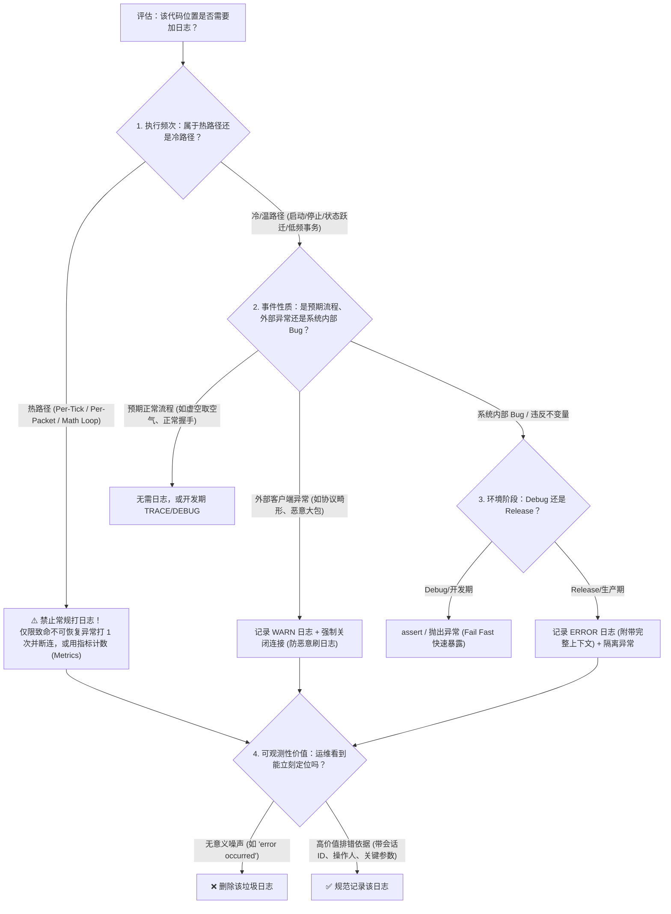

# 敏捷工程、架构思维与质量保证 (Engineering, Architecture & Testing)

> 本专题沉淀了后端开发中的工程思维与质量保障规范，包括自底向上敏捷 Sprint 任务拆解、企业级测试金字塔与 DoD 交付标准、GTest/CTest 单元测试框架核心机制。

---

## 目录

1. [Q1: 为什么 Sprint 任务划分是从下往上（Bottom-Up）的？觉得无从下手，从上往下（Top-Down）会不会更好？](#q1-为什么-sprint-任务划分是从下往上bottom-up的觉得无从下手从上往下top-down会不会更好)
2. [Q2: `tests/` 目录下的自动化测试程序在测什么？GTest 核心机制如何理解？为什么跑测试会有 1 个报错？](#q2-tests-目录下的自动化测试程序在测什么gtest-核心机制如何理解为什么跑测试会有-1-个报错)
3. [Q3: VS Code 运行测试时控制台显示 `100% tests passed, 0 tests failed out of 1` 是怎么回事？为什么在末尾看不到汇总？](#q3-vs-code-运行测试时控制台显示-100-tests-passed-0-tests-failed-out-of-1-是怎么回事为什么在末尾看不到汇总)
4. [Q4: 一个优秀的测试程序该怎么写？如何根据 Sprint 的 DoD 写出高质量测试？企业实际开发中的测试体系是怎样的？](#q4-一个优秀的测试程序该怎么写如何根据-sprint-的-dod-写出高质量测试企业实际开发中的测试体系是怎样的)
5. [Q5: `Chunk::setBlock/getBlock` 坐标越界为什么不记日志？高性能系统与游戏引擎中如何判断某个地方要不要加日志？](#q5-chunksetblockgetblock-坐标越界为什么不记日志高性能系统与游戏引擎中如何判断某个地方要不要加日志)

---

### Q1: 为什么 Sprint 任务划分是从下往上（Bottom-Up）的？觉得无从下手，从上往下（Top-Down）会不会更好？

#### 📍 问题的切入点
很多开发者在按照 Sprint 教程学习本项目时，都会经历这种强烈的迷茫与挫败感：
* **教程目前的编排顺序（从下往上 Bottom-Up）**：
  * Sprint 0：先写纯内存字节容器 `ByteBuffer`，各种游标、VarInt 位运算；
  * TASK-1.2：写 `TcpServer` 与 `TcpSession` 的 Asio 基础连接建立；
  * TASK-1.3：写发送队列 `write_queue_` 与 `sendPacket`；
  * TASK-1.4：写基于 VarInt 的拆包器 `PacketFraming::slicePacket`；
  * TASK-1.5：才真正开始写业务处理 `PacketRouter` 与 `StatusHandler`。
* **学员的真实痛点**：
  * “在写 `ByteBuffer` 和 `write_queue_` 的时候，我连 Minecraft 客户端到底发了什么包都不知道！”
  * “我不知道为什么要这样设计，为什么要这样写，感觉盲人摸象、无从下手。”
  * **“如果是从上往下（Top-Down），先看游戏业务，再做底层支撑，会不会更直观更好理解？”**

---

#### 💡 核心结论（彻底解开心结）

1. **你的感受极其敏锐，而且 100% 击中了人类大脑的学习规律！**
   * **人类的认知天性是“目标驱动（Top-Down / 从上往下）”**：只有先看到目标（“我想让 Minecraft 客户端显示绿色延迟和服务器标语”），你才会对中间遇到的问题产生探求欲。
   * 如果一开始就逼你造轮子（`ByteBuffer`、发送队列），你根本不知道这块砖头将来要砌在房子的哪个角落，自然会觉得枯燥、抽象、无从下手。
2. **那原作者为什么非要“从下往上”来编排？（工程实现与编译系统的客观宿命）**
   * **C++ 强类型与编译器依赖链**：C++ 没有 Python/JavaScript 的动态运行时。如果先写上层的 `StatusHandler`，它必须依赖 `PacketRouter`，而 `PacketRouter` 依赖 `TcpSession`，`TcpSession` 依赖 `ByteBuffer`。在 C++ 里，底层没写出来，上层代码连**编译都通不过**！
   * **单元测试（TDD）的独立性**：从下往上写，每写完一个组件（如 `ByteBufferTest`、`TcpServerTest`）就可以立即跑 `ctest` 验证正误，步步为营。
3. **治愈迷茫的最佳学习法宝：【Top-Down 思考理解，Bottom-Up 编码实现】！**
   * 理解架构时，**坚决必须从上往下倒推**！
   * 下面为你用“Top-Down 倒推法”，让你在 3 分钟内彻底明白 Sprint 1 的每一个任务为什么必须存在、为什么必须这么设计！

---

#### 逆向推导大揭秘：从 Minecraft 游戏业务“倒推”整个系统架构！

让我们忘掉所有 C++ 语法，把自己当成一名想要搭建 Minecraft 游戏服务端的架构师，从最顶层的业务开始往下倒推：

```
                    ┌──────────────────────────────────────────────┐
                    │ 🎯 终极目标：Minecraft 客户端刷新服务器列表     │
                    │ 屏幕上显示: 🟢 20ms | 0/20 人 | "A C++ Server"│
                    └──────────────────────┬───────────────────────┘
                                           │
                                           ▼ (倒推第 1 层：协议业务)
                    ┌──────────────────────────────────────────────┐
                    │ 1. 业务处理器: StatusHandler (TASK-1.5)       │
                    │    客户端发来了什么？我们该回什么？            │
                    │    • 收到 Status Request -> 回送 JSON 描述文本│
                    │    • 收到 Ping(8字节)     -> 原样回送 Pong    │
                    └──────────────────────┬───────────────────────┘
                                           │
                                           ▼ (倒推第 2 层：状态分发)
                    ┌──────────────────────────────────────────────┐
                    │ 2. 状态机分发器: PacketRouter (TASK-1.5)      │
                    │    痛点：客户端在握手、查列表、登录各个阶段发 │
                    │    的包 ID 都是 0x00！服务端怎么知道怎么解析？ │
                    │    解法：按 (ConnectionState, PacketID) 路由! │
                    └──────────────────────┬───────────────────────┘
                                           │
                                           ▼ (倒推第 3 层：传输定界)
                    ┌──────────────────────────────────────────────┐
                    │ 3. 长度前缀拆包器: PacketFraming (TASK-1.4)   │
                    │    痛点：TCP 是无边界字节流！客户端的两个包粘 │
                    │    在一起(粘包)或切碎到达(半包)，业务直接崩溃!│
                    │    解法：根据 VarInt 长度头，精准裁切出一个个整包!│
                    └──────────────────────┬───────────────────────┘
                                           │
                                           ▼ (倒推第 4 层：并发安全下发)
                    ┌──────────────────────────────────────────────┐
                    │ 4. 发送缓冲队列: write_queue_ (TASK-1.3)     │
                    │    痛点：业务层想给客户端回包，若连续发两个包，│
                    │    Asio 严禁并发调用 async_write(会断言崩溃)!│
                    │    解法：做一个内存 FIFO 队列，串行化排队发送! │
                    └──────────────────────┬───────────────────────┘
                                           │
                                           ▼ (倒推第 5 层：连接抽象与生命周期)
                    ┌──────────────────────────────────────────────┐
                    │ 5. 会话自保模型: TcpSession (TASK-1.2)       │
                    │    痛点：每个连进来的客户端生命周期不可预测， │
                    │    异步回调中对象随时可能被意外提前析构野指针!│
                    │    解法：enable_shared_from_this 闭包自保！   │
                    └──────────────────────┬───────────────────────┘
                                           │
                                           ▼ (倒推第 6 层：内存基石)
                    ┌──────────────────────────────────────────────┐
                    │ 6. 字节容器: ByteBuffer (Sprint 0)           │
                    │    痛点：协议全是大端整数、VarInt、UTF-8 字符串│
                    │    总不能到处用 char* 和 memcpy 手撕指针吧？  │
                    │    解法：预留 8 字节头、双游标自动扩容的 Buffer!│
                    └──────────────────────────────────────────────┘
```

---

#### 深度对比：当你知道了顶层目标，底层的代码瞬间有了灵魂！

看看下面的对比，你会发现底层的每一个枯燥设计，全都是被上层业务**“逼出来”**的：

1. **为什么写 `write_queue_`？（TASK-1.3）**
   * **自下而上视角（迷茫）**：“为什么要写个队列？为什么要搞个 `is_writing_` 标记？为什么不直接发送？”
   * **自上而下视角（顿悟）**：在 TASK-1.5 中，客户端先发一个包，我们刚准备回数据，它立刻又发来一个包；如果直接调两次 `async_write`，Asio 当场崩溃终止！为了让上层业务能随心所欲地调用 `sendPacket`，底层**必须**扛下并发排队的苦力活！
2. **为什么写 `slicePacket` 拆包？（TASK-1.4）**
   * **自下而上视角（迷茫）**：“算什么 VarInt 长度？移来移去是在干嘛？”
   * **自上而下视角（顿悟）**：因为底层的网卡根本不管你的 Minecraft 协议，抓包一看（见 [`doc/packets_hex_dump.md`](file:///home/ubu/dev/my/mcpe/doc/packets_hex_dump.md)），客户端的 `Handshake` 和 `Status Request` 是一口气连着送上来的！如果不拆包，业务直接把第二个包当成脏数据丢掉了！
3. **为什么要在 `ByteBuffer` 头部预留 8 字节 `kCheapPrepend`？（Sprint 0）**
   * **自下而上视角（迷茫）**：“前面空 8 个字节不写，纯纯浪费内存？”
   * **自上而下视角（顿悟）**：业务层在组装包体时，必须先算好包体内容，才能知道包体的长度有多大。有了预留头部，最后一步调用 `prependVarInt(len)`，直接在最前面填上长度，**全程 0 次内存搬迁、0 次重新分配！** 性能达到极致！

---

#### 🎯 给你制定的“最佳学习心法”

从今天开始，我们在推进后续任务时，全面采用**“Top-Down 需求输入 + Bottom-Up 扎实实现”**的学习策略：

1. **第一步：先看“终点长什么样”（Top-Down 输入）**
   * 每次开启一个新任务，不要直接跳进 `.cc` 代码；
   * 先看真实抓包文档 [`doc/packets_hex_dump.md`](file:///home/ubu/dev/my/mcpe/doc/packets_hex_dump.md) 或协议清单 [`doc/03_protocol_340_cheatsheet.md`](file:///home/ubu/dev/my/mcpe/doc/03_protocol_340_cheatsheet.md)；
   * 先在脑海中建立场景：“这个任务做完后，客户端会有什么反应？网卡上会多出哪几串十六进制字节？”
2. **第二步：带着“痛点”去写底层代码**
   * 明白底层这个类是为了替上层挡下哪颗“子弹”（是挡粘包？是挡 Asio 并发写断言？还是挡内存泄漏？）。
3. **第三步：后续问答随时切换视角**
   * 只要你觉得哪行底层代码抽象晦涩，随时问我：“**这行代码在最终 Minecraft 交互时到底起到了什么作用？**”，我立刻为你从上层业务和报文角度倒推剖析！


---

### Q2: `tests/` 目录下的自动化测试程序在测什么？GTest 核心机制如何理解？为什么跑测试会有 1 个报错？

#### 📍 代码位置
* 目录：[`tests/`](file:///home/ubu/dev/my/mcpe/tests/)
* 包含文件：`test_varint.cc`、`test_bytebuffer.cc`、`test_framing.cc`、`test_tcp_session.cc`、`test_packet_router.cc`

---

#### 💡 核心解答

本项目采用工业标准的 **GoogleTest (GTest)** 框架。测试代码并不是多余的负担，而是**可执行的代码质量契约与重构安全网**。
1. **测试定位**：覆盖了底层基础库（`ByteBuffer`、`VarInt`）、协议拆包分帧（`PacketFraming`）、网络并发会话（`TcpSession`）以及协议状态机路由（`PacketRouter`）。
2. **测试语法三剑客**：`TEST`（独立单测）、`TEST_F`（带 Fixture 夹具环境的单测）、`TEST_P`（参数化多数据集驱动单测）。
3. **断言区别**：`EXPECT_*`（非致命，失败仍继续） vs `ASSERT_*`（致命，失败立即中断退出，防空指针崩溃）。
4. **报错原因**：当前运行测试报红 `PacketRouterTest.LegalHandshakeTransitionToStatus`，是因为我们正处于 **TDD（测试驱动开发）的红灯阶段（Red Phase）**：该用例在验收 Sprint 1 的 TASK-1.6，而底层业务处理函数 [`StatusHandler::handleHandshake`](file:///home/ubu/dev/my/mcpe/src/protocol/StatusHandler.cc#L13-L16) 还是空实现 `{}`。

---

#### 深度解析 1：GTest 核心语法快速扫盲

* **`TEST(SuiteName, TestName)`**：普通独立函数测试，无状态依赖。
* **`TEST_F(FixtureClass, TestName)`**：`F` 代表 **Fixture**。当测试需要复杂的环境初始化时（如构造本地 Socket 对、启动 IO 线程、挂载日志拦截器），定义一个继承自 `::testing::Test` 的类，实现 `SetUp()` 和 `TearDown()`。每个用例执行前都会重新 `SetUp`，保证用例彼此独立隔离。
* **`TEST_P(ParamFixture, TestName)`**：`P` 代表 **Parameterized**。同一套测试逻辑，配合 `INSTANTIATE_TEST_SUITE_P` 批量注入几十组测试数据（如官方测试向量表），避免手写大量重复代码。

---

#### 深度解析 2：`tests/` 目录下 5 大文件测试架构一览

1. **[`test_varint.cc`](file:///home/ubu/dev/my/mcpe/tests/test_varint.cc)（协议数据类型与契约边界，630+ 行企业级典范）**：
   - 官方测试向量参数化校验（覆盖所有极值边界与负数）；
   - **半包（`kIncomplete`）零副作用断言**：当只收到半个 VarInt 时，断言读游标**绝不移动**，等待下一次读取；
   - **畸形包（`kMalformed`）拦截**：连续 5 字节带继续位的数据断言立刻报错，防御恶意攻击。
2. **[`test_bytebuffer.cc`](file:///home/ubu/dev/my/mcpe/tests/test_bytebuffer.cc)（底层内存缓冲区）**：
   - 大端序（Big-Endian）数值读写准确性；
   - 读写游标推进、环形滑动回收（`reclaim / shift`）与扩容；
   - `std::string_view` / `std::span` 零拷贝视图内存安全性。
3. **[`test_framing.cc`](file:///home/ubu/dev/my/mcpe/tests/test_framing.cc)（拆包器粘包半包）**：
   - **粘包验证**：连续两个包拼在一个 buffer，断言一次切出两个独立包；
   - **半包验证**：一个包分 3 批喂入，断言前两次返回 `kIncomplete` 且游标不乱，第 3 批才成功切出。
4. **[`test_tcp_session.cc`](file:///home/ubu/dev/my/mcpe/tests/test_tcp_session.cc)（异步会话与写队列）**：
   - 利用本机 `127.0.0.1:0` 随机端口在毫秒级搭建真实的 Loopback Socket 对；
   - **微秒级 100 连发**：验证 `sendPacket` 连续高频调用时，底层 `write_queue_` 保证数据包按序完整下发，杜绝 Asio 内部并发写断言异常；
   - **4 线程并发轰炸**：验证线程安全。
5. **[`test_packet_router.cc`](file:///home/ubu/dev/my/mcpe/tests/test_packet_router.cc)（协议状态机路由）**：
   - 利用 `spdlog` 的 `ostream_sink_mt` 拦截系统日志，断言遇到恶意包时必须触发 warning 日志；
   - **参数化白名单验证**：覆盖 Minecraft 1.12.2 的 8 个例行包（如 `0x04 Client Settings`），确保空实现忽略而不误踢玩家；
   - 验证握手成功流转到 `STATUS`。

---

#### 📌 本题总结记忆卡片

| 核心维度 | 关键要点 |
| :--- | :--- |
| **测试核心价值** | 毫秒级反馈、精确边界验证、大刀阔斧重构的安全保护网。 |
| **断言选择原则** | 前提条件（如指针非空）用 `ASSERT_*`；业务字段校验用 `EXPECT_*`。 |
| **为什么会有测试失败？** | TDD 红灯阶段：测试走在实现前面，提醒开发者 TASK-1.6 尚未实现。 |


---

### Q3: VS Code 运行测试时控制台显示 `100% tests passed, 0 tests failed out of 1` 是怎么回事？为什么在末尾看不到汇总？

#### 📍 现象位置
* 触发途径：在 VS Code 打开 `tests/test_packet_router.cc`，点击首行左侧绿色三角按钮。
* 控制台输出：频繁打印单行测试执行信息，末尾显示 `100% tests passed, 0 tests failed out of 1`，但前面明明看到有红字报错。

---

#### 💡 核心解答

这是 **VS Code 测试插件底层的调用机制** 引起的误解：
1. **逐个用例独立调用**：VS Code 点击文件首行运行时，并不是把所有测试当成一个命令执行，而是解析出文件内的 17 个用例，通过循环**依次独立执行** `/usr/bin/ctest ... -R ^用例名`。
2. **“out of 1” 的真相**：对于每一个独立的 CTest 命令，它的任务目标**只有那 1 个测试**，只要这 1 个通过了，自然输出 `100% passed out of 1`！
3. **末尾看不到汇总的原因**：第 7 个测试报错后，控制台打出了错误日志，但 VS Code 继续执行第 8~17 个测试；控制台日志按时间顺序滚动，终端最末尾展示的是**最后一个测试（第 17 个）的执行报告**，没有任何一个进程生成过全盘汇总。

---

#### 深度解析：如何正确查看完整统计结果？

* **方式 1（VS Code GUI 面板）**：点击 VS Code 左侧活动栏的 **测试图标（化学烧瓶 🧪 / 播放列表）**，在树状目录中能清晰看到哪个用例打了红叉 **❌**，点击红叉直接在代码中展示错误原因对比气泡。
* **方式 2（终端原生 GoogleTest 二进制，最推荐）**：
  直接在终端运行编译好的测试二进制：
  ```bash
  ./build/test_packet_router
  ```
  单进程一口气跑完全部用例，并在最末尾输出清晰的红绿大看板：
  ```text
  [==========] 17 tests from 2 test suites ran. (13 ms total)
  [  PASSED  ] 16 tests.
  [  FAILED  ] 1 test, listed below:
  [  FAILED  ] PacketRouterTest.LegalHandshakeTransitionToStatus
  ```
* **方式 3（全项目 CTest）**：
  ```bash
  ctest --test-dir build --output-on-failure
  ```

---

#### 📌 本题总结记忆卡片

| 现象 | 底层原因 | 最佳解决方式 |
| :--- | :--- | :--- |
| **末尾总是 0 failed out of 1** | VS Code 将用例拆分成单条 `-R` 指令独立调用，末尾只是最后一条用例的结果。 | 在终端直接执行 `./build/test_packet_router`。 |
| **左侧找不到测试图标** | 默认可能被隐藏。 | 在左侧活动栏空白处右键勾选「测试」，或按 `Ctrl+Shift+P` 输入 `Testing: Focus on Test View`。 |


---

### Q4: 一个优秀的测试程序该怎么写？如何根据 Sprint 的 DoD 写出高质量测试？企业实际开发中的测试体系是怎样的？

#### 📍 背景来源
* 架构指南：[`doc/07_enterprise_testing_and_dod_guide.md`](file:///home/ubu/dev/my/mcpe/doc/07_enterprise_testing_and_dod_guide.md)
* 迭代看板：[`doc/sprints/02_sprint1_network_ping.md`](file:///home/ubu/dev/my/mcpe/doc/sprints/02_sprint1_network_ping.md)

---

#### 💡 核心解答

1. **优秀测试的核心标准**：严格遵守 **FIRST 原则**（Fast 快速、Independent 独立、Repeatable 可重复、Self-validating 自验证、Timely 及时）；代码结构严格遵守 **AAA 模式**（Arrange 准备 -> Act 执行 -> Assert 断言）。
2. **DoD 转测试四步法**：**提炼裁决指标 $\to$ 设计输入边界 $\to$ 构造运行环境 $\to$ 编写组合断言**。DoD 里的每一句验收要求，直接对应一个 `TEST()` 用例。
3. **企业实际测试体系**：测试金字塔（70% 纯内存单元测试 + 20% 集成测试 + 10% 端到端联调）；TDD 红绿循环；Google Mock 依赖解耦；CI/CD 自动化门禁搭配 ASan（内存越界扫描）与 TSan（线程竞态扫描）；核心解析器引入 libFuzzer 模糊测试。

---

#### 深度解析：Sprint 1 中 DoD 转测试的实战案例

* **案例 1（TASK-1.4 拆包器 DoD）**：
  > *“人为将一个包含 20 字节的数据包切成 3 字节、7 字节、10 字节分批喂入，拆包器能精准在最后一次返回完整包；将两个包拼接一次喂入，能连续返回 2 个包。”*
  * **转化测试**：对应 [`test_framing.cc`](file:///home/ubu/dev/my/mcpe/tests/test_framing.cc) 中的 `StickingPackets`（粘包）与 `TruncatedHalfPacket`（半包）。
* **案例 2（TASK-1.3 发送队列 DoD）**：
  > *“模拟在同一微秒内连续调用 100 次 send_packet，数据包按顺序被完整发送到对端，不会抛出 Asio 内部并发写断言异常。”*
  * **转化测试**：对应 [`test_tcp_session.cc`](file:///home/ubu/dev/my/mcpe/tests/test_tcp_session.cc) 中的 `Send100PacketsSequentialAndSafe`。
* **案例 3（TASK-1.6 Handshake DoD，正在开发的 TDD 用例）**：
  > *“当 Next State == 1 时，将 Session 状态原子切换为 STATUS。”*
  * **转化测试**：对应 [`test_packet_router.cc`](file:///home/ubu/dev/my/mcpe/tests/test_packet_router.cc#L184-L198) 中的 `LegalHandshakeTransitionToStatus`。测试先写好断言 `EXPECT_EQ(session_->state(), ConnectionState::STATUS)`，再去实现业务代码让它变绿。

---

#### 📌 本题总结记忆卡片

| 体系板块 | 核心落地要求 |
| :--- | :--- |
| **测试设计模式** | **AAA 结构**：只在一个用例中 Arrange（准备）、Act（执行目标函数）、Assert（断言校验）。 |
| **DoD 转化核心** | 没有自动化测试校验的 DoD 是空头支票；把文字版验收指标翻译成 `EXPECT_*`。 |
| **大厂测试门禁** | 代码 PR 必须通过 CI 流水线，核心模块行覆盖率 $\ge 85\%$，结合 ASan/TSan 内存安全检查。 |


---

### Q5: `Chunk::setBlock/getBlock` 坐标越界为什么不记日志？高性能系统与游戏引擎中如何判断某个地方要不要加日志？

#### 📍 代码位置
* 源文件：[`src/world/Chunk.cc`](file:///home/azureuser/dev/my/mcpe/src/world/Chunk.cc#L16-L35)
* 上下文：
  ```cpp
  void Chunk::setBlock(BlockPos pos, uint16_t state_id) {
    assert(pos.toChunkPos() == pos_ && "BlockPos does not belong to this Chunk!");

    const int32_t sec_idx = pos.sectionIndex();
    if (sec_idx < 0 || sec_idx >= static_cast<int32_t>(kSectionCount)) {
      return;  // 👉 为什么这里越界直接静默 return，而不打一行 spdlog::warn/error？
    }
    ...
  }

  uint16_t Chunk::getBlock(BlockPos pos) const {
    if (pos.toChunkPos() != pos_) {
      return BlockStates::kAir;
    }
    const int32_t sec_idx = pos.sectionIndex();
    if (sec_idx < 0 || sec_idx >= static_cast<int32_t>(kSectionCount)) {
      return BlockStates::kAir;  // 👉 同样直接返回空气，不记日志
    }
    ...
  }
  ```

#### 💡 核心解答

这是一个在现代高性能 C++ 后端、高并发游戏服务端开发中**极其经典且关键的工程架构决策问题**。

#### 一、 为什么 `Chunk::setBlock/getBlock` 绝对不能无脑打日志？

1. **热路径吞吐量与“日志风暴（Log Storm）”风险**：
   * `getBlock` 与 `setBlock` 是体素世界中**最极端的热路径（Hot Path）**。在服务端 20 TPS 物理世界循环中，实体重力下落与 AABB 碰撞检测、光照 BFS 扩散（Flood Fill）、流水与岩浆蔓延、爆炸冲击波计算、视锥剔除与网格序列化等逻辑，每秒可能产生**数十万甚至数千万次**方块查询！
   * 如果玩家或怪物坠入世界虚空（$Y < 0$，如 $Y = -10, -50$）或高空滑翔（$Y > 255$），物理引擎每 tick 都会检测实体边界附近的 8 ~ 27 个方块坐标。
   * **灾难后果**：
     * **I/O 阻塞雪崩**：如果每次越界都记录一行 `spdlog::warn("Block out of bounds: y={}", pos.y)`，每秒会疯狂产生数万行磁盘写请求，直接打爆系统 I/O 缓冲区；
     * **TPS 暴跌卡死**：即便是异步日志，无尽的内存格式化与队列投递也会频繁争抢 CPU 缓存与内存带宽，直接导致主线程物理节拍器卡顿、严重丢帧，引发拒绝服务（Self-inflicted Log DoS）；
     * **日志磁盘写满**：几个坠落虚空的僵尸在数分钟内就能产生几 GB 垃圾日志，导致服务器磁盘耗尽崩溃。

2. **游戏物理语义的合法性：虚空和高空本就是“空气”**：
   * 在体素沙盒世界中，世界垂直范围是 $Y \in [0, 255]$。超出这个范围并不是内存被篡改的致命 Bug，而是游戏世界的物理现实。
   * 对于 `getBlock(pos)`：当查询虚空或天顶以上的方块时，它的物理客观存在**就是空气（Air）**！直接返回 `BlockStates::kAir` 属于完全符合物理预期的**安全兜底（Safe Fallback）**，无需触发报警；
   * 对于 `setBlock(pos)`：建筑高度合法性通常在外层交互逻辑（如玩家放置方块协议处理器）已经校验；底层 `Chunk` 库提供最终的边界保护（Guard Condition），直接静默拦截即可。

3. **那如何防止真正的代码 Bug 呢？—— 区分开发期断言与生产期日志**：
   * 注意到在 `setBlock` 开头有一行：
     ```cpp
     assert(pos.toChunkPos() == pos_ && "BlockPos does not belong to this Chunk!");
     ```
   * **水平坐标越界（X/Z 不属于本 Chunk）**：属于严重的代码逻辑 Bug（例如世界路由算错了区块），在 Debug 模式下通过 `assert` 直接崩溃中断，**Fail Fast 快速暴露问题**；
   * **垂直坐标越界（Y 越界）**：属于常规物理边界边缘，在生产环境中静默安全防御。

---

#### 二、 工业级判断法则：如何判断某个地方要不要加日志？

在高性能后端与底层架构中，判断是否加日志可以遵循以下**四维决策漏斗（The 4-D Decision Funnel）**：



#### 1. 维度一：执行频次（调用频率是每秒 1 次，还是每秒 100 万次？）
* **极热路径（Per-Packet / Per-Tick / Per-Block / Math Loop）**：
  * **原则**：**绝对零日志开销**。
  * **替代方案**：如果需要监控这类高频越界或丢弃事件，采用**指标计数器（Metrics Counter）**，例如：
    `g_metrics.chunk_oob_queries.fetch_add(1, std::memory_order_relaxed);`
    单次原子累加仅需几个 CPU 周期，Prometheus/Grafana 汇总每秒速率，完全不碰磁盘 I/O。
* **温路径（Session 状态跃迁 / 业务动作）**：
  * 如玩家登录进服、传送完成、装备锻造、区块卸载保存。
  * **原则**：记录 **INFO** 或 **DEBUG** 日志，标记流水。
* **冷路径（服务启动 / 停止 / 加载配置 / 致命崩溃）**：
  * **原则**：详尽记录 **INFO / ERROR / CRITICAL**，哪怕多打几行上下文也无妨。

#### 2. 维度二：事件性质（是业务预期情况，还是外部注入，还是代码 Bug？）
* **预期分支（Expected Branch）**：
  * 密码错误、虚空查方块、传送中移动包被安全丢弃等。
  * **处理**：业务正常处理，无需警报。
* **不可信外部异常（Untrusted Client Anomaly）**：
  * 客户端发送未知包 ID、数据包格式偏移、恶意大包攻击。
  * **处理**：记录 **WARN**，并**立即关闭连接**（`session->close()`），防止黑客利用此处的日志点发动日志写满攻击（Log Injection Denial-of-Service）。
* **内部不变量损坏（Invariant Violation）**：
  * 内存指针损坏、状态机出现未定义状态、跨线程队列损坏。
  * **处理**：Debug 下 `assert`，Release 下带调用栈记录 **ERROR**。

#### 3. 维度三：可观测性价值与排错效用（Actionability）
在写下 `spdlog::error(...)` 之前，先反问三个问题：
1. **“半夜告警群弹出了这条日志，值班人员能凭它立刻排查出是谁干的、在哪发生的吗？”**
   * ❌ 糟糕的日志：`spdlog::error("Invalid position!");`（完全不知道是谁、在哪个世界、传了什么坐标）；
   * ✅ 优秀的日志：`spdlog::error("[Chunk] Player '{}' ({}) tried out-of-bound write at ({}, {}, {})", player_name, session_id, x, y, z);`
2. **“这条日志能指导后续行动吗？”**
   * 如果日志打出来除了让控制台红一行，没有任何修复或排查意义，它就是噪声（Log Noise），应当毫不犹豫地删掉。

#### 4. 维度四：日志级别的严格契约（Log Level Contract）

| 级别 | 含义 | 生产环境要求 | 典型示例 |
| :--- | :--- | :--- | :--- |
| **TRACE** | 最细粒度调试 | 编译期禁用或默认关闭 | 每个包原始 Hex 字节流 Dump |
| **DEBUG** | 研发诊断流程 | 生产默认关闭，灰度或定位时动态开启 | 路由分发进入某 Handler、调色板位压缩解压步骤 |
| **INFO** | 核心业务里程碑 | 生产常开，低频（每秒小于 10 条） | 监听端口就绪、玩家登录进服、区块存档落盘 |
| **WARN** | 非预期但可自愈 | 生产常开，必须有频控或随断连触发 | 收到客户端未知包 ID、传送流水号不匹配被安全拦截 |
| **ERROR** | 单次请求失败/严重异常 | 生产常开，带业务上下文，触发报警 | 客户端发伪造恶意数据包被踢出、区块 NBT 解析失败 |
| **CRITICAL** | 核心系统崩溃 | 生产常开，直接对接 PagerDuty 电话叫醒 | 端口绑定冲突、jemalloc 内存耗尽 OOM、主线程物理循环失控 |
