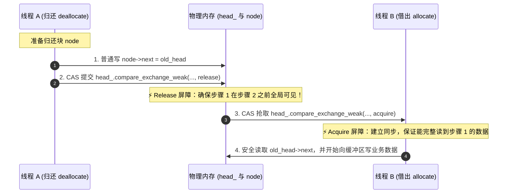
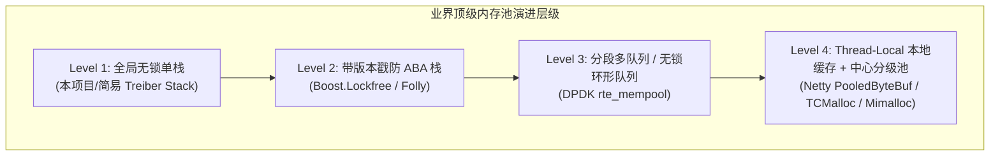

# 无锁定长内存池 Q&A 核心技术手册

本文档专为解析项目中 `BufferPool`（位于 [`src/common/BufferPool.h`](../src/common/BufferPool.h) 与 [`src/common/BufferPool.cc`](../src/common/BufferPool.cc)）的高并发无锁设计、底层硬件优化与 C++ 原子操作知识点而设立。

---

## 目录
- [Q1: `alignas(64)` 是什么意思？为什么要设置为 64？](#q1-alignas64-是什么意思为什么要设置为-64)
- [Q2: `std::atomic` 是什么？这是容器吗？有哪些常用方法？](#q2-stdatomic-是什么这是容器吗有哪些常用方法)
- [Q3: 本内存池中的“无锁（Lock-Free）”具体是怎么做到的？](#q3-本内存池中的无锁lock-free具体是怎么做到的)
- [Q4: 深度剖析 `BufferPool.cc` 中所有内存序（Memory Order）语句的语义与底层原理](#q4-深度剖析-bufferpoolcc-中所有内存序memory-order语句的语义与底层原理)
- [Q5: 程序不是顺序执行吗？怎么会发生 CPU 乱序重排？](#q5-程序不是顺序执行吗怎么会发生-cpu-乱序重排)
- [Q6: 工业级评估：本项目内存池实现的优缺点与成熟开源对标方案](#q6-工业级评估本项目内存池实现的优缺点与成熟开源对标方案)

---

## Q1: `alignas(64)` 是什么意思？为什么要设置为 64？

### 1.1 核心定义
`alignas` 是 C++11 引入的**对齐说明符（Alignment Specifier）**，用于强制要求编译器将修饰的变量或数据结构的物理内存起始地址，对齐到指定的字节边界（必须是 2 的整数次幂）。

```cpp
alignas(64) std::atomic<Node*> head_{nullptr};
alignas(64) std::atomic<size_t> allocated_count_{0};
```
上述代码强制指定：`head_` 的首地址必须是 64 的整数倍，`allocated_count_` 的首地址也必须是 64 的整数倍。

---

### 1.2 为什么必须是 64？—— 揭秘 CPU 缓存行（Cache Line）与“伪共享（False Sharing）”

现代 CPU 访问内存的速度远远落后于算力。为了弥补这个鸿沟，CPU 配备了 L1/L2/L3 级高速缓存（Cache）。

1. **缓存行（Cache Line）**：
   - CPU 与主存之间的数据传输**不是按单个字节**进行的，而是以 **64 字节**为最小块单位（现代 x86/ARM64 体系下绝大多数 Cache Line 均为 64 字节）。
2. **什么是伪共享（False Sharing）？**
   - 假设没有写 `alignas(64)`：
     ```cpp
     // 假设没有对齐：两个变量连续紧密排列在内存中
     std::atomic<Node*> head_;         // 占用 8 字节 (0x1000 - 0x1007)
     std::atomic<size_t> allocated_count_; // 占用 8 字节 (0x1008 - 0x100F)
     ```
   - 因为它们紧挨在一起（都在 `0x1000 ~ 0x103F` 的 64 字节范围内），它们会**被 CPU 强行装入同一个 Cache Line 中**！
   - 此时发生致命的多核灾难：
     - **Core 1** 执行 `allocate()`，频繁 CAS 修改 `head_`。
     - 根据 CPU 缓存一致性协议（如 MESI），Core 1 写入该 Cache Line 时，必须把其他核心中的该 Cache Line 全部标记为**失效（Invalidate）**！
     - **Core 2** 正在执行 `fetch_add` 统计 `allocated_count_`。虽然 Core 2 根本没动 `head_`，但因为属于同一缓存行，Core 2 的缓存强行失效，必须暂停流水线，重新跨核/去 L3 甚至主存拉取数据！
     - 这就是所谓的**“伪共享（False Sharing）”** —— 两个逻辑上完全独立的变量，却因为物理空间挤在同一条缓存线上，导致多核之间像打乒乓球一样反复互刷缓存失效（Cache Bouncing），高并发下性能直接下跌 **90% 以上**！
3. **`alignas(64)` 的作用**：
   - 强制让 `head_` 从新的 64 字节缓存行起始处分配，并填充占位；
   - 强制让 `allocated_count_` 也独占下一个 64 字节缓存行；
   - **两尊大佛各自独立占据一个完整的 Cache Line**，多核并发争抢 `head_` 的同时修改 `allocated_count_`，各自的核心缓存互不干扰，性能达到硬件极限。

---

## Q2: `std::atomic` 是什么？这是容器吗？有哪些常用方法？

### 2.1 它是容器吗？
**不是容器！**  
`vector`、`list`、`map` 等才是用来装载一堆元素的容器。  
`std::atomic<T>` 是 C++11 标准库 `<atomic>` 中提供的**模板类型包装器（Atomic Wrapper）**。它的作用是把一个普通的基础类型（指针、整数、布尔值等）包装起来，使得多线程对它的所有读取、修改、写入操作，在底层硬件层面都是**原子的（不可分割的）**。

---

### 2.2 为什么普通变量不行？
看一个经典场景：
```cpp
size_t count = 0;
count++; // 普通自增
```
在底层汇编中，`count++` 实际上由 3 条独立指令组成：
1. `MOV EAX, [count]`（从内存读到寄存器）
2. `ADD EAX, 1`（在寄存器中计算加 1）
3. `MOV [count], EAX`（把结果写回内存）

若两个线程同时执行：Thread 1 刚读出 0，尚未写回；Thread 2 也读出 0 并写回 1；Thread 1 接着写回 1。执行了两次自增，最终值却是 1（**数据竞争 Data Race / 丢失更新**）。

使用 `std::atomic<size_t> allocated_count_{0};` 之后，底层会直接翻译为硬件原子指令（例如 x86 下带总线锁定的 `LOCK XADD`），CPU 保证该操作在执行期间绝对不会被其他任何核心打断。

---

### 2.3 `std::atomic` 常用核心方法全景指南

| 方法名 | 作用说明 | 常见代码示例 |
| :--- | :--- | :--- |
| **`load()`** | 原子读取当前值 | `Node* p = head_.load(std::memory_order_acquire);` |
| **`store(val)`** | 原子写入新值 | `head_.store(new_node, std::memory_order_release);` |
| **`exchange(val)`** | 原子写入新值，并返回旧值 | `Node* old = head_.exchange(nullptr);` |
| **`fetch_add(val)`** | 原子加法（返回修改前的值） | `allocated_count_.fetch_add(1, std::memory_order_relaxed);` |
| **`fetch_sub(val)`** | 原子减法（返回修改前的值） | `allocated_count_.fetch_sub(1, std::memory_order_relaxed);` |
| **`compare_exchange_weak(...)`** | 弱原子比较并交换（CAS，循环重试首选） | 详见下方第 3 节 |
| **`compare_exchange_strong(...)`** | 强原子比较并交换（不会因伪失败而重试） | 用于单次执行、无法放在循环中的 CAS 操作 |

> **内存序（Memory Order）补充说明**：  
> `std::memory_order_relaxed`：仅保证原子性，不施加指令重排限制（最快，常用于计数器统计）；  
> `std::memory_order_release`：本线程在此之前的所有写操作，对后续 acquire 它的线程立即可见；  
> `std::memory_order_acquire`：本线程在此之后的所有读写操作，都不会被重排到此操作之前。

---

## Q3: 本内存池中的“无锁（Lock-Free）”具体是怎么做到的？

### 3.1 什么是“无锁（Lock-Free）”？
- **传统有锁并发（Lock-Based）**：使用 `std::mutex` 或 `pthread_mutex`。当线程 A 抢到锁后，若线程 B 也来抢，操作系统会将线程 B 强行挂起（阻塞，陷入休眠），引发操作系统内核态切换（Context Switch，消耗数千 CPU 周期）。若持锁线程被操作系统调度换出，所有等待线程统统瘫痪。
- **无锁并发（Lock-Free）**：**不使用任何操作系统互斥锁机制**。所有并发操作完全基于 CPU 硬件原语（CAS 指令）在用户态循环竞争。任何一个线程挂起或死掉，绝不影响其他线程向前推进，系统吞吐量极高。

---

### 3.2 核心底座：CAS 原语（Compare-And-Swap）
现代 CPU（x86 的 `CMPXCHG`，ARM 的 `LDREX/STREX`）提供了在硬件上原子执行比较并交换的单指令。  
在 C++ 中的接口为：
```cpp
bool compare_exchange_weak(T& expected, T desired, ...);
```
**它的硬件逻辑极其直白**：
> “CPU 查看目标原子变量：  
> 如果当前变量的值 == `expected`，说明没有其他人动过它，立刻把变量的值换成 `desired`，返回 `true`（成功！）；  
> 如果当前变量的值 != `expected`，说明被其他并发线程捷足先登给改了，本次放弃修改，并将当前最新的真实值覆写到 `expected` 中，返回 `false`（失败，供调用方重试）。”

---

### 3.3 源码实战剖析：内存池的两大无锁核心

本项目中的无锁数据结构是经典的 **Treiber Stack（无锁单向链表栈）**。栈顶指针即为 `head_`。

#### ① 借出内存（出栈）：`allocate()`
```cpp
PooledBlock BufferPool::allocate() {
  Node* old_head = head_.load(std::memory_order_acquire);

  // 核心 CAS 循环：尝试将栈顶从 old_head 替换为 old_head->next
  while (old_head != nullptr) {
    if (head_.compare_exchange_weak(
            old_head,
            old_head->next,
            std::memory_order_acquire,
            std::memory_order_relaxed
        )) {
      // 成功抢得一块！统计递增，返回包装对象
      allocated_count_.fetch_add(1, std::memory_order_relaxed);
      return PooledBlock(reinterpret_cast<char*>(old_head), BufferBlockDeleter{this});
    }
    // 若被其他并发线程抢先一步弹出，compare_exchange_weak 会自动把最新 head_ 刷新进 old_head，直接重试
  }

  // 弹性降级 (Fallback)：池内预分配块已被借光！调用系统 new 保证业务不中断
  allocated_count_.fetch_add(1, std::memory_order_relaxed);
  char* fallback_mem = static_cast<char*>(::operator new(kBlockSize));
  return PooledBlock(fallback_mem, BufferBlockDeleter{this});
}
```
- **执行过程**：
  1. 线程先乐观读取当前栈顶 `old_head`。
  2. 尝试将 `head_` 原子性地指向 `old_head->next`。
  3. 如果多个线程同时来抢同一个 `old_head`，**硬件 CAS 指令只允许其中 1 个成功**返回 `true`。
  4. 其余失败的线程，`old_head` 会被 CAS 自动赋值为新的栈顶，立即进入下一轮 `while` 尝试，全程 0 阻塞、0 锁等待！

#### ② 归还内存（入栈）：`deallocate()`
```cpp
void BufferPool::deallocate(char* ptr) noexcept {
  if (ptr == nullptr) return;

  if (isInArena(ptr)) {
    auto* node = reinterpret_cast<Node*>(ptr);
    Node* old_head = head_.load(std::memory_order_relaxed);

    // 核心 CAS 循环：把 node 作为新的栈顶挂回链表
    do {
      node->next = old_head;
    } while (!head_.compare_exchange_weak(
        old_head,
        node,
        std::memory_order_release,
        std::memory_order_relaxed
    ));
  } else {
    // 属于突发洪峰期间临时通过 Fallback 申请的内存：直接归还给操作系统
    ::operator delete(ptr);
  }

  allocated_count_.fetch_sub(1, std::memory_order_relaxed);
}
```
- **执行过程**：
  1. 拿回归还的裸指针 `ptr`，就地复用前 8 个字节强转为 `Node* node`（零额外内存开销的**侵入式链表**设计！）。
  2. 把待归还节点的 `next` 指向当前栈顶 `old_head`。
  3. 执行 `compare_exchange_weak`：若这期间没有任何其他线程往栈顶还过东西，直接一步将 `head_` 指向 `node`；
  4. 若刚好有另一个线程也还了一个块，CAS 判定失败，`old_head` 自动更新为那个线程刚刚还进去的节点，本线程更新自己的 `node->next = old_head`，继续下一次循环重试。

---

### 3.4 方案特性总结对比

| 对比维度 | 传统加锁方案 (`std::mutex`) | 本项目无锁池 (`CAS Treiber Stack`) |
| :--- | :--- | :--- |
| **并发开销** | 线程竞争失败时陷入内核休眠，上下文切换 ~2~5 微秒 | 纯用户态原子指令，微秒内完成，纳米级延迟 |
| **多核扩展性** | 线程越多，锁争用越剧烈，吞吐量断崖式下跌 | 16 线程压测 80 万次借还仅耗时 ~180ms，扩展性极高 |
| **死锁风险** | 异常分支、顺序反转可能造成死锁 | 0 互斥锁，数学上不可能发生死锁 |
| **缓存亲和度** | 锁结构破坏缓存局部性 | `alignas(64)` 隔离 + 原地无额外元数据复用 |

---

## Q4: 深度剖析 `BufferPool.cc` 中所有内存序（Memory Order）语句的语义与底层原理

在无锁并发编程中，**内存序（Memory Order）不是可有可无的微调参数，而是决定整个无锁系统会不会发生内存崩溃、野指针、指令颠倒的核心基石**。

C++11 的内存模型针对现代多核 CPU 的**指令乱序执行（Out-of-Order Execution）**和**多级高速缓存一致性（Cache Coherency）**，提供了精确控制编译器与 CPU 屏障的机制。

以下逐条解析 [`src/common/BufferPool.cc`](../src/common/BufferPool.cc) 中全部涉及内存序的代码行：

---

### 4.1 构造函数中的链表发布
- **源码位置**：[`src/common/BufferPool.cc:31`](../src/common/BufferPool.cc#L31)
- **代码语句**：
  ```cpp
  head_.store(curr_head, std::memory_order_release);
  ```
- **内存序语义**：**`std::memory_order_release`（发布屏障）**
- **底层机制与原因**：
  1. 在执行此行之前，构造函数刚刚在循环中完成了整片 Arena 的初始化以及全部 `node->next = curr_head` 的指针穿针连线。
  2. `release` 语义在底层建立了一个**发布内存屏障（Store Barrier）**：强制保证在该 store 之前的所有普通内存写操作（即所有 `node->next` 的赋值），**绝不能被编译器或 CPU 乱序重排到该 store 之后**！
  3. **如果用 `relaxed` 会发生什么？**
     CPU 可能先将 `head_` 指向新链表（因为 store 速度快），而背后的 `node->next` 还在 CPU 写缓冲区（Store Buffer）中排队未刷新。此时其他线程并发调用 `allocate()`，看到 `head_ != nullptr`，立刻通过 `old_head->next` 顺藤摸瓜，直接读取到未初始化的全 0 或垃圾地址，引发 **Segmentation Fault（段错误）**！

---

### 4.2 `allocate()` 中初次探测读取栈顶
- **源码位置**：[`src/common/BufferPool.cc:43`](../src/common/BufferPool.cc#L43)
- **代码语句**：
  ```cpp
  Node* old_head = head_.load(std::memory_order_acquire);
  ```
- **内存序语义**：**`std::memory_order_acquire`（获取屏障）**
- **底层机制与原因**：
  1. `acquire` 与 4.1 和 4.6 节中的 `release` 构成经典的 **Release-Acquire 同步对（Synchronizes-With）**。
  2. 它的硬件语义是：**在此 load 之后的所有读写操作，绝不能被重排到该 load 之前**。
  3. 确保当前线程能够百分之百“看得到”上一个 release 发布该 `head_` 的线程对 `node->next` 所做的全部写操作，保证后续读取 `old_head->next` 绝对安全。

---

### 4.3 `allocate()` 中的 CAS 出栈弹出操作
- **源码位置**：[`src/common/BufferPool.cc:50-53`](../src/common/BufferPool.cc#L50-L53)
- **代码语句**：
  ```cpp
  if (head_.compare_exchange_weak(
          old_head,
          old_head->next,
          std::memory_order_acquire,
          std::memory_order_relaxed
      ))
  ```
- **内存序语义**：
  - **成功时（Success Order）**：`std::memory_order_acquire`
  - **失败时（Failure Order）**：`std::memory_order_relaxed`
- **底层机制与原因**：
  1. **为什么成功时用 `acquire`？**
     - CAS 成功意味着当前线程**正式抢到了这个 4KB 缓冲块的独占使用权**。
     - 该线程马上就要将这个块包装成 `PooledBlock` 返回给外部业务使用，外部业务会往这个 4KB 内存里写网络数据、读数据。
     - `acquire` 保证了：外部业务后续对该块的一切读写操作，绝不会被 CPU 乱序提到 CAS 成功之前执行；并且确保能看到上一个使用该块的线程在归还前写入的所有数据已经完全同步。
  2. **为什么失败时用 `relaxed`？**
     - CAS 失败意味着别的线程抢先一步把栈顶弹走了，本线程**什么都没抢到**。
     - 此时硬件 CAS 指令会自动把 `head_` 的最新值刷新进 `old_head`。
     - 既然没有获取任何资源所有权，就没有需要同步的载荷（Payload），因此用最轻量的 `relaxed`，避免产生任何无意义的硬件内存栅栏开销。

---

### 4.4 `allocate()` 中的统计计数器原子自增
- **源码位置**：[`src/common/BufferPool.cc:55`](../src/common/BufferPool.cc#L55) 与 [`src/common/BufferPool.cc:62`](../src/common/BufferPool.cc#L62)
- **代码语句**：
  ```cpp
  allocated_count_.fetch_add(1, std::memory_order_relaxed);
  ```
- **内存序语义**：**`std::memory_order_relaxed`（松弛内存序）**
- **底层机制与原因**：
  1. `allocated_count_` 的唯一作用是作为**监控和测试指标**，用于统计当前借出的块数。
  2. 它并不保护任何链表指针，也没有任何业务逻辑依赖“计数器增加必须发生在某块内存修改之前”。
  3. `relaxed` 仅保证 `fetch_add` 自身是硬件级原子 Read-Modify-Write（多核不会丢失自增），不添加任何同步屏障，开销最低。

---

### 4.5 `deallocate()` 中初次获取当前栈顶
- **源码位置**：[`src/common/BufferPool.cc:74`](../src/common/BufferPool.cc#L74)
- **代码语句**：
  ```cpp
  Node* old_head = head_.load(std::memory_order_relaxed);
  ```
- **内存序语义**：**`std::memory_order_relaxed`（松弛内存序）**
- **底层机制与原因**：
  1. 此处读取 `head_` 的目的只是为了给紧接着的 `node->next = old_head` 做一个**乐观的初始赋值预测**。
  2. 哪怕读到了稍旧的值也没关系，因为接下来的 `compare_exchange_weak` 会在硬件级别严密核对当前真实栈顶。如果发现旧了，CAS 自动刷新 `old_head` 并循环重试。
  3. 真正的同步屏障发生在后面的 CAS 提交时，因此初次探测无需 `acquire`，使用 `relaxed` 节省时钟周期。

---

### 4.6 `deallocate()` 中的 CAS 压栈归还操作
- **源码位置**：[`src/common/BufferPool.cc:82-85`](../src/common/BufferPool.cc#L82-L85)
- **代码语句**：
  ```cpp
  } while (!head_.compare_exchange_weak(
      old_head,
      node,
      std::memory_order_release,
      std::memory_order_relaxed
  ));
  ```
- **内存序语义**：
  - **成功时（Success Order）**：`std::memory_order_release`
  - **失败时（Failure Order）**：`std::memory_order_relaxed`
- **底层机制与原因**：
  1. **为什么成功时必须用 `release`？**
     - 当前线程在循环中刚刚执行了 `node->next = old_head;`，并且该缓冲区在被归还之前可能被业务层写满了数据。
     - `release` 保证：**写入 `node->next = old_head` 这条关键语句，对全局多核生效的时间点，绝对早于 `head_` 被更新为 `node`**！
     - 否则，一旦别的线程通过 `allocate()` 抢先 pop 出了这个 `node`，它若试图沿着 `node->next` 继续弹下一个块，可能会读到尚未刷新的错误指针，导致无锁链表彻底断裂。
  2. **为什么失败时用 `relaxed`？**
     - CAS 失败表示在当前线程尝试将 `node` 挂上栈顶的瞬间，另一个线程抢先完成了一次压栈。
     - 此时 `node` 并未发布给其他线程，只需拿到更新后的 `old_head` 回到循环首部重写 `node->next`，不需要任何同步屏障。

---

### 4.7 `deallocate()` 中的统计计数器原子自减
- **源码位置**：[`src/common/BufferPool.cc:91`](../src/common/BufferPool.cc#L91)
- **代码语句**：
  ```cpp
  allocated_count_.fetch_sub(1, std::memory_order_relaxed);
  ```
- **内存序语义**：**`std::memory_order_relaxed`（松弛内存序）**
- **底层机制与原因**：
  - 同 4.4 节：仅保证计数自减的原子性，不施加指令重排约束。

---

### 4.8 内存序协同工作拓扑图（Release-Acquire 闭环）



---

## Q5: 程序不是顺序执行吗？怎么会发生 CPU 乱序重排？

### 5.1 “程序是顺序执行的” —— 现代体系结构给程序员的美丽幻觉

所有程序员刚学编程时，直觉上都认为：“代码写在第 1 行就先执行第 1 行，写在第 2 行就后执行第 2 行”。

这种直觉之所以存在，是因为编译器规范和 CPU 硬件架构共同遵守一条最高宪法：**“As-If-Serial 语义”**。
> **As-If-Serial 规则**：无论编译器怎么优化代码、无论 CPU 硬件怎么并行乱序执行，**在单个线程（Single Thread）内部观察到的执行结果，必须与严格按代码书写顺序执行的结果完全一致**。

只要单线程内部结果正确，底层无论是把第 2 行挪到第 1 行前面，还是两行同时执行，单线程程序都毫无感知。**这种单线程下的“天衣无缝”，在多线程并发时却成了致命灾难。**

---

### 5.2 为什么现代计算系统必须搞“乱序”？—— 残酷的“内存墙（Memory Wall）”

为什么 CPU 不老老实实按顺序一条条执行？答案只有一个字：**慢！**

看看计算机各级硬件的访问时钟周期对比：

| 硬件操作 | 耗时时钟周期 | 形象比喻（若 1 个周期 = 1 秒） |
| :--- | :--- | :--- |
| **CPU 寄存器加法** | 1 个时钟周期 (~0.3ns) | 眨一下眼 (1 秒) |
| **访问 L1 缓存** | 4 个时钟周期 (~1ns) | 喝一口水 (4 秒) |
| **访问 L2 缓存** | 12 个时钟周期 (~3ns) | 洗个脸 (12 秒) |
| **访问 L3 缓存** | 40 个时钟周期 (~12ns) | 泡一杯咖啡 (40 秒) |
| **访问主内存（DRAM）** | **200 ~ 300 个时钟周期 (~60-100ns)** | **出门吃顿大餐 (4~5 分钟)！** |

如果 CPU 严格顺序执行：  
当遇到一条向内存写入数据或从内存读取数据的指令时，CPU 的核心计算单元就必须**原地挂起、发呆等待 200~300 个时钟周期**！现代 4GHz 的超强 CPU 算力将瞬间跌落至上世纪单片机水平。

为了压榨出极致性能，编译器与 CPU 联手演化出了两个阶段的“乱序重排”：

---

### 5.3 阶段一：编译器乱序优化（Compiler Reordering）

在开启 `-O2` 或 `-O3` 编译优化时，GCC/Clang 会为了提升流水线利用率、减少寄存器换出，在**不破坏单线程因果关系**的前提下，对指令生成的顺序进行大挪移。

例如：
```cpp
// 程序员写的代码：
int a = 0;
int b = 0;

void foo() {
    a = 1;  // 操作 1
    b = 2;  // 操作 2
}
```
编译器分析发现：`a` 和 `b` 是两个毫无依赖的独立变量，先写谁对当前函数毫无区别。编译器很可能把汇编生成为先写 `b` 后写 `a`。

---

### 5.4 阶段二：CPU 硬件层面的指令乱序执行（Out-of-Order Execution）

现代 CPU 全是**超标量乱序执行（OoOE）**引擎。一条指令不是一条一条串行跑完的，而是被拆分为取指（Fetch）、译码（Decode）、保留站（Reservation Station）、执行单元（ALU/LSU）、重排序缓冲区（ROB，Reorder Buffer）。

更致命的是 CPU 芯片内部的**写缓冲区（Store Buffer）**与**失效队列（Invalidate Queue）**：
1. **写缓冲区（Store Buffer）的“自作主张”**：
   - 当 CPU Core 1 要写一个变量到内存时，若该变量在当前核心的 L1 缓存中缺失（Cache Miss），Core 1 不可能傻等主存响应。
   - Core 1 随手把数据扔进自己身旁的硬件队列 **Store Buffer**，然后**立即假装这条写指令已经执行完毕**，大摇大摆地接着去执行后面的读指令！
   - 很久之后，Store Buffer 才慢悠悠地把数据真正刷入各级缓存。
2. **多核视角下的时空扭曲**：
   - 站在 Core 1 自己的角度：它觉得自己是先写后读的（单线程幻觉依然成立）；
   - 但站在并行的 Core 2 角度：Core 2 已经看到了 Core 1 后面执行的读操作，却**迟迟看不到 Core 1 早就写进 Store Buffer 的数据**！
   - 这在外部观察者看来，就是指令执行顺序发生了颠倒！

---

### 5.5 灾难时刻：当“As-If-Serial 幻觉”遭遇“多线程并发”

编译器和 CPU 在判断指令能否重排时，**只能看见当前这一个线程**！它根本不知道世界上还有另一个线程在偷偷观察自己。

回到我们的内存池代码：
```cpp
// 线程 A (归还块 deallocate)：
node->next = old_head; // 【写操作 1】：写入链表节点的 next 指针
head_ = node;          // 【写操作 2】：更新全局栈顶指针
```

- **编译器和 CPU 的自作聪明**：
  > “`node->next` 是一块内存地址，`head_` 是另一块内存地址。它们两个地址毫无重叠，没有数据依赖。那我先更新 `head_`，把 `node->next` 压到 Store Buffer 晚点再写，能提升吞吐量！”

- **并发线程 B 此时杀了进来 (`allocate`)**：
  ```cpp
  Node* old_head = head_; // 线程 B 读到了刚刚更新的 head_（非空！）
  Node* next = old_head->next; // 💥 灾难发生！
  ```
  因为【写操作 1】还在 Store Buffer 里没真正刷到内存，线程 B 读取到的 `old_head->next` 是**全 0 或者垃圾内存地址**！
  线程 B 紧接着沿着这个垃圾指针访问，操作系统当场报出 **Segmentation fault（段错误核心已转储）**！

---

### 5.6 破局者：内存序与内存屏障（Memory Barrier / Fence）

既然编译器和 CPU 的“盲目乱序”在多线程下会引发灾难，我们就必须在关键代码处**立一道墙，明确下达禁令**！这就是 `std::memory_order` 的本质。

- **`std::memory_order_release`（写屏障）**：
  - 相当于对编译器和 CPU 厉声喝道：
    > **“立正！在把我（`head_`）写出去之前，必须把前面所有的写操作（`node->next`）全部强制刷入缓存，一条都不准重排到我后面！”**
- **`std::memory_order_acquire`（读屏障）**：
  - 相当于对编译器和 CPU 下令：
    > **“立正！在把我（`head_`）读进来之前，后面所有的读写操作一条都不准提前抢跑！必须老老实实等我完成并拿到最新数据！”**

有了这组屏障，编译器禁止重排指令，CPU 硬件也会插入特定的屏障指令（如 x86 的 `SFENCE/LFENCE/MFENCE`，ARM 的 `DMB/DSB`），从而在微秒与纳秒之间，守住了多核内存一致性的绝对安全防线。

---

## Q6: 工业级评估：本项目内存池实现的优缺点与成熟开源对标方案

### 6.1 本内存池实现的工程亮点（Pros）

| 亮点 | 架构设计 | 收益与工业价值 |
| :--- | :--- | :--- |
| **1. 页面级紧凑对齐** | 单块固定 4096 字节（4KB），契合 Linux 页表大小及网络 MTU/TCP 窗口缓冲需求 | 规避零碎小内存外部碎片，单次系统读写正好对齐一个物理页 |
| **2. 零元数据开销侵入式链表** | 未使用内存块就地借用前 8 字节充当 `Node* next` 指针 | 无需额外分配节点结构体，4MB 池子有效载荷比达 **100%** |
| **3. 硬件级防伪共享** | `alignas(64)` 隔离 `head_` 与 `allocated_count_` | 消除多核缓存一致性风暴（Cache Bouncing），并发吞吐提升数倍 |
| **4. 双轨血统弹性降级** | 借穿容量时不阻塞，调用 `::operator new` 兜底；释放时 `isInArena` 自动路由回收 | 杜绝了传统固定内存池高并发洪峰下的阻塞死锁，兼顾了吞吐与业务可用性 |
| **5. RAII 自动化回收** | 封装 `std::unique_ptr<char[], BufferBlockDeleter>` | 业务层像普通指针一样使用，离开作用域自动安全归还，0 泄露心智负担 |

---

### 6.2 深度挑刺：潜在缺陷与生产级盲点（Cons & Latent Bugs）

尽管在中小规模并发和测试下表现优异，但在超高并发大型服务端生产环境下，该设计存在以下几个关键架构瓶颈：

#### ① 潜在的 ABA 陷阱（ABA Problem in Pop）
- **现象**：虽然教程中提到“连续 Arena 内存永不销毁，因而天然免疫 ABA 导致的野指针访问”，但在多线程极速并发下：
  - 线程 1 准备 `allocate()`，读到栈顶 `A`，准备将栈顶替换为 `A->next`（即 `B`）；
  - 线程 1 被操作系统切出（挂起）；
  - 线程 2 迅速将 `A` 弹出，紧接着把 `B` 也弹出了；
  - 随后线程 3 把 `A` 又归还到了栈顶；
  - 此时栈顶又变成了 `A`，线程 1 恢复运行并执行 `CAS(A, B)`，CAS 判定成功！
  - **严重后果**：栈顶被强行指成了 `B`，而 `B` 此刻其实正握在线程 2 手里被业务写入！后续线程 4 再次 `allocate()` 时就会抢到 `B`，导致**两个并发线程同时持有并覆写同一块内存**！
- **工业级解法**：采用**带版本戳的标记指针（Tagged Pointer）**，利用 64 位指针的高 16 位未用位存放版本号，或使用 128 位双字 CAS（`CMPXCHG16B`）。

#### ② 全局单栈顶竞争热点（Global Head Bottleneck）
- **瓶颈**：全系统所有线程在借还内存时，争抢的是**同一个原子变量 `head_`**。
- **后果**：在 32 核、64 核等高核心数服务器上，高并发会导致 `compare_exchange_weak` 剧烈冲突，CPU 核心把绝大部分算力浪费在 CAS 自旋重试和缓存行总线仲裁上（硬件吞吐量断崖式下跌）。

#### ③ 洪峰降级时的“性能悬崖”（Fallback Performance Cliff）
- **瓶颈**：一旦 1024 块被耗尽，后续每一次请求都退化为 `::operator new`，直接触发 glibc 的全局 heap 锁争用，高负载时系统延迟会出现毛刺峰值。

---

### 6.3 业界顶级成熟开源实现对标

在高性能网络框架与分布式系统中，本项目所处的生态位通常对标以下开源巨头：



#### 1. Facebook Folly: `folly::IndexedMemPool`
- **定位**：C++ 高性能并发基础设施典范。
- **对标技术点**：
  - 不使用裸指针做 Treiber Stack，而是使用 **32 位整数索引（Index） + 32 位版本计数器（Tag）** 拼成一个 64 位的原子变量。
  - 仅用普通的单字 CAS 就完美终结了 ABA 问题！
  - 支持多分片（Sharded Pool），按线程哈希打散到多个独立的 Slot，化解全局锁争用。

#### 2. Linux DPDK: `rte_mempool`
- **定位**：百万级 PPS（每秒数据包）电信级报文处理底座。
- **对标技术点**：
  - **无锁环形队列（Lockless Multi-Producer Multi-Consumer Ring Buffer）** 代替单向链表栈；
  - **Per-Core Local Cache（核心本地缓存）**：每个 CPU Core 本地保留一个无需任何原子操作的私有小池子，本地池空了才批量从全局大池子批发，将全局总线争抢降低数个数量级！

#### 3. Java Netty: `PooledByteBufAllocator`
- **定位**：现代高并发异步网络编程事实标准（Minecraft 官方服务端即基于 Netty 构建！）。
- **对标技术点**：
  - 基于 jemalloc 架构思想，划分为 **Arena -> Chunk (16MB) -> Page (8KB) -> Subpage**。
  - 配备 **PoolThreadCache**：利用线程局部存储（TLS），绝大多数报文缓冲分配完全在当前线程的私有无锁队列中纳秒级返回。

#### 4. Microsoft: `mimalloc` / Google: `tcmalloc`
- **定位**：全球顶级通用多线程内存分配器。
- **对标技术点**：
  - 现代高性能内存池的终极形态：**Thread-Local Cache (本地线程缓存) + Central FreeList (中央无锁空闲链表)** 双层架构。

---

### 6.4 本项目的演进路线与建议

| 优化阶段 | 改造方案 | 预期提升 |
| :--- | :--- | :--- |
| **近期（低成本）** | 为 `head_` 引入 64 位 Tagged Pointer（高 16 位计数器，低 48 位地址），彻底解决 ABA 理论漏洞 | 彻底消除并发覆写隐患，0 性能损失 |
| **中期（高回报）** | 引入简单的 **TLS（Thread-Local Cache）本地批量借还**：每线程预存 8~16 块，不足时才向全局池原子批发 | 全局 `head_` CAS 冲突率骤降 **90%** |
| **远期（完备化）** | 借鉴 DPDK / Netty，支持多阶 Size-Class（如 512B、4KB、64KB 分级池） | 覆盖全协议报文尺寸，避免 4KB 缓冲池装载小包时的内部碎片 |
