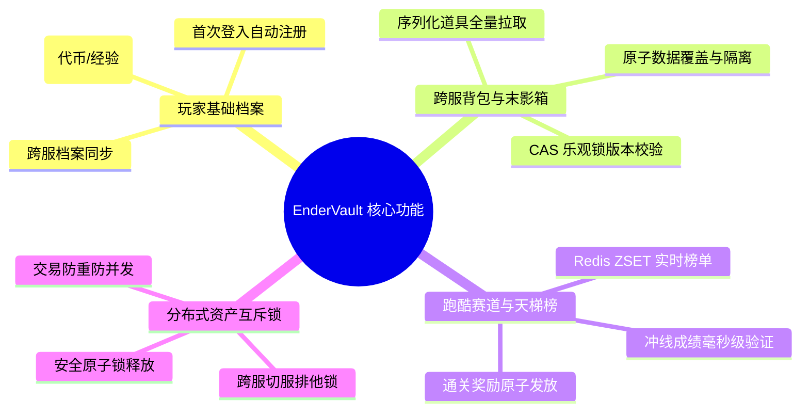

# EnderVault 需求分析说明书 (Requirements Analysis Specification)

> **文档标识**：`MC-DOC-VAULT-01`  
> **服务名称**：EnderVault (分布式数据代理微服务)  
> **所属系统**：Minecraft Cluster (mc-cluster)  
> **版本**：v1.0.0  
> **最后更新**：2026-10-18  

---

## 一、 业务背景与系统定位

### 1.1 业务背景
在大型 Minecraft 分布式服务器集群（如大型空岛、生存集群或竞技小游戏大厅）中，通常采用 **BungeeCord / Velocity** 等网关将海量玩家分流至不同的后端节点（如 C++ 编写的无状态微端大厅服 `mcpe-lobby`、Java Paper 编写的跑酷子服 `paper-parkour` 等）。

这种架构带来了一个核心痛点：**玩家跨服状态与资产的持久化和同步**。
1. **数据孤岛**：传统单个 Bukkit/Paper 服务端依赖本地 SQLite 或独立 MySQL，跨服切换时容易发生背包回档、道具丢失或跨服不同步。
2. **刷物品（Item Duplication）漏洞**：在网络抖动或恶意并发攻击下，玩家同时在多个服务器节点尝试登入或转移资产，极易利用切服时隙进行物品复制。
3. **数据库高并发击穿**：每逢高峰期数千名玩家同时跨服切服，瞬间产生对 MySQL 的暴风式并发读写（Cold Reads / Heavy Writes），导致关系型数据库连接池耗尽、锁竞争激烈甚至雪崩瘫痪。
4. **性能损耗严重**：游戏服务器主线程对 TPS（20 TPS 即每 Tick 50ms）极其敏感。如果游戏服在主线程直接与数据库同步通信，数据库数十毫秒的抖动就会直接引发游戏严重卡顿（Lag/Stutter）。

### 1.2 系统定位
**EnderVault** 是整个 `mc-cluster` 集群的 **核心分布式数据代理中间件**（Data Proxy & Cache Layer），它独立于具体的游戏业务逻辑节点运行，充当游戏服务器与底层数据库（MySQL / Redis）之间的“防波堤”和“资产金库”：
* **向上屏蔽底层存储复杂性**：为 C++ 大厅服、Java 业务子服提供高性能、跨语言、统一的数据存取接口。
* **高并发削峰填谷**：通过内存并发合并、异步微批处理落盘、多级缓存，将数据库写入 IOPS 降低 90% 以上。
* **资产安全与一致性保障**：通过分布式互斥锁（Distributed Lock）与版本号 CAS 乐观锁，彻底杜绝跨服背包冲突与刷物隐患。

---

## 二、 核心功能需求 (Functional Requirements)

### 2.1 玩家基础档案管理 (Player Profile Management)
* **自动注册（Auto-Provisioning）**：当玩家通过客户端首次接入集群时，EnderVault 能够根据 Mojang/离线 UUID 及游戏名（Username）完成基础档案的幂等初始化，赋予新手初始资产（如默认货币）。
* **全局信息维护**：维护玩家的全局资产（Coins 游戏币）、等级（Level）、经验值（Exp）以及最后所在的子服节点（LastServer）。
* **支持原子增量更新**：支持游戏节点上报数值增量（如跑酷通关增加 100 代币），而非全量覆盖，防止不同子服并发写入导致的数值覆盖丢失。

### 2.2 跨服背包与末影箱代理 (Vault & Inventory Proxy)
* **全量背包存储**：支持玩家 36 格背包、装备栏、副手及 27 格全局末影箱（Ender Chest）的数据存取。数据形态支持 NBT 序列化字节流、Base64 或通用 JSON 字符串。
* **版本号控制（CAS 乐观锁）**：针对玩家背包等全量结构数据，记录 `version` 递增版本号。游戏子服拉取数据时获取版本号，回写时提交期望版本号（Expected Version）。若版本不匹配，拒绝写入，杜绝跨服脏写。
* **扩展属性（Extra Attributes）**：支持灵活存储玩家称号、权限、装扮开关等 JSON 动态扩展字段。

### 2.3 跑酷竞速结算与实时排行榜 (Parkour & Leaderboard)
* **冲线成绩结算**：接收跑酷子服上报的冲线数据（赛道 ID、玩家 UUID、耗时毫秒数 `time_ms`、检查点数 `checkpoints`）。
* **全量历史归档**：将每次有效的冲线记录落盘至 MySQL，以供防作弊审查和历史回溯。
* **实时排行榜**：基于内存缓存提供 Top-N 排行榜查询，响应延迟必须控制在 1ms 以内，支持高频刷新。
* **通关奖励发放**：通关验证通过后，自动联动货币服务发放通关金币与经验奖励。

### 2.4 分布式互斥锁机制 (Distributed Lock)
* **资产独占保护**：当玩家在 A 服务器进行切服准备或跨服道具转移时，游戏服向 EnderVault 申请独占资源锁（Lock Key 绑定玩家 UUID），阻止玩家同时在 B 服务器操作资产。
* **防止死锁**：锁必须具备租约时效（TTL），防止由于游戏子服崩溃未释放锁导致的资源永久死锁。
* **防误解锁机制**：解锁时必须校验持有者令牌（Token），严格禁止实例 A 释放了已被实例 B 续期或获取的锁。

---

## 三、 非功能性需求 (Non-Functional Requirements)

### 3.1 性能与延迟指标 (SLA)
| 操作类型 | 目标场景 | 并发目标 (QPS) | P99 延迟目标 | 评测依据 |
| :--- | :--- | :--- | :--- | :--- |
| **读操作（Cache Hit）** | 玩家进服拉取档案/背包 | ≥ 20,000 QPS | ≤ 2 ms | Redis 内存读取 + Singleflight |
| **冷读回源（Cache Miss）** | 罕见/新进玩家冷启动 | ≥ 3,000 QPS | ≤ 15 ms | MySQL 索引主键精准定位 |
| **轻量数值写（异步）** | 跑酷得分、代币经验增量 | ≥ 10,000 QPS | ≤ 3 ms | 投递内存通道即返回，后台微批处理 |
| **全量背包写（强一致）** | 玩家退服/切服保存背包 | ≥ 2,000 QPS | ≤ 20 ms | MySQL 事务 + 乐观锁版本校验 |
| **实时榜单查询** | 全服大厅全息榜单轮询 | ≥ 30,000 QPS | ≤ 1 ms | Redis ZRange 纯内存高效检索 |

### 3.2 高可用与可靠性 (High Availability & Reliability)
1. **平滑优雅关机（Graceful Shutdown）**：
   - 收到 SIGINT/SIGTERM 信号时，必须拒绝接收新请求，并留出至少 5 秒窗口期将内存队列（Batch Channel）中积压的所有待落盘数据全量强制刷新（Flush）到 MySQL，确保数据零丢失。
2. **故障容忍与降级**：
   - 当异步批处理队列满载时，系统应具备过载保护能力，平滑降级为同步事务写入，而非直接拒绝或丢弃玩家数据。
   - Redis 发生瞬时抖动或连接断开时，读操作应能平滑降级回源 MySQL，保障集群核心玩法可用。
3. **健康检查机制**：
   - 必须提供深度健康探测接口（`/health`），包含 MySQL 连通性、Redis 连通性与服务存活状态，供 Kubernetes 或 Docker 健康检查探针探测。

### 3.3 数据安全性与一致性需求边界
* **资产强一致性（Strong Consistency）**：玩家背包、末影箱、大额交易，必须满足强一致性边界，采用强事务或 CAS 校验，坚决不能出现脏读或脏写。
* **高频数值最终一致性（Eventual Consistency）**：微小代币变动、经验增量、非核心统计数据允许在内存中缓冲毫秒级时间窗（如 200ms），在极短延迟后达到最终一致。
* **幂等性保障**：关键写操作（如注册、结算、分布式锁）应支持幂等执行，允许上游网络超时后安全重试。
