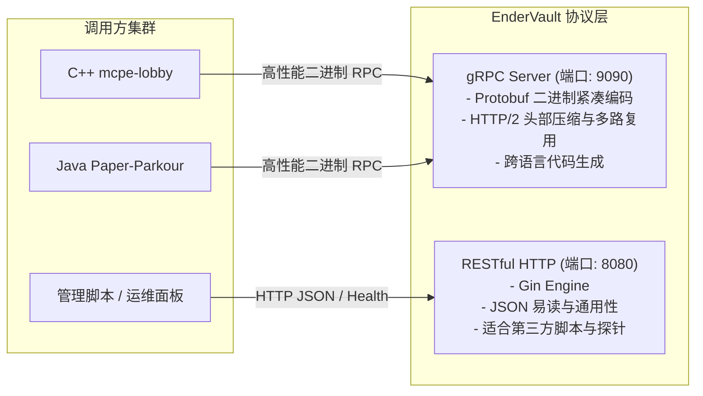

# EnderVault 技术选型说明书 (Technology Selection & Rationale)

> **文档标识**：`MC-DOC-VAULT-02`  
> **服务名称**：EnderVault (分布式数据代理微服务)  
> **所属系统**：Minecraft Cluster (mc-cluster)  
> **版本**：v1.0.0  
> **最后更新**：2026-10-18  

---

## 一、 开发语言选型：Golang vs Java vs C++ vs Rust

在 `mc-cluster` 架构中，网关采用 Java (BungeeCord)，游戏逻辑大厅采用 C++20 (`mcpe-lobby`)，跑酷服采用 Java (Paper)。数据代理服作为承上启下的中间件，其语言选型至关重要。

```mermaid
quadrantChart
    title 开发成本与运行效能权衡象限图
    x-axis 低开发运维门槛 --> 高系统级控制力与复杂度
    y-axis 较重资源占用与抖动 --> 极轻量资源与微秒级高并发
    quadrant-1 极致性能但成本高(C++20, Rust)
    quadrant-2 极轻并发且生态繁荣(Golang)
    quadrant-3 传统企业级方案(Java/Spring)
    quadrant-4 纯脚本语言(Python, Node.js)
    "Java (Spring Boot / Netty)": [0.35, 0.35]
    "Golang (EnderVault 最终选型)": [0.38, 0.85]
    "C++20 (mcpe-lobby 选型)": [0.90, 0.92]
    "Rust": [0.88, 0.90]
```

### 1.1 候选语言对比分析

| 评估维度 | Golang 1.22 (最终选型) | Java 17 / Netty | C++20 / Asio | Rust |
| :--- | :--- | :--- | :--- | :--- |
| **并发模型** | **GMP 调度器**，原生轻量级 Goroutine (初始 2KB) | 平台线程 (1MB) 或 Project Loom 虚拟线程 | 操作系统线程 / 异步回调 / 无栈协程 | 异步 Task + async/await 运行时 (Tokio) |
| **GC 与延迟** | 毫秒级三色标记并发 GC，STW 通常 < 1ms | ZGC / G1GC 需调优堆内存，百兆级堆内存开销大 | 无 GC，完全手动 RAII 管理，确定性高 | 无 GC，编译期所有权检查，零开销抽象 |
| **内存占用** | **极低**（静态编译镜像约 15MB，运行内存 20~50MB） | 较高（基础 JVM 启动即占 200MB+） | 极致（运行内存 ≤ 20MB） | 极致（运行内存 ≤ 20MB） |
| **I/O 编程心智模型** | **同步直观代码**，底层由 netpoller 驱动异步 I/O | 响应式编程复杂度高或 Spring 阻塞式 | 异步回调链路长，心智负担极重 | 状态机推导，编译期生命周期借用规则严格 |
| **云原生容器化** | 单个二进制产物，`scratch` / `alpine` 基础镜像 | 需装载 JRE / JDK 环境，镜像 200MB+ | 动态链接库依赖多，交叉编译复杂 | 单个静态二进制，交叉编译门槛略高 |
| **中间件生态** | 官方及社区级 Redis/MySQL/gRPC 驱动极成熟 | 历史沉淀丰富，但代码冗重 | 关系数据库驱动生态碎片化，ORM 简陋 | 生态活跃，但部分 ORM 驱动尚在演进阶段 |

### 1.2 选型结论：为什么是 Golang？
1. **天然适配 I/O 密集型中间件**：EnderVault 的核心职责是网络中转、协议解析、缓存读写和数据库批量操作，属于典型的 I/O 密集型服务。Go 的 Goroutine + Channel 模型能以极低的开发成本实现数万级并发 I/O。
2. **极小内存脚手架与秒级冷启动**：相较于 Java/Spring 动辄数秒的启动时间和数百兆内存，Go 编译后的单一静态二进制文件体积仅 15MB 左右，常驻内存仅数十兆，可以在 50ms 内瞬间冷启动，高度契合容器化与云原生编排。
3. **团队工程交付平衡**：C++ 用于大厅服是为了追求每 Tick 绝对确定的 20 TPS 物理帧率，而数据层需要频繁调整业务表结构与协议。Go 语言在保持接近 C++ 级别性能的同时，提供了数倍于 C++ 的开发和维护效率。

---

## 二、 通信协议选型：gRPC vs RESTful (HTTP/JSON)

数据代理服务需要同时与 C++ 节点、Java 节点及外部监控管理脚本进行通信。



### 2.1 协议深度对比

| 评估指标 | gRPC (Protocol Buffers v3) | RESTful API (HTTP/1.1 + JSON) |
| :--- | :--- | :--- |
| **传输层协议** | **HTTP/2** (天然支持单一 TCP 连接多路复用、流式传输) | HTTP/1.1 (队头阻塞，依赖连接池频繁握手) |
| **序列化效率** | **Varint + 二进制编码**，体积缩小 60%~80%，CPU 编解码速度提升 5~10 倍 | 文本字符序列化，包含冗余 Key，高并发下 GC 产生较多临时 String |
| **强类型契约** | **`.proto` 单一事实来源**，自动生成 Go/C++/Java 强类型 Stub，编译期检查类型 | 依赖 OpenAPI / Swagger 文档，字段手写容易拼错，运行时校验 |
| **调试与外部集成** | 需要专用调试工具（grpcurl, Postman gRPC），门槛略高 | **零门槛**（浏览器、curl、简单脚本即可直接发起调用） |
| **网络吞吐表现** | 单机 QPS 轻松突破 30,000+，连接复用率极高 | 单机 QPS 约 10,000~15,000，受限于 JSON 反序列化及 HTTP/1.1 开销 |

### 2.2 选型策略：双协议支持（Dual-Protocol Strategy）
* **核心生产数据链路（East-West 东西向微服务流量）**：采用 **gRPC (Protobuf)**。供 C++ 大厅服与 Java 跑酷服在进出服、跨服切服、背包拉取时调用，享受 HTTP/2 长连接多路复用与零反射二进制反序列化红利。
* **运维与通用数据链路（North-South 南北向流量）**：采用 **RESTful (Gin)**。用于容器健康检查探针（`/health`）、管理后台查询、Python 压测脚本快速调用。

---

## 三、 缓存方案选型：Redis 7.0 vs 进程内本地缓存

| 评估指标 | Redis 7.0 (独立缓存中间件) | 进程内本地缓存 (Go sync.Map / FreeCache / BigCache) |
| :--- | :--- | :--- |
| **数据共享范围** | **分布式全局共享**，多副本 EnderVault 节点无缝共享同一份缓存 | 仅限当前 Go 进程内部，多节点部署时缓存无法互通，数据产生分裂 |
| **数据一致性** | 集中式淘汰/更新，单点更新即全网可见 | 存在跨进程“缓存分裂”与多节点脏数据问题 |
| **高级数据结构** | **原生支持 ZSET (跳表+哈希表)**、Hash、Bitmap、HyperLogLog | 仅支持简单 KV，排行榜需在本地手写排序树，开销巨大且跨节点不同步 |
| **原子操作支持** | **原生支持 Lua 脚本**，提供绝对确定性的原子执行能力 | 需依赖本地读写锁，无法跨网络节点协同 |
| **内存与网络开销** | 跨主机网络往返（约 0.2~0.5ms） | 纳秒级内存读取（零网络开销） |

### 选型结论
选用 **Redis 7.0** 作为全局分布式缓存：
1. **排行榜刚需**：跑酷排行榜需要按照耗时毫秒数进行全服实时排序，Redis `ZSET`（内部以 SkipList + Dict 实现）提供 $O(\log N)$ 的插入和查询效率，是游戏天梯榜的行业黄金标准。
2. **分布式锁与原子性**：跨服防止玩家刷物需要全局原子性，Redis 的 `SETNX` 与 Lua 脚本执行是不可替代的核心能力。
3. **补充方案**：在只读高频热点（如服务器配置字典）中可局部辅以 Go 进程内只读缓存，但玩家易变资产必须存放在 Redis。

---

## 四、 存储引擎选型：MySQL 8.0 InnoDB vs NoSQL

| 评估指标 | MySQL 8.0 (InnoDB) (最终选型) | MongoDB (文档数据库) | Redis 纯持久化 (AOF everysec) |
| :--- | :--- | :--- | :--- |
| **事务支持 (ACID)** | **完整强事务支持**（Undo Log 保证原子性，Redo Log 保证持久性） | 仅支持多文档分布式事务，开销大，一致性保障模型复杂 | 缺乏完整事务回滚机制，易在断电时产生半事务状态 |
| **数据完整性与约束** | 强类型模式（Schema）、主外键检查、UNIQUE 约束彻底杜绝 UUID 重复 | 无强模式约束（Schema-less），业务错误容易写入畸变字段 | 仅依靠代码逻辑控制字段合法性 |
| **资产与对账审计** | **关系表 + 结构化 SQL**，便于资产对账、流水按时间段分页统计与聚合分析 | 聚合管道语法繁琐，资产流水 audit 复杂度较高 | 极其不擅长复杂范围查询与对账审计 |
| **成本与运维成熟度** | 业界第一梯队成熟度，成熟的主从复制、备份恢复与容灾体系 | 较成熟，但运维成本和内存开销相对较高 | 内存成本极其昂贵，不适合全量冷数据海量归档 |

### 选型结论
选用 **MySQL 8.0 (InnoDB)**：
* 玩家全局代币、账号、背包元数据关系明确，且涉及虚拟经济系统的安全性，必须由成熟的 **ACID 关系型事务** 提供兜底。
* InnoDB 存储引擎具备成熟的行级锁（Row Locks）、自适应哈希索引（AHI）、聚集索引（Clustered Index）和双写缓冲（Doublewrite Buffer），在高并发写与高持久性之间做到了最优平衡。

---

## 五、 数据访问层选型：GORM vs sqlx vs 原生 database/sql

| 评估指标 | GORM v1.25 (当前框架) | sqlx | 原生 database/sql |
| :--- | :--- | :--- | :--- |
| **开发效率与代码量** | **极高**，自动映射结构体，封装事务、CRUD、批量写入 | 中等，手写 SQL，但能自动绑定 Struct | 较低，需大量手写扫描 `rows.Scan(&a, &b)` |
| **性能损耗与内存分配** | 存在反射（Reflection）开销，较原生慢 15%~30%，产生额外堆分配 | 极小反射开销，接近原生性能 | **绝对零开销**，性能上限最高 |
| **复杂 SQL 与优化透明度** | 抽象遮蔽了底层 SQL，不当使用容易产生全表更新或隐式慢查询 | **100% 透明**，完全由开发者控制 SQL 执行计划 | **100% 透明** |
| **事务嵌套与钩子** | 极其方便，支持闭包式事务管理与自动回滚 | 需手动管理 `tx.Commit()` 与 `tx.Rollback()` | 需手动管理事务生命周期 |

### 选型决策与渐进式演进策略
* **原型与业务快速迭代阶段（当前）**：采用 **GORM**。通过模型注解自动建表（AutoMigrate），利用结构体便捷地完成模型映射与事务闭包，降低入门门槛。
* **高并发核心热点演进阶段（未来优化点）**：
  - 针对高频的批处理写入、原子加减数值与覆盖索引查询，逐步采用 **原生 SQL / 原生 Prepared Statement** 替换 GORM 抽象，规避反射损耗并精确掌控 MySQL 执行计划（Execution Plan）。
