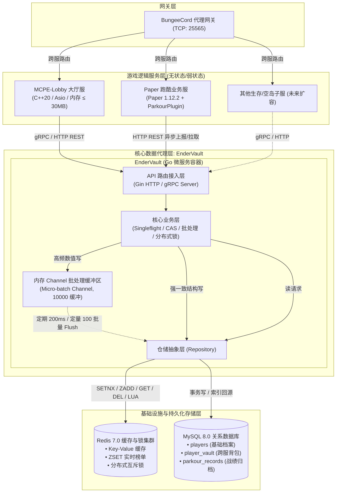
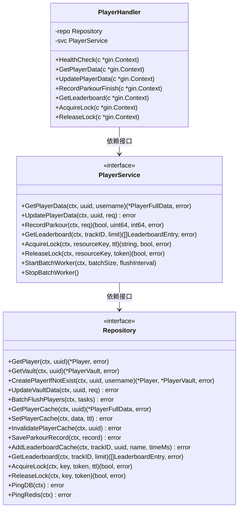
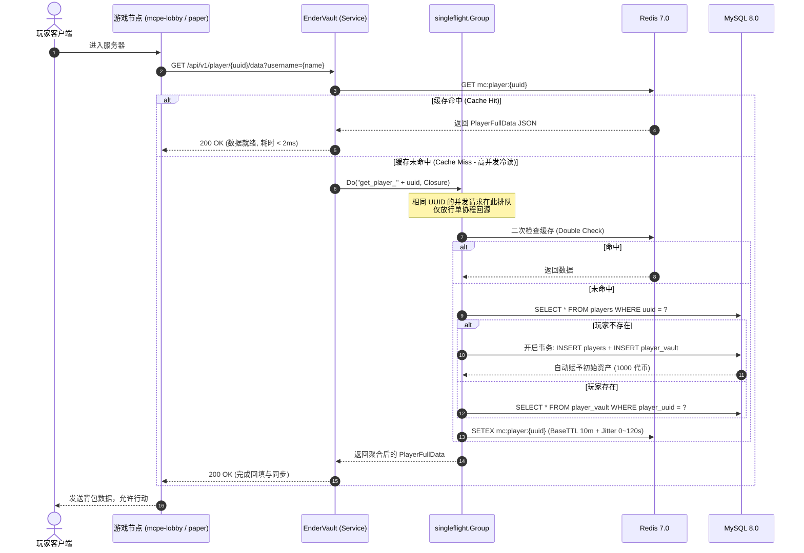
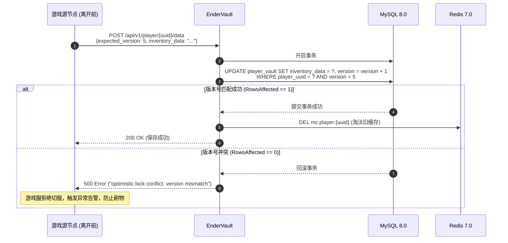
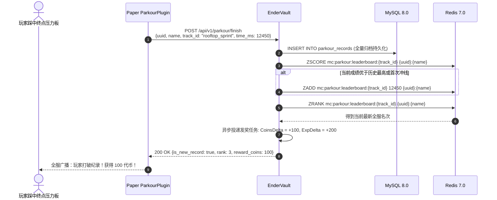
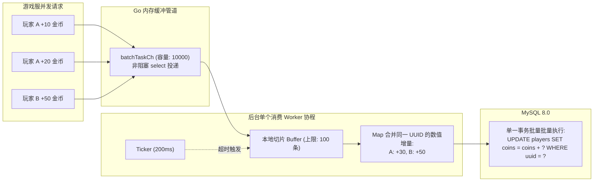
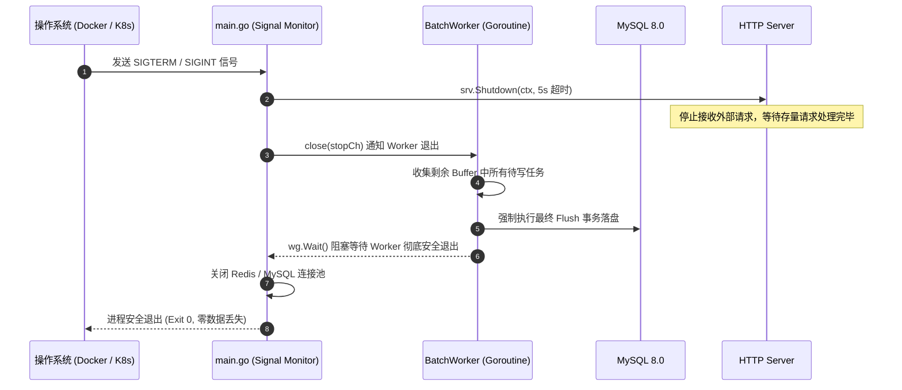

# EnderVault 架构设计说明书 (Architecture Design Specification)

> **文档标识**：`MC-DOC-VAULT-03`  
> **服务名称**：EnderVault (分布式数据代理微服务)  
> **所属系统**：Minecraft Cluster (mc-cluster)  
> **版本**：v1.0.0  
> **最后更新**：2026-10-18  

---

## 一、 系统总体架构与拓扑 (System Topology)

EnderVault 在 `mc-cluster` 云原生微服务网络中充当 **统一数据代理与状态同步枢纽**。



---

## 二、 内部四层分层架构 (Clean Architecture)

EnderVault 遵循经典的分层架构与控制反转原则，各层之间通过 Go `interface` 解耦：



1. **接入适配层 (`internal/handler`)**：
   - 负责 HTTP / gRPC 请求参数解析、入参校验（`binding:"required"`）、统一错误响应和 JSON 序列化。
2. **核心业务逻辑层 (`internal/service`)**：
   - 负责业务编排。维护 `singleflight.Group` 并发去重，协调 Redis 缓存与 MySQL 回源，管理 Channel 异步批量合并 Worker，组装分布式锁与跑酷发奖逻辑。
3. **数据仓储抽象层 (`internal/repository`)**：
   - 封装 GORM 事务、批量 SQL 构建、Redis 缓存 Key 拼装与 Lua 脚本执行。上层业务无须关心底层 SQL 拼装细节。
4. **领域模型与数据传输对象 (`internal/model`)**：
   - 定义数据库实体（`Player`, `PlayerVault`, `ParkourRecord`）与网络传输契约（DTO）。

---

## 三、 核心业务时序图 (Sequence Diagrams)

### 3.1 玩家登入与档案拉取流程 (Singleflight + Cache-Aside)



### 3.2 跨服切服/退服背包保存流程 (CAS 乐观锁防刷物)



### 3.3 跑酷冲线结算与实时排行榜刷新



---

## 四、 核心高并发与高可靠技术机制 (Core Mechanisms)

### 4.1 Singleflight 击穿防护与双重检查 (Double-Check)
当大量玩家在服务器重启后瞬间同时涌入，缓存全为空。如果没有任何防护，数千个协程会同时穿透至 MySQL 查询同一名热点玩家（或同屏所有玩家），造成数据库瞬时挂起。

EnderVault 的防护实现如下：
```go
v, err, _ := s.sfGroup.Do(fmt.Sprintf("get_player_%s", uuid), func() (interface{}, error) {
    // 1. 二次校验缓存 (Double Check)
    // 避免第 2~N 个等待排队的协程在获得锁后依然盲目查库
    if doubleCheck, _ := s.repo.GetPlayerCache(ctx, uuid); doubleCheck != nil {
        return doubleCheck, nil
    }
    // 2. 仅单协程回源 MySQL 并回填 Redis
    ...
})
```
* **效果**：将针对同一 Key 的瞬间 $N$ 个并发请求合并为 $1$ 次 MySQL 查询，其余协程共享该回源结果，数据库压力瞬间降低 $N$ 倍。

### 4.2 缓存雪崩与穿透防护
1. **防雪崩（Dynamic TTL Jitter）**：
   - 传统固定 TTL（如 10 分钟）会导致某一批次缓存同一时刻集体失效。
   - EnderVault 在回填缓存时增加 $0 \sim 120$ 秒的随机扰动：
     $$\text{TTL} = \text{BaseTTL} (10\text{m}) + \text{rand}(0, 120)\text{s}$$
   - 使缓存过期时间均匀平摊在时间轴上，消除毛刺峰值。
2. **防穿透（Cache Penetration）**：
   - 对非法 UUID 或不存在的玩家，系统应在 Redis 回填空对象标记（或极短 TTL 如 30s），防止黑客利用伪造 UUID 恶意轮询打爆数据库。

### 4.3 Channel 内存异步微批处理（Micro-batching）与写合并
游戏内高频的数值增减（如走动获得经验、小游戏金币跳动、跑酷通关）如果每次都执行一次完整的 MySQL 事务更新，数据库写 IOPS 将不堪重负。

EnderVault 采用了 **Producer-Consumer 内存微批处理架构**：



* **写合并（Write Coalescing）**：如果同一玩家在 200ms 内触发了多次金币变动，微批处理将它们在内存中累加为单次 SQL，极大减少行锁等待与 Redo Log 刷盘。
* **过载降级保护**：当缓冲管道满载时，通过 `select default` 优雅降级为同步写入，绝不盲目丢弃任务。

### 4.4 Redis + Lua 原子分布式互斥锁
分布式锁用于切服时资产独占保护。为了避免传统锁“超时后误删他人锁”的经典并发安全隐患，释放锁时必须采用 Lua 脚本进行校验：

```lua
-- KEYS[1]: lockKey (如 mc:lock:player:uuid)
-- ARGV[1]: token (持有者唯一标识)
if redis.call("get", KEYS[1]) == ARGV[1] then
    return redis.call("del", KEYS[1])
else
    return 0
end
```
* **原子性保证**：Redis 执行 Lua 脚本具备绝对单线程原子性，确保“校验 Token”与“执行 DEL”一气呵成，杜绝网络竞态。

---

## 五、 生命周期与优雅停机 (Graceful Shutdown)


