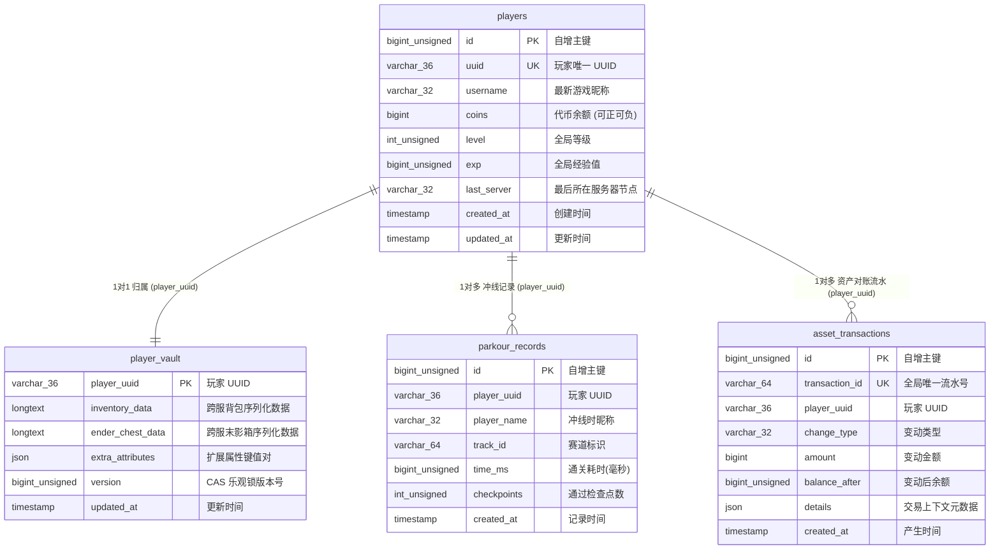
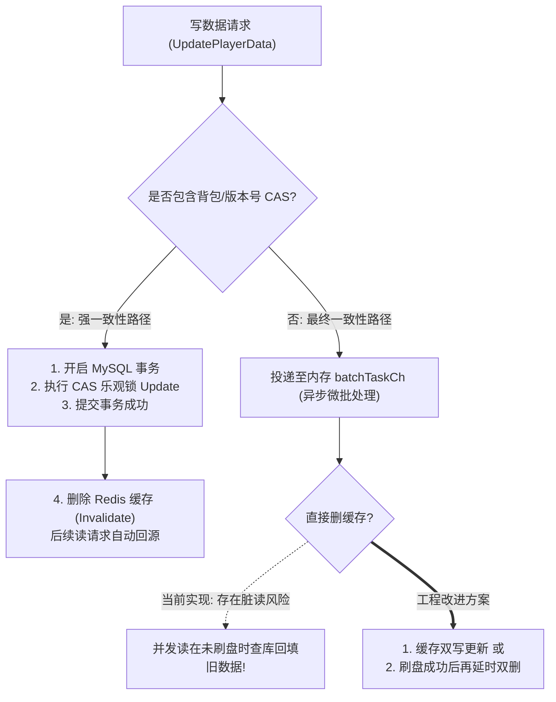

# EnderVault 数据模型与存储设计规范 (Data Models & Storage Specification)

> **文档标识**：`MC-DOC-VAULT-04`  
> **服务名称**：EnderVault (分布式数据代理微服务)  
> **所属系统**：Minecraft Cluster (mc-cluster)  
> **版本**：v1.0.0  
> **最后更新**：2026-10-18  

---

## 一、 关系型数据库 (MySQL 8.0) 实体与物理表设计

所有表均统一使用 **InnoDB** 引擎，默认字符集为 `utf8mb4`，排序规则为 `utf8mb4_unicode_ci`，以完整支持玩家特殊符号与 Emoji 昵称。



---

### 1.1 玩家全局基础档案表 (`players`)

```sql
CREATE TABLE IF NOT EXISTS `players` (
    `id` BIGINT UNSIGNED NOT NULL AUTO_INCREMENT COMMENT '自增物理主键',
    `uuid` VARCHAR(36) NOT NULL COMMENT '玩家 Mojang / 离线 128 位 UUID 字符串',
    `username` VARCHAR(32) NOT NULL COMMENT '最新玩家游戏名',
    `coins` BIGINT NOT NULL DEFAULT 0 COMMENT '代币/游戏币余额',
    `level` INT UNSIGNED NOT NULL DEFAULT 1 COMMENT '玩家全局等级',
    `exp` BIGINT UNSIGNED NOT NULL DEFAULT 0 COMMENT '玩家当前经验值',
    `last_server` VARCHAR(32) DEFAULT 'lobby' COMMENT '最后所在服务器节点名',
    `created_at` TIMESTAMP NOT NULL DEFAULT CURRENT_TIMESTAMP COMMENT '首次入服时间',
    `updated_at` TIMESTAMP NOT NULL DEFAULT CURRENT_TIMESTAMP ON UPDATE CURRENT_TIMESTAMP COMMENT '最后更新时间',
    PRIMARY KEY (`id`),
    UNIQUE KEY `uk_uuid` (`uuid`),
    KEY `idx_username` (`username`)
) ENGINE=InnoDB DEFAULT CHARSET=utf8mb4 COLLATE=utf8mb4_unicode_ci COMMENT='玩家全局核心数据表';
```

#### 索引与性能设计考量：
* **聚集索引（Clustered Index）**：选用 `id` 自增物理主键，保证 InnoDB B+ 树页分裂平稳，避免使用随机 UUID 作为主键导致的海量插入页分裂（Page Split）和聚簇索引碎片。
* **唯一二级索引 `uk_uuid`**：业务寻址全量基于 UUID。InnoDB 二级索引叶子节点存储主键 `id`，回表成本低。
* **普通二级索引 `idx_username`**：支持运营后台或管理指令按游戏昵称（Username）模糊或精准检索。

---

### 1.2 玩家跨服元数据与末影箱表 (`player_vault`)

```sql
CREATE TABLE IF NOT EXISTS `player_vault` (
    `player_uuid` VARCHAR(36) NOT NULL COMMENT '玩家 UUID (主键关联)',
    `inventory_data` LONGTEXT COMMENT '通用背包/道具数据序列化 (JSON/Base64/NBT)',
    `ender_chest_data` LONGTEXT COMMENT '全局跨服末影箱数据',
    `extra_attributes` JSON COMMENT '扩展元数据 (如称号、权限、特效等)',
    `version` BIGINT UNSIGNED NOT NULL DEFAULT 0 COMMENT 'CAS 乐观锁版本号',
    `updated_at` TIMESTAMP NOT NULL DEFAULT CURRENT_TIMESTAMP ON UPDATE CURRENT_TIMESTAMP COMMENT '更新时间',
    PRIMARY KEY (`player_uuid`)
) ENGINE=InnoDB DEFAULT CHARSET=utf8mb4 COLLATE=utf8mb4_unicode_ci COMMENT='玩家跨服存储与背包数据表';
```

#### 关键机制：CAS 乐观锁（Optimistic Locking）
跨服背包写回采用带有版本号条件的原子更新：
$$\text{UPDATE player\_vault SET inventory\_data = ?, version = version + 1 WHERE player\_uuid = ? AND version = ?}$$
* 当发生网络延迟导致源子服延迟保存，或者两台子服同时尝试提交玩家数据时，版本号不匹配的更新将直接影响行数为 0（`RowsAffected == 0`），触发事务回滚并阻止脏写。

---

### 1.3 跑酷赛道通关战绩表 (`parkour_records`)

```sql
CREATE TABLE IF NOT EXISTS `parkour_records` (
    `id` BIGINT UNSIGNED NOT NULL AUTO_INCREMENT COMMENT '自增主键',
    `player_uuid` VARCHAR(36) NOT NULL COMMENT '玩家 UUID',
    `player_name` VARCHAR(32) NOT NULL COMMENT '冲线时玩家名',
    `track_id` VARCHAR(64) NOT NULL DEFAULT 'rooftop_sprint' COMMENT '赛道标识符',
    `time_ms` BIGINT UNSIGNED NOT NULL COMMENT '通关耗时(毫秒)',
    `checkpoints` INT UNSIGNED NOT NULL DEFAULT 0 COMMENT '检查点数',
    `created_at` TIMESTAMP NOT NULL DEFAULT CURRENT_TIMESTAMP COMMENT '完成时间',
    PRIMARY KEY (`id`),
    KEY `idx_track_leaderboard` (`track_id`, `time_ms`),
    KEY `idx_player_history` (`player_uuid`, `created_at`)
) ENGINE=InnoDB DEFAULT CHARSET=utf8mb4 COLLATE=utf8mb4_unicode_ci COMMENT='跑酷赛道通关战绩归档表';
```

#### 联合索引设计与覆盖索引优化：
* **`idx_track_leaderboard (track_id, time_ms)`**：
  - 用于冷启动时从 MySQL 快速恢复排行榜。
  - 符合 **最左前缀原则**。查询 `WHERE track_id = 'rooftop_sprint' ORDER BY time_ms ASC LIMIT 10` 时，MySQL 直接沿着索引树顺序扫描，**彻底消除 Using filesort 排序开销**。
* **`idx_player_history (player_uuid, created_at)`**：
  - 支撑玩家在客户端查询个人历史通关记录分页。

---

### 1.4 资产流水对账表 (`asset_transactions` - 进阶对账设计)

```sql
CREATE TABLE IF NOT EXISTS `asset_transactions` (
    `id` BIGINT UNSIGNED NOT NULL AUTO_INCREMENT COMMENT '自增主键',
    `transaction_id` VARCHAR(64) NOT NULL COMMENT '全局唯一业务幂等流水号',
    `player_uuid` VARCHAR(36) NOT NULL COMMENT '玩家 UUID',
    `change_type` VARCHAR(32) NOT NULL COMMENT '变动类型 (PARKOUR_REWARD/SHOP_BUY/TRADE)',
    `amount` BIGINT NOT NULL COMMENT '变动金额 (正数增加，负数扣减)',
    `balance_after` BIGINT UNSIGNED NOT NULL COMMENT '变动后账户余额',
    `details` JSON DEFAULT NULL COMMENT '交易详情上下文 (如道具 ID、商品名称)',
    `created_at` TIMESTAMP NOT NULL DEFAULT CURRENT_TIMESTAMP COMMENT '流水时间',
    PRIMARY KEY (`id`),
    UNIQUE KEY `uk_tx_id` (`transaction_id`),
    KEY `idx_player_time` (`player_uuid`, `created_at`)
) ENGINE=InnoDB DEFAULT CHARSET=utf8mb4 COLLATE=utf8mb4_unicode_ci COMMENT='玩家资产变动对账流水表';
```

---

## 二、 Redis 缓存设计与键规范 (Key Schema)

EnderVault 在 Redis 中的 Key 均遵循统一的命名空间前缀 `mc:`，严格区分数据类型与生命周期：

| 键模式 (Key Pattern) | 数据类型 | TTL 过期策略 | 业务说明与数据结构 |
| :--- | :---: | :---: | :--- |
| `mc:player:{uuid}` | `String` (JSON) | 10分钟 + 随机抖动 (0~120s) | 存储 `PlayerFullData` 聚合实体缓存，读多写少，写操作后立即淘汰 |
| `mc:parkour:leaderboard:{track_id}` | `ZSet` (有序集合) | **永久常驻** | 实时竞速排行榜。<br/>**Score**：耗时毫秒数 `time_ms` (越小排越前)<br/>**Member**：`{uuid}:{player_name}` |
| `mc:lock:{resource_key}` | `String` | 5秒 (排他自动过期) | 分布式互斥锁。Value 为唯一生成的毫秒时间戳与随机令牌 Token |
| `mc:player:session:{uuid}` | `String` | 30秒 (心跳续租) | 记录玩家当前在线的游戏服节点名及认证 Token |

---

## 三、 数据一致性策略权衡 (Consistency Trade-Offs)



1. **强一致性数据（背包与资产）**：
   - 采用 **Cache-Aside 变种（写后失效）**。先更新 MySQL 事务并校验版本号，成功后再淘汰 Redis 缓存。后续读请求通过 Singleflight 单协程回源保证缓存重建安全。
2. **最终一致性数据（高频金币经验）**：
   - 采用 **Write-Behind（微批处理异步刷盘）**。在毫秒级时间窗口内合并数值，以牺牲极短时间的可见性换取 10 倍以上的吞吐提升。
