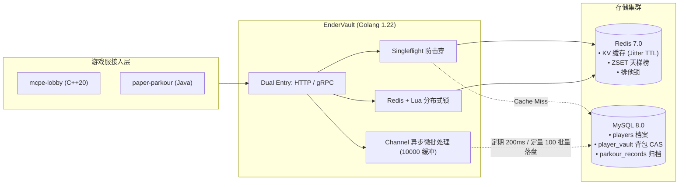

# EnderVault 分布式数据代理微服务设计规范与全景索引

> **所属项目**：Minecraft Cluster (mc-cluster)  
> **服务模块**：`services/ender-vault`  
> **语言框架**：Golang 1.22 + Gin + GORM + go-redis + gRPC  
> **最后修订**：2026-10-18  

---

## 📚 设计文档体系导航 (Documentation Index)

本项目为 `mc-cluster` 集群的核心数据存储与高并发代理服务，全套设计方案拆解如下：

| 序号 | 文档名称 | 核心主题与摘要 | 链接 |
| :---: | :--- | :--- | :---: |
| **01** | **需求分析说明书** | 业务背景、资产强一致性痛点、性能指标 (QPS/SLA)、功能与非功能需求 | [01_requirements_analysis.md](./01_requirements_analysis.md) |
| **02** | **技术选型说明书** | Go vs Java vs C++、gRPC vs REST、Redis 7.0 vs 本地缓存、MySQL 8.0 存储引擎与 ORM 权衡 | [02_technology_selection.md](./02_technology_selection.md) |
| **03** | **架构设计说明书** | 系统拓扑、四层分层架构、Singleflight、Channel 异步批处理、Redis+Lua 分布式锁、时序图 | [03_architecture_design.md](./03_architecture_design.md) |
| **04** | **数据模型与存储规范** | MySQL 物理建表、覆盖索引设计、Redis Key 规范、CAS 乐观锁与资产对账流水 | [04_data_models_and_storage.md](./04_data_models_and_storage.md) |
| **05** | **接口与契约规范** | RESTful HTTP API (Gin)、统一 JSON 错误码、gRPC Protobuf (`vault.proto`) 跨语言规范 | [05_api_specifications.md](./05_api_specifications.md) |
| **06** | **实战开发指南与 Sprint 计划** | 学习路线图、开源参考（HuskSync / LuckPerms / Singleflight）、Sprint 0~4 从零实现清单 | [sprint/README.md](./sprint/README.md) |

---

## ⚡ 架构全景速览 (Architecture at a Glance)



---

## 🛠️ 快速启动与本地调试

### 1. 独立本地调试
```bash
# 确保本地 MySQL (3306) 与 Redis (6379) 已启动
cd services/ender-vault

# 安装依赖
go mod download

# 本地执行运行
go run cmd/server/main.go
```

### 2. Docker Compose 集群模式一键编排
```bash
# 返回仓库根目录
docker compose up -d ender-vault
```

### 3. 健康检查探测
```bash
curl http://localhost:8080/health
```
