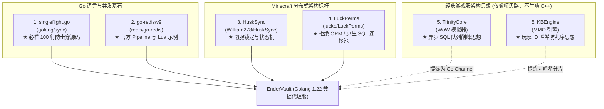
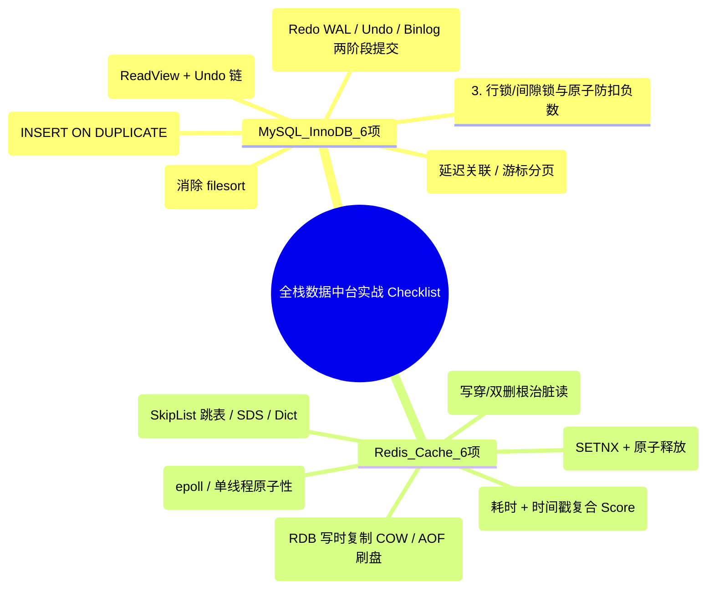

# EnderVault 开源参考标杆与面试实战 Checklist (Open Source References & Checklist)

> **文档标识**：`MC-DOC-VAULT-REF-00`  
> **所属模块**：`services/ender-vault`  
> **核心目标**：从优秀开源项目中精准“偷师”核心设计，摒弃冗余代码；结合工业级 Checklist 逐项通关 **Go 并发**、**MySQL 存储** 与 **Redis 缓存** 底层技术。

---

## 一、 为什么建议参考开源项目“从零手写”？

AI 直接生成的原型代码通常存在三大“毒瘤”：
1. **模式堆砌，缺乏工程温度**：一口气把反射 ORM、Goroutine Channel、Singleflight、分布式锁全部揉在一个包里，新手根本不知道“为什么这里要加锁”、“为什么数据会被冲掉”。
2. **伪实现与并发脏读陷阱**：例如代码里先停 Worker 再停 HTTP 服务的优雅关机 Bug，以及异步投递通道后立即删除缓存导致的 **10 分钟脏读漏洞**。
3. **黑盒化丧失掌控感**：自己没写过一行原生 SQL、没手动调试过一次 Redis 连接池，一旦出 Bug 就完全无从下手。

**最好的学习方式，是站在优秀的开源项目肩膀上，具体到文件与函数，提炼出核心思想，自己亲手敲出每一行干净的代码。**

---

## 二、 核心参考开源项目清单（具体到文件目录与核心代码）



---

### 1. Go 并发防击穿原语：`golang.org/x/sync/singleflight` (必读 100 行)
* **源码仓库**：`github.com/golang/sync`
* **必看具体文件**：[`singleflight/singleflight.go`](https://github.com/golang/sync/blob/master/singleflight/singleflight.go)
* **核心代码段索引**：
  * **结构体定义**：
    ```go
    type Group struct {
        mu sync.Mutex       // 保护底层映射表 m
        m  map[string]*call // 正在执行中的相同 key 的请求
    }
    type call struct {
        wg  sync.WaitGroup  // 用于挂起等待相同 key 的其他并发协程
        val interface{}
        err error
    }
    ```
  * **核心函数**：`func (g *Group) Do(key string, fn func() (interface{}, error))`
* **你只需要从中“偷师”什么？**
  - **看它如何用最干净的 Go 语言解决缓存击穿**：当 1000 个并发请求同时查询冷数据时，第一个协程抢先在 `g.m` 注册 `call` 并加锁执行 `fn()`；其余 999 个协程发现 `call` 已存在，便直接调用 `c.wg.Wait()` 优雅挂起；执行完毕后 `wg.Done()` 一次性唤醒所有协程共享结果。

---

### 2. 现代 Minecraft 跨服数据同步天花板：`HuskSync` (Java / Kotlin)
* **源码仓库**：`github.com/WiIIiam278/HuskSync`
* **必看具体目录与文件**：
  * **切服锁定状态机**：`common/src/main/java/net/william278/husksync/sync/DataSyncer.java`
  * **Redis 跨服锁与广播**：`common/src/main/java/net/william278/husksync/redis/RedisManager.java`
  * **快照历史与 MySQL 写入**：`common/src/main/java/net/william278/husksync/database/MySqlDatabase.java`
* **你只需要从中“偷师”什么？**
  - **切服锁定机制（Server Switching Lockout）**：
    当玩家踩入大厅传送门触发切服时，大厅服先将玩家状态标记为 `LOCKED` 并通知 Redis；玩家进入跑酷子服时，跑酷服会检测该锁，若锁未释放则禁止行动，直到大厅服确认 MySQL 事务落盘并发出广播后才解锁。**彻底从机制上消除了切服刷物品与脏读漏洞**。
  - **不可变快照（Data Snapshot）思想**：
    数据表设计不仅存当前数据，关键资产变更记录全量快照，支持精准回溯。

---

### 3. Minecraft 顶级存储抽象神作：`LuckPerms` (Java)
* **源码仓库**：`github.com/lucko/LuckPerms`
* **必看具体目录与文件**：
  * **原生 SQL 封装与执行器**：`common/src/main/java/me/lucko/luckperms/common/storage/implementation/sql/SqlStorage.java`
  * **高性能连接池调优**：`common/src/main/java/me/lucko/luckperms/common/storage/implementation/sql/connection/hikari/HikariConnectionFactory.java`
* **你只需要从中“偷师”什么？**
  - **拒绝重型 ORM 的黑盒反射**：作者 `lucko` 从不使用 Hibernate 或 MyBatis，全部采用手写预编译 SQL + 严谨的连接池参数。我们在 Go 里同样坚持用标准库 `database/sql` 或轻量 `sqlx` 手写 SQL。

---

### 4. Go 官方高性能 Redis 驱动：`go-redis/v9`
* **源码仓库**：`github.com/redis/go-redis`
* **必看具体文件**：
  * **官方推荐用法范式**：`example_test.go`
  * **连接池工作机制**：`internal/pool/pool.go`
* **你只需要从中“偷师”什么？**
  - **Pipeline 批量提交**：一次网络 RTT 打包执行多条命令，削减网络往返延迟。
  - **Lua 脚本原子执行**：`rdb.Eval(ctx, releaseLockLua, []string{lockKey}, token)` 的标准入参写法。
  - **原生原子更新排行榜**：`rdb.ZAddArgs(ctx, key, redis.ZAddArgs{LT: true, Members: ...})`。

---

### 5. C++ 经典游戏服思想（仅偷师思路，坚决不生啃 C++ 源码）
* **TrinityCore**（魔兽世界模拟器）：
  * **参考路径**：`src/server/database/Database/DatabaseWorkerPool.h` & `SQLOperation.h`
  * **偷师思路**：将写操作包装为 Task 对象丢入队列，后台单线程批量写入 MySQL。
  * **Go 语言降维打击实现**：在 Go 里不要写几千行 C++ 线程池，直接用 `batchCh := make(chan Task, 2000)` + `for task := range batchCh` 即可在 20 行内优雅实现。
* **KBEngine**（开源 MMO 引擎）：
  * **参考路径**：`kbe/src/server/dbmgr/buffered_dbtasks.h`
  * **偷师思路**：**单玩家顺序一致性**。按玩家 `UUID` 哈希分发到不同通道，防止同一个玩家的后发写操作比先发操作更早入库导致回档。

---

## 三、 100% 覆盖面试考点的“知识与实战清单” (Checklist)

把重写 `ender-vault` 的过程，当做逐项点亮以下 12 项技能树的过程。**只要这 12 个点全在代码中落地并能解释清楚，你在任何游戏服与后端面试中都将游刃有余。**



---

### 模块 A：MySQL 8.0 (InnoDB) 必会清单（6 项）

#### 1. 表结构与索引底层设计（B+ 树原理）
* **核心知识点**：聚簇索引（物理主键）与二级索引区别、回表查询、最左前缀匹配原则、覆盖索引（Covering Index）、索引下推（ICP）。
* **项目实操与代码落地**：
  - 跑酷战绩表建联合索引：`KEY idx_track_leaderboard (track_id, time_ms)`。
  - 使用 MySQL `EXPLAIN` 分析查询：
    ```sql
    EXPLAIN SELECT player_uuid, time_ms FROM parkour_records 
    WHERE track_id = 'rooftop_sprint' ORDER BY time_ms ASC LIMIT 10;
    ```
  - **验收指标**：`type` 为 `ref`，`Extra` 显示 `Using index`，彻底消除 `Using filesort` 临时表排序开销。

#### 2. 事务与并发控制（MVCC 与隔离级别）
* **核心知识点**：ACID 特性、四大隔离级别（默认可重复读 RR vs 读已提交 RC）、MVCC 底层的 `ReadView` 机制、`Undo Log` 版本链与回滚段。
* **项目实操与代码落地**：
  - 在玩家新服注册与购买道具时，使用显式事务 `tx, _ := db.BeginTx(ctx, nil)`。
  - 掌握 `tx.Commit()` 与在 `defer` 中捕获 panic 执行 `tx.Rollback()` 的标准写法。

#### 3. 锁机制与防扣成负数（并发安全核心）
* **核心知识点**：行锁（Record Lock）、间隙锁（Gap Lock 解决幻读）、临键锁（Next-Key Lock）、悲观锁 `FOR UPDATE` vs 乐观锁版本号。
* **项目实操与代码落地**：
  - **防超扣原子条件更新**（彻底杜绝先查后改的竞态）：
    ```sql
    UPDATE players 
    SET coins = coins + ? 
    WHERE uuid = ? AND (coins + ? >= 0);
    ```
  - 检查返回的 `RowsAffected`：若为 0 说明余额不足或用户不存在，拒绝交易。
  - 在 `player_vault` 表中使用 CAS 乐观锁：`UPDATE ... WHERE version = expected_version`。

#### 4. 三大核心日志与崩溃恢复（Crash-Safe 原理）
* **核心知识点**：
  - `Redo Log`（InnoDB 引擎层物理日志，WAL 预写机制，循环写，保证崩溃恢复能力）；
  - `Undo Log`（逻辑日志，保证原子性回滚与 MVCC 快照读）；
  - `Binlog`（Server 层归档逻辑日志，用于主从复制与点对点恢复）；
  - **两阶段提交（2PC）**：为什么需要两阶段提交？（保证 Redo Log 与 Binlog 的数据严格一致）。

#### 5. 高频写入性能优化与批量落盘
* **核心知识点**：单条 `INSERT` 为什么慢？（每次都是单独的网络 RTT、单独的事务提交与磁盘 fsync 刷盘）。
* **项目实操与代码落地**：
  - 在 Go 批处理 Worker 中实现批量 SQL：
    ```sql
    INSERT INTO players (uuid, username, coins) VALUES (?, ?, ?), (?, ?, ?)
    ON DUPLICATE KEY UPDATE coins = coins + VALUES(coins);
    ```
  - 压测对比：单条执行 1000 次耗时约 5~10 秒；单次批量执行 1000 条耗时 < 50ms。

#### 6. 深分页与慢查询调优
* **核心知识点**：为什么 `LIMIT 100000, 10` 极慢？（MySQL 必须扫描前 100010 条记录并抛弃前 100000 条）。
* **项目实操与代码落地**：
  - 改用基于游标的**“记住上一页最大 ID”**分页：
    ```sql
    SELECT * FROM parkour_records 
    WHERE id > ? ORDER BY id ASC LIMIT 10;
    ```
  - 利用主键索引直接精准定位，扫描行数恒定为 10。

---

### 模块 B：Redis 7.0 缓存与高并发必会清单（6 项）

#### 1. 核心数据结构与底层 C 语言实现
* **核心知识点**：
  - `String`：简单动态字符串（SDS，预分配空间，二进制安全，常数复杂度取长度）；
  - `Hash`：压缩列表 / Listpack 紧凑列表与 Dict 字典（渐进式 Rehash 避免主线程阻塞）；
  - `ZSet`：**跳跃表（SkipList）+ 哈希表**。
* **面试必杀技**：能够在白板上清晰画出 SkipList 的多层索引节点指针（Forward 指针与 Span 跨度计算），解释为什么 Redis 选跳表而不选红黑树（实现简单、区间范围查找效率高、并发调整成本低）。

#### 2. 跑酷排行榜同分时间序（公平性设计）
* **核心知识点**：Redis `ZSET` 的 Score 是 64 位浮点数（`float64`），同分默认按 Member 字典序排序，无法体现“谁先跑出来谁排名高”。
* **项目实操与代码落地**：
  - **复合分数拼装算法**：
    $$\text{Score} = \text{耗时毫秒} + (1 - \frac{\text{当前时间戳}}{10^{13}})$$
    或者整数部分存毫秒耗时，小数部分存逆序时间戳偏移。
  - 实现相同耗时下，率先达成纪录的玩家绝对排在前面。

#### 3. 线程模型与高吞吐奥秘
* **核心知识点**：
  - 为什么 Redis 核心命令执行是单线程还能突破 10 万+ QPS？（纯内存操作、避免多线程上下文切换与锁竞争、基于 Linux `epoll` 的 I/O 多路复用非阻塞网络模型）；
  - Redis 6.0 引入的多线程到底干了什么？（**仅用于网络 I/O 读写与协议解析，核心命令执行依然是单线程原子执行**）。

#### 4. 缓存三大灾难与双写一致性
* **核心知识点**：
  - **缓存穿透**：查询必定不存在的 Key $\to$ 写入空对象标记并设置 30s 短 TTL。
  - **缓存击穿**：超热点 Key 突然失效 $\to$ 用 `singleflight` 压制并发回源。
  - **缓存雪崩**：大批 Key 同一时间过期 $\to$ 基础 TTL (10m) + 随机抖动 Jitter (0~120s)。
* **项目实操：根除异步写合并的“10 分钟脏读 Bug”**：
  - **方案（写穿模式 Write-Through）**：向 Go 内存通道投递异步落盘任务的同时，**立即同步更新 Redis 缓存中的数值**！并发读请求到来时，从 Redis 读到的永远是最新数据，哪怕 MySQL 还在后台等待微批处理。

#### 5. Lua 脚本与分布式互斥锁
* **核心知识点**：
  - 加锁命令：`SET resource_key token NX EX 5`；
  - 为什么解锁必须用 Lua 脚本？（保证“比较 Token 是否属于自己”与“执行 DEL”之间的原子性，防止网络延迟导致释放了别人的锁）。
* **项目实操与代码落地**：
  ```lua
  if redis.call("get", KEYS[1]) == ARGV[1] then
      return redis.call("del", KEYS[1])
  else
      return 0
  end
  ```

#### 6. 持久化机制（RDB vs AOF）
* **核心知识点**：
  - **RDB（内存快照）**：基于操作系统的 `bgsave` 与 `fork` 子进程，利用 Linux 的 **Copy-On-Write（写时复制）** 机制实现在不阻塞主进程的前提下全量落盘。
  - **AOF（日志追加）**：命令先执行再写日志；三种刷盘策略（`always`, `everysec` 默认每秒, `no`）；AOF 重写（Rewrite）机制压缩日志体积。
