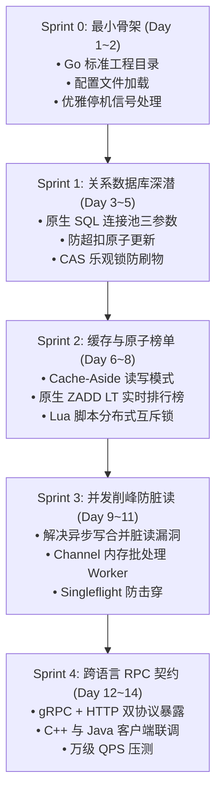

# EnderVault 从零实战开发指南与 Sprint 索引

> **所属模块**：`services/ender-vault`  
> **核心宗旨**：拒绝死记硬背 AI 生成的黑盒代码，参考成熟开源架构（HuskSync / LuckPerms / Groupcache），通过分步实战彻底攻克 **Go 高并发**、**MySQL 事务与索引**、**Redis 缓存与锁**。

---

## 📚 文档目录与演进指南

| 文档名称 | 核心主题 | 说明链接 |
| :--- | :--- | :---: |
| **00_open_source_references.md** | **开源项目深度拆解** | HuskSync 切服锁定机制、LuckPerms 存储抽象层、Singleflight 源码剖析 | [开源参考文档](./00_open_source_references.md) |
| **sprint_plan.md** | **分阶段实施路线图** | Sprint 0 到 Sprint 4 的详细任务清单、验收指标、避坑红线与验收标准 | [实战计划书](./sprint_plan.md) |

---

## 🧭 五个 Sprint 阶段速览

---

## 💡 新手“从零单排”避坑心法

1. **先不要用 GORM，用手写 SQL 入门**：
   - 先写清楚每一句 `SELECT ... WHERE uuid = ?` 和 `UPDATE ... SET coins = coins + ?`，看懂 MySQL 的返回结果与行锁行为，再去体会 ORM 的优缺点。
2. **写每一行并发代码时，问自己三个问题**：
   - 这里的 Channel 会不会满？
   - 容器被 `kill -9` 时这部分数据会不会丢？
   - 并发读的时候会不会刚好读到还没刷盘的旧数据？
3. **跑测试时必带 `-race` 参数**：
   - `go test -race ./...` 是 Go 语言提供给开发者的神级工具，能帮你在开发期就揪出所有的内存竞争隐患。
