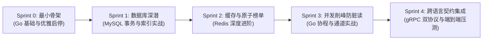

# EnderVault 从零开始实战 Sprint 计划书

> **文档标识**：`MC-DOC-VAULT-SPRINT-01`  
> **面向目标**：彻底告别“看不懂 AI 生成代码”的黑盒状态，参考成熟开源架构，通过 5 个渐进式 Sprint 亲手敲出高并发数据代理微服务，扎实掌握 **Golang**、**MySQL** 与 **Redis**。  
> **周期规划**：约 2 周（5 个 Sprint，循序渐进）

---

## 🗺️ 全局演化路线图 (Roadmap Overview)



---

## 🚀 Sprint 0: 拓荒与最小骨架（Go 基础与生命周期管理）

### 🎯 Sprint 目标
搭建最干净的 Go 工程骨架，不依赖任何重型框架，实现基础 HTTP 服务监听、配置加载与**真正的平滑优雅关机（Graceful Shutdown）**。

### 📚 核心学习点
1. **Go 基础与工程目录规范**：
   - 理解 Standard Go Project Layout：为什么入口要放在 `cmd/server/main.go`？为什么内部包必须放在 `internal/`？
   - 理解 Go Module 机制与依赖锁定（`go.mod` 与 `go.sum`）。
2. **生命周期与系统信号（Signals）**：
   - 掌握 `os/signal` 监听 `SIGINT` (Ctrl+C) 和 `SIGTERM` (Docker 停止信号)。
   - 掌握 `context.WithTimeout` 为资源回收分配确定性的时间窗口（如 5 秒超时）。
   - 掌握 `http.Server.Shutdown(ctx)` 的底层行为：停止接收新请求，等待存量请求处理完毕。

### 🔨 实践任务清单
- [ ] **Task 0.1**：清理现有复杂的 AI 业务代码，将原代码归档或备份，建立清晰的空目录结构：
  ```text
  services/ender-vault/
  ├── cmd/server/main.go        # 程序启动唯一入口
  ├── config/config.yaml        # 基础配置文件
  ├── internal/
  │   ├── config/config.go      # 配置映射结构体与加载逻辑
  │   ├── handler/              # HTTP 路由与控制器
  │   ├── service/              # 业务逻辑接口
  │   └── repository/           # 数据访问层接口
  └── go.mod
  ```
- [ ] **Task 0.2**：编写极简的配置加载模块，支持读取 `config.yaml` 并允许通过环境变量（`MYSQL_DSN`, `REDIS_ADDR`）动态覆盖。
- [ ] **Task 0.3**：编写极简的 `main.go`，挂载 `/health` 探针接口。
- [ ] **Task 0.4**：实现标准的优雅关机闭环，使用 `curl` 模拟慢请求并在终端发送 `Ctrl+C`，亲眼见证服务等待请求完成后安全退出。

### 🧪 验收标准
* 运行 `go run cmd/server/main.go` 成功在 `:8080` 启动服务。
* `curl http://localhost:8080/health` 返回 `{"status":"ok"}`。
* 按下 `Ctrl+C` 时，终端输出优雅关机日志，退出码为 `0`，没有产生 panic。

---

## 🗄️ Sprint 1: 关系数据库深潜（MySQL 8.0 事务、行锁与索引）

### 🎯 Sprint 目标
不使用任何“魔法”ORM，直接使用 Go 官方 `database/sql`（或精简的 `sqlx`），亲手建表、编写高效 SQL、实现玩家注册/查询与**防并发超扣的账户余额变更**。

### 📚 核心学习点
1. **连接池的核心三参数**：
   - `SetMaxOpenConns(100)`：最大并发打开连接数。
   - `SetMaxIdleConns(20)`：最大空闲连接数，避免高频握手创建 TCP 连接。
   - `SetConnMaxLifetime(5 * time.Minute)`：连接最大存活时间，防止 MySQL 8.0 默认 `wait_timeout`（8小时）关闭空闲连接导致的“坏连接（broken pipe）”。
2. **SQL 防注入与执行计划分析**：
   - 掌握 `stmt.Prepare` 与占位符 `?` 的预编译机制。
   - 运行 `EXPLAIN SELECT ...`，看懂 `type` 列（`const`, `ref`, `range`, `ALL`）与 `Extra` 列（`Using index`, `Using filesort`）。
3. **账户扣款并发安全（防扣成负数）**：
   - 理解为什么在并发下不能“先 SELECT 查余额，在 Go 里减完，再 UPDATE 写回”（典型的 Check-Then-Act 竞态）。
   - 学习**原子条件更新法**：
     ```sql
     UPDATE players 
     SET coins = coins + ? 
     WHERE uuid = ? AND (coins + ? >= 0);
     ```
   - 通过判断 `result.RowsAffected()` 是否为 1 来决定扣费是否成功，彻底规避负数资产！
4. **CAS 乐观锁版本控制**：
   - 在 `player_vault` 表中手写版本号更新：`WHERE player_uuid = ? AND version = ?`。

### 🔨 实践任务清单
- [ ] **Task 1.1**：在 MySQL 中执行初始化脚本，创建 `players`、`player_vault`、`parkour_records` 三张表。
- [ ] **Task 1.2**：编写 `repository/mysql_player.go`，实现底层数据库初始化与连接池参数调优。
- [ ] **Task 1.3**：手写 `GetPlayer(uuid)` 与 `CreatePlayerIfNotExist(uuid, name)`，利用事务保证档案表和背包表原子创建。
- [ ] **Task 1.4**：实现 `UpdateCoins(uuid, delta)` 原子扣款接口，并校验余额不足时的边界返回。
- [ ] **Task 1.5**：手写 CAS 背包保存接口，体验版本号冲突时返回 `409 Conflict`。

### 🧪 验收标准
* 编写单元测试 `mysql_player_test.go`，并发启动 20 个 Goroutine 对同一个只有 100 金币的玩家同时扣减 10 金币：
  - 结果必须是：恰好 10 次成功，10 次因余额不足失败，最终余额精确为 0，**绝对不能出现负数**。

---

## ⚡ Sprint 2: 内存缓存与原子竞速（Redis 7.0 高级实战）

### 🎯 Sprint 目标
掌握标准 Cache-Aside 缓存读写模式，攻克缓存穿透与雪崩；利用 Redis 原生 `ZSET` 打造零延迟的跑酷排行榜，并手写带 Token 校验的 Lua 分布式锁。

### 📚 核心学习点
1. **Cache-Aside 经典读写模式**：
   - 读流程：查 Redis $\to$ 命中直接返回 $\to$ 未命中查 MySQL $\to$ 回填 Redis。
   - 防穿透：数据库不存在的空值，以短 TTL（如 30 秒）写入空标记，防止被黑客恶意遍历打穿数据库。
   - 防雪崩：回填 TTL 加上随机扰动值（Jitter），防止缓存集体同时过期。
2. **Redis 7.0 ZSet 实时排行榜原语**：
   - 学习 `ZADD key [NX|XX] [GT|LT] score member`：
     - 使用 `LT`（Less Than）选项：**仅当通关耗时比历史成绩更短时才更新**，一行原子命令替代原本低效的“先查后改”！
   - 使用 `ZRANK key member`（升序排名，耗时越短名次越靠前，第 0 名为冠军）。
   - 解决同分排序公平性：如果两人耗时相同，怎样让先达成的人排在前面？（设计复合分数值）。
3. **分布式锁与 Lua 原子脚本**：
   - 加锁：`rdb.SetNX(ctx, "lock:player:"+uuid, token, 5*time.Second)`。
   - 释放锁：手写 Lua 脚本，只有当 Value 等于调用者持有的 Token 时才执行 `DEL`，理解为什么不用客户端 `GET + DEL`。

### 🔨 实践任务清单
- [ ] **Task 2.1**：集成 `github.com/redis/go-redis/v9`，建立 Redis 连接池。
- [ ] **Task 2.2**：实现 `PlayerCache` 读写封装，落实 Cache-Aside、防穿透空对象缓存与 TTL 随机抖动。
- [ ] **Task 2.3**：重构跑酷排行榜 `LeaderboardRepo`：
  - 将 ZSet 的 Member 调整为唯一的 `uuid`（避免改名导致榜单数据分裂）；
  - 将昵称等明细放入 Redis Hash（`player:profile:{uuid}`）或 MySQL；
  - 使用原生 `ZAddArgs{LT: true}` 实现毫秒级成绩刷新；
  - 增加 `GetTopN(trackId, limit)` 接口，返回包含真实名次的排名列表。
- [ ] **Task 2.4**：实现带 Token 校验的 Redis 分布式互斥锁，并在 Handler 中挂载 `/lock/acquire` 和 `/lock/release`。

### 🧪 验收标准
* 上报成绩 15000ms，再次上报 18000ms，排行榜分数依然保持 15000ms（验证 `LT` 过滤生效）。
* 查询排行榜，第 1 名的 `rank` 精确为 1，第 2 名为 2（彻底终结原本硬编码返回 1 的 Bug）。
* 实例 A 申请了锁，实例 B 传入错误的 Token 尝试释放，返回 `false` 且锁未被删除。

---

## 🌪️ Sprint 3: 并发削峰与并发安全（Go 协程与通道实战）

### 🎯 Sprint 目标
彻底搞懂 Go 核心并发组件（Goroutine、Channel、Singleflight、WaitGroup）；**根治 AI 代码中“异步批处理导致缓存脏读”的致命 Bug**；打造抗压万级并发的写合并 Worker。

### 📚 核心学习点
1. **Singleflight 并发去重原理**：
   - 彻底读懂 `singleflight.Group` 源码。
   - 理解它如何将瞬间 1000 个相同 UUID 的冷数据读请求，折叠合并为只有 1 个去查 MySQL，其余 999 个共享结果返回。
2. **根治“异步写合并导致缓存脏读”的架构方案**：
   - **痛点复盘**：任务投递给 Channel 后，数据库还没更新，此时如果直接删除缓存，并发读会查出 MySQL 旧数据重新填入 Redis，导致 10 分钟脏读！
   - **解决方案选择**：
     - **方案（双写缓存/写穿）**：向 Channel 投递异步任务的同时，利用 Redis 原生命令（如 `HINCRBY` 或更新缓存实体）**立即同步更新 Redis 缓存中的数值**！这样并发读进来看见的永远是最新的数值，哪怕 MySQL 要等 200ms 后才落盘。
3. **基于 Channel 的生产-消费微批处理模型**：
   - 缓冲队列满载保护：使用 `select default` 防止通道阻塞住 HTTP 请求线程。
   - 批量合并算法（Write Coalescing）：在内存切片中合并同一玩家的增量，将 100 次 `UPDATE` 汇聚成单次批量事务。
   - 优雅关机生命周期顺序：**必须先关闭 HTTP 入口，再通知 Worker 刷空通道，最后退出进程**。

### 🔨 实践任务清单
- [ ] **Task 3.1**：在 `service/player_service.go` 中引入 `singleflight.Group`，包裹 Cache Miss 时的回源逻辑。
- [ ] **Task 3.2**：编写高可靠的 `BatchWriter`：
  - 定义内部缓冲通道与 `time.Ticker`；
  - 实现任务聚合合并逻辑（将同一 UUID 的代币增量在 Go 内存中相加）；
  - 实现安全的 Flush 事务批量提交；
  - 修复优雅关机的时序，确保停机时缓冲区内未落盘数据 100% 刷入 MySQL。
- [ ] **Task 3.3**：实现写穿/双写机制，根除并发读脏数据的时序漏洞。
- [ ] **Task 3.4**：编写并发基准测试（Benchmark），对比开启与关闭批处理时 MySQL 的 QPS 和连接数表现。

### 🧪 验收标准
* 运行 `go test -race ./...`（开启数据竞态检测），测试全部通过，**无任何 DATA RACE 告警**。
* 编写自动化测试脚本，并发 500 个写请求 + 500 个读请求同时发起，验证读出来的数据单调递增，**绝无旧数据回退或脏读**。

---

## 🌐 Sprint 4: 跨语言 RPC 契约与集群端到端集成（gRPC 双协议与压测）

### 🎯 Sprint 目标
兑现 `api/proto/vault.proto` 契约，让服务同时监听 HTTP（端口 8080）与 gRPC（端口 9090）；与 Java 跑酷服插件和 C++ 大厅服完整打通，完成集群压测。

### 📚 核心学习点
1. **gRPC 与 Protocol Buffers 机制**：
   - 掌握 `protoc` 编译器与 `protoc-gen-go` / `protoc-gen-go-grpc` 插件。
   - 理解 HTTP/2 多路复用对游戏大厅高频调用的性能红利。
2. **Go 单进程监听多服务端口**：
   - 在同一个 `main.go` 中利用两个独立 Goroutine 分别启动 Gin HTTP Server 与 gRPC Server。
   - 统一由外层 `signal.Notify` 和 `sync.WaitGroup` 管理两个服务的优雅停机。
3. **端到端集成与基准压测**：
   - 调试 Java Bukkit 插件（`ParkourPlugin.java`）与 EnderVault 的联调连通性。
   - 使用压测工具进行打流测试，观察 CPU、内存与协程数表现。

### 🔨 实践任务清单
- [ ] **Task 4.1**：根据根目录 `api/proto/vault.proto` 生成 Go 代码存放在 `pkg/proto/v1`。
- [ ] **Task 4.2**：编写 `internal/handler/grpc_server.go`，实现 `EnderVaultServiceServer` 接口。
- [ ] **Task 4.3**：调整 `main.go`，同时启动 `:8080` (HTTP) 和 `:9090` (gRPC) 监听。
- [ ] **Task 4.4**：在 Docker Compose 环境中启动全套集群（MySQL + Redis + EnderVault + mcpe-lobby + Paper-Parkour），实地在跑酷服通关，观察排行榜实时刷新与金币同步。
- [ ] **Task 4.5**：编写压测脚本（Python 或 Go），进行 10,000 QPS 持续打流测试，记录 P99 延迟与稳定性。

### 🧪 验收标准
* 使用 `grpcurl` 工具测试 gRPC 接口，正确返回玩家数据与排行榜响应。
* 集群环境下，玩家在跑酷服冲线后，金币增加 100，排行榜刷新，且能在客户端聊天栏看到广播。
* 压测下单机 QPS 突破 10,000，P99 延迟 $\le 5\text{ms}$，服务无崩溃、无内存泄漏。
