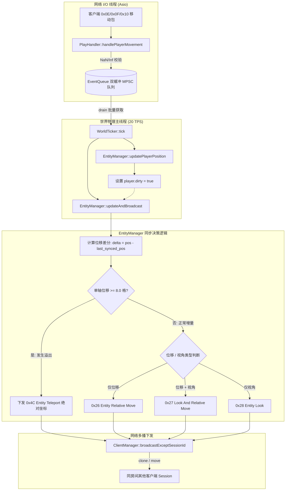
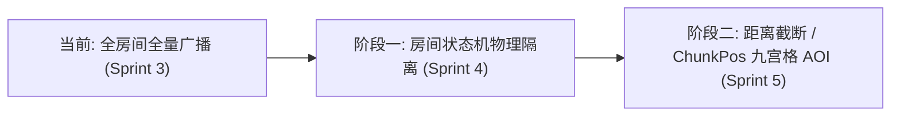

# MCPE 项目当前 AOI (Area of Interest) 算法实现与架构深度分析

> **文档标识**：`MCPE-DOC-ARCH-AOI`  
> **关联代码版本**：Sprint 3 (Protocol 340 / Minecraft 1.12.2)  
> **核心模块**：`EntityManager`、`WorldTicker`、`ClientManager`、`SpatialTypes`

---

## 一、 执行摘要 (Executive Summary)

针对当前代码库的全面审计分析，**当前系统的“AOI（Area of Interest，兴趣范围）”机制本质上为：全域/房间级无裁剪广播模型（Full-Room Broadcast / Flat Implicit AOI）**，辅以 **$1/4096$ 方块定点数差分增量位移压缩（Delta Move Compression）** 与 **$8.0$ 格物理临界溢出降级瞬移保护（Teleport Fallback）**。

目前尚未引入传统大型 MMORPG 或无边界生存服中的“动态九宫格空间索引（Chunk Grid AOI）”或“十字链表法（Cross-List）”。这是与项目在 [`AGENTS.md`](../../AGENTS.md) 中确立的**“轻量级集群大厅与多地图跑酷微服务引擎（Lobby & Parkour Microservice Engine）”**核心定位相匹配的阶段性设计权衡。

---

## 二、 核心源码分布与定位 (Source Locations)

AOI 与实体同屏可见性涉及架构四层中的**基础层（Foundations）**、**网络层（Network）**、**协议层（Protocol）**与**领域层（Domain/World）**。具体代码分布如下：

| 模块分层 | 源码文件 | 核心职责与 AOI 关联 |
| :--- | :--- | :--- |
| **Domain (领域层)** | [`src/world/EntityManager.h`](../../src/world/EntityManager.h)<br>[`src/world/EntityManager.cc`](../../src/world/EntityManager.cc) | **【核心所在】** 维护玩家实体状态表、同屏生成/销毁时序编排、单 Tick 脏标记扫描、增量差分数学运算与 $8.0$ 格降级判定 |
| **Domain (物理调度)** | [`src/world/WorldTicker.h`](../../src/world/WorldTicker.h)<br>[`src/world/WorldTicker.cc`](../../src/world/WorldTicker.cc) | 20 TPS 物理帧主循环，批量消费跨线程事件并驱动 `EntityManager::updateAndBroadcast()` |
| **Foundations (基础层)** | [`src/common/SpatialTypes.h`](../../src/common/SpatialTypes.h) | 提供 `Vector3d`（连续空间物理向量）、`Rotation`（朝向与 1 字节 Angle 转换）、`ChunkPos`（带哈希特化）与 `BlockPos` 原语 |
| **Foundations (并发队列)** | [`src/world/EventQueue.h`](../../src/world/EventQueue.h) | MPSC 双缓冲跨线程任务队列，网络 I/O 线程将客户端位移包与进出服事件低锁推入逻辑主线程 |
| **Protocol (协议层)** | [`src/protocol/PlayHandler.cc`](../../src/protocol/PlayHandler.cc) | 反序列化客户端上行的移动包族（`0x0E`/`0x0F`/`0x10`），执行有限数（NaN/Inf）安全检查，并组装投递 `PlayerMoveEvent` |
| **Protocol (连接管理)** | [`src/protocol/ClientManager.h`](../../src/protocol/ClientManager.h)<br>[`src/protocol/ClientManager.cc`](../../src/protocol/ClientManager.cc) | 管理全局在线会话，执行 `broadcastExceptSessionId()`，并利用 `ByteBuffer` 的 COW/Move 实现低拷贝多播 |

---

## 三、 当前算法实现架构与核心机制

当前实体的生命周期管理与可见性同步分为四个核心阶段，整体数据流向如下图所示：



### 1. 实体生命周期与全域可见性编排 (`addPlayer` / `removePlayer`)

在 [`EntityManager.cc`](../../src/world/EntityManager.cc) 中，玩家实体维护于哈希表：
```cpp
std::unordered_map<uint64_t, PlayerEntity> players_;
```

#### ① 新玩家进服（双向同屏广播）
Minecraft 官方客户端（Notchian Client）有一项严格的时序约束：**在客户端渲染并生成玩家实体模型之前，该玩家的 UUID 与名字必须已经存在于 Tab 列表中（`Player List Item 0x2E`）。如果先发 `0x05` 或未下发 `0x2E`，客户端将发生模型隐形（“隐形人” bug）。**

当前实现的进服时序为：
1. 构建新玩家的 `0x2E PlayerListItem (Action = AddPlayer)` 与 `0x05 SpawnPlayer` 数据包；
2. **遍历已有玩家列表**：
   - 向所有既有玩家下发新玩家的 `0x2E` 与 `0x05`；
   - 同时向新玩家单播每一个既有玩家的 `0x2E` 与 `0x05`；
3. 向新玩家单播其自身的 `0x2E`，确保新玩家在自身的 Tab 列表中正常显示；
4. 将新玩家插入 `players_`。

#### ② 玩家离开世界（模型销毁与 Tab 移除）
当收到玩家断开连接事件时：
1. 构造 `0x32 Destroy Entities` 携带该玩家的 `entity_id`；
2. 构造 `0x2E PlayerListItem (Action = RemovePlayer)`；
3. 调用 `broadcast_except_(session_id, ...)` 排除离开玩家自身，向全服其余在线玩家广播；
4. 从 `players_` 中剔除。

---

### 2. 20 TPS 帧驱动增量差分同步算法 (`updateAndBroadcast`)

在每个 50ms 物理 Tick 结束时，[`EntityManager::updateAndBroadcast()`](../../src/world/EntityManager.cc) 遍历玩家集合：

#### ① 脏标记检测（Dirty Checking）
```cpp
if (!p.dirty) {
  continue;
}
```
只有当客户端在本 Tick 内上报了移动包时才参与计算。

#### ② $1/4096$ 方块定点数数学编码
Minecraft 1.12.2（Protocol 340）协议为了压缩带宽，将增量位移编码为 16 位有符号大端整型（`int16_t`，单位为 $\frac{1}{4096}$ 方块）：
$$\text{dx} = \text{round}(\Delta x \times 4096.0)$$
$$\text{dy} = \text{round}(\Delta y \times 4096.0)$$
$$\text{dz} = \text{round}(\Delta z \times 4096.0)$$

#### ③ $8.0$ 格临界溢出防反向抽搐降级保护
`int16_t` 的最大正数表示范围为 $32767$：
$$\frac{32767}{4096} \approx 7.999756 \text{ 格}$$
**若单轴位移绝对值超过 $8.0$ 格（例如玩家剧烈跳跃、下落、踩弹簧垫或触发瞬移），数值将发生严重符号反转溢出（变为负值），客户端屏幕上表现为人物瞬间反向倒退飞跃数十格而后抽搐**。

代码中设置了防御性临界分支：
```cpp
const bool overflow =
    (std::abs(delta.x) >= 8.0 || std::abs(delta.y) >= 8.0 || std::abs(delta.z) >= 8.0);

if (overflow) {
  pkt = buildEntityTeleportPacket(p); // 降级下发 0x4C 绝对坐标
} else if (move_changed && look_changed) {
  pkt = buildLookAndRelMovePacket(p.entity_id, delta, p.rotation, p.on_ground); // 0x27
} else if (move_changed) {
  pkt = buildRelMovePacket(p.entity_id, delta, p.on_ground); // 0x26
} else {
  pkt = buildEntityLookPacket(p.entity_id, p.rotation, p.on_ground); // 0x28
}
```

---

### 3. 多播管道零拷贝与 COW 优化

在 [`ClientManager::broadcastExceptSessionId`](../../src/protocol/ClientManager.cc) 中：
```cpp
for (size_t i = 0; i < targets.size(); ++i) {
  if (i + 1 == targets.size()) {
    targets[i]->sendPacket(std::move(packet)); // 最后一个目标直接移动，消灭拷贝
  } else {
    targets[i]->sendPacket(packet.clone());     // 基于 ByteBuffer COW 浅拷贝
  }
}
```
利用底层 [`ByteBuffer`](../../src/common/ByteBuffer.h) 的引用计数与 Copy-On-Write 机制，多个接收者的发送管道共享底层同一块物理内存切片，避免了重复序列化与深拷贝开销。

---

## 四、 架构权衡与设计背景分析

### 1. 为什么当前没有实现“九宫格 / 十字链表”？
在项目初期规划中，曾考虑过 3x3 九宫格方案（见早期文档引用）。但随着项目定位确立，当前设计具有充分的工程合理性：
1. **产品形态剪裁**：本项目定位为**轻量级大厅与跑酷微服务**（冷启动 $\le 50\text{ms}$，内存 $\le 30\text{MB}$），不承载无限生存地图。
2. **世界几何尺寸极小**：
   - 默认大厅仅为 $5 \times 5$ 区块（$80 \times 80$ 格）；
   - 跑酷地图均为单张悬空跑道 Schematic（通常 $30 \sim 100$ 格长宽）；
   - 原版客户端在 1.12.2 下默认视距通常为 $8 \sim 12$ 区块（$128 \sim 192$ 格半径）。
3. **空间重叠度 $100\%$**：在几十方块大小的紧凑大厅内，所有玩家在物理距离上全部互相处于视距内。如果在此时强行套用九宫格空间索引，**不仅无法过滤掉任何广播包，反而会额外引入每个 Tick 维护实体网格映射、跨网格链表移动的 CPU 局部性开销和内存占用**。

### 2. 优点 (Strengths)
* **代码纯粹度极高**：无冗余空间树维护逻辑，[`EntityManager`](../../src/world/EntityManager.h) 单一职责，聚焦实体状态与协议格式；
* **单线程物理驱动**：所有实体坐标读写严格收敛在 `WorldTicker` 单线程内，零加锁并发冲突；
* **协议稳健性**：双向 0x2E/0x05 注册时序、8.0 格定点数保护经过了严格单元测试（见 [`tests/test_sprint3.cc`](../../tests/test_sprint3.cc)）与集成测试闭环。

---

## 五、 性能瓶颈与复杂度评估 (Complexity & Scalability)

| 场景指标 | 当前算法表现 | 理论复杂度 | 临界负载评估 |
| :--- | :--- | :--- | :--- |
| **单玩家移动广播** | 遍历所有其他在线玩家并发送 | $O(N)$ | 在线 $N \le 100$ 时无压力 |
| **单 Tick 全服移动广播** | $M$ 个脏标记玩家各自向其余 $N$ 人广播 | $O(M \cdot N)$ 最坏 $O(N^2)$ | 若 500 个压测 Bot 同时高速移动，将产生 $500 \times 499 \approx 250,000$ 次网络投递/秒，引发 CPU 与带宽风暴 |
| **空间内存占用** | 仅 `std::unordered_map<uint64_t, PlayerEntity>` | $O(N)$ 极低 | 100 玩家内存开销 $< 20\text{KB}$ |

---

## 六、 未来演进方案路线图 (Evolution Roadmap)

根据 [`doc/TODO.md`](../TODO.md) 与规划，AOI 系统的演进将分为两个渐进阶段：



### 方案 1：Sprint 4 房间状态机空间隔离（Room-level AOI）
* **设计目标**：将当前单一全局的 `EntityManager` 降级为每个房间实例的内部组件，由 `RoomManager` 调度；
* **隔离效果**：
  - `LobbyRoom`（大厅）与各个 `ParkourRoom`（跑酷房间）拥有独立的 `EntityManager` 实例；
  - 跑酷玩家之间、跑酷玩家与大厅玩家之间彻底物理隔离，广播复杂度自动缩减至 $O(N_{room}^2)$，天然消除跨玩法无效广播。

### 方案 2：基于 `ChunkPos` 哈希特化的九宫格空间索引（Grid-based AOI）
若在 Sprint 5 中单大厅需要承受 500~1000 并发压测 Bot，可按如下方案引入九宫格空间索引：
1. **数据结构**：
   在 `EntityManager` 中引入空间桶（Spatial Bucket）：
   ```cpp
   std::unordered_map<ChunkPos, std::vector<uint64_t>> chunk_entities_;
   std::unordered_map<uint64_t, ChunkPos> entity_chunk_pos_;
   ```
   直接复用 [`SpatialTypes.h`](../../src/common/SpatialTypes.h) 中已实现的带有素数雪崩抗冲突特化的 `std::hash<ChunkPos>`。
2. **移动跨区块边界判定**：
   - 每次玩家坐标变化时计算 `new_chunk = pos.toBlockPos().toChunkPos()`；
   - 若 `new_chunk != old_chunk`，计算以 `old_chunk` 与 `new_chunk` 为中心的 $3 \times 3$ 九宫格差集：
     - **进入集合（Enter）**：新九宫格独有的玩家，向双方互发 `0x05 SpawnPlayer` 与 `0x2E`；
     - **离开集合（Leave）**：旧九宫格遗留的玩家，向双方互发 `0x32 DestroyEntities` 与 `0x2E`。
3. **位移广播裁剪**：
   - 仅向该玩家当前所在 `ChunkPos` 周围九宫格内的会话发送 `0x26/0x27/0x28`，将广播开销由 $O(N^2)$ 彻底压降至局部常数 $O(1)$。
