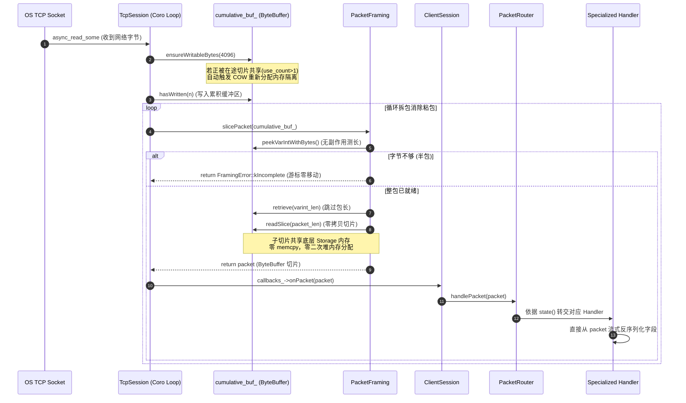
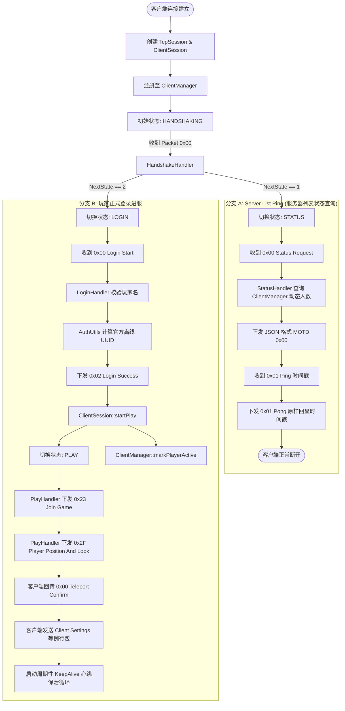
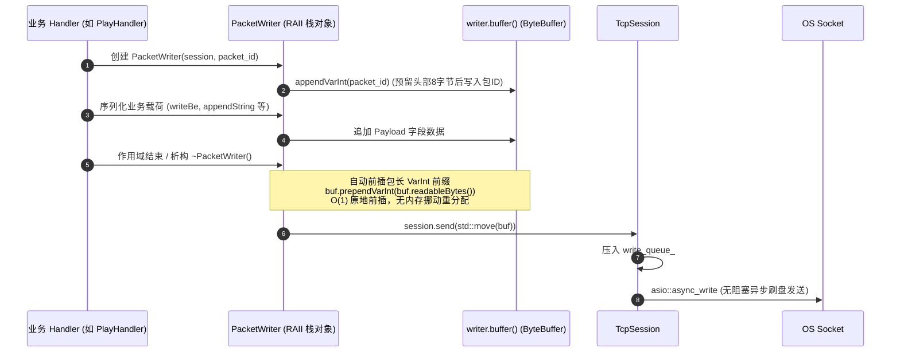
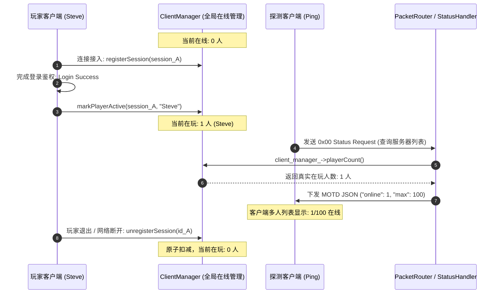

# MCPE 重构后架构全景、类职责清单与数据流转总览 (Architecture & Data Flow Summary)

> **文档定位**：系统性总结 Sprint 1/2 架构深度重构与 Netty 零拷贝升级后的工程拓扑、模块职责划分与全链路数据流转。  
> **对标标杆**：工业级 Minecraft 服务端 Cuberite (`cProtocol`, `cClientHandle`, `cServer`, `cByteBuffer`)。

---

## 一、系统整体架构全景 (System Architecture Overview)

系统严格恪守**四层单向依赖架构**（Foundations $\to$ Network $\to$ Protocol $\to$ Domain），底层完全不知晓上层业务，各层通过清晰的抽象接口与所有权模型进行协作：

```
┌────────────────────────────────────────────────────────────────────────┐
│                        4. Domain (领域与世界层)                        │
│          World / Chunk / Entity / Inventory  [Sprint 3+ 重点演进]       │
└───────────────────────────────────▲────────────────────────────────────┘
                                    │ (事件分发 / 状态变更)
┌───────────────────────────────────┴────────────────────────────────────┐
│                       3. Protocol (协议与会话层)                        │
│ ┌────────────────────────────────────────────────────────────────────┐ │
│ │  ClientManager (全局在线会话注册中心、动态在线统计、广播与踢人)     │ │
│ ├────────────────────────────────────────────────────────────────────┤ │
│ │  ClientSession (会话生命周期、状态机驱动、心跳保活、startPlay)     │ │
│ ├────────────────────────────────────────────────────────────────────┤ │
│ │  PacketRouter (对标 cProtocol, 协议路由分发、动态在线 MOTD)        │ │
│ ├────────────────────────────────────────────────────────────────────┤ │
│ │  各状态 Handler (HandshakeHandler, StatusHandler, Login, Play)     │ │
│ ├────────────────────────────────────────────────────────────────────┤ │
│ │  PacketWriter (RAII 自动 VarInt 包长前插与出站封包)                │ │
│ └────────────────────────────────────────────────────────────────────┘ │
└───────────────────────────────────▲────────────────────────────────────┘
                                    │ (SessionCallbacks: onPacket / onDisconnect)
┌───────────────────────────────────┴────────────────────────────────────┐
│                       2. Network (网络传输层)                          │
│ ┌────────────────────────────────────────────────────────────────────┐ │
│ │  TcpServer (Asio 异步监听、非阻塞连接接入、Session 生命周期管理)   │ │
│ ├────────────────────────────────────────────────────────────────────┤ │
│ │  TcpSession (单连接异步 I/O 协程、双工读写、发送缓冲队列)           │ │
│ ├────────────────────────────────────────────────────────────────────┤ │
│ │  PacketFraming (无状态流式定界拆包器、2MB 边界防御、readSlice 切包) │ │
│ └────────────────────────────────────────────────────────────────────┘ │
└───────────────────────────────────▲────────────────────────────────────┘
                                    │ (读写内存切片 / 引用计数)
┌───────────────────────────────────┴────────────────────────────────────┐
│                     1. Foundations (底层基础库)                        │
│  ByteBuffer (Netty 零拷贝切片、COW 写时复制防护、泛型大端读写)         │
│  VarInt (纯算术位运算编解码、无副作用试探解析、零魔数)                 │
└────────────────────────────────────────────────────────────────────────┘
```

---

## 二、各个类的职责清单 (Class Responsibilities Matrix)

### 1. 底层基础库 (`src/common/`)

| 类名 | 核心职责与设计契约 | 对标 Cuberite 组件 | 关键机制与亮点 |
| :--- | :--- | :--- | :--- |
| **`ByteBuffer`** | 统一字节缓冲区，负责所有网络 I/O 字节流的暂存、切片与基础数据类型大端序列化/反序列化。 | `cByteBuffer` | **Netty 零拷贝切片与 COW 防护**：通过 `std::shared_ptr<Storage>` 共享物理内存；`readSlice()` 切片零拷贝；检测到共享时触发写时复制，根除野指针。 |
| **`VarInt`** | Minecraft 协议专用可变长整型（VarInt/VarLong）的无状态独立编解码器。 | `cByteBuffer` 内嵌位操作 | 纯算术位移，无魔数常量（`kContinuationBit`），提供 `decodeVarInt(const char*, size_t)` 供拆包无副作用探测。 |

### 2. 网络传输层 (`src/network/`)

| 类名 | 核心职责与设计契约 | 对标 Cuberite 组件 | 关键机制与亮点 |
| :--- | :--- | :--- | :--- |
| **`TcpServer`** | 管理 TCP 监听套接字（`acceptor_`），负责非阻塞异步接收客户端连接，并绑定生命周期。 | `cServer` / `cNetwork` | 纯网络层抽象，完全不感知 Minecraft 协议。接受连接后创建 `TcpSession` 并注册至 `ClientManager`。 |
| **`TcpSession`** | 单个 TCP 连接的全双工异步通信管理器。管理网络协程、累积接收缓冲区与出站写队列。 | `cSocket` / `cConnection` | 纯网络传输，**严禁包含 Packet ID 或业务逻辑**。通过 `SessionCallbacks` 纯虚接口与上层协议层解耦。 |
| **`PacketFraming`** | Minecraft 变长 VarInt 长度前缀的流式定界拆包器。负责粘包合并与半包探测。 | `cProtocol::ReadPacket` | **无状态纯函数**。2MB 长度防御抗攻击；半包零副作用；成功时直接调用 `recv_buf.readSlice(...)` 实现真正的零拷贝分包。 |
| **`SessionCallbacks`** | 网络传输层通知协议层的抽象回调接口契约（`onPacket`, `onDisconnect`）。 | `cClientHandle` 网络回调 | 彻底斩断 `TcpSession` 对业务层强依赖的关键隔离层。 |

### 3. 协议与会话层 (`src/protocol/`)

| 类名 | 核心职责与设计契约 | 对标 Cuberite 组件 | 关键机制与亮点 |
| :--- | :--- | :--- | :--- |
| **`ClientSession`** | 单个客户端在协议层的主控对象，维护玩家会话的生命周期与状态机转换。 | `cClientHandle` | 继承 `SessionCallbacks`。持有状态机 `ClientState`；管理心跳定时器；通过 `startPlay()` 自驱动驱动生命周期解耦。 |
| **`ClientManager`** | 全局在线会话注册与在线玩家管理中心。 | `cServer::GetClientManager()` | 线程安全管理所有在线 `ClientSession`；维护真实在玩人数 `playerCount()`；提供多播广播 `broadcast()` 与全服踢人 `kickAll()`。 |
| **`PacketRouter`** | 统一协议包分发网关。根据会话当前状态分发至对应 Handler。 | `cProtocol` | 继承 `ProtocolHandler`。向 `ClientManager` 查询真实在玩人数组装动态 MOTD；未消费字节警报与畸形包防御。 |
| **`HandshakeHandler`** | 专职承接 `HANDSHAKING` 根状态。处理客户端握手包（0x00）。 | `cProtocol1122::HandleHandshake` | 单一职责。校验协议版本号（340），驱动状态分支走向 `STATUS` 或 `LOGIN`，彻底消灭越权。 |
| **`StatusHandler`** | 专职承接 `STATUS` 状态（Server List Ping 服务器列表状态查询）。 | `cProtocol::HandleStatus` | 响应 Status Request (0x00) 并回传 JSON MOTD；响应 Ping (0x01) 原样回显客户端时间戳。 |
| **`LoginHandler`** | 专职承接 `LOGIN` 状态（玩家登录鉴权流程）。 | `cProtocol::HandleLogin` | 校验玩家用户名；调用 `AuthUtils` 生成官方离线 UUID；下发 Login Success (0x02) 并触发 `session.startPlay()`。 |
| **`PlayHandler`** | 专职承接 `PLAY` 状态（游戏内正常游玩通信）。 | `cProtocol::HandlePlay` | 下发 Join Game (0x23)、玩家出生点坐标 (0x2F)；例行包白名单静默消费；下发周期性心跳 KeepAlive (0x1F) 并校验回显。 |
| **`PacketWriter`** | RAII 风格的出站数据包序列化构建器。 | `cPacketizer` | 基于栈对象生命周期。自动在作用域析构时为数据包原地前插 VarInt 长度头，并调用 `session.send(...)` 提交网络队列。 |
| **`AuthUtils`** | 离线身份鉴权与 UUID 工具库。 | 官方 UUID 生成工具 | 实现 RFC 4122 v3 MD5 官方离线 UUID 生成算法与 Minecraft 玩家名合规性校验。 |
| **`GameTypes.h`**<br>`PacketTypes.h` | 协议常量、包 ID、维度、游戏模式、服务器配置结构体。 | 全局常量系统 | **彻底消灭代码中所有硬编码裸数字与魔数**。保证强类型安全。 |

---

## 三、当前阶段核心数据流转图谱 (End-to-End Data Flows)

### 数据流 1：入站网络数据流与 Netty 零拷贝拆包链路

展示 TCP 原始字节流如何经过定界拆包、零拷贝切片，最终抵达业务 Handler 的全过程：



---

### 数据流 2：状态机流转与玩家入服全生命周期

展示客户端从建立连接、握手分支选择、状态流转到游戏内保活的完整生命周期：



---

### 数据流 3：出站包封装与发送链路 (PacketWriter RAII)

展示服务端如何通过 `PacketWriter` 高效构建出站包，利用头部预留空间（Cheap Prepend）实现 O(1) 长度前缀前插并异步发送：



---

### 数据流 4：全局会话管理与 MOTD 实时联动链路

展示客户端的进服与离线如何全自动同步至全局会话中心并体现在服务器 MOTD 响应中：



---

## 四、重构带来的核心工程收益 (Architectural Wins)

1. **零拷贝与绝对内存安全并存**：
   * 删除了存在悬挂指针风险且重复度 100% 的 `ByteReader`；
   * 在 `ByteBuffer` 内部确立 Netty 风格共享引用计数切片与 Copy-On-Write 防护，彻底消灭了拆包环节的二次堆分配与 payload memcpy。
2. **纯粹的模块单一职责 (SRP)**：
   * `TcpSession` 不再有任何协议解析代码，回归纯粹的网络套接字收发；
   * `HandshakeHandler` 独立承接握手，解除了 `StatusHandler` 的历史越权；
   * `ClientSession::startPlay()` 驱动生命周期，解除了登录与游戏业务的强耦合。
3. **全局会话与动态感知就绪**：
   * `ClientManager` 实现了全局在线会话统一管理，MOTD 不再硬编码虚假在线人数，并具备向全服多播广播（`broadcast`）与全服踢人（`kickAll`）的工业级能力。
4. **彻底告别魔数与硬编码**：
   * `GameTypes.h` 与 `PacketTypes.h` 将所有版本、包 ID、维度、配置全面枚举化与强类型化，代码可读性与健壮性达到工业级水准。
