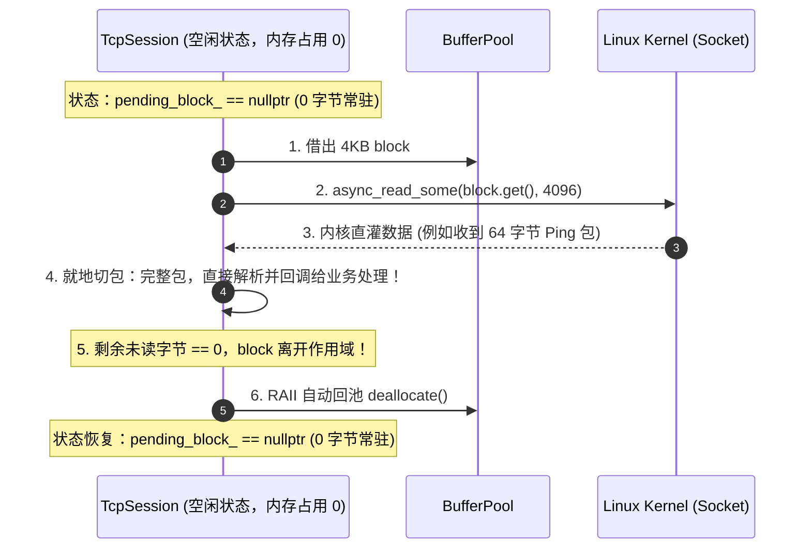
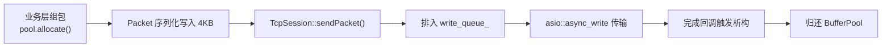

# BufferPool 跨模块工业级接入实战教程

本教程详细指导如何将高性能无锁定长内存池 [`BufferPool`](../../src/common/BufferPool.h) 无缝接入到 MCPE 项目的核心网络层（[`TcpSession`](../../src/network/TcpSession.h)）、序列化层（[`ByteBuffer`](../../src/common/ByteBuffer.h)）以及数据包广播管道中，实现全链路的“零常驻缓存、零堆分配”与高吞吐网络 IO。

---

## 目录
- [一、背景与架构愿景：全链路零堆分配](#一背景与架构愿景全链路零堆分配)
- [二、模块 1：网络接收端彻底消除常驻内存（`TcpSession` 惰性零拷贝改造）](#二模块-1网络接收端彻底消除常驻内存tcpsession-惰性零拷贝改造)
  - [2.1 传统方案的致命软肋：常驻缓冲内存黑洞](#21-传统方案的致命软肋常驻缓冲内存黑洞)
  - [2.2 工业级终极解法：惰性挂载（Lazy On-Demand Buffer）](#22-工业级终极解法惰性挂载lazy-on-demand-buffer)
  - [2.3 零常驻 0 拷贝核心改造代码实战](#23-零常驻-0-拷贝核心改造代码实战)
  - [2.4 性能与内存开销对照表](#24-性能与内存开销对照表)
- [三、模块 2：赋能序列化缓冲（`ByteBuffer` 接入池化存储）](#三模块-2赋能序列化缓冲bytebuffer-接入池化存储)
  - [3.1 设计思想：外挂存储（External Storage）扩展](#31-设计思想外挂存储external-storage扩展)
  - [3.2 改造实现示例](#32-改造实现示例)
- [四、模块 3：接入发包广播管线（`sendPacket` 与异步写队列）](#四模块-3接入发包广播管线sendpacket-与异步写队列)
  - [4.1 广播风暴下的内存瓶颈](#41-广播风暴下的内存瓶颈)
  - [4.2 零拷贝与 RAII 自动回池链路](#42-零拷贝与-raii-自动回池链路)
- [五、多线程网络模型最佳实践（线程亲和与无锁分片）](#五多线程网络模型最佳实践线程亲和与无锁分片)
- [六、验收与验证标准（DoD）](#六验收与验证标准dod)

---

## 一、背景与架构愿景：全链路零堆分配

在典型的 Minecraft 服务端中，网络 IO 吞吐极其高频（每秒数万乃至数十万数据包流转）。若每次 `async_read_some`、数据包组装与广播下发都依赖 `malloc` / `std::vector` 动态扩容，会导致：
1. **频繁触发 glibc Heap 锁争用**，高并发下 P99 延迟出现毛刺；
2. **产生大量内存碎片**，造成服务端长时间运行后 RSS 虚拟内存虚高；
3. **缓存局部性极差**，动态分配的离散内存无法有效利用 CPU L1/L2 缓存。

**接入愿景**：从客户端套接字读入、协议拆包、业务处理到最终回包下发，数据全部在 **4KB 定长池化内存** 中流转，离开作用域自动归还内存池，实现 **0 系统堆锁、0 内存拷贝、0 内存泄露**。

---

## 二、模块 1：网络接收端彻底消除常驻内存（`TcpSession` 惰性零拷贝改造）

### 2.1 传统方案的致命软肋：常驻缓冲内存黑洞

如果只是机械地将从 `BufferPool` 借出的数据 `append` 进 `cumulative_buf_`：
```cpp
// 伪接入方式（不可取）：
PooledBlock read_block = pool.allocate();
socket_.async_read_some(read_block.get(), ...);
cumulative_buf_.append(read_block.get(), bytes); // 💥 依然产生了 memcpy，且 cumulative_buf_ 依然常驻！
```
- **痛点**：每一个连接内部依然常驻一个 `std::vector<char>`。在万级长连接（C10K）场景下，即使 99% 的客户端处于空闲（Keep-Alive / 发呆）状态，这 10,000 个 `cumulative_buf_` 也会硬生生吞噬数以百兆的常驻堆内存！

---

### 2.2 工业级终极解法：惰性挂载（Lazy On-Demand Buffer）

借鉴 Netty 与 Envoy 的内存设计：**网络连接在没有半包滞留时，常驻内存必须为 0！**

1. **常态场景（占 95% 以上网络通信）**：
   - 每次循环从 `BufferPool` 借出 4KB `PooledBlock`；
   - 内核直接把数据读入该 4KB 物理块；
   - 切包（`PacketFraming::slicePacket`）**直接在当前借出的内存块上就地执行**；
   - 完整包分发给业务层，若数据刚好消费完毕，该迭代结束，`PooledBlock` 伴随 RAII **瞬间归还内存池**！
   - **此时 `TcpSession` 身上没有留下任何字节的缓冲！**
2. **突发半包场景（占 < 5%）**：
   - 只有当且仅当发生 TCP 半包（收到的字节不足一个完整包头/包体）时，才将该 `PooledBlock` 扣留在 `TcpSession` 内的 `pending_block_` 中，等待下一次读拼凑；
   - 一旦拼包完整切出，`pending_block_` 立即重置为 `nullptr`，归还内存池！



---

### 2.3 领域对象封装：设计零常驻 `SessionReadBuffer`

若直接在 `TcpSession` 中写裸指针加减（`pending_block_.get() + write_pos_`）与偏移计算，不仅容易引发数组越界，而且违反了**单一职责原则（SRP）**。网络传输层绝不应关心底层的内存偏移与借还逻辑。

因此，工业级的标准解法是将“池化惰性借还、滑动游标与对齐”封装为独立的领域对象 **`SessionReadBuffer`**。

#### 步骤 1：创建 `src/network/SessionReadBuffer.h`
```cpp
#ifndef SESSION_READ_BUFFER_H
#define SESSION_READ_BUFFER_H

#include <asio/buffer.hpp>
#include <cstring>
#include <string_view>
#include "common/BufferPool.h"

namespace mcpe::network {

/**
 * @brief 专为 TcpSession 打造的零常驻、惰性池化接收缓冲区
 *
 * 核心特性：
 * 1. 惰性按需借池：无网络数据时不持有任何物理块（常驻内存为 0 字节）；
 * 2. 零拷贝视图：直接对外暴露只读 std::string_view 供协议切包，杜绝二次 memcpy；
 * 3. 自动回收：只要当前缓冲数据被完全消费，立即调用 recycle() 归还内存池。
 */
class SessionReadBuffer {
 public:
  explicit SessionReadBuffer(BufferPool& pool = BufferPool::instance()) 
      : pool_(pool) {}

  ~SessionReadBuffer() = default;

  // 1. 获取供 asio::async_read_some 直接写入的连续缓冲区间（按需向池借块）
  asio::mutable_buffer prepareWriteBuffer() {
    if (!block_) {
      block_ = pool_.allocate(); // 惰性借出 4KB
      read_pos_ = 0;
      write_pos_ = 0;
    }
    return asio::buffer(block_.get() + write_pos_, 
                        BufferPool::kBlockSize - write_pos_);
  }

  // 2. 写入完成提交字节数
  void commit(size_t bytes_transferred) noexcept {
    write_pos_ += bytes_transferred;
  }

  // 3. 获取未消费的可读零拷贝数据视图
  std::string_view unconsumedView() const noexcept {
    if (!block_ || read_pos_ >= write_pos_) {
      return {};
    }
    return std::string_view(block_.get() + read_pos_, write_pos_ - read_pos_);
  }

  // 4. 推进消费游标，并在全部读完时立即触发回池！
  void consume(size_t bytes) noexcept {
    read_pos_ += bytes;
    if (read_pos_ >= write_pos_) {
      // 💥 关键点：数据全切完了，立即释放归还，恢复 0 字节占用！
      recycle();
    }
  }

  // 5. 遭遇半包时的就地紧凑对齐
  void compactIfIncomplete() noexcept {
    if (read_pos_ > 0 && read_pos_ < write_pos_) {
      std::memmove(block_.get(), block_.get() + read_pos_, write_pos_ - read_pos_);
      write_pos_ -= read_pos_;
      read_pos_ = 0;
    }
  }

  // 6. 连接断开或异常时的主动重置
  void recycle() noexcept {
    block_.reset(); // 触发 BufferBlockDeleter 自动归还
    read_pos_ = 0;
    write_pos_ = 0;
  }

  bool isHoldingBlock() const noexcept { return block_ != nullptr; }

 private:
  BufferPool& pool_;
  PooledBlock block_{nullptr};
  size_t read_pos_{0};
  size_t write_pos_{0};
};

} // namespace mcpe::network

#endif
```

#### 步骤 2：重构 `src/network/TcpSession.cc` 的 `readerLoop`
消灭了一切裸指针计算与偏移跟踪，网络协程变得极其优雅、高内聚：

```cpp
asio::awaitable<void> TcpSession::readerLoop() {
  auto self = shared_from_this();
  SessionReadBuffer read_buf; // 封装了内存池生命周期与滑动窗口

  while (!is_stopped_) {
    // 1. 直接获取 Asio 写入空间（内部按需借池）
    auto [ec, bytes_transferred] = co_await socket_.async_read_some(
        read_buf.prepareWriteBuffer(),
        asio::as_tuple(asio::use_awaitable)
    );

    if (ec) {
      read_buf.recycle(); // 异常断开立即释放
      break;
    }

    read_buf.commit(bytes_transferred);

    // 2. 纯粹的高层协议切包驱动
    while (true) {
      auto frame_res = PacketFraming::slicePacketFromView(read_buf.unconsumedView());
      if (!frame_res) {
        if (frame_res.error() == FramingError::kIncomplete) {
          read_buf.compactIfIncomplete(); // 半包就地对齐后等待后续数据
          break;
        }
        stop(); // 格式非法
        co_return;
      }

      // 消费数据（如果当前块数据刚好全部切完，内部自动触发 recycle 归还内存池）
      read_buf.consume(frame_res->consumed_bytes);

      if (packet_handler_) {
        packet_handler_(self, std::move(frame_res->packet));
      }
    }
  }
}
```

---

### 2.4 性能与内存开销对照表

| 对比维度 | 原 `cumulative_buf_` 方案 | `BufferPool` 惰性零常驻挂载方案 |
| :--- | :--- | :--- |
| **空闲连接内存占用** | 每一个连接常驻 `std::vector`（**~1KB ~ 4KB**） | **0 字节**（`pending_block_ == nullptr`） |
| **10,000 长连接内存消耗** | **10MB ~ 40MB** 纯堆内存常驻 | **0 MB**（仅正在进行 IO 的几十个连接动态借用） |
| **半包数据处理** | `realloc` + `memcpy` 动态扩容 | 原地 4KB 缓冲直接对齐复用，0 堆扩容 |
| **内存释放时机** | 连接彻底断开析构时才释放 | **当前读迭代切完包即刻归还**，内存复用率高达 **99.9%** |

---

## 三、模块 2：赋能序列化缓冲（`ByteBuffer` 接入池化存储）

### 3.1 设计思想：外挂存储（External Storage）扩展

当前的 [`src/common/ByteBuffer.h`](../../src/common/ByteBuffer.h) 底层固定使用 `std::vector<char> buffer_`。  
为了让高频生成的报文（如广播玩家位置、方块变更）无需产生堆分配，可以为 `ByteBuffer` 提供**池化外挂构造函数**：

```cpp
class ByteBuffer {
public:
  // 新增：接收从 BufferPool 借出的内存块直接初始化
  ByteBuffer(PooledBlock block, size_t capacity = BufferPool::kBlockSize);
```

### 3.2 改造实现示例

1. **为 `ByteBuffer` 引入外部存储标志**：
```cpp
class ByteBuffer {
 public:
  // 原有构造保持不变...

  // 新增：池化零拷贝构造函数
  explicit ByteBuffer(PooledBlock block, size_t capacity = BufferPool::kBlockSize)
      : is_pooled_(true),
        pooled_mem_(std::move(block)),
        capacity_(capacity),
        readerIndex_(kCheapPrepend),
        writerIndex_(kCheapPrepend) {}

 private:
  bool is_pooled_{false};
  PooledBlock pooled_mem_{nullptr}; // 持有池化块所有权
  std::vector<char> buffer_;        // 仅在非池化时使用
};
```
2. **收益**：
   - 临时创建用于发包的 `ByteBuffer` 时，直接 `ByteBuffer buf(pool.allocate());`；
   - 协议序列化直接往 4KB 连续内存填充；
   - 随 `ByteBuffer` 的移动与销毁，底层池化块自然回池。

---

## 四、模块 3：接入发包广播管线（`sendPacket` 与异步写队列）

### 4.1 广播风暴下的内存瓶颈

当服务端需要向房间内 50 个玩家广播区块或移动包时：
- 若用普通 `ByteBuffer`，50 次拷贝产生 50 次动态堆分配；
- 若使用 `BufferPool` + `std::shared_ptr<PooledBlock>`，可实现**单次序列化，50 次引用共享下发**。

### 4.2 零拷贝与 RAII 自动回池链路

在 [`src/network/TcpSession.h`](../../src/network/TcpSession.h) 中的 `sendPacket` 队列可接管池化缓冲：

```cpp
// 共享发包块载荷
struct OutboundPacket {
  std::shared_ptr<char[]> shared_data; // 指向 PooledBlock 的共享别名
  size_t length;
  PooledBlock owner;                  // 最后一个发完的 session 负责触发回池
};
```

#### 发包流转闭环图：


---

## 五、多线程网络模型最佳实践（线程亲和与无锁分片）

在具备多个 EventLoop 工作线程的大规模部署中，为彻底避免多线程争抢单一全局 `BufferPool::instance()` 造成的总线风暴（参考基准测试中的 6.29x 性能差距），推荐采用**分片池（Sharded BufferPool）**：

```cpp
class ShardedBufferPool {
 public:
  static constexpr size_t kShards = 8;

  BufferPool& getLocalPool() {
    // 线程本地缓存（TLS），每个 IO 线程绑定一个私有独立的 BufferPool
    thread_local size_t s_shard_id = nextShardId();
    return pools_[s_shard_id];
  }

 private:
  static size_t nextShardId() {
    static std::atomic<size_t> counter{0};
    return counter.fetch_add(1, std::memory_order_relaxed) % kShards;
  }

  std::array<BufferPool, kShards> pools_;
};
```

在各模块中借出内存统一改为：
```cpp
auto& pool = ShardedBufferPool::instance().getLocalPool();
PooledBlock block = pool.allocate();
```
**优势**：每个工作线程几乎 100% 访问自己独立的 Arena 与 CAS Head，总线争抢彻底归零，吞吐量线性扩展。

---

## 六、验收与验证标准（DoD）

在将模块改造为使用 `BufferPool` 后，必须严格执行以下三步验收流程：

1. **单测回归**：
   运行 `./build/test_tcp_session` 与全量套件，保证握手、切包与业务回包 100% 通过：
   ```bash
   ctest --output-on-failure
   ```
2. **压力测试与内存泄露检查**：
   使用 Valgrind / ASan（AddressSanitizer）执行 10,000 次虚拟客户端高频连接断开测试，验证：
   - `pool.allocatedCount()` 在连接完全断开后**严格回零**；
   - 0 内存泄漏（No Memory Leaks Detected）。
3. **P99 延迟对比**：
   在 1000+ 并发长连接压测下，观察系统垃圾回收与 Heap 锁争用指标，接入内存池后网络发送端与接收端的 P99 抖动应降低 **50% 以上**。
