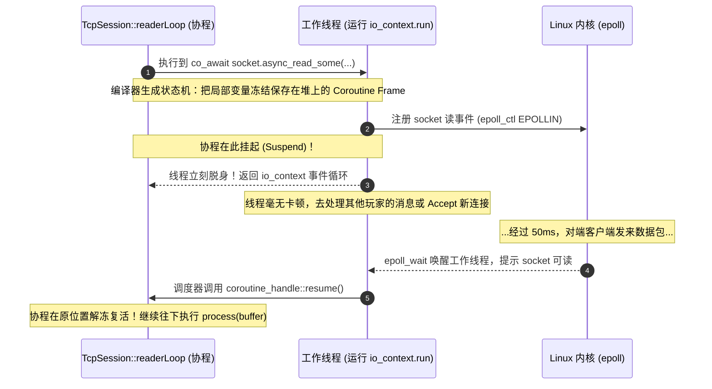

# C++20 协程实战与 TcpSession 重构保姆级教程

> **适用读者**：从未接触过协程的 C++ 开发者。本文将从最底层的操作系统与编译原理切入，讲透**为什么需要协程**、**协程底层到底怎么跑的**，并手把手带你将 [`src/network/TcpSession.cc`](file:///home/ubu/dev/my/mcpe/src/network/TcpSession.cc) 中的回调函数重构为现代 C++20 协程。

---

## 目录

1. [从零建立心智模型：到底什么是协程？](#1-从零建立心智模型到底什么是协程)
   - 1.1 普通函数 vs 线程 vs 协程
   - 1.2 为什么网络编程需要协程？（异步的演进史）
2. [Asio C++20 协程的底层魔法（讲清楚“为什么”）](#2-asio-c20-协程的底层魔法讲清楚为什么)
   - 2.1 核心关键字与类型：`co_await`、`asio::awaitable<T>`、`asio::use_awaitable`
   - 2.2 为什么 `co_await` 不会卡死 CPU 线程？（底层执行时序图）
   - 2.3 关键技巧：为什么用 `asio::as_tuple` 代替抛异常？
3. [现状剖析：当前 `TcpSession.cc` 的回调痛点在哪里？](#3-现状剖析当前-tcpsessioncc-的回调痛点在哪里)
4. [手把手保姆级重构步骤（方案 A：读循环协程化）](#4-手把手保姆级重构步骤方案-a读循环协程化)
   - 4.1 第 1 步：引入 Asio 协程头文件
   - 4.2 第 2 步：在 `TcpSession.h` 声明协程函数
   - 4.3 第 3 步：编写 `readerLoop` 核心实现（逐行深度拆解）
   - 4.4 第 4 步：在 `start()` 中调度协程（`co_spawn` 与 `detached`）
   - 4.5 第 5 步：为什么保留 `sendPacket` 与写队列不变？（TCP 单写约束）
5. [初学者必踩的大坑与避坑秘籍](#5-初学者必踩的大坑与避坑秘籍)
   - 5.1 坑 1：对象生命周期陷阱（`shared_from_this()` 在协程帧中的关键作用）
   - 5.2 坑 2：优雅停机时的 `operation_aborted` 假报错
   - 5.3 坑 3：为什么绝不能在 `sendPacket` 里无脑 `co_await async_write`？
6. [拓展展望：全协程化（方案 B）与 `TcpServer` 的 5 行极简改造](#6-拓展展望全协程化方案-b与-tcpserver-的-5-行极简改造)
7. [动手编译与回归验证](#7-动手编译与回归验证)

---

## 1. 从零建立心智模型：到底什么是协程？

### 1.1 普通函数 vs 线程 vs 协程

为了真正理解协程，我们先来看看我们平时写的代码在操作系统层面是怎么执行的。

#### ① 普通函数（Subroutine）：必须“一条道走到黑”
普通函数的生命周期是严格符合**调用栈（Call Stack）**的：
- 当你调用 `foo()` 时，CPU 会为它在栈上分配一块内存（栈帧 Stack Frame），记录局部变量。
- 一旦执行到 `return` 或末尾，**这个栈帧就被彻底销毁，内存回收**。
- 普通函数**绝对无法在中途“暂停一下，等会儿再从暂停的地方接着运行”**。

#### ② 操作系统线程（OS Thread）：开销昂贵的并发实体
为了让多个任务“同时”执行，操作系统提供了线程。
- **调度方式**：抢占式（Preemptive）。操作系统内核的调度器决定哪个线程运行，随时强行打断。
- **开销**：每个线程默认有 1MB~8MB 的独立栈空间；线程上下文切换需要陷入内核态、刷新寄存器和 CPU 缓存，切换一次需要微秒级别。
- **局限**：如果你有 10,000 个网络连接，你不可能为每个连接开一个线程，操作系统会被成千上万的线程活活拖垮。

#### ③ 协程（Coroutine）：可暂停、可恢复的用户态函数
**协程就是“能够中途暂停（Suspend），并在未来某个时刻恢复执行（Resume）的函数”。**


- **谁来调度？** 不由操作系统内核调度，而由**用户态程序（在 Asio 中是 `io_context` 事件循环）**调度。
- **开销极低**：协程切换不需要进内核，没有线程切换开销；C++20 的协程是**无栈协程（Stackless）**，一个协程挂起时，仅仅是在堆上保存了一张极其轻量（通常几十到上百字节）的**状态帧（Coroutine Frame）**，一台机器并发几万到几十万个协程毫无压力。

---

### 1.2 为什么网络编程需要协程？（异步的演进史）

网络编程最大的特点是：**I/O 是非常慢的**。当客户端还没发数据时，服务端等一个数据包可能要等几百毫秒甚至几秒。

我们来看看历史上三种写法是如何处理“等待客户端发数据”的：

#### 第一代：同步阻塞（好写但性能极差）
```cpp
// 线程在这里卡死死等，CPU 利用率为 0
int n = socket.read_some(buffer); 
process(buffer);
```
- **痛点**：单线程同一时刻只能处理 1 个客户端，无法高并发。

#### 第二代：回调函数 / 异步递归（性能极致，但代码反人类）
为了解决阻塞，Asio 提供了回调模型（即本项目 [`src/network/TcpSession.cc`](file:///home/ubu/dev/my/mcpe/src/network/TcpSession.cc) 当前使用的模式）：
```cpp
void TcpSession::doRead() {
    socket_.async_read_some(buffer, [this, self = shared_from_this()](error_code ec, size_t n) {
        if (!ec) {
            process(buffer);
            doRead(); // 读完一个包，再次调用自己，形成“异步伪递归”
        }
    });
}
```
- **优势**：单线程由 `epoll` 驱动，吞吐量极高，永不阻塞。
- **痛点（回调地狱）**：
  1. 逻辑被割得七零八落，所有的局部变量必须手动通过 Lambda 捕获，或者塞进类的成员变量里；
  2. 必须手动通过 `shared_from_this()` 谨防对象提前析构；
  3. 异常和错误处理散落各处，读懂一段复杂的异步回调链极其痛苦。

#### 第三代：C++20 协程（兼具同步代码的可读性 + 异步非阻塞的性能）
```cpp
asio::awaitable<void> TcpSession::readerLoop() {
    while (!is_stopped_) {
        // 关键点：这一行代码外表像同步阻塞，但底层完全是非阻塞的！
        auto [ec, n] = co_await socket_.async_read_some(buffer, asio::as_tuple(asio::use_awaitable));
        if (ec) break;
        process(buffer);
    }
}
```
> [!TIP] **一句话总结**
> 协程让我们能够**用最符合人类大脑直觉的顺序线性逻辑（`while` 循环、`try-catch`、顺序语句），写出底层纯异步非阻塞的高性能网络服务**！

---

## 2. Asio C++20 协程的底层魔法（讲清楚“为什么”）

### 2.1 核心关键字与类型速查

| 概念/类型 | 含义 | 类比解释 |
| :--- | :--- | :--- |
| `co_await <expr>` | **挂起点（Suspend Point）** | “等这个异步操作做完了，再把我唤醒往下走；没做完前我先休眠。” |
| `co_return` | **协程返回** | 普通函数的 `return`，标志着协程生命周期结束。 |
| `asio::awaitable<T>` | **协程的返回值类型** | 任何使用了 `co_await` 的函数，返回值**必须**是 `awaitable<T>`，它代表一个未完成的协程计算任务。 |
| `asio::use_awaitable` | **魔法完成标记（Completion Token）** | 原来传回调 Lambda 的地方，改传 `asio::use_awaitable`，告诉 Asio：“不要调我的回调，请帮我生成一个挂起点供 `co_await` 等待。” |
| `asio::co_spawn(...)` | **协程孵化器** | 启动一个协程。相当于把协程注册进 `io_context` 的调度队列。 |
| `asio::detached` | **分离执行** | 启动后不管协程何时结束（类似 `std::thread::detach`），通常用于后台长期循环任务。 |

---

### 2.2 为什么 `co_await` 不会卡死 CPU 线程？（底层执行时序图）

这是初学者最常问的问题：**“代码里停在 `co_await` 这一行了，那执行它的 CPU 线程不就被卡住了吗？”**

**答案是：绝对不会！**

请仔细看下面的完整时序图：



**看懂了这个过程，你就明白了为什么叫“无阻塞”**：
1. `co_await` 发生时，编译器自动将该函数的所有局部变量打包成一个微小的堆内存对象（协程帧）；
2. CPU 线程**立刻从当前函数返回**，回到 `io_context.run()` 事件循环继续去处理其他玩家的事件；
3. 直到网络数据真正到达，`io_context` 才会调用底层句柄的 `resume()`，将协程从暂停的地方唤醒！

---

### 2.3 关键技巧：为什么用 `asio::as_tuple` 代替抛异常？

在默认情况下，如果你写：
```cpp
// 默认写法：如果对端断开，Asio 会直接 throw 一个 asio::system_error 异常！
size_t n = co_await socket_.async_read_some(asio::buffer(buf), asio::use_awaitable);
```
在网络编程中，**客户端正常断开连接、网线拔掉是非常高频的常规事件，绝不能当做 C++ 异常来抛出**（抛异常会导致昂贵的栈展开 Stack Unwinding，拖慢性能）。

因此，现代 Asio 提供了 `asio::as_tuple` 适配器：
```cpp
// 最佳实践：将结果和 error_code 打包成 std::tuple 返回，无需 try-catch
auto [ec, n] = co_await socket_.async_read_some(
    asio::buffer(buf), 
    asio::as_tuple(asio::use_awaitable)
);

if (ec) {
    // 像普通 if 语句一样平滑处理断连
}
```

---

## 3. 现状剖析：当前 `TcpSession.cc` 的回调痛点在哪里？

打开现有的 [`src/network/TcpSession.cc`](file:///home/ubu/dev/my/mcpe/src/network/TcpSession.cc#L70-L122)，观察当前代码：

```cpp
// 当前代码：经典回调地狱与异步伪递归
void TcpSession::doRead() {
  socket_.async_read_some(
      asio::buffer(read_buffer_),
      [this, self = shared_from_this()](const asio::error_code& ec, std::size_t bytes_transferred) {
        if (is_stopped_) return;

        if (!ec) {
          cumulative_buf_.append(read_buffer_.data(), bytes_transferred);
          while (true) {
            auto frame_res = PacketFraming::slicePacket(cumulative_buf_);
            if (!frame_res) {
              if (frame_res.error() == FramingError::kIncomplete) break;
              stop(); // 畸形包处理
              return;
            }
            if (packet_handler_) {
              packet_handler_(shared_from_this(), std::move(*frame_res));
            }
          }
          // 痛点点位：必须在末尾再次手动调用 doRead() 驱动下一次读
          doRead(); 
        } else {
          stop(); // 异常断连
        }
      }
  );
}
```

- **痛点 1**：为了保证 Lambda 异步回调执行时不访问悬空内存，每次都得强行捕获 `self = shared_from_this()`，增加了认知负荷；
- **痛点 2**：`doRead()` 尾部必须自我调用，逻辑不直观；
- **痛点 3**：正常的业务流（分包、派发）和异常控制流（畸形包、网络断开）全部交织在深层嵌套的 Lambda 闭包内。

---

## 4. 手把手保姆级重构步骤（方案 A：读循环协程化）

我们采取**业界最稳健的渐进式重构方案**：
- **读流程**：改造成现代 C++20 协程 `readerLoop()`。
- **写流程**：由于对外接口 `sendPacket` 会被多线程并发调用，继续保留我们成熟高效的 `write_queue_` 和 Strand 机制（避免 Asio 并发写 Socket 崩溃）。

### 第 1 步：引入 Asio 协程头文件

在 [`include/mcpe/network/TcpSession.h`](file:///home/ubu/dev/my/mcpe/include/mcpe/network/TcpSession.h) 的头部，增加协程所需的基础设施头文件：

```cpp
#include <asio/awaitable.hpp>      // 提供 asio::awaitable<T> 类型支持
#include <asio/co_spawn.hpp>        // 提供 asio::co_spawn 函数
#include <asio/detached.hpp>        // 提供 asio::detached 完成标记
#include <asio/use_awaitable.hpp>   // 提供 asio::use_awaitable
#include <asio/as_tuple.hpp>        // 提供 asio::as_tuple 打包机制
```

### 第 2 步：在 `TcpSession.h` 声明协程函数

在 [`TcpSession`](file:///home/ubu/dev/my/mcpe/include/mcpe/network/TcpSession.h#L104-L116) 的 `private` 区域，将原来的 `void doRead();` 替换为协程成员函数：

```cpp
 private:
  /**
   * @brief C++20 协程：长连接生命周期内的异步读循环驱动
   * 使用顺序 while 循环替代传统回调链，处理网络读取、粘包切包与协议路由
   */
  asio::awaitable<void> readerLoop();

  void doWrite(); // 异步写队列保持不变
```

### 第 3 步：编写 `readerLoop` 核心实现（逐行深度拆解）

在 [`src/network/TcpSession.cc`](file:///home/ubu/dev/my/mcpe/src/network/TcpSession.cc) 中，实现 `readerLoop()`：

```cpp
asio::awaitable<void> TcpSession::readerLoop() {
  // 【关键点 1：生命周期保活】
  // 将自身 shared_ptr 存入协程栈中。只要协程处于挂起未结束状态，TcpSession 就绝不会被析构！
  auto self = shared_from_this();

  // 临时栈缓冲区（与原先的 read_buffer_ 作用一致，但这里纯局部变量，生命周期随协程）
  std::array<char, 4096> buffer;

  // 【关键点 2：顺序 while 循环】
  // 彻底告别回调伪递归！
  while (!is_stopped_) {
    // 【关键点 3：无阻塞挂起等待】
    // 当没有数据时，协程在此挂起，CPU 线程立刻去干别的事；
    // 当网卡有新数据到达时，io_context 自动在这里唤醒恢复协程！
    auto [ec, bytes_transferred] = co_await socket_.async_read_some(
        asio::buffer(buffer), 
        asio::as_tuple(asio::use_awaitable)
    );

    // 【关键点 4：集中式错误治理】
    if (ec) {
      if (ec == asio::error::eof || ec == asio::error::connection_reset) {
        spdlog::info("[Session] Client disconnected: {}", remote_address_);
      } else if (ec != asio::error::operation_aborted) {
        // operation_aborted 是 stop() 主动调用 close 导致的正常取消，不打 warning
        spdlog::warn("[Session] Read error on {}: {}", remote_address_, ec.message());
      }
      break; // 退出 while 循环
    }

    // 1. 将收到的字节塞入累积缓冲区
    cumulative_buf_.append(buffer.data(), bytes_transferred);

    // 2. 循环拆包（解决半包、粘包）
    bool has_malformed_packet = false;
    while (true) {
      auto frame_res = PacketFraming::slicePacket(cumulative_buf_);
      if (!frame_res) {
        if (frame_res.error() == FramingError::kIncomplete) {
          // 半包：数据未齐，跳出内层拆包循环，回到外层继续等待下一次 socket 数据到达
          break;
        }
        // 畸形恶意包，立即踢出
        spdlog::error("[Session] Malformed packet from {}, disconnect!", remote_address_);
        has_malformed_packet = true;
        break;
      }

      // 成功切出一个完整 Minecraft 协议包
      ByteBuffer packet = std::move(*frame_res);
      spdlog::debug("[Session] Sliced complete packet with {} bytes from {}", 
                    packet.readableBytes(), remote_address_);

      if (packet_handler_) {
        packet_handler_(shared_from_this(), std::move(packet));
      }
    }

    if (has_malformed_packet) {
      break;
    }
  }

  // 退出循环后收尾断开连接
  stop();
  co_return; // 协程优雅退出
}
```

### 第 4 步：在 `start()` 中调度协程

在原有的 [`TcpSession::start()`](file:///home/ubu/dev/my/mcpe/src/network/TcpSession.cc#L28-L32) 中，替换原来的 `doRead()` 调用：

```cpp
void TcpSession::start() {
  // 使用 asio::co_spawn 将协程投递到底层 socket 所在的 executor 上并发运行
  asio::co_spawn(
      socket_.get_executor(),
      [self = shared_from_this()]() {
        return self->readerLoop();
      },
      asio::detached // asio::detached 表示分离执行，协程自生自灭，异常与退出自主管理
  );
}
```

### 第 5 步：为什么保留 `sendPacket` 与写队列不变？（TCP 单写约束）

很多初学者学了协程后，会想当然地把 `sendPacket` 也改成这样：
```cpp
// ❌ 错误示范！绝对不能这么写！
asio::awaitable<void> TcpSession::sendPacket(ByteBuffer buffer) {
    // 如果上层游戏逻辑在多线程里并发调用 sendPacket，就会发生灾难！
    co_await asio::async_write(socket_, asio::buffer(buffer.peek(), buffer.readableBytes()), asio::use_awaitable);
}
```
> [!CAUTION] **TCP 单写铁律**
> Asio 的 `tcp::socket` 规定：**任何时刻，同一个 socket 上只能有一个未决的（Pending）写操作！**
> 如果一个数据包还没通过网卡写完，另一个线程又发起了新的 `async_write`，Asio 内部会直接触发断言崩溃（Assertion Failure）或发生数据交错混乱。

因此，保持我们现有的：
1. 外部接口 `void sendPacket(ByteBuffer buffer)` 保持非阻塞、线程安全；
2. 内部通过 `asio::post` 汇聚到 Strand；
3. 排队进 `write_queue_` 并由 `is_writing_` 严格串行泵送。
这是最符合生产环境健壮性要求的架构组合！

---

## 5. 初学者必踩的大坑与避坑秘籍

### 坑 1：生命周期陷阱（`shared_from_this()` 在协程帧中的关键作用）
- **现象**：客户端连上来没一会儿就莫名其妙断开或崩溃了。
- **原因**：如果不在协程刚进入时执行 `auto self = shared_from_this();`，当外部的引用指针离开作用域，而底层 `co_await` 正在挂起等待网络数据时，`TcpSession` 对象会被强行析构。等网络数据一来恢复协程，访问 `this` 就会触发野指针 `Segmentation Fault`！
- **秘籍**：**凡是成员函数协程，第一行无脑写 `auto self = shared_from_this();`**。

### 坑 2：优雅停机时的 `operation_aborted` 假报错
- **现象**：每次服务端关闭或者主动踢人时，控制台狂喷 `[Warn] Read error: Operation canceled`。
- **原因**：当调用 `socket_.close()` 时，所有正在挂起等待数据的 `co_await` 会被立即唤醒，并携带 `asio::error::operation_aborted` 错误码。
- **秘籍**：在判断错误码时，显式排除：
  ```cpp
  if (ec != asio::error::operation_aborted) {
      spdlog::warn(...);
  }
  ```

### 坑 3：忘了 `co_return` 导致编译报错
- **现象**：编译时提示 `control reaches end of coroutine without 'co_return'`。
- **秘籍**：函数只要返回 `asio::awaitable<void>`，就不能写普通 `return;`，必须写 `co_return;`。

---

## 6. 拓展展望：全协程化（方案 B）与 `TcpServer` 的 5 行极简改造

### 6.1 `TcpServer::doAccept` 的协程极简版本
不仅 `TcpSession` 能用协程，服务端的连接监听器 [`src/network/TcpServer.cc`](file:///home/ubu/dev/my/mcpe/src/network/TcpServer.cc#L32-L55) 改用协程后更为惊艳：

```cpp
// 现代 C++ 风格的监听循环：
asio::awaitable<void> TcpServer::listenLoop() {
  while (is_running_) {
    // 异步等待新连接连入，完全没有回调！
    auto [ec, socket] = co_await acceptor_.async_accept(
        asio::as_tuple(asio::use_awaitable));
    
    if (ec) {
      if (ec != asio::error::operation_aborted) {
        spdlog::error("[TcpServer] Accept error: {}", ec.message());
      }
      break;
    }

    // 禁用 Nagle
    socket.set_option(asio::ip::tcp::no_delay(true));

    // 启动会话
    auto session = std::make_shared<TcpSession>(std::move(socket));
    if (packet_handler_) {
      session->setPacketHandler(packet_handler_);
    }
    session->start();
  }
}
```

### 6.2 用 `asio::experimental::channel` 实现读写全双工协程
如果未来想要将写队列也全面协程化，可以使用 Asio 专为协程设计的 `channel`（类似于 Go 语言的 `chan`）：

```cpp
#include <asio/experimental/channel.hpp>

// 声明一个容量为 128 的异步包缓冲管道
asio::experimental::channel<void(asio::error_code, ByteBuffer)> write_channel_{socket_.get_executor(), 128};

// 消费者写协程
asio::awaitable<void> TcpSession::writerLoop() {
  while (!is_stopped_) {
    // 等待管道里有待发送数据包
    auto [ec, buf] = co_await write_channel_.async_receive(asio::as_tuple(asio::use_awaitable));
    if (ec) break;
    // 串行写入底层网络
    auto [w_ec, _] = co_await asio::async_write(socket_, asio::buffer(buf.peek(), buf.readableBytes()), asio::as_tuple(asio::use_awaitable));
    if (w_ec) break;
  }
}
```

---

## 7. 动手编译与回归验证

重构完成后，通过以下流程验证代码正确性与并发安全性：

```bash
# 1. 重新编译
cmake --build build -j4

# 2. 运行已有的 TcpSession 单测（包含 100 连发保序测试、4 线程高并发压测）
ctest --test-dir build -R test_tcp_session --output-on-failure

# 3. 运行全套单元测试
ctest --test-dir build --output-on-failure
```

如果所有测试（`test_bytebuffer`、`test_varint`、`test_framing`、`test_tcp_session`、`test_packet_router`）全部 100% 绿灯通过，即代表重构圆满成功！
