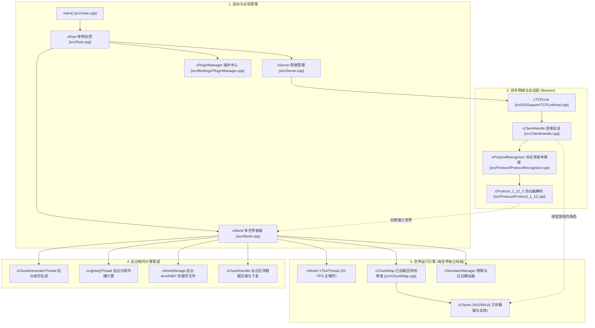
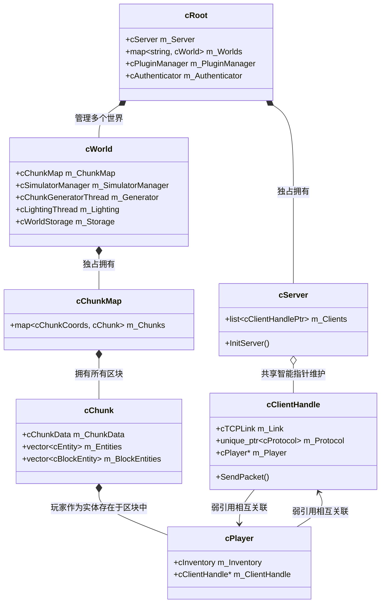
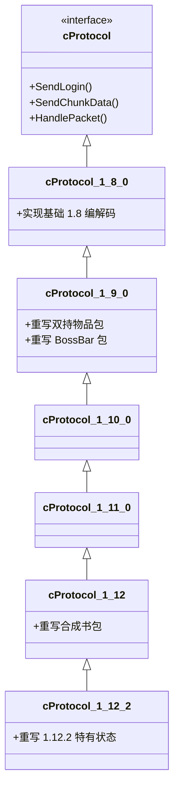

# Cuberite (MCServer) 架构全景解析与源码导读手册

> **前言**：Cuberite（早期代号 MCServer）是一个使用 C++ 编写的、工业级开源 Minecraft Java 版服务端。整个项目包含约 **875 个源文件**、**36 万行代码**，历经十余年迭代。初看该项目极易被其庞大的文件堆砌和复杂的类继承体系所劝退。
> 本文档旨在化繁为简，用分层思维与架构图谱，彻底拆解 Cuberite 的**目录结构、模块职责、线程模型、协议流水线以及核心玩法系统**，并提炼其对我们自研服务端的指导价值。

---

## 目录
1. [宏观全景：Cuberite 是如何工作的？](#一-宏观全景cuberite-是如何工作的)
2. [顶级目录全貌与分工](#二-顶级目录全貌与分工)
3. [核心源码目录 `src/` 深入剖析](#三-核心源码目录-src-深入剖析)
4. [核心对象所有权与拓扑体系（Object Ownership）](#四-核心对象所有权与拓扑体系object-ownership)
5. [并发与多线程架构（Thread Model）](#五-并发与多线程架构thread-model)
6. [网络与多版本协议流水线（Protocol Subsystem）](#六-网络与多版本协议流水线protocol-subsystem)
7. [世界、区块与微观模拟器（World & Simulators）](#七-世界区块与微观模拟器world--simulators)
8. [插件与脚本系统（Lua & tolua++）](#八-插件与脚本系统lua--tolua)
9. [对我们自研服务端（MCPE）的直接借鉴与映射指南](#九-对我们自研服务端mcpe的直接借鉴与映射指南)

---

## 一、 宏观全景：Cuberite 是如何工作的？

与官方 Mojang 原版服务端采用 Java 且重度依赖主线程单一大循环不同，Cuberite 采用了**完全并发化、面向对象、模块解耦**的 C++ 设计理念：



---

## 二、 顶级目录全貌与分工

打开 Cuberite 根目录，其整体结构清晰且标准：

| 目录/文件 | 类型 | 核心作用与职责解析 |
| :--- | :--- | :--- |
| **`src/`** | 核心源码 | 服务端全部核心 C++ 源码（约 36 万行），所有业务逻辑与架构都在这里。 |
| **`lib/`** | 第三方库 | 项目内嵌的所有依赖库（采用源码引入而非动态库），包含：<br>• `libevent`：高性能跨平台网络事件循环引擎。<br>• `mbedtls`：提供 Minecraft 握手阶段必须的 RSA 密钥协商与 AES-128-CFB 流式加密。<br>• `lua` & `tolua++`：嵌入式 Lua 解释器及 C++/Lua 自动绑定生成器。<br>• `jsoncpp`：JSON 解析（用于 MOTD、Chat 消息、配置读取）。<br>• `sqlite` & `SQLiteCpp`：嵌入式数据库，用于玩家封禁、权限或统计持久化。<br>• `libdeflate`：超高性能 deflate 压缩库，替代原生 zlib 极大加速区块压缩。<br>• `fmt`：现代 C++ 高性能格式化库。<br>• `tclap`：命令行参数解析库。 |
| **`Server/`** | 运行时目录 | 服务端编译后的**工作运行根目录**（类似 Release 目录）：<br>• `settings.ini`：全局服务器配置（端口、最大人数、MOTD 等）。<br>• `items.ini` / `monsters.ini`：物品与怪物的静态属性数据。<br>• `crafting.txt` / `furnace.txt`：合成台配方与熔炉烧炼配方定义。<br>• `Plugins/`：Lua 插件存放目录（开箱即用）。<br>• `webadmin/`：内嵌网页管理后台的前端 HTML/JS/CSS 资源。 |
| **`Tools/`** | 开发者工具集 | 官方配套的工具集（极具学习价值）：<br>• `ProtoProxy`：协议调试代理，可串联在官方客户端与服务端中间抓包比对。<br>• `MCADefrag`：Minecraft `.mca` Region 存档文件的碎片整理工具。<br>• `NoiseSpeedTest`：地形生成噪声算法性能基准压测。<br>• `GrownBiomeGenVisualiser`：生物群系生成可视化预览器。 |
| **`dev-docs/`** | 架构草图与文档 | 核心作者留下的设计资料，包含 `Object ownership.gv`（对象所有权图）、`SocketThreads states.gv`（网络状态机图）、`Login sequence.txt`（登录抓包时序）等。 |
| **`CMake/`** | 构建配置 | CMake 模块脚本，处理预编译头文件（PCH）、Unity Build 聚合构建与跨平台编译宏。 |
| **`tests/`** | 单元测试 | 针对数学库、NBT、噪声生成等核心模块的独立测试。 |

---

## 三、 核心源码目录 `src/` 深入剖析

`src/` 是整个项目的精髓所在。875 个文件被划分为清晰的子系统：

### 1. 根层公共核心（Root & Common）
- **`main.cpp`**：服务端主程序入口，初始化信号处理、网络单例 `cNetworkSingleton`，解析命令行并启动 `cRoot`。
- **`Root.h / .cpp`**：全局管理根单例 `cRoot`。持有全局的 `cServer`、`cWorld` 列表、配方库、正版验证队列 `cAuthenticator` 以及插件管理器。
- **`Server.h / .cpp`**：代表整个网络服务端。监听指定的 IPv4/IPv6 端口，维护最大/当前在线人数、MOTD，并作为所有 `cClientHandle` 的顶层容器。
- **`ClientHandle.h / .cpp`**：代表一个**连入的客户端网络连接**。继承自 `cTCPLink::cCallbacks`。管理网络数据流、玩家视距（View Distance）、数据包收发队列、所归属的世界与玩家对象 `cPlayer`。
- **`World.h / .cpp`**：代表**一个独立的世界**（主世界、地狱、末地）。内部拥有独立的 Tick 线程、区块存储、物理与流体模拟器。
- **`ChunkMap.h / .cpp`**：当前世界内的所有已加载区块的内存存储容器（基于 `std::map<cChunkCoords, cChunk>`）。
- **`Chunk.h / .cpp`**：单个区块（16x256x16）的内存数据结构。维护其包含的方块数据 `cChunkData`、方块实体（箱子等）、活动实体列表、已加载该区块的客户端集合。
- **`ByteBuffer.h / .cpp`**：底层字节缓冲区，封装变长整数（VarInt）、大端数值、Minecraft 格式字符串读写与事务性回滚读。

### 2. 子系统模块分类表

| 子目录 | 核心职责 | 代表性类/文件 | 核心技术点与设计 |
| :--- | :--- | :--- | :--- |
| **`OSSupport/`** | 跨平台底层抽象 | `Network.h`<br>`TCPLinkImpl.cpp`<br>`IsThread.h`<br>`CriticalSection.h` | 隔离操作系统差异。基于 `libevent` 封装了 `cTCPLink` 异步网络接口；封装了跨平台的线程基类 `cIsThread` 和互斥锁 `cCriticalSection`。 |
| **`Protocol/`** | Minecraft 协议编解码 | `ProtocolRecognizer.cpp`<br>`Protocol_1_8.cpp`<br>`Protocol_1_12.cpp`<br>`ChunkDataSerializer.cpp` | **极其惊艳的多版本支持体系**。握手时自动识别版本；采用面向对象继承链（`1.12.2 -> 1.12 -> 1.11 -> 1.10 -> 1.9 -> 1.8`），只在子类覆盖差异包。 |
| **`mbedTLS++/`** | 协议加密抽象 | `AesCfb128Encryptor.h`<br>`RsaPrivateKey.h` | Minecraft 登录协议要求客户端与服务端进行 RSA 握手并切换至 AES/CFB8 共享密钥流加密。该目录对底层 C 库 `mbedtls` 进行了面向对象封装。 |
| **`WorldStorage/`** | 存档持久化 (Anvil/NBT) | `WSSAnvil.cpp`<br>`FastNBT.cpp`<br>`WorldStorage.cpp` | 实现了 Minecraft 官方标准的 Anvil 存档格式（`.mca` 区域文件）；自主实现了不依赖第三方的高性能二进制 NBT 序列化与流式反序列化。 |
| **`Generating/`** | 程序化地图与世界生成 | `ComposableGenerator.cpp`<br>`BioGen.cpp`<br>`HeiGen.cpp`<br>`FinishGen.cpp`<br>`Caves.cpp`<br>`Trees.cpp` | 高度工程化的**管道组合式地形生成器**。将生成切分为：生物群系生成（Biome）$\to$ 基础地形高程（Height）$\to$ 地表覆盖（Composition）$\to$ 结构点缀（Features：树木、矿脉、村庄、洞穴）。 |
| **`Simulator/`** | 游戏微观物理模拟器 | `FluidSimulator.cpp`<br>`SandSimulator.cpp`<br>`FireSimulator.cpp`<br>`IncrementalRedstoneSimulator/` | 将复杂的方块行为解耦为独立的模拟器：水流/岩浆流动扩散模拟、沙子/铁砧重力下落模拟、火焰蔓延与方块引燃模拟、红石电路图模拟。 |
| **`Entities/`** | 游戏实体体系 | `Entity.h`<br>`Pawn.h`<br>`Player.h`<br>`ProjectileEntity.h`<br>`Minecart.h`<br>`Pickup.h` | 经典的面向对象继承树：`cEntity`（基础实体：位置、速度、AABB）$\to$ `cPawn`（具生物属性：血量、状态效果）$\to$ `cPlayer`（玩家玩家背包、视距、经验、权限）。 |
| **`Mobs/`** | 生物行为与 AI 寻路 | `Monster.cpp`<br>`PathFinder.cpp`<br>`Zombie.cpp`<br>`Creeper.cpp` | 生物状态机（待机、徘徊、追逐、攻击）；内置基于 3D 体素网格的 **A\* 寻路算法（PathFinder）**。 |
| **`Blocks/` & `BlockEntities/`** | 方块与容器方块 | `BlockEntity.h`<br>`ChestEntity.cpp`<br>`FurnaceEntity.cpp`<br>`HopperEntity.cpp` | 普通方块只有 ID 和 Meta；包含状态/NBT 的方块由 `BlockEntity` 管理（例如箱子背包存储、熔炉烧炼进度、漏斗物品转移）。 |
| **`Items/`** | 物品属性与交互 | `Item.h`<br>`ItemGrid.cpp`<br>`ItemHandler.cpp` | 物品堆（ItemStack）、物品格栅（ItemGrid）、装备穿戴、食物消化、工具挖掘速度计算。 |
| **`UI/`** | 交互界面与窗口 | `Window.h`<br>`Inventory.h`<br>`SlotArea.h` | 玩家物品栏、工作台 3x3 界面、箱子 9x3 容器、铁砧、附魔台网络协议同步与点击槽位逻辑。 |
| **`Bindings/`** | Lua 脚本插件生态 | `PluginManager.cpp`<br>`PluginLua.cpp`<br>`Bindings.cpp` | 借助 `tolua++` 工具在编译期将 C++ 头文件中的类和函数扫描并导出为 Lua 函数，使社区开发者可通过纯 Lua 编写强大插件。 |
| **`HTTP/`** | 网页控制台后台 | `HTTPServer.cpp`<br>`WebAdmin.cpp` | 内置微型 HTTP 服务器，在浏览器提供图形化 WebAdmin 管理面板，支持在线玩家列表查看、控制台发指令、服务器参数配置。 |
| **`Noise/`** | 数学与过程化噪声 | `Noise.h`<br>`Interpolation.h` | 经典 Perlin 噪声、Simplex 单纯形噪声、Voronoi 沃罗诺伊多边形划分，为地形生成提供底层数学支持。 |
| **`Physics/`** | 几何碰撞与物理投射 | `BoundingBox.h`<br>`LineBlockTracer.cpp` | AABB 包围盒碰撞检测、视线方块相交射线追踪（Raycast）。 |

---

## 四、 核心对象所有权与拓扑体系（Object Ownership）

初读 Cuberite 最容易困惑的是：*谁拥有谁？谁在什么时候被销毁？*

根据官方设计架构图与源码，Cuberite 严格遵守了**自顶向下的单向树状所有权**：



### 关键所有权设计原则：
1. **世界隔离原则**：`cWorld` 是彻底隔离的实体。主世界、地狱、末地互不影响，各自拥有独立的 `cChunkMap`。
2. **玩家的双重身份解耦**：
   - 在**网络视角**下，它是一个连接：`cClientHandle`（处理 TCP 读写、断线重连、协议转换）。
   - 在**世界物理视角**下，它是一个实体：`cPlayer`（继承自 `cEntity`，位于某一个世界的某一个 `cChunk` 中，具备坐标与血量）。
   - 二者通过原始指针互相持有弱引用关联；当客户端断线时，`cClientHandle` 负责将 `cPlayer` 从世界区块中卸载并销毁。

---

## 五、 并发与多线程架构（Thread Model）

**这是 Cuberite 性能能够碾压原生 Java 服务端的最核心秘密！**

Cuberite **没有全局大锁**，而是将耗时任务深度拆分到不同的后台线程池中运行：

| 线程名称/角色 | 数量 | 触发机制 | 核心职责 | 线程间数据同步方式 |
| :--- | :--- | :--- | :--- | :--- |
| **Network I/O Thread** | 1 ~ 2 个 | `libevent` 事件驱动 | 专职负责网络连接 `accept`、原始 TCP 数据流读取与发送。绝不进行复杂计算。 | 收到完整包后将任务投递给 `cClientHandle`。 |
| **World Ticker Thread** | **每个世界各 1 个** | 恒定 50ms 频率 (20 TPS) | 处理当前世界的物理 Tick、实体 AI 移动、方块更新、流体扩散。 | 世界之间互不阻塞；世界内部通过 `cCriticalSection` 保护区块树。 |
| **Chunk Generator** | 独立后台工作线程 | 任务队列驱动 | 当玩家走到未探索区域时被唤醒。执行重度 CPU 运算（噪声计算、群系匹配、洞穴雕刻）。 | 生成完成后构造好数据，通过线程安全队列交由 `cChunkMap` 挂载。 |
| **Lighting Thread** | 独立后台工作线程 | 任务队列驱动 | 计算新区块中每个方块的天空光与方块光辐射衰减。 | 光照计算完成前，区块不会被标记为“就绪”。 |
| **Chunk Sender** | 独立后台工作线程 | 任务队列驱动 | 玩家进入新视距时，在后台将区块三维方块数组序列化并执行 `libdeflate` 压缩。 | 压缩完成后直接将二进制数据抛给网络层下发，不阻塞世界主循环。 |
| **World Storage (I/O)** | 独立后台工作线程 | 定时或卸载触发 | 负责调用磁盘 API 将脏区块以 Anvil 格式写入硬盘 `.mca` 文件。 | 完全异步磁盘 I/O，再慢也不会造成游戏内卡顿（Lag Spike）。 |
| **Authenticator Thread** | 独立后台工作线程 | 玩家登录触发 | 向 Mojang 官方 session 认证服务器发起 HTTPS 校验请求。 | 纯网络等待线程，防止因为 Mojang 服务器网络波动导致全服卡死。 |

---

## 六、 网络与多版本协议流水线（Protocol Subsystem）

Cuberite 的协议层设计被誉为 C++ Minecraft 领域的典范教材：

### 1. 自动版本协商（Protocol Recognition）
当一个客户端连入时：
1. 底层 `cTCPLink` 建立连接，生成初始 `cClientHandle`。
2. 此时连接尚未确定具体的协议版本，挂载通用嗅探器 `cMultiVersionProtocol`。
3. 客户端发送第一个包 `0x00 Handshake`：
   - 包含客户端的版本号 `ProtocolVersion`（例如 1.12.2 为 `340`，1.8 为 `47`）。
   - 包含意图 `NextState`（1: 状态查询，2: 进服登录）。
4. 嗅探器在 [`ProtocolRecognizer.cpp`](file:///home/ubu/dev/ref/cuberite/src/Protocol/ProtocolRecognizer.cpp#L326-L346) 中根据该版本号动态实例化具体的协议实现类：
   ```cpp
   switch (ProtocolVersion)
   {
       case 47:  return std::make_unique<cProtocol_1_8_0>(...);
       case 340: return std::make_unique<cProtocol_1_12_2>(...);
       case 498: return std::make_unique<cProtocol_1_14_4>(...);
   }
   ```

### 2. 继承树解耦多版本差异
Minecraft 几乎每个小版本都会增删数据包 ID 或微调字段。Cuberite 没有为每个版本写一份独立代码，而是建立了继承链：



- **基类（`cProtocol_1_8_0`）**：实现了 90% 的通用网络包打包与拆包。
- **派生类（`cProtocol_1_12_2`）**：只需要重写变动的虚拟函数（例如 1.9 增加了 Teleport Confirm、1.12 增加了配方书），复用率超过 95%！

---

## 七、 世界、区块与微观模拟器（World & Simulators）

### 1. 区块内存布局 (`cChunkDef`)
Minecraft 世界是由无数个 $16 \times 256 \times 16$ 的区块构成的体素网格：
- **BlockType 数组**：$16 \times 256 \times 16 = 65,536$ 字节，每个方块用 1 个字节保存类型 ID。
- **BlockMeta 数组**：半字节（4 bits，Nibble），用于记录方向、材质变种等额外信息。
- **BlockLight / SkyLight 数组**：各占半字节（4 bits），记录该方块的光照等级（0 ~ 15）。
- **Section 划分**：垂直方向划分为 16 个小 Section（每个 $16 \times 16 \times 16$），便于空区域跳过压缩下发。

### 2. 微观模拟器模式（Simulator Pattern）
许多自研服务端最容易把方块逻辑全部揉死在 `World.cpp` 里。Cuberite 采用了极其干净的**模拟器分离**：
- `cWorld` 内部维护一个 `cSimulatorManager`。
- 当有玩家打破方块、水流改变或放置红石时，并不立即执行复杂的蔓延递归，而是调用 `WakeUpSimulators(Position)`。
- 在世界 Tick 时：
  - `cFluidSimulator`：集中处理所有等待流动的水和岩浆（计算斜坡、向低处流淌）。
  - `cRedstoneSimulator`：按广度优先传播红石充能信号。
  - `cSandSimulator`：检测下方悬空的沙子并生成下落中的实体。
这种设计将计算瓶颈牢牢限制在可控的时钟周期内。

---

## 八、 插件与脚本系统（Lua & tolua++）

Cuberite 的另一大亮点是无需重新编译 C++ 即可通过 Lua 编写完整插件。

1. **自动代码生成机制**：
   在 C++ 头文件中，只要在类或函数前后加上 `// tolua_begin` 与 `// tolua_end`：
   ```cpp
   // tolua_begin
   class cPlayer {
       const AString & GetName() const;
       void TeleportToCoords(double a_X, double a_Y, double a_Z);
   };
   // tolua_end
   ```
2. 构建阶段，`CMake/GenerateBindings.cmake` 会调用 `tolua++` 工具解析这些注释，自动生成出 `src/Bindings/Bindings.cpp`（包含所有 C++ 与 Lua 虚拟栈交互的胶水代码）。
3. 社区开发者编写简单的 Lua 脚本即可监听服务端事件：
   ```lua
   -- Server/Plugins/Core/main.lua
   function Initialize(Plugin)
       cPluginManager:AddHook(cPluginManager.HOOK_PLAYER_JOINED, OnPlayerJoined)
   end

   function OnPlayerJoined(Player)
       Player:SendMessage("欢迎来到 Cuberite C++ 高性能服务器！")
   end
   ```

---

## 九、 对我们自研服务端（MCPE）的直接借鉴与映射指南

我们当前正在开发的自研服务端项目与 Cuberite 高度契合，以下为各大 Sprint 研发时可以直接对照借鉴的核心文件映射：

| 我们的 Sprint / 任务 | 目标功能与痛点 | Cuberite 对应参考源文件 | 核心可借鉴代码/技巧 |
| :--- | :--- | :--- | :--- |
| **Sprint 1 (已完成)** | Server List Ping 握手与 MOTD | [`src/Protocol/ProtocolRecognizer.cpp`](file:///home/ubu/dev/ref/cuberite/src/Protocol/ProtocolRecognizer.cpp#L414)<br>[`src/Server.cpp`](file:///home/ubu/dev/ref/cuberite/src/Server.cpp) | 查看其 `HandlePacketStatusRequest` 如何组装 JSON 与 favicon base64 图像。 |
| **Sprint 2 (即将开始)** | 离线登录 UUID 计算与握手状态流转 | [`src/UUID.cpp`](file:///home/ubu/dev/ref/cuberite/src/UUID.cpp)<br>[`src/Protocol/Protocol_1_8.cpp`](file:///home/ubu/dev/ref/cuberite/src/Protocol/Protocol_1_8.cpp#L182) | 学习 `cUUID::GenerateOfflinePlayerUUID`（MD5 `OfflinePlayer:玩家名`）的标准算法；以及 `SendLogin` 下发 EntityID 的时序。 |
| **Sprint 2 (即将开始)** | 玩家出生传送与防虚空掉落 | [`src/Protocol/Protocol_1_9.cpp`](file:///home/ubu/dev/ref/cuberite/src/Protocol/Protocol_1_9.cpp)<br>[`src/Entities/Player.cpp`](file:///home/ubu/dev/ref/cuberite/src/Entities/Player.cpp) | 学习 `Player Position And Look` 的 1.9+ `TeleportID` 计数器处理与客户端 `Teleport Confirm (0x00)` 的必选消费机制。 |
| **Sprint 3** | 区块数据结构与 Section 打包序列化 | [`src/Protocol/ChunkDataSerializer.cpp`](file:///home/ubu/dev/ref/cuberite/src/Protocol/ChunkDataSerializer.cpp)<br>[`src/ChunkDef.h`](file:///home/ubu/dev/ref/cuberite/src/ChunkDef.h) | 学习如何将 16x16x16 构成的 Section 格式压缩并构造合法且符合 1.12.2 规范的 `Chunk Data (0x20)` 数据包。 |
| **Sprint 4** | 视野管理（AOI）与多玩家移动广播 | [`src/ChunkSender.cpp`](file:///home/ubu/dev/ref/cuberite/src/ChunkSender.cpp)<br>[`src/ChunkMap.cpp`](file:///home/ubu/dev/ref/cuberite/src/ChunkMap.cpp) | 学习如何计算玩家移动 cross-chunk 时的区块载入与卸载逻辑，以及周围玩家的位置增量广播（Relative Move / Look）。 |
| **Sprint 5** | 高并发性能调优与写缓冲背压 | [`src/OSSupport/TCPLinkImpl.cpp`](file:///home/ubu/dev/ref/cuberite/src/OSSupport/TCPLinkImpl.cpp)<br>[`src/ClientHandle.cpp`](file:///home/ubu/dev/ref/cuberite/src/ClientHandle.cpp) | 学习其发送缓冲区的内存水位控制（High Watermark），防止慢客户端把服务端内存撑爆。 |

---

## 总结

Cuberite 是 C++ 游戏服务端领域不可多得的工业级艺术品。理解它的关键不在于死记硬背每个类，而在于把握这三条主线：
1. **网络线**：`libevent` $\to$ `cTCPLink` $\to$ `cClientHandle` $\to$ `cProtocol_1_x`。
2. **世界线**：`cRoot` $\to$ `cWorld` $\to$ `cChunkMap` $\to$ `cChunk` $\to$ `cEntity`。
3. **流水线**：将耗时的**地形生成、光照计算、区块压缩、磁盘存盘**彻底从主 Tick 线程剥离，交由后台独立工作线程异步处理。

掌握了这一架构脉络后，再次阅读其代码将如视掌纹，也能为我们自己的游戏服务器研发带来极为宝贵的工业级设计启发！
