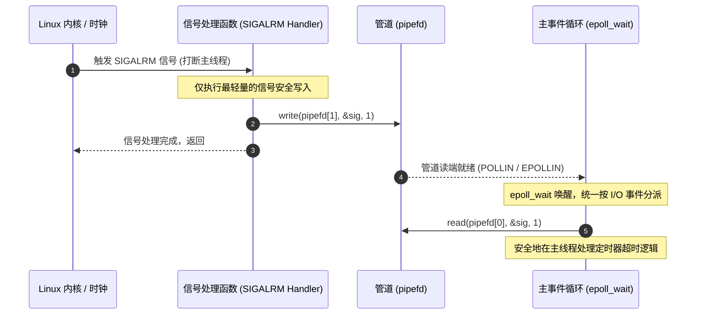
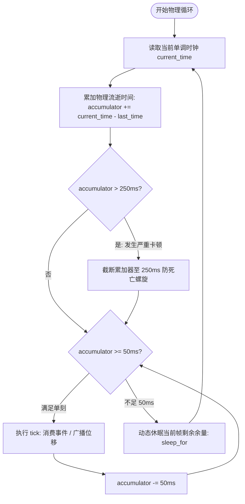

# 高性能网络与游戏引擎定时器架构深度解析：从游双《Linux高性能服务器编程》到现代 C++23/Asio 实践

> **前言**：
> 在高性能网络服务与多人在线游戏引擎开发中，**定时器（Timer）** 犹如心脏的脉搏。无论是识别死连接的双向心跳检测（KeepAlive）、防范恶意慢连接的超时熔断、限流与重试退避，还是驱动游戏世界状态推演的物理节拍器（Tick），都离不开定时器的精准支撑。
> 
> 本文以游双老师的经典著作 **《Linux高性能服务器编程》（第11章 定时器）** 为理论基石，系统性拆解 Linux 传统的三种系统级定时方法与三种经典用户态定时器容器（升序链表、时间轮、时间堆），并给出严谨清晰的代码实现与数学复杂度推演；随后，本文跨越到现代工业级实践，深度剖析现代 Linux（`timerfd`）、现代 C++ 时钟体系（`std::chrono`）与 Standalone Asio 的内部定时调度机制；最后，全面复盘本项目（MCPE）针对高并发多人大厅与跨服网关微服务引擎所独创的 **“网络 I/O 稀疏长周期事件 + 物理世界密集高频 20 TPS 累加器节拍器” 双引擎定时器架构**。

---

## 目录

- [一、 定时器的本质与在服务端架构中的核心角色](#一-定时器的本质与在服务端架构中的核心角色)
  - [1.1 什么是定时器？服务端的核心定时需求](#11-什么是定时器服务端的核心定时需求)
  - [1.2 定时器的四大核心评价维度与设计权衡](#12-定时器的四大核心评价维度与设计权衡)
- [二、 游双书《Linux高性能服务器编程》定时方法全景解析与代码实现](#二-游双书linux高性能服务器编程定时方法全景解析与代码实现)
  - [2.1 Linux 原生提供的三种底层系统定时机制](#21-linux-原生提供的三种底层系统定时机制)
    - [2.1.1 Socket 选项 `SO_RCVTIMEO` 和 `SO_SNDTIMEO`](#211-socket-选项-so_rcvtimeo-和-so_sndtimeo)
    - [2.1.2 `SIGALRM` 信号与统一事件源（Unified Event Source）](#212-sigalrm-信号与统一事件源unified-event-source)
    - [2.1.3 I/O 复用系统调用的超时参数（`epoll_wait` timeout）](#213-io-复用系统调用的超时参数epoll_wait-timeout)
  - [2.2 经典用户态定时器容器与算法实现](#22-经典用户态定时器容器与算法实现)
    - [2.2.1 基于升序双向链表的定时器（Ascending Linked List）](#221-基于升序双向链表的定时器ascending-linked-list)
    - [2.2.2 时间轮（Timing Wheel）算法模型与单轮实现](#222-时间轮timing-wheel算法模型与单轮实现)
    - [2.2.3 时间堆（Timing Heap / Min-Heap）与二叉堆连续内存优化](#223-时间堆timing-heap--min-heap与二叉堆连续内存优化)
  - [2.3 游双书三大定时器数据结构横向对比矩阵](#23-游双书三大定时器数据结构横向对比矩阵)
- [三、 现代 Linux 与 Asio 定时器的技术演进飞跃](#三-现代-linux-与-asio-定时器的技术演进飞跃)
  - [3.1 Linux 现代原语：`timerfd_create` 与“一切皆文件”哲学](#31-linux-现代原语timerfd_create-与一切皆文件哲学)
  - [3.2 C++ 标准库时钟范式：为什么严禁 `system_clock`，必须用 `steady_clock`？](#32-c-标准库时钟范式为什么严禁-system_clock必须用-steady_clock)
  - [3.3 Asio 内部定时器调度模型与源码级机制揭秘（`timer_queue` 底层机制）](#33-asio-内部定时器调度模型与源码级机制揭秘timer_queue-底层机制)
  - [3.4 破除认知误区：“时间轮与时间堆已经过时了吗？”](#34-破除认知误区时间轮与时间堆已经过时了吗)
  - [3.5 深度解析：为什么 `asio::steady_timer` 比其他方案更优？（系统工程学视角）](#35-深度解析为什么-asiosready_timer-比其他方案更优系统工程学视角)
- [四、 本项目（MCPE）的“双引擎”定时器架构深度剖析](#四-本项目mcpe的双引擎定时器架构深度剖析)
  - [4.1 架构设计背景：稀疏长周期 I/O 事件 vs 密集短周期物理节拍的矛盾](#41-架构设计背景稀疏长周期-io-事件-vs-密集短周期物理节拍的矛盾)
  - [4.2 网络/协议层：基于 `asio::steady_timer` 与 C++20 协程的异步心跳机制](#42-网络协议层基于-asiosready_timer-与-c20-协程的异步心跳机制)
  - [4.3 物理世界层：基于单调时钟与累加器的 20 TPS 物理节拍器 (`WorldTicker`)](#43-物理世界层基于单调时钟与累加器的-20-tps-物理节拍器-worldticker)
    - [4.3.1 累加器追帧算法原理（消除累积漂移 Cumulative Drift）](#431-累加器追帧算法原理消除累积漂移-cumulative-drift)
    - [4.3.2 250ms 防死亡螺旋（Anti-Death-Spiral）熔断保护](#432-250ms-防死亡螺旋anti-death-spiral熔断保护)
    - [4.3.3 动态休眠余量计算（CPU 负载与时间精度的黄金平衡）](#433-动态休眠余量计算cpu-负载与时间精度的黄金平衡)
  - [4.4 架构决断：为什么严禁将 20 TPS 物理循环挂在 `asio::steady_timer` 上？](#44-架构决断为什么严禁将-20-tps-物理循环挂在-asiosready_timer-上)
- [五、 全场景定时器技术选型对比决策矩阵（Decision Matrix）](#五-全场景定时器技术选型对比决策矩阵decision-matrix)
- [六、 工业级避坑血泪史与大厂高频面试硬核考点](#六-工业级避坑血泪史与大厂高频面试硬核考点)
  - [6.1 工业实战四大经典暗坑](#61-工业实战四大经典暗坑)
  - [6.2 高频面试硬核考点与标准作答](#62-高频面试硬核考点与标准作答)
- [七、 总结与架构心法](#七-总结与架构心法)

---

## 一、 定时器的本质与在服务端架构中的核心角色

### 1.1 什么是定时器？服务端的核心定时需求

在操作系统和应用层网络编程中，**定时器（Timer）** 是一种机制：用于在未来的某个特定时间点，或者在一段指定的时间间隔之后，触发执行预先注册的回调函数或任务。

在网络游戏与分布式微服务架构中，定时需求通常分为两大形态：
1. **稀疏、离散的长周期事件（Sparse & Long-Period Events）**：
   - **连接空闲检测与保活（KeepAlive）**：客户端是否在 20 秒内回复了心跳？若无应答则踢出（如本项目协议层处理）；
   - **登录/握手超时熔断（Handshake Timeout）**：客户端建立 TCP 连接后若超过 5 秒不发握手包，直接关闭连接，防范慢速 Slowloris DoS 攻击；
   - **异步 RPC 响应超时**：向外部服务发起请求后，超过设定时限判定超时并回退降级。
2. **密集、等距的短周期物理模拟（Dense & Isochronous Simulation）**：
   - **游戏物理引擎主循环（Fixed Timestep Tick）**：Minecraft 官方规范严格规定为 **20 TPS（每秒 20 次，单刻严格 50ms）**。用于推进实体位置、碰撞检测、下落复位（Fall Reset）、空间 AOI 裁剪与增量多播同步。

### 1.2 定时器的四大核心评价维度与设计权衡

设计或选用一个定时器体系时，必须综合考量以下四个维度：

```
                [时间精度 (Precision)]
                    ▲
                    │
[内存占用与 Cache 友好度] ┼ ──► [时间复杂度 (O(1) vs O(log N))]
                    │
                    ▼
            [时钟源稳定性 (Monotonicity)]
```

1. **时间精度（Precision & Granularity）**：是秒级（如基于传统信号 `alarm`）、毫秒级（`epoll_wait`）、还是微秒/纳秒级（`std::chrono::steady_clock`、`timerfd`）？
2. **增删查复杂度（Time Complexity）**：
   - 添加定时器（Add）：$O(1)$、$O(\log N)$ 还是 $O(N)$？
   - 删除/取消定时器（Cancel）：$O(1)$ 还是 $O(N)$？
   - 获取最近超时事件（Get Min）：$O(1)$ 还是 $O(N)$？
   - 每刻心跳推进/触发（Tick / Expire）：单次遍历开销多大？
3. **内存与 Cache 局部性（Cache Friendliness）**：是链表散列在堆上的离散节点指针，还是连续内存的扁平数组（如二叉堆向量）？
4. **时钟源稳定性（Monotonicity）**：当运维人员手动修改系统时间、或者 NTP 服务器进行夏令时跳变或闰秒同步时，定时器会不会发生集体瞬间暴毙或挂起数十年？

---

## 二、 游双书《Linux高性能服务器编程》定时方法全景解析与代码实现

游双老师在《Linux高性能服务器编程》第 11 章中，将 Linux 环境下的定时机制高度总结为：**三种底层系统定时方法**，以及**三种用户态定时器容器数据结构**。

---

### 2.1 Linux 原生提供的三种底层系统定时机制

```
┌────────────────────────────────────────────────────────────────────────┐
│                   Linux 传统的 3 种底层系统级定时机制                     │
├─────────────────────┬────────────────────┬─────────────────────────────┤
│ 1. Socket 选项超时  │ 2. SIGALRM 信号     │ 3. I/O 复用超时参数          │
│ SO_RCVTIMEO/SNDTIMEO│ alarm / setitimer  │ epoll_wait(..., timeout)    │
│ 阻塞套接字专用       │ 统一事件源 (管道转读)│ Reactor 经典架构核心基石    │
└─────────────────────┴────────────────────┴─────────────────────────────┘
```

#### 2.1.1 Socket 选项 `SO_RCVTIMEO` 和 `SO_SNDTIMEO`

* **工作原理**：
  通过 `setsockopt` 设置套接字的接收超时（`SO_RCVTIMEO`）与发送超时（`SO_SNDTIMEO`）。参数为 `struct timeval`（秒 + 微秒）。
* **行为表现**：
  - 仅对**阻塞套接字**有效；
  - 当在套接字上调用阻塞的 `recv/read` 或 `send/write` 时，如果在超时时间内没有数据到达或内核写缓冲未清空，系统调用直接返回 `-1`，且将全局错误码 `errno` 设置为 `EWOULDBLOCK` 或 `EAGAIN`；
  - 类似地，`connect` 超时时返回 `-1`，`errno` 为 `EINPROGRESS` 或 `ETIMEDOUT`。
* **C++ 代码示例**：
  ```cpp
  #include <sys/socket.h>
  #include <sys/time.h>
  #include <unistd.h>
  #include <cerrno>
  #include <iostream>

  bool readWithTimeout(int sockfd, char* buf, size_t len, int timeout_sec) {
      struct timeval tv;
      tv.tv_sec = timeout_sec;
      tv.tv_usec = 0;
      
      // 设置接收超时
      if (setsockopt(sockfd, SOL_SOCKET, SO_RCVTIMEO, &tv, sizeof(tv)) < 0) {
          return false;
      }

      ssize_t ret = recv(sockfd, buf, len, 0);
      if (ret < 0) {
          if (errno == EWOULDBLOCK || errno == EAGAIN) {
              std::cerr << "recv timed out after " << timeout_sec << " seconds!\n";
          }
          return false;
      }
      return true;
  }
  ```
* **架构局限性**：
  - **严重违背非阻塞 Reactor 架构**：在基于 `epoll` 的高并发非阻塞体系中，套接字全部配置为 `O_NONBLOCK`，`recv/send` 永远是立即返回，`SO_RCVTIMEO` 彻底失效；
  - **粒度极粗且无法统一管理**：每个连接必须单独发起系统调用设置，无法支持批量会话的统一超时调度。

---

#### 2.1.2 `SIGALRM` 信号与统一事件源（Unified Event Source）

* **工作原理**：
  系统调用 `alarm(seconds)` 或 `setitimer(ITIMER_REAL, ...)` 可以在指定时间后向当前进程发送 `SIGALRM` 信号。
* **痛点（信号处理函数的危险性）**：
  Linux 信号处理函数（Signal Handler）是在用户态堆栈被操作系统强行打断后插入执行的。在信号处理函数内部：
  - **严禁调用非异步信号安全函数（Non-Async-Signal-Safe Functions）**：如 `malloc`、`free`、`printf`、或获取标准互斥锁 `pthread_mutex_lock`，否则极易引发**死锁（Deadlock）或堆内存元数据破坏**；
  - **严禁直接执行业务逻辑**：如果定时任务需要遍历所有在线玩家或发送网络包，直接在 handler 中执行会彻底打崩主线程的控制流。
* **游双解决方案：统一事件源（Unified Event Source）**：
  通过 `socketpair` 或 `pipe` 建立全双工/单向管道：
  1. 信号处理函数只做一件事：向管道写端写入 1 字节代表接收到的信号值（如 `char sig = SIGALRM; write(pipefd[1], &sig, 1);`）；
  2. 将管道读端 `pipefd[0]` 注册到主线程的 `epoll` 监听列表中；
  3. 主事件循环的 `epoll_wait` 被唤醒，像处理普通客户端套接字可读一样处理管道读事件，从而**将异步信号优雅转化为同步的 I/O 事件**！



* **架构局限性**：
  - `alarm` 是秒级粗粒度定时，精度无法胜任游戏逻辑；
  - 信号会打断正在执行的慢速系统调用（产生 `EINTR` 错误），必须到处编写重试代码；
  - 多线程环境下信号分发目标不确定，极难控制。

---

#### 2.1.3 I/O 复用系统调用的超时参数（`epoll_wait` timeout）

* **工作原理**：
  `epoll_wait(int epfd, epoll_event* events, int maxevents, int timeout)` 接收毫秒级 `timeout` 参数：
  - `timeout = -1`：永久阻塞，直到有文件描述符事件就绪；
  - `timeout = 0`：非阻塞轮询，立即返回；
  - `timeout > 0`：若指定毫秒内没有任何 I/O 事件就绪，系统调用超时返回 `0`。
* **Reactor 联动机制**：
  1. 用户态维护一个定时器容器（如时间堆）；
  2. 在每次进入 `epoll_wait` 之前，查询容器中**最近（最早）要超时的那个定时器**，计算其距离当前时间的差值 $\Delta t$；
  3. 将 $\Delta t$ 作为 `timeout` 传入 `epoll_wait`；
  4. `epoll_wait` 返回后：
     - 若处理了就绪的 I/O 事件，可能耗费了时间，随后调用 `tick()` 扫描并触发已过期的定时器；
     - 若因为超时返回，说明最近的定时器已准时到期，直接调用 `tick()` 执行其回调。
* **为什么这是 Muduo / Libevent 等经典网络库的绝对核心？**
  它完全依托现有的事件循环机制，无需操作系统信号，零额外线程，精度达到毫秒级，把 I/O 事件调度与定时调度完美融合在单次系统调用中。

---

### 2.2 经典用户态定时器容器与算法实现

掌握了底层通知机制后，核心问题转向：**在用户态应该用什么数据结构来管理成千上万个定时器？**

---

#### 2.2.1 基于升序双向链表的定时器（Ascending Linked List）

* **数据结构模型**：
  - 维护一个按绝对过期时间（`expire`）**严格从小到大单调递增**排序的双向链表；
  - 链表头节点 `head` 恒为最早到期的定时器。
* **C++23 风格工业级实现代码**：
  ```cpp
  #include <chrono>
  #include <functional>
  #include <memory>

  struct UtilTimer;

  struct UtilTimer {
      using TimePoint = std::chrono::steady_clock::time_point;
      TimePoint expire;
      std::function<void()> cb_func;
      UtilTimer* prev{nullptr};
      UtilTimer* next{nullptr};
  };

  class SortTimerList {
  public:
      SortTimerList() = default;
      ~SortTimerList() {
          UtilTimer* cur = head_;
          while (cur) {
              UtilTimer* next = cur->next;
              delete cur;
              cur = next;
          }
      }

      // 添加定时器：O(N) 复杂度
      void addTimer(UtilTimer* timer) {
          if (!timer) return;
          if (!head_) {
              head_ = tail_ = timer;
              return;
          }
          if (timer->expire < head_->expire) {
              timer->next = head_;
              head_->prev = timer;
              head_ = timer;
              return;
          }
          addTimerInternal(timer, head_);
      }

      // 调整已存在定时器的超时时间（如收到客户端心跳后顺延）：O(N)
      void adjustTimer(UtilTimer* timer) {
          if (!timer) return;
          UtilTimer* tmp = timer->next;
          // 如果本身已是尾节点，或者新超时依然小于下一个节点，无需移动
          if (!tmp || (timer->expire < tmp->expire)) return;

          if (timer == head_) {
              head_ = head_->next;
              head_->prev = nullptr;
              timer->next = nullptr;
              addTimerInternal(timer, head_);
          } else {
              timer->prev->next = timer->next;
              timer->next->prev = timer->prev;
              addTimerInternal(timer, timer->next);
          }
      }

      // 删除指定定时器：O(1)
      void delTimer(UtilTimer* timer) {
          if (!timer) return;
          if (timer == head_ && timer == tail_) {
              head_ = tail_ = nullptr;
          } else if (timer == head_) {
              head_ = head_->next;
              head_->prev = nullptr;
          } else if (timer == tail_) {
              tail_ = tail_->prev;
              tail_->next = nullptr;
          } else {
              timer->prev->next = timer->next;
              timer->next->prev = timer->prev;
          }
          delete timer;
      }

      // 核心心跳检测：只需从表头检查，到期就执行并剔除
      void tick() {
          if (!head_) return;
          const auto now = std::chrono::steady_clock::now();
          UtilTimer* cur = head_;
          while (cur) {
              if (now < cur->expire) {
                  // 由于升序排列，遇到第一个未超时的节点即可立刻退出循环！
                  break;
              }
              cur->cb_func();
              head_ = cur->next;
              if (head_) head_->prev = nullptr;
              delete cur;
              cur = head_;
          }
      }

  private:
      void addTimerInternal(UtilTimer* timer, UtilTimer* list_head) {
          UtilTimer* cur = list_head;
          while (cur->next) {
              if (timer->expire < cur->next->expire) {
                  timer->next = cur->next;
                  cur->next->prev = timer;
                  timer->prev = cur;
                  cur->next = timer;
                  return;
              }
              cur = cur->next;
          }
          // 插入尾部
          cur->next = timer;
          timer->prev = cur;
          timer->next = nullptr;
          tail_ = timer;
      }

  private:
      UtilTimer* head_{nullptr};
      UtilTimer* tail_{nullptr};
  };
  ```
* **复杂度分析与致命弱点**：
  - **添加定时器**：平均 $O(N)$。若同时在线 50,000 个玩家，每个玩家每次发包都要刷新定时器，每次刷新都要在双向链表中线性扫描数万个节点，CPU 缓存命中率雪崩，网络吞吐急剧下降；
  - **删除定时器**：已知节点指针时为 $O(1)$；
  - **心跳 Tick**：平均 $O(1)$（只需检查表头若干超时节点）。

---

#### 2.2.2 时间轮（Timing Wheel）算法模型与单轮实现

* **设计心智跃迁（哈希思想）**：
  升序链表的瓶颈在于 $O(N)$ 的插入。时间轮借鉴了**哈希表（Hash Table）与机械时钟**的设计：
  - 拥有固定数量的槽位 $N$（Slot），每个槽位对应一个定时器链表；
  - 槽位代表的时间步长为 $SI$（Slot Interval，例如 1 秒）；
  - 指针 `cur_slot` 每经过 $SI$ 时间顺时针转动一格；
  - 对于超出单圈（$N \times SI$）的定时器，记录剩余圈数 `rotation`：当指针转到该槽时，只扣减 `rotation`，仅当 `rotation == 0` 时触发超时。

```
              Slot 0 [TimerA: rot=0 -> 触发]
            ／      ＼
    Slot 7             Slot 1 [TimerB: rot=1 -> 减为0]
    │                     │
    │    ┌─────────┐      │
    │    │cur_slot │      │
    │    └────┬────┘      │
    Slot 6    │        Slot 2
            ＼▼     ／
        Slot 5      Slot 3
             Slot 4
```

* **C++23 风格时间轮核心实现代码**：
  ```cpp
  #include <vector>
  #include <functional>
  #include <chrono>

  struct WheelTimer {
      int rotation{0};             // 记录需要转多少整圈后触发
      int time_slot{0};            // 记录属于哪一个槽
      std::function<void()> cb_func;
      WheelTimer* next{nullptr};
      WheelTimer* prev{nullptr};
  };

  class TimeWheel {
  public:
      TimeWheel(int slots, int slot_interval_ms)
          : slot_count_(slots),
            slot_interval_ms_(slot_interval_ms),
            slots_(slots, nullptr) {}

      ~TimeWheel() {
          for (int i = 0; i < slot_count_; ++i) {
              WheelTimer* cur = slots_[i];
              while (cur) {
                  WheelTimer* next = cur->next;
                  delete cur;
                  cur = next;
              }
          }
      }

      // 添加定时器：O(1) 极速哈希计算！
      WheelTimer* addTimer(int timeout_ms, std::function<void()> cb) {
          if (timeout_ms < 0) return nullptr;
          
          int ticks = timeout_ms / slot_interval_ms_;
          if (ticks < 1) ticks = 1;

          int rotation = ticks / slot_count_;
          int target_slot = (cur_slot_ + ticks) % slot_count_;

          auto* timer = new WheelTimer{rotation, target_slot, std::move(cb), nullptr, nullptr};
          
          // 头插法加入目标槽的链表中：O(1)
          if (!slots_[target_slot]) {
              slots_[target_slot] = timer;
          } else {
              timer->next = slots_[target_slot];
              slots_[target_slot]->prev = timer;
              slots_[target_slot] = timer;
          }
          return timer;
      }

      // 删除定时器：O(1)
      void delTimer(WheelTimer* timer) {
          if (!timer) return;
          int slot = timer->time_slot;
          if (timer == slots_[slot]) {
              slots_[slot] = slots_[slot]->next;
              if (slots_[slot]) slots_[slot]->prev = nullptr;
          } else {
              timer->prev->next = timer->next;
              if (timer->next) timer->next->prev = timer->prev;
          }
          delete timer;
      }

      // 每次滴答推进一格：处理该槽位
      void tick() {
          WheelTimer* cur = slots_[cur_slot_];
          while (cur) {
              WheelTimer* next = cur->next;
              if (cur->rotation > 0) {
                  // 圈数大于 0，说明还没到轮转周期，仅仅递减圈数
                  cur->rotation--;
                  cur = next;
              } else {
                  // 圈数为 0：触发超时！
                  cur->cb_func();
                  // 从链表移除并销毁
                  if (cur == slots_[cur_slot_]) {
                      slots_[cur_slot_] = cur->next;
                      if (slots_[cur_slot_]) slots_[cur_slot_]->prev = nullptr;
                  } else {
                      cur->prev->next = cur->next;
                      if (cur->next) cur->next->prev = cur->prev;
                  }
                  delete cur;
                  cur = next;
              }
          }
          // 指针顺时针前移一格
          cur_slot_ = (cur_slot_ + 1) % slot_count_;
      }

  private:
      int slot_count_;
      int slot_interval_ms_;
      int cur_slot_{0};
      std::vector<WheelTimer*> slots_;
  };
  ```
* **复杂度分析与工程权衡**：
  - **添加定时器**：严格 $O(1)$；
  - **删除定时器**：严格 $O(1)$；
  - **适用场景**：极度适合**长周期、均匀分布、且超时时间相近的高并发连接保活（如万级连接的 20 秒 KeepAlive）**。Netty 的 `HashedWheelTimer` 以及 Linux 内核定时器均采用多级时间轮设计。

---

#### 2.2.3 时间堆（Timing Heap / Min-Heap）与二叉堆连续内存优化

* **设计心智跃迁（完全二叉树 + 优先队列）**：
  升序链表查找慢（$O(N)$），时间轮在跨度过大时需要较多槽或产生退化链表。
  **最小堆（Min-Heap）** 则通过优先队列实现：
  - 满足堆序性：父节点的超时时间恒小于或等于子节点的超时时间；
  - 堆顶元素（数组索引 `0`）恒为全局最早到期的定时器；
  - 可以直接使用连续数组（如 `std::vector`）存储完全二叉树，索引映射关系极简：
    $$\text{parent}(i) = \frac{i - 1}{2}, \quad \text{left}(i) = 2i + 1, \quad \text{right}(i) = 2i + 2$$
  - 与 CPU L1/L2 缓存行完美契合，消除指针跳跃解引用。

* **C++23 风格时间堆核心实现代码**：
  ```cpp
  #include <vector>
  #include <chrono>
  #include <functional>
  #include <algorithm>
  #include <optional>

  class TimeHeap {
  public:
      using TimePoint = std::chrono::steady_clock::time_point;

      struct HeapNode {
          int id;
          TimePoint expire;
          std::function<void()> cb_func;
      };

      TimeHeap() = default;

      // 获取堆顶元素（最早到期时间）：O(1)
      std::optional<TimePoint> topExpire() const {
          if (heap_.empty()) return std::nullopt;
          return heap_.front().expire;
      }

      // 添加定时器：O(log N) 上浮调整
      void addTimer(int id, TimePoint expire, std::function<void()> cb) {
          heap_.push_back(HeapNode{id, expire, std::move(cb)});
          siftUp(heap_.size() - 1);
      }

      // 删除指定索引的定时器：O(log N)
      void delTimerByIndex(size_t index) {
          if (index >= heap_.size()) return;
          // 将待删节点与数组末尾交换，再做下沉/上浮
          std::swap(heap_[index], heap_.back());
          heap_.pop_back();
          if (index < heap_.size()) {
              siftDown(index);
              siftUp(index);
          }
      }

      // 核心心跳检测：循环弹出堆顶到期节点
      void tick() {
          const auto now = std::chrono::steady_clock::now();
          while (!heap_.empty()) {
              if (heap_.front().expire > now) {
                  // 堆顶都未到期，其余所有节点必然都未到期！
                  break;
              }
              // 触发堆顶回调
              heap_.front().cb_func();
              // 弹出堆顶：将末尾覆盖堆顶并下沉
              std::swap(heap_.front(), heap_.back());
              heap_.pop_back();
              if (!heap_.empty()) {
                  siftDown(0);
              }
          }
      }

  private:
      void siftUp(size_t i) {
          while (i > 0) {
              size_t parent = (i - 1) / 2;
              if (heap_[i].expire >= heap_[parent].expire) break;
              std::swap(heap_[i], heap_[parent]);
              i = parent;
          }
      }

      void siftDown(size_t i) {
          size_t n = heap_.size();
          while (2 * i + 1 < n) {
              size_t left = 2 * i + 1;
              size_t right = 2 * i + 2;
              size_t smallest = i;

              if (heap_[left].expire < heap_[smallest].expire) smallest = left;
              if (right < n && heap_[right].expire < heap_[smallest].expire) smallest = right;

              if (smallest == i) break;
              std::swap(heap_[i], heap_[smallest]);
              i = smallest;
          }
      }

  private:
      std::vector<HeapNode> heap_;
  };
  ```
* **复杂度分析与工业地位**：
  - **获取最近超时时间**：严格 $O(1)$，直接查 `heap_.front()`，能瞬间转化为 `epoll_wait` 的 `timeout`；
  - **插入与删除**：严格 $O(\log N)$；
  - **内存布局**：连续 `std::vector` 存储，无内存碎片，Cache 命中率极高；
  - **工业地位**：**Muduo、Libevent、Nginx** 等工业级 C/C++ 网络库的默认首选实现。

---

### 2.3 游双书三大定时器数据结构横向对比矩阵

| 对比维度 | 升序双向链表 (Sorted List) | 时间轮 (Timing Wheel) | 时间堆 / 最小堆 (Min-Heap) |
| :--- | :--- | :--- | :--- |
| **数据组织形式** | 离散堆节点 + 双向指针 | 环形数组槽 + 单向/双向链表 | 连续物理内存数组 (`vector`) |
| **插入复杂度 Add** | ❌ $O(N)$（长链表灾难） | ✅ $O(1)$（哈希直接定位） | ⚖️ $O(\log N)$（上浮调整） |
| **删除复杂度 Del** | ✅ $O(1)$（已知节点指针时） | ✅ $O(1)$（已知节点指针时） | ⚖️ $O(\log N)$（需维护哈希映射找索引） |
| **查询堆顶 Get Min**| ✅ $O(1)$（取表头） | ❌ 无法瞬时获取绝对最小值 | ✅ $O(1)$（取堆顶元素） |
| **单刻扫描 Tick** | 检查表头若干超时节点 | 遍历单槽链表，扣减圈数 | 循环弹出堆顶已到期节点 |
| **CPU Cache 友好度** | 差（指针跳跃，缓存缺失高） | 一般（槽位数组连续，链表离散） | 极佳（扁平连续内存） |
| **联动 epoll 复杂度**| 容易（直接取 head 算 timeout）| 复杂（必须依赖步长固定循环） | 天然完美契合（直接把 top 传给 epoll） |
| **适用业务场景** | 连接数极少（$<100$）的轻量程序 | 超大规模连接（$10^5+$）固定超时心跳 | 通用网络库定时调度（Muduo/Libevent） |

---

## 三、 现代 Linux 与 Asio 定时器的技术演进飞跃

从游双老师成书至今，Linux 内核与 C++ 标准经历了翻天覆地的演进。理解这些现代特性的底层变化，是掌握本项目架构的关键。

### 3.1 Linux 现代原语：`timerfd_create` 与“一切皆文件”哲学

在 Linux 2.6.25 之前，定时器与 epoll 的联动需要手动计算最小超时传递给 `epoll_wait`。
Linux 2.6.25 引入了专门的定时器文件描述符三剑客：
```c
int timerfd_create(int clockid, int flags);
int timerfd_settime(int fd, int flags, const struct itimerspec *new_value, struct itimerspec *old_value);
int timerfd_gettime(int fd, struct itimerspec *curr_value);
```
* **核心哲学**：**一切皆文件（Everything is a File Descriptor）**！
  - `timerfd` 把定时器直接包装为一个可读的 `fd`；
  - 能够像普通套接字一样直接调用 `epoll_ctl(epfd, EPOLL_CTL_ADD, tfd, &ev)` 加入监听；
  - 当定时器到期时，`tfd` 变为**可读**（调用 `read(tfd, &expirations, sizeof(uint64_t))` 读取超时次数）；
  - 支持高精度单调时钟 `CLOCK_MONOTONIC`；
  - **革命性价值**：多线程或跨模块添加定时器时，再也不需要去和 `epoll_wait` 争抢或唤醒计算 `timeout` 参数，由内核统一调度！

---

### 3.2 C++ 标准库时钟范式：为什么严禁 `system_clock`，必须用 `steady_clock`？

在 C++11 `<chrono>` 中，标准库提供了三种时钟：

```cpp
std::chrono::system_clock       // 挂钟时间 (Wall-Clock Time) —— 严禁用于定时器！
std::chrono::steady_clock       // 单调时钟 (Monotonic Clock) —— 定时器唯一法定标准！
std::chrono::high_resolution_clock // 通常是 steady_clock 的别名，平台相关
```

* **血泪事故（为什么严禁 `system_clock`）**：
  `system_clock` 对应操作系统的挂钟日历时间。
  1. **NTP 阶跃调整（NTP Step Jump）**：当系统时间与时间服务器出现偏差时，NTP 可能将系统时间向后调慢 1 秒或向后回调数小时；
  2. **运维手动修时间或夏令时切换**；
  - **灾难后果**：若定时器基于 `system_clock::now() + 10s`，一旦系统时间向后倒拨 1 小时，该定时器将被迫**沉睡 3610 秒才会被唤醒**，所有心跳逻辑彻底瘫痪！
* **`steady_clock` 的硬核保障**：
  底层直接绑定硬件单调计数器（如 x86 的 TSC 结合内核 `CLOCK_MONOTONIC`），**保证物理时间单调递增，绝不倒退，绝不受任何外界系统改时间干扰**。

---

### 3.3 Asio 内部定时器调度模型与源码级机制揭秘（`timer_queue` 底层机制）

本项目网络会话层采用的 Standalone Asio 定时器为 `asio::steady_timer`（即 `asio::basic_waitable_timer<std::chrono::steady_clock>`）。

很多开发者以为 Asio 的定时器是一种“黑魔法”，甚至误以为它是“每个 timer 开启一个 Linux 线程或一个内核 `timerfd`”。**这是巨大的技术认知偏差！** 深入 Asio 源码（`asio/detail/timer_queue.hpp` 与 `asio/detail/epoll_reactor.hpp`），其实际实现兼顾了算法优雅性与系统工程学的极致性能。

#### 1. 分层门面架构（Facade & Service Pattern）
Asio 遵循 Boost/ASIO 经典的 I/O Executor 服务分离模型：
- **用户前端**：`asio::steady_timer` 仅仅是一个轻量级句柄（Handle），内部持有一个指向底层服务的指针和一个 `per_timer_data` 上下文；
- **核心服务**：全局单例 `detail::deadline_timer_service<Time_Traits>` 管理当前 `io_context` 下该时钟类型的所有定时器；
- **物理容器**：服务底层将所有未决的定时任务委托给 `detail::timer_queue<Time_Traits>`。

#### 2. 容器物理实现：扁平连续内存最小堆（Min-Heap）
在 `asio/detail/timer_queue.hpp` 源码中，Asio 并没有采用红黑树，而是维护了一个**连续内存向量的最小堆**：
```cpp
// Asio 内部 detail/timer_queue.hpp 核心数据结构模型示意
template <typename Time_Traits>
class timer_queue {
  struct heap_entry {
    time_type time_;            // 绝对到期时间点 (std::chrono::steady_clock::time_point)
    per_timer_data* timer_;     // 关联的定时器对象元数据指针
  };

  std::vector<heap_entry> heap_; // 扁平连续内存实现的二叉最小堆！
  // ...
};
```
- **堆序性保证**：`heap_[0]` 恒为全局**最早过期的定时器**；
- **$O(1)$ 取消索引优化**：每个 `per_timer_data` 维护了一个待决操作链表（`op_queue`），并记录了自身当前在 `heap_` 数组中的动态索引。当用户调用 `timer.cancel()` 时，Asio 能通过索引直接定位并执行 $O(\log N)$ 下沉/上浮剔除，无需遍历扫描整个堆，彻底杜绝 $O(N)$ 灾难。

#### 3. 单内核唤醒源多路复用（The Single-Wakeup Multiplexing Trick）
这是 Asio 架构中最精妙的工程设计：**成千上万个 `steady_timer`，在操作系统内核层面永远只共享 1 个唤醒源！**

```mermaid
flowchart TD
    subgraph 用户态内存 (User Space)
        T1[Client A Timer (10s)] --> Heap[Asio timer_queue 最小堆]
        T2[Client B Timer (15s)] --> Heap
        T3[Client C Timer (5s)]  --> Heap
        Heap -->|O(1) 堆顶查询| Top[当前最早到期: 5s]
    end

    subgraph 操作系统内核 (Linux Kernel)
        Top -->|只有堆顶变化才更新| TFD[单例 timerfd / epoll_wait timeout]
        TFD --> Epoll[epoll_wait 事件循环]
    end

    Epoll -->|到期唤醒| Drain[批量弹出所有到期 timer -> 派发就绪协程/回调]
```

- **误区警示**：如果为每个玩家会话都创建一个操作系统的 `timerfd`，当有 50,000 个在线连接时，系统将消耗 50,000 个文件描述符，每次创建/销毁伴随巨大的内核态上下文切换，内核的高精度软中断红黑树（`hrtimer`）将彻底崩溃；
- **Asio 的解法**：
  - 50,000 个 `steady_timer` 纯粹是用户态堆中的数据结构（内存开销仅几十字节）；
  - 整个 `epoll_reactor` 只持有一个单例 `timerfd`（或在 `epoll_wait` 中动态传入堆顶剩余毫秒作为 `timeout`）；
  - **堆顶重设分支预测（Zero System Call on Non-Top Insert）**：
    - **情况 A（新 timer 晚于堆顶）**：新注册一个 10 秒定时器，而当前堆顶是 5 秒。执行 `up_heap` 后它沉在堆内部，**底层完全不做任何系统调用**！开销为纯纳秒级内存操作；
    - **情况 B（新 timer 早于堆顶）**：新注册一个 2 秒定时器，上浮成为了新的堆顶。此时 Asio 才会调用一次 `timerfd_settime` 更新单内核定时器，或者向 `eventfd` 写入 1 字节唤醒正在等待 5 秒的 `epoll_wait`，重新调整休眠步长。

---

### 3.4 破除认知误区：“时间轮与时间堆已经过时了吗？”

> 很多开发者学到这里会产生一个严重的认知偏差：“*既然有了 `timerfd` 和 `asio::steady_timer`，游双书里讲的‘时间轮’和‘时间堆’是不是已经被历史淘汰的过时产物了？*”

**答案是：绝对没有！恰恰相反，它们不仅没有过时，反而是所有现代高性能网络框架底层的终极基石！**

#### 1. 为什么说时间堆没有过时？
正如 3.3 节的源码剖析所示：**`asio::steady_timer` 的底层正是时间堆（Min-Heap）！**
现代网络库并没有颠覆数据结构，而是把时间堆包进了一流的现代 C++ 异步框架里。如果不懂时间堆的 $O(\log N)$ 上浮下沉原理、不懂完全二叉树的连续内存平铺，你就根本不可能真正理解 Asio 的性能边界与调优哲学。

#### 2. 为什么说时间轮在特定领域依然是无法被堆撼动的“性能王者”？
既然 Asio 选择了最小堆，那时间轮（Timing Wheel）是不是真不如时间堆？**绝非如此！在海量长连接场景下，时间轮具有降维打击般的优势。**

让我们用工业界真实的极端场景进行**数学量化推演**：
* **业务场景**：设系统维持 **$N = 1,000,000$（100 万并发长连接）** 的大型推送网关或消息中间件，每个连接采用固定的 30 秒心跳超时检测；
* **若采用时间堆（如 Asio 堆模型）**：
  - 当在线人数达到 100 万时，二叉堆深度为 $\lceil \log_2(1,000,000) \rceil \approx 20$；
  - 客户端每发送一次心跳包，服务端为了“刷新超时时间”，必须在堆中删除旧节点并重新插入新时间点（执行调整）；
  - 单次刷新需要经历 **约 20 次节点比较与数组内存交换**；
  - 假设每秒有 10 万个心跳包到达（吞吐量 100k QPS），时间堆每秒要执行 **$100,000 \times 20 = 2,000,000$ 次内存写操作与堆维护**！
  - 伴随着极其激烈的 CPU Cache 颠簸和互斥锁争用，CPU 会直接被堆结构的维护吃满，根本腾不出算力跑业务；
* **若采用时间轮（如 Netty HashedWheelTimer / Kafka Purgatory）**：
  - 时间轮的槽位代表绝对步长（如 1 秒 1 个槽，共 60 个槽代表 60 秒）；
  - 客户端发来心跳时，只需将该连接从旧槽的链表中脱钩（$O(1)$），计算目标槽 `target_slot = (cur_slot + 30) % 60`（$O(1)$），通过头插法直接挂入目标槽链表（$O(1)$）；
  - **整个过程严格耗时 $O(1)$ 常数时间，零比较，零堆重构，零全局锁颠簸！**
  - 每秒 10 万次心跳对时间轮而言只是简单的指针重挂，CPU 占用率不到 2%。

* **工业界顶级开源组件的选择**：
  - **Linux 内核低精度时钟（`timer_list`，处理内核 Jiffies 超时）**：历经三十年演进，至今核心依然是经典的 **层次化多级时间轮（Hierarchical Timing Wheel）**；
  - **Netty（Java 网络霸主）**：专为管理海量 Channel 空闲设计的核心组件是 `HashedWheelTimer`；
  - **Kafka**：其最核心的高并发延时请求管理组件 `DelayedOperationPurgatory` 采用的就是基于层级时间轮（Hierarchical Timing Wheel）算法。

---

### 3.5 深度解析：为什么 `asio::steady_timer` 比其他方案更优？（系统工程学视角）

既然时间轮如此强大、且 Asio 底层也不过是个最小堆，那么**为什么在绝大多数 C++ 现代服务端与微服务（包括本项目）中，工程师依然压倒性地首选 `asio::steady_timer`，而不是手写时间轮或手写时间堆？**

答案在于：**Asio 的优势根本不是“算法复杂度上的新发明”，而是现代系统工程学、异步并发模型与现代语言原语上的降维打击！**

```
┌────────────────────────────────────────────────────────────────────────┐
│              asio::steady_timer 相比手写方案的四大工业级降维打击          │
├─────────────────────┬────────────────────┬─────────────────────────────┤
│ 1. 全生命周期无竞态  │ 2. 单内核源多路复用 │ 3. C++20 协程生态闭环       │
│ Zero-Race Cancel    │ 消除系统调用风暴   │ co_await 扁平线性代码       │
├─────────────────────┴────────────────────┴─────────────────────────────┤
│ 4. 跨平台操作系统抽象闭环 (Linux timerfd / macOS kqueue / Windows IOCP)│
└────────────────────────────────────────────────────────────────────────┘
```

#### 1. 全生命周期无竞态安全保证（Zero-Race Cancellation）—— 手写定时器的头号死穴
在多线程网络库中，手写定时器崩溃率最高的 Bug 永远是 **“取消与到期的竞态条件（Race Condition）导致的悬挂指针（UAF, Use-After-Free）”**：
- **灾难场景**：
  - 线程 A（网络 I/O 线程）：客户端主动断开连接，准备析构 `Session`，调用 `timer->cancel()`；
  - 线程 B（定时器工作线程）：该定时器在纳秒级同一时刻正好到期，从堆中弹出，正在触发 `Session::onTimeout()`；
  - 此时 `Session` 对象在线程 A 被销毁，线程 B 的回调访问已释放内存，引发瞬间 **SIGSEGV / 段错误**。
- **Asio 的工业级解法**：
  - Asio 将定时器的取消操作深度内嵌于其 **Strand / Executor 事件调度状态机** 中；
  - 当调用 `timer.cancel()` 时，Asio 保证：任何未决的异步操作立即被拦截，并以标准错误码 `asio::error::operation_aborted` 投递给绑定的 Executor；
  - 绝不会在对象销毁后发生幽灵回调，从底层数学逻辑上杜绝了多线程 UAF 竞态。

#### 2. 用户态聚合与零系统调用风暴（Zero System Call Storm）
初学者使用现代 Linux `timerfd` 时，往往简单粗暴地为每个连接都 `timerfd_create`。这种做法在 10,000 连接时就会引发严重的内核系统调用风暴与文件描述符耗尽。
Asio 通过将海量定时器以最小堆聚合在用户态，实现了“万物归一”的单唤醒源机制，兼顾了高精度纳秒时钟与最低限度的内核上下文切换。

#### 3. 现代 C++20 协程生态闭环（Zero-Callback Hell）
手写时间堆或时间轮必须依赖 `std::function<void()>` 注册回调：
- 每次注册伴随一次微小的堆内存分配（Heap Allocation）；
- 回调闭包中必须捕获 `shared_from_this()`，稍有不慎就与会话形成**循环引用（Circular Reference）导致内存永久泄漏**；
- 回调拆碎了业务逻辑（Callback Hell）。

而 `asio::steady_timer` 完美契合 C++20 协程：
```cpp
// 线性直观、零回调、生命周期天然受 RAII 协程帧保护
keep_alive_timer_.expires_after(std::chrono::seconds(10));
auto [ec] = co_await keep_alive_timer_.async_wait(asio::as_tuple(asio::use_awaitable));
if (ec == asio::error::operation_aborted) return; // 优雅感知取消
```
挂起时协程帧仅占用极其紧凑的内存块，恢复时自动回到绑定的 Strand，异常安全保证登峰造极。

#### 4. 跨平台操作系统抽象闭环
Linux 下基于 `timerfd` 或 `epoll_wait` 超时；macOS / iOS 下基于 `kqueue` 的 `EVFILT_TIMER`；Windows 下基于完成端口 IOCP。上层业务代码无论在何种操作系统，面对的都是完全同一份类型安全、纳秒精度的 `std::chrono::steady_clock` 接口。

---

## 四、 本项目（MCPE）的“双引擎”定时器架构深度剖析

在清晰理解了 Linux 底层机制与 Asio 机制后，我们来系统复盘本项目在多人游戏大厅与集群网关微服务引擎中的定时器工业级架构。

### 4.1 架构设计背景：稀疏长周期 I/O 事件 vs 密集短周期物理节拍的矛盾

在游戏微服务引擎中，如果试图用“一把锤子敲所有钉子”，系统必将崩溃：
- **矛盾 1：时间频率数量级的巨大悬殊**：
  - 网络心跳（KeepAlive）：10~20 秒一次（频率 0.05 Hz ~ 0.1 Hz）；
  - 物理推进（Physics Tick）：每秒 20 次，间隔严格 50ms（频率 20 Hz，相差 400 倍！）；
- **矛盾 2：线程所有权与单写入者（Single-Writer）Actor 隔离**：
  - 网络 I/O 运行在 Asio 事件循环中，负责套接字读写与拆包；
  - 游戏世界（World/EntityManager/LobbyInstance）遵循**单写入者原则**，严禁并发加锁，状态必须在独立逻辑主线程推演。

因此，本项目采用了明确解耦的 **“双引擎”定时器架构**：

```
┌────────────────────────────────────────────────────────────────────────┐
│                        MCPE 双引擎定时器架构拓扑                         │
├──────────────────────────────────┬─────────────────────────────────────┤
│ 引擎 A：网络与会话层 (稀疏长周期) │ 引擎 B：游戏物理世界层 (密集等距)    │
│ 组件：asio::steady_timer 协程环   │ 组件：WorldTicker 20 TPS 累加器     │
│ 宿主：Asio I/O 线程池             │ 宿主：独立独占单线程 (Worker Thread)│
│ 精度：秒级 ~ 毫秒级               │ 精度：纳秒单调时钟恒定 50ms 追帧    │
│ 职责：KeepAlive 保活与超时熔断   │ 职责：玩家位移广播、AABB判定、切世界 │
└──────────────────────────────────┴─────────────────────────────────────┘
```

---

### 4.2 网络/协议层：基于 `asio::steady_timer` 与 C++20 协程的异步心跳机制

在 `src/protocol/ClientSession.h` 与 `ClientSession.cc` 中，每个连入的玩家会话均持有一个独立的 `asio::steady_timer keep_alive_timer_`。

* **C++20 无回调地狱的协程心跳环（Coroutine Loop）**：
  传统网络库写心跳，通常是 `async_wait` 绑定成员函数，成员函数里发包后再调一次 `async_wait`，代码支离破碎且生命周期难以管理。
  本项目采用了现代 C++20 协程，在 `ClientSession::keepAliveLoop()` 中实现了极其优雅的串行化保活逻辑：

  ```cpp
  // src/protocol/ClientSession.cc
  asio::awaitable<void> ClientSession::keepAliveLoop() {
    auto self = shared_from_this(); // 智能指针保活

    while (!isStopped()) {
      // 1. 设置 10 秒超时
      keep_alive_timer_.expires_after(std::chrono::seconds(10));
      auto [ec] = co_await keep_alive_timer_.async_wait(asio::as_tuple(asio::use_awaitable));
      if (isStopped() || ec) {
        break; // 优雅退出
      }

      // 2. 超时检测：距上次收到客户端响应是否已超过 20 秒
      const auto now = std::chrono::steady_clock::now();
      const auto elapsed =
          std::chrono::duration_cast<std::chrono::seconds>(now - last_alive_time_).count();
      if (elapsed > 20) {
        spdlog::warn("[ClientSession] Client {} keep-alive timeout ({}s > 20s), kicking!",
                     remoteAddress(), elapsed);
        stop(); // 熔断踢出死连接
        break;
      }

      // 3. 向客户端下发 0x1F KeepAlive 数据包
      sendKeepAlive();
    }
    co_return;
  }
  ```

* **架构亮点**：
  1. **零回调嵌套**：以直观的 `while(!isStopped())` 串联起生命周期；
  2. **非阻塞等待**：`co_await async_wait` 让出协程控制权给 Asio 调度器，不占任何物理线程；
  3. **单调时钟防调时**：内部计算 `elapsed` 采用 `std::chrono::steady_clock`，防御外界改时间；
  4. **精确熔断防僵尸连接**：20 秒未响应即触发 `stop()`，从底层拔掉套接字，释放内存与端口资源。

---

### 4.3 物理世界层：基于单调时钟与累加器的 20 TPS 物理节拍器 (`WorldTicker`)

游戏主线程的节拍器位于 `src/world/WorldTicker.h` 和 `WorldTicker.cc`，这是本项目的物理推进心脏。

#### 4.3.1 累加器追帧算法原理（消除累积漂移 Cumulative Drift）

如果写成简单的 `while(running) { tick(); sleep_for(50ms); }`，每次循环耗时 $50\text{ms} + \Delta t_{work} + \Delta t_{sched}$，长期运行会导致世界时间严重滞后。

本项目实现了工业级游戏引擎的标准**恒定步长累加器追帧算法（Fixed Timestep with Accumulator）**：



#### 4.3.2 250ms 防死亡螺旋（Anti-Death-Spiral）熔断保护

* **什么是死亡螺旋（Spiral of Death）？**
  如果宿主机因为发生大规模 I/O 阻塞或容器暂停，主线程挂起了 5 秒钟。
  此时 `accumulator` 累加到了 5000ms。主线程恢复后，如果老老实实去追这 100 帧（$5000 / 50$），连续执行 100 次 `tick()` 会耗尽 CPU 资源，导致下一秒再次超时，累加器永远无法清零，服务器彻底陷入假死瘫痪！
* **本项目的工业防御**：
  ```cpp
  constexpr nanoseconds kMaxAccumulator(250'000'000); // 250ms 上限 (最多追 5 帧)
  if (accumulator > kMaxAccumulator) {
    spdlog::warn("[WorldTicker] Lag spike detected, capping accumulator to prevent death spiral");
    accumulator = kMaxAccumulator; // 强行丢弃过剩追帧，保全系统生命！
  }
  ```

#### 4.3.3 动态休眠余量计算（CPU 负载与时间精度的黄金平衡）

每次追帧完成后，并不死板地 `sleep(50ms)`，而是动态测量当帧业务已经消耗的时间，**只休眠剩余不足 50ms 的余量**：
```cpp
const auto elapsed = steady_clock::now() - current_time;
if (elapsed < kTickInterval) {
  std::this_thread::sleep_for(kTickInterval - elapsed);
}
```
这样既保证了空闲时让出 CPU 给操作系统，又保证了每个 Tick 的起始点紧紧贴合物理 50ms 网格。

---

### 4.4 架构决断：为什么严禁将 20 TPS 物理循环挂在 `asio::steady_timer` 上？

很多初学者容易产生一个念头：“*既然 Asio 提供了 `steady_timer`，为什么不直接在网络线程里弄一个 `50ms` 的 timer，每到期一次就调 `world.tick()`？*”

**架构红线严禁如此设计，原因有三**：
1. **彻底破坏单写入者（Single-Writer）Actor 模型**：
   如果让 Asio 的 Worker 线程去调 `world.tick()`，由于 Asio 线程池有多个线程，多个异步回调可能跨线程并发读写玩家实体哈希表，引发严重的数据竞态（Data Race）；
2. **事件循环饥饿与抖动（Event Loop Starvation）**：
   `tick()` 内部需要处理复杂的 AABB 碰撞检测、跨服传送与大量广播包组装。如果将其阻塞在 Asio 的 I/O 线程中，套接字拆包和 `async_write` 将大面积积压，网络时延暴增；
3. **节拍精度失真**：
   Asio 定时器排在 `io_context` 任务队列中。当网络高并发涌入时，定时器回调往往被大量就绪的 I/O 事件挤在后面，50ms 的 Tick 会频繁抖动成 30ms、80ms，导致客户端玩家位移严重卡顿撕裂。

---

## 五、 全场景定时器技术选型对比决策矩阵（Decision Matrix）

为帮助开发者与面试官建立完整选型图谱，特总结如下全场景权衡矩阵：

| 方案 / 场景 | 游双: 升序链表 | 游双: 时间轮 | 游双: 时间堆 | 现代 Linux timerfd | Asio: steady_timer (本项目网络层) | 独立线程累加器 (本项目物理层) |
| :--- | :--- | :--- | :--- | :--- | :--- | :--- |
| **底层机制** | 用户态链表遍历 | 用户态轮盘槽 | 用户态最小堆 | 内核高精度定时器 fd | 内部优先队列 + epoll/timerfd | `steady_clock` + 时间累加器 |
| **精度等级** | 毫秒级 | 毫秒/秒级 | 毫秒级 | 纳秒级 | 纳秒/微秒级 | 纳秒级 (严格 50ms 步长) |
| **插入复杂度** | $O(N)$ | $O(1)$ | $O(\log N)$ | $O(1)$ (单fd) | $O(\log N)$ | 不适用 (单主循环驱动) |
| **删除复杂度** | $O(1)$ | $O(1)$ | $O(\log N)$ | $O(1)$ (单fd) | $O(\log N)$ | 不适用 |
| **跨线程并发支持** | 需外部大锁 | 需外部大锁 | 需外部大锁 | 天然线程安全 | 由 Asio Strand/Executor 保证 | 独占主线程，通过 MPSC 队列解耦 |
| **与协程集成度** | 无原生支持 | 无原生支持 | 无原生支持 | 需自行封装 | ✅ 原生 `co_await` 极其优雅 | 不适用 |
| **防时间漂移能力** | 差 | 一般 | 依赖时钟源 | 极佳 | 极佳 (`steady_clock`) | 极佳 (双向消除累积漂移) |
| **典型适用场景** | 教学玩具 Demo | 超大规模心跳保活 (Netty/Kafka) | 通用 Reactor 超时调度 (Muduo) | 现代 Linux 高吞吐服务器 | 现代 C++ 异步连接生命周期管理 | 游戏物理引擎、高频交易撮合引擎 |

---

## 六、 工业级避坑血泪史与大厂高频面试硬核考点

### 6.1 工业实战四大经典暗坑

#### 坑 1：时钟源选错引发的“穿越雪崩”
* **现象**：服务器平稳运行，运维夜间校准服务器时间倒拨了 30 秒，结果数万名在线玩家在同一瞬间全部被判定心跳超时强行踢下线！
* **根因**：使用了 `std::chrono::system_clock` 或 `gettimeofday` 记录最后活跃时间。时间倒拨导致计算差值出现溢出或异常，防线全毁。
* **避坑铁律**：**所有用于超时检测、性能采样、帧同步的代码，强制只认 `std::chrono::steady_clock`（或 `CLOCK_MONOTONIC`）！**

#### 坑 2：定时器风暴与惊群（Timer Storm）
* **现象**：配置所有客户端心跳超时为固定 10.0 秒。当 10,000 名机器人同时连入时，每到整 10 秒瞬间，服务器 CPU 飙升到 100%，网络瞬间拥塞。
* **根因**：所有连接的定时器在相同的时间点同时到期（相位同相）。
* **避坑铁律**：引入 **抖动因子（Jitter / Randomization）**。将超时时间设为 `10s + rand(-500ms, +500ms)`，使定时器在时间轴上均匀散开。

#### 坑 3：惰性删除（Lazy Deletion）导致的内存伪泄漏
* **现象**：使用二叉堆管理定时器时，客户端断开后仅在节点上标记 `deleted = true`，没有立即从二叉堆中删除。随着大量短连接进出，二叉堆膨胀到数千万个空节点，内存居高不下。
* **避坑铁律**：采用双向映射表记录 `timer_id -> heap_index` 支持 $O(\log N)$ 物理删除，或者在堆顶弹出时做级联清理，并在堆有效利用率低于 50% 时触发全局重建压缩（Compaction）。

#### 坑 4：64 位时间戳防环绕溢出
* **现象**：在 32 位系统下用毫秒计数器，大约 49.7 天后计数器发生 32 位有符号整数回绕（Wrap Around），所有比较公式 `now > expire` 全部失效。
* **避坑铁律**：统一使用 64 位整型（`int64_t` 或 `std::chrono::nanoseconds`）。64 位纳秒计数器足以支撑数百年不溢出。

---

### 6.2 高频面试硬核考点与标准作答

#### Q1: 游双书中为什么说信号处理函数中不能直接调用业务逻辑？“统一事件源”是如何解决这个问题的？
* **标准作答**：
  信号处理函数是由操作系统内核在任意时刻打断主线程上下文后强制执行的。在信号上下文中只能调用系统规定的异步信号安全（Async-Signal-Safe）函数。像 `malloc/free`、标准 I/O 以及非递归互斥锁都不是信号安全的，若被中断的代码恰好持有锁或正在修改堆内存结构，信号处理函数内再次请求该资源会导致立即死锁或内存破坏。
  “统一事件源”思想是在信号处理函数中仅做最轻量的一步：通过 `write` 向管道写端发送 1 字节信号编号（`write` 是绝对信号安全的）；主线程的 `epoll` 监听管道读端，当监听到可读事件后，主事件循环按常规 I/O 流程在安全的线程上下文中读取该字节并分发业务逻辑，彻底解决了安全冲突。

#### Q2: 比较基于升序链表的定时器与基于最小堆的时间堆，为什么工业级网络库更青睐最小堆？
* **标准作答**：
  1. **时间复杂度差距**：升序链表在添加定时器或更新心跳时需要从头遍历寻找插入点，复杂度为 $O(N)$，在高并发连接下 CPU 成为严重瓶颈；而最小堆通过二叉树上浮下沉，插入和调整复杂度严格为 $O(\log N)$；
  2. **与 Reactor 架构天然契合**：最小堆的堆顶元素在 $O(1)$ 时间内即可获取，可以直接把堆顶的最早超时绝对时间换算为毫秒差值，作为 `epoll_wait` 的 `timeout` 参数传入；
  3. **内存与 Cache 局部性**：最小堆通常以一维 `vector` 数组平铺存储完全二叉树，内存连续，对比链表的离散指针跳跃，CPU 缓存命中率显著更高。

#### Q3: 既然时间轮的增删复杂度是 $O(1)$，它相比最小堆有什么劣势？在什么场景下选用时间轮？
* **标准作答**：
  时间轮的劣势在于：
  1. **时间跨度与精度的矛盾**：单级时间轮若要覆盖超长跨度且保持微秒高精度，槽位数组将膨胀到不可接受；若引入圈数计数（`rotation`），单槽链表可能退化；若引入多级时间轮（Hierarchical），跨级降级（Cascade）逻辑复杂度剧增；
  2. **无法瞬时知道全局最早到期时间**：难以直接为 `epoll_wait` 计算最优的休眠 timeout。
  **适用场景**：当连接规模达到十万至百万级，且绝大多数定时器的超时周期固定且均匀（例如统一的 20 秒连接保活）时，时间轮以几乎零开销的 $O(1)$ 哈希成为绝对统治者（如 Netty 和 Kafka）。

#### Q4: 本项目（MCPE）中，为什么不直接用 `asio::steady_timer` 来驱动 20 TPS 的游戏世界模拟？
* **标准作答**：
  这是出于领域驱动与系统并发模型的深层考量：
  1. **单写入者（Single-Writer）Actor 隔离**：游戏世界所有实体状态与大厅实例状态机严格由独立的物理主线程独占管理，零锁运行；若交由 Asio 的线程池定时器驱动，会破坏线程所有权，引发并发竞态；
  2. **消除时间累积漂移**：Asio 定时器只能做到“到期唤醒”，无法自动消除帧耗时与系统调度带来的累积时间漂移；`WorldTicker` 采用累加器追帧算法，能够自动补偿前一帧的延迟，确保物理时刻严格对齐 50ms 网格；
  3. **防死亡螺旋熔断**：主循环内置了 250ms（5 帧）的累加器保护屏障，当系统发生严重抖动时能主动放弃不可逆的追帧，防止服务器被级联延时彻底拖垮。

#### Q5: 现代 Linux 提供了 `timerfd`，为什么不能直接为每个客户端连接都创建一个 `timerfd`？Asio 是如何设计的？
* **标准作答**：
  为每个连接创建独立的 `timerfd` 在工程上是灾难性的：
  1. **文件描述符与内核内存耗尽**：一个服务器若支撑 50,000 个在线并发，会额外耗尽 50,000 个文件描述符和大量的内核 `file` 结构体内存；
  2. **系统调用风暴**：每次连接创建、重置、销毁都要调用 `timerfd_create/timerfd_settime/close`，频繁切换用户态与内核态，CPU 开销巨大；
  3. **打垮内核时钟软中断**：Linux 内核管理 `timerfd` 的底层结构是高精度红黑树（`hrtimer`）。数万个软中断高频触发会导致内核时钟中断处理成为全系统瓶颈。
  **Asio 的工业解法**：采用“用户态聚合 + 单内核唤醒源多路复用”。所有数万个应用层定时器由用户态的高性能连续最小堆统一管理，整个 Reactor 只向内核注册 1 个全局单例唤醒源（单个 timerfd 或 `epoll_wait` 的 timeout 参数），只有当堆顶改变时才触发一次系统调用，将海量系统调用压缩近乎于零。

#### Q6: 时间轮和时间堆真的过时了吗？为什么在大规模长连接网关中，Netty 和 Kafka 依然坚决使用时间轮？
* **标准作答**：
  绝没有过时：
  1. **时间堆是现代定时器（如 Asio）的底层实体**：Asio 的 `timer_queue` 内部就是连续数组实现的最小堆，现代网络库只是将时间堆与异步调度、协程生命周期做了更高阶的封装；
  2. **时间轮在超大规模固定心跳场景下性能超越时间堆**：当长连接规模达到百万级（$N=1,000,000$）且心跳周期固定（如 30 秒）时，如果使用最小堆，客户端每发一次心跳包刷新超时，堆都要进行 $O(\log N) \approx 20$ 次比较与数组交换，每秒 10 万次心跳将引发 200 万次内存写与剧烈锁竞争，CPU 直接被打爆；而时间轮通过哈希槽定位与双向链表头插法，插入与删除严格为 $O(1)$ 常数时间，零比较、零堆维护。因此，Netty 的 `HashedWheelTimer` 和 Kafka 的层级时间轮在千万级长连接推送与延时请求场景下依然是不可替代的统治级方案。

---

## 七、 总结与架构心法

从 2010 年游双老师笔下的经典 Linux 基础，到现代 C++23、Standalone Asio 协程与高性能体素游戏引擎，定时器的技术形态经历了从**“系统信号与裸链表”**到**“Reactor 堆组织”**，再到**“多核并发下的 Actor 单写入者与双引擎隔离”**的深刻演变。

技术演进的底层脉络始终未变：
1. **时钟必须单调**：用 `steady_clock` 构筑永不回退的基准；
2. **职责必须单一**：I/O 稀疏长周期事件与世界物理密集高频推进必须分流隔离；
3. **安全必须前置**：用防死亡螺旋与超时熔断构筑服务器永不崩溃的高可用底线。
