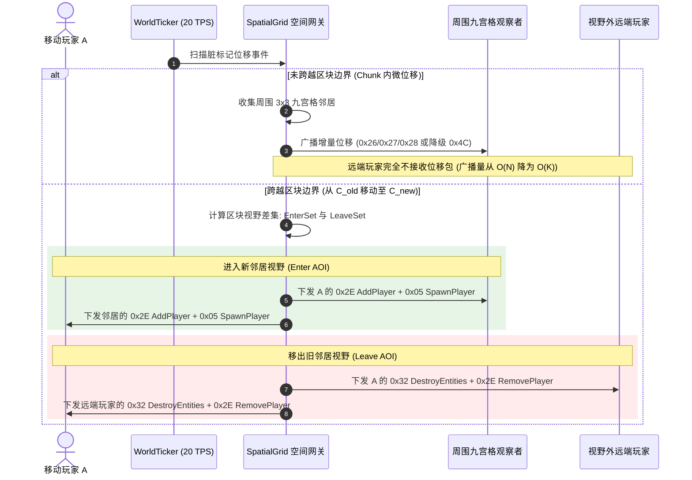

# MCPE 对齐商业大型大厅（Hypixel/Hive 规范）的大厅引擎与九宫格 AOI 重构方案

> **文档标识**：`MCPE-DOC-PROP-LOBBY-AOI-ALIGNED`  
> **版本**：v2.0.0 (商业化对齐升级版)  
> **设计对标**：Hypixel Lobby Architecture / The Hive Hub Specification / NanoLimbo  
> **目标协议**：Minecraft 1.12.2 (Protocol 340)  
> **关联模块**：`World`、`SchematicLoader`、`EntityManager`、`SpatialGrid`、`PlayHandler`

---

## 一、 工业级商用大厅对齐全景 (Commercial Alignment Blueprint)

结合 Hypixel、The Hive 等千万级大型服务器的最佳工程实践，将当前原型大厅升级为**高密度、低延迟、零物理损耗的商用微服务大厅引擎**。重构后的核心架构由四大工业级支柱构成：

```
┌─────────────────────────────────────────────────────────────────────────────┐
│                 MCPE 商业级微服务大厅四大支柱架构 (4 Pillars)                 │
├──────────────────────┬──────────────────────┬───────────────────────────────┤
│ 1. 浮空岛与虚空熔断  │ 2. 只读零物理世界    │ 3. 动态视距区块流式下发       │
│ • 100x100 浮空岛蓝图 │ • 锁定常昼与晴天     │ • 视距 R=3 (7x7 区块)         │
│ • 外围纯虚空         │ • 彻底禁用生物与方块Tick│ • 跨界动态 0x20 加载 / 0x1D 卸载 │
│ • Y < 20.0 毫秒级复位│ • 内存只读，零磁盘I/O│ • 空 Section 压缩比极高       │
├──────────────────────┴──────────────────────┴───────────────────────────────┤
│ 4. 工业级多层九宫格 AOI 体系                                                │
│ • 基于 ChunkPos 的局部九宫格位移广播 (O(N) 降为局部常数 O(K))                │
│ • 跨区块 Enter / Leave 集合差集自动化双向编排                               │
│ • 双阈值滞后缓冲区 (R_enter = 2, R_leave = 3) 防边界微动抖动                │
│ • 同屏实体可见性上限 (Entity Capping, 最多推送最近 25 人，杜绝出生点挤压卡顿) │
└─────────────────────────────────────────────────────────────────────────────┘
```

---

## 二、 地图资产选型与空间几何规范 (Lobby Map Specifications)

### 1. 地图格式标准：WorldEdit `.schematic` (1.12.2 标准)
* **存储结构**：Gzip 压缩 + NBT 树形标签，内含 `Width`、`Height`、`Length`（均为 `int16_t`）与三维方块数组 `Blocks`（8-bit ID）、`Data`（4-bit Meta）；
* **规格要求**：文件体积控制在 $500\text{KB} \sim 1.5\text{MB}$，解压后纯方块内存仅需 $2 \sim 4\text{MB}$，完全满足大厅微服务冷启动 $\le 50\text{ms}$、总常驻内存 $\le 30\text{MB}$ 的硬性要求。

### 2. 空间几何布局与功能区规划 (Layout Design)
采用经典**奇幻悬空浮空岛（Floating Island Fantasy Hub）**设计，尺寸约为 $100 \times 100 \times 60$ 方块（跨越约 $7 \times 7$ 个区块柱）：

```
                    ~ 虚空边缘 (Void - Y < 20.0 跌落复位) ~
        ┌─────────────────────────────────────────────────────────┐
        │                    [北向: 经典游戏传送阵]               │
        │                             ▲                           │
        │                             │                           │
        │   [西向: 悬空跑道入口] ◄──── ┼ ────► [东向: Bungee跨服星门]│
        │                         (0, 64, 0)                      │
        │                        [中央主出生点]                   │
        │                             │                           │
        │                             ▼                           │
        │                     [南向: 排行榜/公告板]               │
        └─────────────────────────────────────────────────────────┘
                    ~ 虚空边缘 (Void - Y < 20.0 跌落复位) ~
```

* **中央主出生点（Spawn Plaza）**：
  - 坐标定位于 $(0.5, 64.0, 0.5)$；中心为大理石/海晶石环形喷泉与集聚平台；
* **四周四个功能象限（Four Quadrants）**：
  - **东向**：BungeeCord / Velocity 跨服传送门台座（与 Sprint 5 网关路由对接）；
  - **西向**：大厅环岛立体跑道起点（内置 Checkpoint 压力板与计时器）；
  - **北向**：子游戏房间传送阵；
  - **南向**：全服通关榜与公告栏；
* **虚空边界与跌落复位（Void Fallback）**：
  - 岛屿外围完全不铺设任何方块，下方即为虚空；
  - 设定熔断阈值 $Y_{\text{reset}} = 20.0$。当玩家不慎失足跳崖时，立即触发复位。

---

## 三、 世界生命周期与区块流式传输 (World & Chunk Pipeline)

### 1. 彻底冻结世界开销（Zero-Physics Read-Only World）
对标商用大厅的性能准则，大厅世界在启动后处于**纯静态只读模式**：
* **锁定环境**：世界时间恒定为正午 `6000`（太阳当空，光照最佳），天气锁定无雨 `clear`；
* **关闭原生 Tick**：不执行方块流动（水/岩浆）、不执行随机农作物 Tick、不生成任何原版生物与怪物；
* **禁止破坏**：客户端发送的 `0x14 Player Digging` 与 `0x1F Block Placement` 一律静默忽略或拒绝，杜绝世界状态脏写。

### 2. 动态视距流式下发架构 (Chunk Streaming)

```mermaid
flowchart TD
    subgraph Startup["服务端冷启动 (耗时 <= 10ms)"]
        File[assets/maps/lobby.schematic] --> Decompress[zlib inflate 解压 NBT]
        Decompress --> Parser[SchematicLoader 解析 Blocks 与 Data]
        Parser --> WorldMemory["World 内存单例 (仅填充包含有效方块的 7x7 区块)"]
    end

    subgraph Streaming["客户端视距窗口流水线"]
        Join[玩家登入 Play 状态] --> Center[计算出生点 ChunkPos(0, 0)]
        Center --> CalcWindow[以出生点为中心半径 R=3: 圈定 7x7 视距区块]
        CalcWindow --> SendChunks[向客户端下发 49 个 0x20 Chunk Data]
        SendChunks --> SendPos[下发 0x2F Player Position And Look]
        
        Move[玩家移动跨越 Chunk 边界] --> DiffChunks[计算进入/移出视距差集]
        DiffChunks --> Load[新进入的区块: 下发 0x20 Chunk Data]
        DiffChunks --> Unload[移出视野的区块: 下发 0x1D Unload Chunk]
    end
```

* **空 Section 极限压缩**：
  浮空岛下方（$Y < 32$）与高空（$Y > 128$）均为空气，对应的 `ChunkSection` 内存指针直接为 `nullptr`。下发 `0x20 Chunk Data` 时 `PrimaryBitMask` 仅激活有实体的段，带宽与客户端渲染损耗降低 $80\%$ 以上。

---

## 四、 工业级多层九宫格 AOI 重构方案

大厅地图扩容后，核心挑战在于**防止中央广场密集人群造成的广播风暴**以及**长距离移动时的平滑可见性切换**。

### 1. 空间桶与观察者模型 (`SpatialGrid`)
```cpp
class SpatialGrid {
 public:
  // 每个区块柱内当前驻留的玩家会话 ID 列表
  std::unordered_map<ChunkPos, std::vector<uint64_t>> chunk_players_;

  // 每个玩家当前所在的区块坐标
  std::unordered_map<uint64_t, ChunkPos> player_chunks_;

  // 每个玩家屏幕上当前已生成并正在追踪的实体 EID 集合（避免重复生成）
  std::unordered_map<uint64_t, std::unordered_set<int32_t>> tracked_entities_;
};
```

### 2. 多层广播决策与可见性管理时序



### 3. 三重防卡顿与防风暴黑科技

#### ① 滞后防抖缓冲区 (Hysteresis Buffer)
* **痛点**：若玩家在区块分界线（如 $X=15.9$ 与 $X=16.1$）来回微步，严格的网格切分会导致客户端高频收到 `Spawn` 与 `Destroy`，造成人物模型疯狂闪烁。
* **解决**：设定非对称双阈值：
  - 实体进入视距：$R_{\text{enter}} = 2$ 个区块（约 32 格）；
  - 实体销毁视距：$R_{\text{leave}} = 3$ 个区块（约 48 格）；
  - 只有物理距离彻底超过 $R_{\text{leave}}$ 才销毁模型，中间形成 $16$ 方块的防抖滞后缓冲带。

#### ② 商用大厅实体上限动态截断 (Entity Capping)
* **痛点**：在主出生点，可能会有数十上百名玩家聚集在同一网格，导致即使采用九宫格依然产生巨大的位移多播负载。
* **解决**：为每个客户端设定 `kMaxVisibleEntities = 25`：
  - 仅向该客户端推送距离其最近的前 25 个实体；
  - 超出的远端玩家自动静默，客户端帧率与服务端带宽得到刚性硬顶保护。

#### ③ 快捷栏隐身切换器（Player Visibility Toggle）
* 在玩家登入时，将其物品栏第 8 格常驻一枚魔杖/染料道具（例如绿色染料）；
* 客户端点击该道具时触发交互包，服务端拦截并切换状态：
  - 🟢 **全部可见**：正常九宫格接收；
  - ⚪ **全部隐藏**：服务端单播清屏指令（向该玩家下发全部其他人的 `0x32 Destroy Entities`），同屏瞬间只剩自己，客户端帧率立刻飙升至极致。

---

## 五、 跑酷与虚空掉落复位（Fall Reset）算法规范

在大厅漫游或参与外环跑酷时，玩家一旦失足掉落悬崖：

$$\text{Trigger Condition}: Y_{\text{player}} < Y_{\text{fall\_reset}} \quad (\text{默认 } Y_{\text{fall\_reset}} = 20.0)$$

1. **瞬移拉回流水线**：
   - 服务端提取玩家坐标发现 $Y < 20.0$ 时，立刻生成全新的 `Teleport ID`；
   - 下发 `0x2F Player Position And Look`，目标坐标强制重置为出生点 $(0.5, 64.0, 0.5)$，朝向对准正前方；
2. **音效与标题激励（可选体验增强）**：
   - 下发 `0x48 Title (Action=1)` 提示：`§e[大厅] 已将你传送回主广场！`；
   - 下发 `0x46 Sound Effect` 播放末影人瞬移音效（`entity.endermen.teleport`）；
3. **零伤害、无死亡黑屏**：
   - 客户端全程不掉血、不死亡、不触发扣分，瞬移过程耗时 $< 5\text{ms}$，游玩体验极度丝滑。

---

## 六、 渐进式实施演进路线图 (Step-by-Step Milestones)

为保证项目代码严格符合四层红线与 0 告警交付门禁，整个重构划分为 4 个严格的 Sprint 迭代阶段：

| 阶段 | 核心目标 | 详细交付任务 | 完成定义 (DoD) |
| :---: | :--- | :--- | :--- |
| **Phase 1** | **蓝图资产准备与极简解析器** | 1. 放入标准开源浮空岛大厅 `assets/maps/lobby.schematic`；<br>2. 实现 `SchematicLoader`（zlib inflate + NBT 读取方块矩阵）；<br>3. 编写蓝图单元测试 `tests/test_schematic.cc`。 | CTest 单测 100% 通过，成功读取蓝图三维尺寸与方块 ID。 |
| **Phase 2** | **领域层 World 与区块流式下发** | 1. 构建 `World` 领域单例集中托管 `std::unordered_map<ChunkPos, Chunk>`；<br>2. 替换 `PlayHandler` 写死超平坦，改为根据出生点流式下发大厅区块；<br>3. 实现跨界下发 `0x20` 与 `0x1D Unload Chunk`。 | 真实客户端进入即置身于精致浮空岛中央，周围 7x7 区块完整渲染。 |
| **Phase 3** | **九宫格 Grid AOI 架构重构** | 1. 在 `EntityManager` 中集成 `SpatialGrid`；<br>2. 移动增量广播重构为九宫格局部多播；<br>3. 跨区块移动时驱动 Enter / Leave 集合差集双向编排；<br>4. 编写 `tests/test_aoi_grid.cc`。 | 单元测试验证两人靠近时生成、远离时销毁；无幽灵替身残留。 |
| **Phase 4** | **虚空跌落复位与商用大厅验收** | 1. 实现 $Y < 20.0$ 虚空跌落拉回（Fall Reset）；<br>2. 运行 Python 多人脚本模拟进出大厅漫游；<br>3. 真实客户端实机跑酷与虚空跳崖实测。 | 0 告警编译，全量单测通过，跳崖瞬间拉回出生点，漫游平稳流畅。 |
