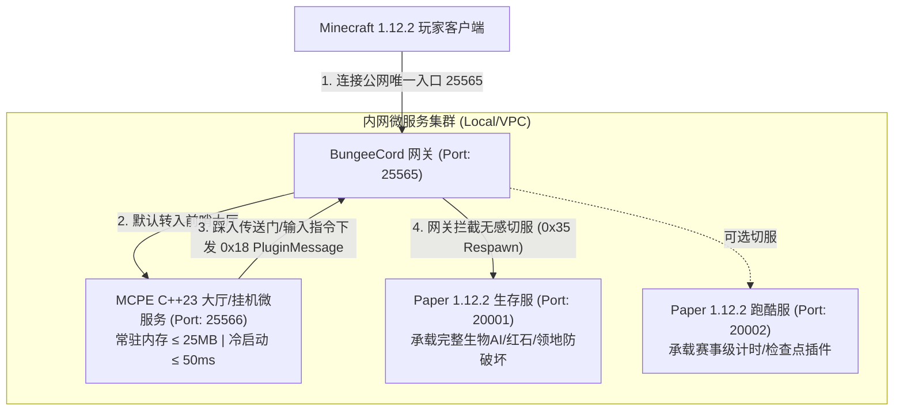

# BungeeCord 网关与 Paper 1.12.2 生存/跑酷子服从零搭建与 MCPE 集群联动实战指南

> **核心目标**：从零开始完整搭建商业级 Minecraft 1.12.2（Protocol 340）微服务集群，打通：  
> **公网反向代理网关 (BungeeCord: 25565)** $\longrightarrow$ **高性能轻量大厅 (MCPE C++23: 25566)** $\longleftrightarrow$ **核心玩法后端 (Paper 1.12.2: 20001)**。  
> **文档定位**：全链路保姆级实战教程，覆盖从官方下载、Java 环境调优、EULA 协议、子服改造、跨服传送门配置、一键脚本到端到端实机验证与排错。

---

## 目录

- [一、 整体集群拓扑与目录规划](#一-整体集群拓扑与目录规划)
  - [1.1 架构分工与数据流图](#11-架构分工与数据流图)
  - [1.2 标准工程目录结构规划](#12-标准工程目录结构规划)
- [二、 第一部分：Paper 1.12.2 (Build 1620) 怎么用？](#二-第一部分paper-1122-build-1620-怎么用)
  - [2.1 官方定位与运行环境依赖 (Java 8 vs Java 17)](#21-官方定位与运行环境依赖-java-8-vs-java-17)
  - [2.2 首次启动与 EULA 协议签署](#22-首次启动与-eula-协议签署)
  - [2.3 业务场景 A：搭建原版高防生存服](#23-业务场景-a搭建原版高防生存服)
  - [2.4 业务场景 B：搭建竞技赛事跑酷服](#24-业务场景-b搭建竞技赛事跑酷服)
  - [2.5 关键步骤：Paper 群组子服化改造 (接入 BungeeCord)](#25-关键步骤paper-群组子服化改造-接入-bungeecord)
- [三、 第二部分：BungeeCord 网关怎么用？(从下载到配置)](#三-第二部分bungeecord-网关怎么用从下载到配置)
  - [3.1 官方稳定构建下载源](#31-官方稳定构建下载源)
  - [3.2 首次运行与目录生成](#32-首次运行与目录生成)
  - [3.3 核心配置 `config.yml` 逐行精讲](#33-核心配置-configyml-逐行精讲)
  - [3.4 网关启动脚本编写](#34-网关启动脚本编写)
- [四、 第三部分：MCPE C++ 大厅微服务的协同联动](#四-第三部分mcpe-c-大厅微服务的协同联动)
  - [4.1 编译与主程序准备](#41-编译与主程序准备)
  - [4.2 大厅网关配置 (`src/settings.ini`)](#42-大厅网关配置-srcsettingsini)
  - [4.3 跨服空间传送门 AABB 配置 (`assets/maps/lobby/lobby.ini`)](#43-跨服空间传送门-aabb-配置-assetsmapslobbylobbyini)
- [五、 第四部分：全链路一键启动与端到端实机切服验证](#五-第四部分全链路一键启动与端到端实机切服验证)
  - [5.1 一键启动脚本 (Windows & Linux)](#51-一键启动脚本-windows--linux)
  - [5.2 启动时序规范](#52-启动时序规范)
  - [5.3 真实客户端连接与全功能闭环测试](#53-真实客户端连接与全功能闭环测试)
- [六、 第五部分：高频报错与避坑指南 (Troubleshooting FAQ)](#六-第五部分高频报错与避坑指南-troubleshooting-faq)

---

## 一、 整体集群拓扑与目录规划

### 1.1 架构分工与数据流图

在商业群组服标准拓扑中，端口与服务边界清晰划分：



- **BungeeCord（端口 25565）**：对外唯一暴露端口，负责正版鉴权、连接保持与无感切服；
- **MCPE C++ 大厅（端口 25566）**：极速冷启动、超低内存（$\le 25\text{MB}$），承担玩家首次进服的大厅漫游、选服导航与低资源挂机；
- **Paper 1.12.2 后端（端口 20001 / 20002）**：提供成熟完备的原版生存物理与丰富的 Bukkit/Spigot 跑酷玩法。

---

### 1.2 标准工程目录结构规划

为了保持工作区整洁，推荐在项目根目录外或 `servers/` 目录下搭建集群：

```text
mcpe/                                 # 本项目主工程
├── bin/server.exe                    # MCPE C++ 编译生成的大厅主程序
├── src/settings.ini                  # MCPE 全局配置文件
├── assets/maps/lobby/lobby.ini       # 大厅传送门与出生点配置
├── paper-1.12.2-1620.jar             # 根目录下已就绪的 Paper 官方服务端包
│
└── servers/                          # 推荐的集群独立运行目录
    ├── bungeecord/                   # 1. 网关运行目录
    │   ├── BungeeCord.jar            # 官方下载的网关核心
    │   ├── config.yml                # 网关核心路由配置
    │   └── start.bat (或 start.sh)
    │
    ├── paper_survival/               # 2. Paper 生存服运行目录
    │   ├── paper-1.12.2-1620.jar     # 复制自根目录
    │   ├── eula.txt                  # EULA 同意配置
    │   ├── server.properties         # 端口设为 20001，关闭 online-mode
    │   ├── spigot.yml                # 开启 bungeecord: true
    │   ├── paper.yml
    │   ├── plugins/                  # 存放 EssentialsX、Residence 等
    │   └── start.bat (或 start.sh)
    │
    └── start_all.bat (或 start_all.sh)# 全集群一键启动脚本
```

---

## 二、 第一部分：Paper 1.12.2 (Build 1620) 怎么用？

### 2.1 官方定位与运行环境依赖 (Java 8 vs Java 17)

`paper-1.12.2-1620.jar` 是 PaperMC 官方针对 1.12.2 的**最后一个最终封顶稳定版本（Build 1620）**。
- **协议版本**：Protocol 340（与本项目 MCPE 100% 相同）；
- **Java 运行环境**：
  - **推荐使用 Java 8 / Java 11**：原生完全免配置；
  - **若本机已安装 Java 17 / Java 21 LTS**：也可以完美运行！但因为 1.12.2 服务端内部做过 Java 版本检查，在启动 JVM 参数中必须加上 `"-DPaper.IgnoreJavaVersion=true"`，否则会报错提示版本不兼容。

---

### 2.2 首次启动与 EULA 协议签署

#### 步骤 1：创建独立目录并拷贝服务端 Jar
```bash
# 在 mcpe 工程根目录下执行 (以 PowerShell 为例)
mkdir servers\paper_survival
cp paper-1.12.2-1620.jar servers\paper_survival\
cd servers\paper_survival
```

#### 步骤 2：执行首次启动生成文件
在 `servers\paper_survival` 目录下运行：
```powershell
# 如果使用 Java 17+
java "-DPaper.IgnoreJavaVersion=true" -jar paper-1.12.2-1620.jar nogui
```
运行几秒后，服务端会自动退出并生成 `eula.txt`：
```text
[INFO] You need to agree to the EULA in order to run the server. Go to eula.txt for more info.
```

#### 步骤 3：同意 EULA
打开 `servers\paper_survival\eula.txt`，将：
```text
eula=false
```
修改为：
```text
eula=true
```

---

### 2.3 业务场景 A：搭建原版高防生存服

如果希望该子服承载**多人生存服**：
1. **基础特性**：保留生物生成（Monsters/Animals）、PVP、地狱与末地世界、天气与方块交互物理；
2. **推荐必备插件**（放入 `servers\paper_survival\plugins\` 即可）：
   - `EssentialsX`：提供基础玩家家园 (`/sethome`)、地标传送 (`/warp`)、玩家间传送请求 (`/tpa`)；
   - `Residence` 或 `Towny`：提供领地圈地，防止生存玩家建筑被拆被偷；
   - `CoreProtect`：高性能 SQLite/MySQL 方块破坏审计日志与一键回滚 (`/co rollback`)；
   - `Vault` + `QuickShop`：经济系统与箱子商店；
   - `LuckPerms`：权限组管理（配置普通玩家组与管理员组）。

---

### 2.4 业务场景 B：搭建竞技赛事跑酷服

如果希望该子服承载**独立跑酷小游戏服**：
1. **调整 `server.properties` 优化性能与纯净度**：
   ```properties
   spawn-monsters=false       # 关闭怪物生成
   spawn-animals=false        # 关闭动物生成
   spawn-npcs=false           # 关闭村民
   pvp=false                  # 关闭玩家互殴
   difficulty=0               # 和平模式 (无饥饿度消耗)
   generate-structures=false  # 关闭神殿/地牢等自然建筑
   ```
2. **跑酷专属插件推荐**：
   - **`Parkour` (by A5H73Y4)**：工业级跑酷插件。通过木牌或压力板自动设置起点、检查点（Checkpoints）与终点，高精度毫秒计时，个人历史最快榜单与全服 Top 10 排行榜，跌落虚空或踩水自动拉回最近检查点；
   - **`WorldGuard` + `WorldEdit`**：框选跑酷赛道区域，设置标志位 `block-break: deny`（禁止破坏）、`block-place: deny`（禁止放置）、`fall-damage: deny`（免疫摔落掉血）。

---

### 2.5 关键步骤：Paper 群组子服化改造 (接入 BungeeCord)

无论做生存服还是跑酷服，**要接入 BungeeCord 网关，必须完成以下 3 项核心配置修改**：

#### 1. 修改 `server.properties`
```properties
# 1. 修改端口为 20001 (避免与网关 25565 和大厅 25566 冲突)
server-port=20001

# 2. 关闭独立正版验证 (必须！由 BungeeCord 网关统一在最前沿鉴权)
online-mode=false

# 3. 关闭单 IP 连接频控 (必须！否则网关高频转发连接会被 Paper 判定为网络攻击而切断)
connection-throttle=-1
```

#### 2. 修改 `spigot.yml`
打开 `spigot.yml`，定位到 `settings` 段：
```yaml
settings:
  bungeecord: true    # 必须改为 true！开启接收来自网关的 IP Forwarding 穿透信息
```

#### 3. 修改 `paper.yml`
打开 `paper.yml`，定位到 `settings` 段：
```yaml
settings:
  bungee-online-mode: true   # 继承网关的正版在线模式，确保玩家 UUID 与皮肤正常
```

> [!CAUTION]
> **安全警示（防黑客伪造提权）**：
> 当子服开启 `online-mode=false` 后，如果服务器端口对外暴露，黑客可以直接连接 `20001` 端口并伪造服主或管理员的 UUID 盗取权限。
> **防范措施**：在子服 `plugins/` 目录下放置 `BungeeGuard.jar`，并在其 `config.yml` 中配置与 MCPE `src/settings.ini` 完全相同的防伪密钥（Token）。只有携带该密钥的 BungeeCord 网关连接才被允许放行。

---

## 三、 第二部分：BungeeCord 网关怎么用？(从下载到配置)

### 3.1 官方稳定构建下载源

BungeeCord 是由 SpigotMC 官方维护的开源反向代理网关。

- **官方 Jenkins 稳定直接下载链接**：
  `https://ci.md-5.net/job/BungeeCord/lastSuccessfulBuild/artifact/bootstrap/target/BungeeCord.jar`
- **高性能替代分支 Waterfall（PaperMC 官方出品，完全兼容）**：
  `https://papermc.io/downloads/waterfall`

#### 一键下载命令 (PowerShell)
```powershell
mkdir servers\bungeecord
cd servers\bungeecord
# 下载官方最新构建
Invoke-WebRequest -Uri "https://ci.md-5.net/job/BungeeCord/lastSuccessfulBuild/artifact/bootstrap/target/BungeeCord.jar" -OutFile "BungeeCord.jar"
```

---

### 3.2 首次运行与目录生成

在 `servers\bungeecord` 目录下执行一次启动：
```powershell
java -Xms512M -Xmx512M -jar BungeeCord.jar
```
BungeeCord 会自动释放运行库并生成配置文件，看到如下日志后，在控制台输入 `end` 正常关闭：
```text
[INFO] Listening on /0.0.0.0:25565
[INFO] Enabled BungeeCord version git:BungeeCord-Bootstrap:...
> end
```

此时目录下会生成核心配置文件 `config.yml`。

---

### 3.3 核心配置 `config.yml` 逐行精讲

打开 `servers\bungeecord\config.yml`，这是整个集群的调度大脑。以下是**最精简、高可用的生产级配置**：

```yaml
# ==============================================================================
# BungeeCord 商业集群网关核心配置文件
# ==============================================================================

# 1. 开启 IP Forwarding 协议穿透 (必须为 true！)
# 开启后，网关会将客户端真实公网 IP、正版 UUID 与皮肤属性通过握手包透传给后端大厅与子服
ip_forward: true

# 2. 网络监听配置
listeners:
- query_port: 25565
  motd: '&aMCPE Microservice Cluster &7[C++23 & Paper 1.12.2]'
  tab_list: GLOBAL_PING
  query_enabled: false
  proxy_protocol: false
  forced_hosts: {}
  ping_passthrough: false
  priorities:
  - lobby                   # 默认优先引导玩家进入 MCPE 大厅服务器
  bind_local_address: true
  host: 0.0.0.0:25565       # 对外暴露的唯一公网端口
  max_players: 2000         # 网关层并发承载上限
  tab_size: 60
  force_default_server: true # 玩家每次重新登录集群，强制先回到大厅

# 3. 后端子服务器列表映射
servers:
  # A. MCPE C++23 高性能大厅微服务
  lobby:
    motd: '&bMCPE C++ High-Perf Lobby'
    address: 127.0.0.1:25566
    restricted: false

  # B. Paper 1.12.2 原版生存服
  survival:
    motd: '&aPaper 1.12.2 Survival Server'
    address: 127.0.0.1:20001
    restricted: false

  # C. (可选) Paper 1.12.2 跑酷服
  parkour:
    motd: '&ePaper 1.12.2 Parkour Arena'
    address: 127.0.0.1:20002
    restricted: false

# 4. 全局参数
player_limit: -1
online_mode: false          # 如果用于离线服/测试服设为 false；商用正版服设为 true
timeout: 30000
log_pings: false
```

---

### 3.4 网关启动脚本编写

在 `servers\bungeecord` 目录下新建 `start.bat`（Windows）或 `start.sh`（Linux）：

- **Windows (`servers\bungeecord\start.bat`)**：
  ```bat
  @echo off
  title BungeeCord Proxy (25565)
  java -Xms512M -Xmx512M -jar BungeeCord.jar
  pause
  ```
- **Linux (`servers\bungeecord\start.sh`)**：
  ```bash
  #!/usr/bin/env bash
  java -Xms512M -Xmx512M -jar BungeeCord.jar
  ```

---

## 四、 第三部分：MCPE C++ 大厅微服务的协同联动

MCPE 大厅已经**完全内置了商业网关的即插即用引擎**，无需任何额外插件，只需确认以下配置：

### 4.1 编译与主程序准备

在项目根目录下通过 CMake 编译生成服务端二进制：
```powershell
cmake -B build -G "MinGW Makefiles" -DCMAKE_BUILD_TYPE=Release
cmake --build build --target server -j
```
生成的目标文件为：[`bin/server.exe`](file:///E:/workspace/class_101/mcpe/bin/server.exe)（Linux 下为 `bin/server`）。

---

### 4.2 大厅网关配置 (`src/settings.ini`)

打开 [`src/settings.ini`](file:///E:/workspace/class_101/mcpe/src/settings.ini)：
```ini
[Server]
port = 25566                ; MCPE 监听端口 (对应 BungeeCord 配置的 127.0.0.1:25566)
max_players = 1500

[Gateway]
bungee_forwarding = true    ; 开启 BungeeCord IP Forwarding 协议穿透解析
bungee_guard_token =        ; 若需防伪密钥可在此处填写；本地联调可留空
```

---

### 4.3 跨服空间传送门 AABB 配置 (`assets/maps/lobby/lobby.ini`)

打开 [`assets/maps/lobby/lobby.ini`](file:///E:/workspace/class_101/mcpe/assets/maps/lobby/lobby.ini)，配置空间传送门碰撞盒与目标服务器代号：

```ini
[World]
baked_file = assets/maps/lobby/floating-island.mcpe_map
spawn_x = -56.00
spawn_y = 52.00
spawn_z = 8.00

; ==============================================================================
; 跨服空间传送门定义 (AABB 空间范围: min 至 max)
; ==============================================================================

; 前往生存服的传送门 (target 必须与 BungeeCord config.yml 中的服务器名称完全一致)
[Portal.survival]
min = -65.0, 50.0, 5.0
max = -60.0, 56.0, 11.0
target = survival
display_name = §a§l[原版生存服]

; 前往跑酷服的传送门
[Portal.parkour]
min = -65.0, 50.0, -11.0
max = -60.0, 56.0, -5.0
target = parkour
display_name = §b§l[极限跑酷服]
```

---

## 五、 第四部分：全链路一键启动与端到端实机切服验证

### 5.1 一键启动脚本 (Windows & Linux)

为了方便一键拉起全集群，在 `servers/` 目录下创建启动脚本：

#### Windows 批量启动脚本 (`servers/start_cluster.bat`)
```bat
@echo off
echo ===================================================
echo   Starting MCPE + Paper + BungeeCord Microservices 
echo ===================================================

echo [1/3] Starting MCPE C++ Lobby (Port 25566)...
start "MCPE Lobby (25566)" cmd /k "cd .. && bin\server.exe"

echo [2/3] Starting Paper 1.12.2 Survival (Port 20001)...
start "Paper Survival (20001)" cmd /k "cd paper_survival && java -DPaper.IgnoreJavaVersion=true -Xms2G -Xmx2G -jar paper-1.12.2-1620.jar nogui"

echo Waiting 5 seconds for backend microservices to initialize...
timeout /t 5 /nobreak >nul

echo [3/3] Starting BungeeCord Gateway (Port 25565)...
start "BungeeCord Gateway (25565)" cmd /k "cd bungeecord && java -Xms512M -Xmx512M -jar BungeeCord.jar"

echo ===================================================
echo   All cluster services launched successfully!
echo   Connect client to 127.0.0.1:25565
echo ===================================================
```

#### Linux 统一启动脚本 (`servers/start_cluster.sh`)
```bash
#!/usr/bin/env bash
set -e

echo "[1/3] Starting MCPE C++ Lobby (Port 25566)..."
(cd .. && ./bin/server) &

echo "[2/3] Starting Paper 1.12.2 Survival (Port 20001)..."
(cd paper_survival && java -DPaper.IgnoreJavaVersion=true -Xms2G -Xmx2G -jar paper-1.12.2-1620.jar nogui) &

sleep 5

echo "[3/3] Starting BungeeCord Gateway (Port 25565)..."
(cd bungeecord && java -Xms512M -Xmx512M -jar BungeeCord.jar)
```

---

### 5.2 启动时序规范

商业群组微服务必须遵循**“先起后端微服务，再起代理网关”**的时序原则：
1. **先起 MCPE 大厅 (25566)**：确认控制台打印 `[TcpServer] Listening on 0.0.0.0:25566`；
2. **再起 Paper 生存服 (20001)**：确认控制台打印 `Done (x.xs)! For help, type "help"`；
3. **最后起 BungeeCord 网关 (25565)**：确认控制台打印 `Listening on /0.0.0.0:25565`。

---

### 5.3 真实客户端连接与全功能闭环测试

启动纯净无 Mod 的 Minecraft 1.12.2 客户端：

```
                    客户端连接 127.0.0.1:25565
                                │
                                ▼
              ┌───────────────────────────────────┐
              │  验证 1: 进入 MCPE 浮空岛大厅     │
              │  * Tab 列表正常展示正版皮肤与 UUID │
              │  * 可以在大厅自由漫游、飞行 (/fly) │
              └─────────────────┬─────────────────┘
                                │
        ┌───────────────────────┴───────────────────────┐
        ▼                                               ▼
[方式 A: 指令切服]                              [方式 B: 空间漫游切服]
输入指令: /server survival                      物理走向坐标 (-62.5, 52.0, 8.0)
        │                                               │
        └───────────────────────┬───────────────────────┘
                                ▼
              ┌───────────────────────────────────┐
              │  验证 2: 屏幕提示 + 自动跨服      │
              │  * ActionBar: "正在前往生存服..." │
              │  * 0x18 PluginMessage 转交信令    │
              │  * 客户端无感切入 Paper 1.12.2    │
              └─────────────────┬─────────────────┘
                                │
                                ▼
              ┌───────────────────────────────────┐
              │  验证 3: 在生存服中体验原版玩法    │
              │  * 撸树、挖矿、打怪、红石均正常   │
              │  * 输入 /server lobby 无感切回大厅 │
              └───────────────────────────────────┘
```

---

## 六、 第五部分：高频报错与避坑指南 (Troubleshooting FAQ)

### Q1: Paper 启动报错 `UnsupportedClassVersionError` 或提示需要 Java 8
- **原因**：Minecraft 1.12.2 原生面向 Java 8 编译。如果系统默认是 Java 17 或更高版本，Paper 内部的版本检测会拒绝启动。
- **解决方案**：在 Java 启动命令中显式附加忽略标志：
  ```bash
  java -DPaper.IgnoreJavaVersion=true -Xms2G -Xmx2G -jar paper-1.12.2-1620.jar nogui
  ```

### Q2: 客户端被踢出并报错：`If you wish to use IP forwarding, please enable it in your BungeeCord config as well!`
- **原因**：Paper 的 `spigot.yml` 中开启了 `bungeecord: true`，但 `BungeeCord/config.yml` 里的 `ip_forward` 依然是 `false`，导致网关发出的握手包未带 `\0` 穿透数据。
- **解决方案**：打开 `BungeeCord/config.yml`，将 `ip_forward: false` 修改为 `ip_forward: true`，然后重启网关。

### Q3: 玩家从大厅切服时报错：`Could not connect to a default or fallback server`
- **原因**：网关无法连接到目标子服。
- **排查步骤**：
  1. 检查 Paper 进程是否正常运行；
  2. 检查 `BungeeCord/config.yml` 中 `survival` 的端口是否准确填写为 `127.0.0.1:20001`；
  3. 检查 Paper `server.properties` 中的 `online-mode` 是否为 `false`。

### Q4: 玩家踩进传送门没有任何反应？
- **原因**：坐标盒未包含玩家脚下坐标，或传送门代号与网关名称不匹配。
- **排查步骤**：
  1. 打开 `assets/maps/lobby/lobby.ini`，确认 `target = survival` 与 `BungeeCord/config.yml` 中的 key 完全一致；
  2. 确认 `min` 与 `max` 的坐标包围盒覆盖了玩家实际走入的三维区域。

### Q5: 玩家直连大厅或子服被直接掐断？
- **原因**：服务端配置了 `bungee_guard_token` 防伪鉴权。
- **机制解释**：这是符合预期的安全策略，防止黑客绕过 BungeeCord 直连大厅冒充管理员。所有玩家必须经由 `25565` 网关统一接入。
