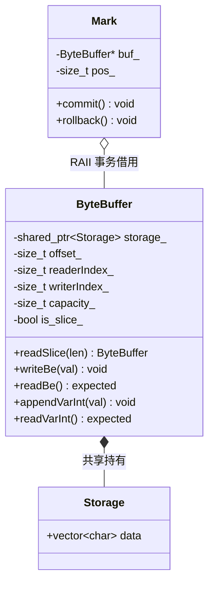

# Sprint 0 保姆级实战开发教程：基础设施、Netty 风格切片与变长整型编解码（Infra & Byte Foundations）

> **目标协议**：Minecraft Java Edition 1.12.2（Protocol 340）  
> **当前阶段**：Sprint 0（TASK-0.1 至 TASK-0.5）  
> **面向读者**：刚开始接触高性能 C++23 网络编程与游戏服务端开发，面对“**为什么不能直接用 `std::vector<uint8_t>`**”、“**Netty 风格切片到底怎么做零拷贝**”、“**VarInt 变长整数如何安全防御恶意包**”等底层疑问的开发者。  
> **文档宗旨**：不写妥协玩具代码，从第一天起以工业级标准构建底层基础库（Foundations 层），系统性剖析设计思路、技术选型权衡及大厂高频面试考点。

---

## 目录

- [一、 心智模型跃迁与架构原理（是什么与为什么）](#一-心智模型跃迁与架构原理是什么与为什么)
  - [1.1 为什么标准库 std::vector 和 std::string 无法胜任游戏二进制缓冲？](#11-为什么标准库-stdvector-和-stdstring-无法胜任游戏二进制缓冲)
  - [1.2 为什么必须采用 Netty 风格零拷贝切片（readSlice）与双游标设计？](#12-为什么必须采用-netty-风格零拷贝切片readslice与双游标设计)
  - [1.3 写时复制（Copy-On-Write, COW）与浅拷贝隔离哲学](#13-写时复制copy-on-write-cow与浅拷贝隔离哲学)
  - [1.4 现代 C++ 错误处理范式演进：全面拥抱 C++23 std::expected](#14-现代-c-错误处理范式演进全面拥抱-c23-stdexpected)
- [二、 二进制底层协议硬核推演与算法原理（协议物理详解）](#二-二进制底层协议硬核推演与算法原理协议物理详解)
  - [2.1 LEB128（Little-Endian Base 128）变长整数数学推导](#21-leb128little-endian-base-128变长整数数学推导)
  - [2.2 VarInt 最多占 5 字节与 VarLong 最多占 10 字节的数学证明与 DoS 防御](#22-varint-最多占-5-字节与-varlong-最多占-10-字节的数学证明与-dos-防御)
  - [2.3 网络大端序与主机小端序硬件转换指令（std::byteswap / bswap）](#23-网络大端序与主机小端序硬件转换指令stdbyteswap--bswap)
  - [2.4 IEEE 754 浮点数的二进制序列化与类型双关（std::bit_cast vs UB）](#24-ieee-754-浮点数的二进制序列化与类型双关stdbit_cast-vs-ub)
- [三、 严格四层架构拓扑与模块职责划分](#三-严格四层架构拓扑与模块职责划分)
  - [3.1 Foundations 层的神圣红线：严禁制造冗余平行的 Reader/Writer 类](#31-foundations-层的神圣红线严禁制造冗余平行的-readerwriter-类)
  - [3.2 底层数据流拓扑与生命周期控制块](#32-底层数据流拓扑与生命周期控制块)
  - [3.3 模块文件蓝图与依赖关系图](#33-模块文件蓝图与依赖关系图)
- [四、 任务逐步实现指南（怎么做：接口契约与代码落地）](#四-任务逐步实现指南怎么做接口契约与代码落地)
  - [TASK-0.1: 现代 CMake FetchContent 依赖编排与 GCC 14 零警告门禁](#task-01-现代-cmake-fetchcontent-依赖编排与-gcc-14-零警告门禁)
  - [TASK-0.2: mcpe::ByteBuffer 核心数据结构与双游标大端读写落地](#task-02-mcpebytebuffer-核心数据结构与双游标大端读写落地)
  - [TASK-0.3: Netty 风格 readSlice 零拷贝切片与 COW 机制落地](#task-03-netty-风格-readslice-零拷贝切片与-cow-机制落地)
  - [TASK-0.4: mcpe::VarInt 编解码算法与 std::expected 无异常设计](#task-04-mcpevarint-编解码算法与-stdexpected-无异常设计)
  - [TASK-0.5: GoogleTest 极限边界自动化单元测试套件](#task-05-googletest-极限边界自动化单元测试套件)
- [五、 工业级避坑指南与高频面试核心考点](#五-工业级避坑指南与高频面试核心考点)
  - [5.1 工业避坑血泪史](#51-工业避坑血泪史)
  - [5.2 核心技术选型深度对比（Trade-offs 权衡矩阵）](#52-核心技术选型深度对比trade-offs-权衡矩阵)
    - [选型 1：mcpe::ByteBuffer vs Muduo::Buffer vs Netty ByteBuf vs std::vector](#选型-1mcpebytebuffer-vs-muduobuffer-vs-netty-bytebuf-vs-stdvector)
    - [选型 2：LEB128 变长整型 vs Protobuf Varint vs 固定 4/8 字节整型](#选型-2leb128-变长整型-vs-protobuf-varint-vs-固定-48-字节整型)
    - [选型 3：C++23 std::expected vs C++ 传统异常 throw/catch vs 错误码/指针](#选型-3c23-stdexpected-vs-c-传统异常-throwcatch-vs-错误码指针)
    - [选型 4：CMake FetchContent vs Git Submodule vs 系统全局安装 vs vcpkg/conan](#选型-4cmake-fetchcontent-vs-git-submodule-vs-系统全局安装-vs-vcpkgconan)
  - [5.3 高频面试核心考点与标准作答](#53-高频面试核心考点与标准作答)
- [六、 验收门禁与端到端实测规范 (DoD)](#六-验收门禁与端到端实测规范-dod)

---

## 一、 心智模型跃迁与架构原理（是什么与为什么）

### 1.1 为什么标准库 std::vector 和 std::string 无法胜任游戏二进制缓冲？

* **是什么**：
  在 C++ 网络编程中，很多新手直接使用 `std::vector<uint8_t>` 或 `std::string` 充当网络接收与发送缓冲区。
* **为什么（痛点与危害）**：
  1. **没有读写双游标区分**：`std::vector` 只有一个 `size()`。从网络读入 1024 字节后，业务解析了前 10 字节，为了“消费”这 10 字节，新手通常调用 `vec.erase(vec.begin(), vec.begin() + 10)`。这会引发 $O(N)$ 的内存前移（`memmove`），在每秒成千上万个数据包吞吐下，CPU 大量周期耗费在无效的内存复制上；
  2. **缺少网络字节序编解码原语**：Minecraft 协议规定定宽整数（Short/Int/Long）与浮点数均采用**大端序（Big-Endian）**。`std::vector` 无法提供泛型原子的 `writeBe<T>` 与 `readBe<T>`，迫使业务层在各个角落手写脆弱的移位和强制类型转换；
  3. **无法实现零拷贝切片**：当解析出一个子包时，若直接拷贝出一份 `vector`，会产生额外的堆内存分配（Heap Allocation）。

---

### 1.2 为什么必须采用 Netty 风格零拷贝切片（readSlice）与双游标设计？

* **是什么**：
  `mcpe::ByteBuffer` 借鉴了 Java 高性能网络框架 Netty 的 `ByteBuf` 设计：
  - 维护独立的 `readerIndex_`（读游标）与 `writerIndex_`（写游标）；
  - `readableBytes() = writerIndex_ - readerIndex_`；
  - 提供 `readSlice(size_t len)`：**不拷贝底层实际内存，仅递增父 Buffer 的 `readerIndex_`，并返回一个指向同一连续内存块的新 `ByteBuffer` 视图**。
* **为什么（优势）**：
  ```
  原始 Buffer [----------------- 连续内存 Storage -----------------]
                     ▲                     ▲
                readerIndex           writerIndex
                     │                     │
  readSlice(L) ──► 生成 Slice Buffer 共享 Storage，父 readerIndex 前移 L
  ```
  拆包器（Packet Framing）从 TCP 接收缓冲区提取单个数据包时，**耗时仅为常数时间 $O(1)$，内存分配次数为 0**。

---

### 1.3 写时复制（Copy-On-Write, COW）与浅拷贝隔离哲学

* **是什么**：
  多个 `ByteBuffer` 切片可以同时指向同一个底层的共享存储块（`std::shared_ptr<Storage>`）。
  当某个切片或会话仅进行只读解析时，各视图共享同一片只读物理内存，享受零拷贝红利；
  但若某个持有者试图调用写操作追加新数据，且检测到底层存储存在多个引用（`storage_.use_count() > 1`）时，系统自动触发**写时复制（COW）**：在真实写入前深拷贝属于自身有效区间的数据并绑定至独立的独占存储中，完成与其余切片的解耦隔离。
* **为什么**：
  在多播（Multicast）场景下（例如一个玩家移动，需要广播给房间内其余 99 个玩家）：服务端只需在逻辑线程构造一份 `ByteBuffer`，通过 `std::shared_ptr` 浅拷贝推入 99 个发送队列，底层物理内存只有一份。若未来某层需要独立修改（如加密），COW 机制自动隔离，既安全又极致省内存。

---

### 1.4 现代 C++ 错误处理范式演进：全面拥抱 C++23 std::expected

* **是什么**：
  传统的错误处理方式有三代：
  1. **第一代：错误码 + 出参指针**（`bool readInt(int* out)`）：破坏函数式返回值链式调用，易遗忘检查；
  2. **第二代：C++ 异常 `throw/catch`**：抛出异常时会经历栈展开（Stack Unwinding）、遍历 DWARF 异常表、调用 RTTI 与堆分配，吞吐量断崖式下跌 10~100 倍，且导致二进制膨胀；
  3. **第三代：C++23 `std::expected<T, E>`**：值语义的高效联合体（类似 Rust `Result<T, E>`），包含数值或错误枚举，零堆分配、零栈展开开销。
* **为什么**：
  网络拆包时，“半包”（数据未完全到达）是高频发生的正常状态，根本不是“异常”。使用 `std::expected<T, DecodeError>` 能够兼顾优雅的强类型返回值与极致执行性能。

---

## 二、 二进制底层协议硬核推演与算法原理（协议物理详解）

### 2.1 LEB128（Little-Endian Base 128）变长整数数学推导

* **编码逻辑**：
  Minecraft 使用的 `VarInt` 属于 LEB128 变种。每个字节的 **最高位（Bit 7，`0x80`）为 Continuation Bit（续标志位）**：
  - 若 Bit 7 == 1：表示后续还有字节，当前字节的低 7 位（Bit 0 ~ 6）为有效数值；
  - 若 Bit 7 == 0：表示这是该变长数的最后一个字节。
* **推演示例**：整数 `25565`（Minecraft 默认端口号）：
  1. 十六进制表示：`0x63DD`，二进制表示：`00011000 11110101`；
  2. 拆分为 7 位一组（从低位向高位）：
     - 第 1 组（低 7 位）：`1110101`（数值 `0x75`）；
     - 第 2 组（高位）：`0000001`（数值 `0x01`）与 `100`（数值 `0x04`），合并得 `000000100` 即 `0x0187`？重新核算：
       $25565 = 127 \times 201 + \dots$ 严格按位右移：
       - `val = 25565`（`0b0110_0011_1101_1101`）
       - `val & 0x7F` = `0b101_1101` (`0x5D`)；`val >>= 7` 得到 `0b0000_0001_0100_0111` 即 `199`；
       - `199 & 0x7F` = `0b100_0111` (`0x47`)；`val >>= 7` 得到 `1`；
       - `1 & 0x7F` = `0b000_0001` (`0x01`)；`val >>= 7` 得到 `0`（终止）。
  3. 加上 Continuation Bit：
     - 字节 1：`0x5D | 0x80 = 0xDD`
     - 字节 2：`0x47 | 0x80 = 0xC7`
     - 字节 3：`0x01 | 0x00 = 0x01`
  4. 最终网络编码字节流为：`DD C7 01`（共 3 字节）。

---

### 2.2 VarInt 最多占 5 字节与 VarLong 最多占 10 字节的数学证明与 DoS 防御

* **数学证明**：
  - 32 位有符号整型 `int32_t` 包含 32 位二进制信息；
  - 每个 VarInt 字节仅提供 7 位有效信息：
    $$\lceil 32 / 7 \rceil = \lceil 4.57 \rceil = 5 \text{ 字节}$$
  - 5 个字节共提供 $5 \times 7 = 35$ 位空间，能完整容纳 32 位整型（包括负数）；
  - 同样，64 位整型 `int64_t`：
    $$\lceil 64 / 7 \rceil = \lceil 9.14 \rceil = 10 \text{ 字节}$$
* **DoS 防御设计**：
  若客户端恶意构造一个连续发送 `0x80`（Continuation Bit 恒为 1）的字节流：
  如果服务端解码循环写成 `while (byte & 0x80)`，服务端将陷入死循环，或者在累加移位 $7 \times i$ 时发生未定义整型溢出（UB）崩坏！
  **防御断言**：循环变量 $i$ 达到 5（VarInt）或 10（VarLong）时，若 Continuation Bit 依然为 1，必须立即返回 `DecodeError::kMalformed`，并切断该连接！

---

### 2.3 网络大端序与主机小端序硬件转换指令（std::byteswap / bswap）

* **原理**：
  x86_64 和 ARM64 绝大多数为小端机器（低地址存低位），而网络标准协议（RFC 1700）强制要求大端序（高地址存低位，低地址存高位）。
* **编译期字节序转换设计**：
  现代 C++23 引入了 `<bit>` 中的标准库原语 `std::byteswap` 与 `std::endian`：
  - **零运行时分支开销**：通过 `if constexpr (std::endian::native == std::endian::little)` 在编译阶段完成机器字节序判定。在小端平台上，编译器将字节序调换逻辑直接优化为内联硬件指令（x86 的 `bswap eax`，ARM 的 `rev w0, w0`）；若在原生大端平台上，该分支被完全消除，等同于零开销内存直写；
  - **泛型约束与类型安全**：基于 C++20 Concepts 约束整数与浮点数类型，杜绝指针强转引发的潜在对齐缺陷与未定义行为。

---

### 2.4 IEEE 754 浮点数的二进制序列化与类型双关（std::bit_cast vs UB）

* **类型双关的未定义行为陷阱（Strict Aliasing Rule）**：
  传统 C 语言常使用裸指针强制转换（如 `*(uint32_t*)&float_val`）提取浮点数底层的比特位。但在现代 C++ 标准与开启激进优化（如 `-O2` / `-O3`）的编译器眼中，该写法严重违反了**严格别名规则（Strict Aliasing Rule）**。编译器有权假设不同类型的指针绝不可能指向同一块内存区域，从而引发指令乱序重排甚至死代码消除，导致难以追踪的幽灵数据破坏。
* **基于 std::bit_cast 的安全序列化架构**：
  在架构底层采用 C++20 `<bit>` 的 `std::bit_cast` 规范实现类型双关：
  - **语义保障**：`std::bit_cast` 是编译器内建的值级别位重解释原语，要求源类型与目标类型尺寸一致且满足平凡可复制（Trivially Copyable），完全规避指针别名违背；
  - **位转换管线**：将 32 位 `float` 或 64 位 `double` 转换为等宽无符号整型（`uint32_t` / `uint64_t`）后，复用大端字节序翻转管线（`std::byteswap`），实现硬件级高效无损序列化。

---

## 三、 严格四层架构拓扑与模块职责划分

### 3.1 Foundations 层的神圣红线：严禁制造冗余平行的 Reader/Writer 类

根据项目架构记忆与工程守则：
```
[红线警告]
Foundations 层（src/common/）作为全工程最底层，必须纯粹、自闭包。
ByteBuffer 自身具备完整的双游标状态和切片机制。
严禁在外部重复发明平行的 ByteReader、ByteWriter、PacketInputStream 等冗余包装类！
所有读写逻辑统一收口在 ByteBuffer 及其 Mark 事务回滚中！
```

### 3.2 底层数据流拓扑与生命周期控制块



### 3.3 模块文件蓝图与依赖关系图

```
src/common/
├── ByteBuffer.h     <-- 核心双游标缓冲区、切片与大端泛型接口
├── ByteBuffer.cc    <-- 变长整型与字符串扩容追加实现
├── VarInt.h         <-- 栈上零分配 LEB128 编解码算法模板
└── VarInt.cc        <-- 错误类型字符串转换实现
tests/
├── test_bytebuffer.cc  <-- GoogleTest: 切片/COW/泛型读写单测套件
└── test_varint.cc      <-- GoogleTest: 极限边界/恶意攻击防御单测套件
```

---

## 四、 任务逐步实现指南（怎么做：接口契约与设计落地）

### TASK-0.1: 现代 CMake 依赖编排与 GCC 14 零警告质量门禁

* **构建系统拓扑架构设计**：
  - **C++23 强约束**：以根目录 `CMakeLists.txt` 为唯一构建入口，强制开启 `CMAKE_CXX_STANDARD 23` 与 `CMAKE_CXX_STANDARD_REQUIRED ON`，禁用编译器非标扩展（`CMAKE_CXX_EXTENSIONS OFF`），确保多平台纯净合规；
  - **声明式依赖编排**：全面采用 CMake 3.25+ 的 `FetchContent` 模块取代传统的 Git Submodule。在构建配置期声明外部单元测试依赖（GoogleTest）的 URL 与版本指纹，自动化完成源码拉取、隔离编译与目标链接，杜绝开发者本地环境差异导致的“编译玄学”；
  - **最高级别代码卫生规范（-Werror 门禁）**：开启 `-Wall -Wextra -Wpedantic -Wconversion -Wshadow` 组合拳。在基础库阶段即强制杜绝隐式类型截断（如 `size_t` 隐式强转 `int`）、变量遮蔽（Shadowing）与非标扩展，将所有潜在安全隐患消灭在编译期；
  - **模块化静态目标划分**：定义底层基础静态库 `mcpe_common`，仅对外暴露公共 `src/` 头文件目录，清晰界定 Foundations 层对外的符号边界。

---

### TASK-0.2: mcpe::ByteBuffer 核心数据结构与双游标大端读写设计契约

* **物理内存拓扑与三段式连续布局**：
  - **头前预留区（Prependable Zone）**：底层存储前置预留 `kCheapPrepend = 8` 字节。当上层协议准备下发数据包时，外层长度定界拆包器可直接利用 `prependVarInt` 在载荷前就地写入长度帧头，彻底消灭二次内存申请与 $O(N)$ 整体内存前移；
  - **可读载荷区（Readable Zone）**：由 `readerIndex_` 与 `writerIndex_` 闭区间界定，有效数据长度严格定义为 `readableBytes() = writerIndex_ - readerIndex_`；
  - **可写空闲区（Writable Zone）**：由 `writerIndex_` 与总容量 `capacity_` 界定，`writableBytes() = capacity_ - writerIndex_`。
* **双游标状态不变量（Class Invariants）**：
  - 核心状态机必须在任意读写调用后恒定满足几何约束：
    $$0 \le \text{kCheapPrepend} \le \text{readerIndex\_} \le \text{writerIndex\_} \le \text{capacity\_}$$
* **泛型大端序列化契约**：
  - **编译期类型约束**：利用 C++20 Concepts 约束方法接收 `std::integral` 与 `std::floating_point` 类型；
  - **大端翻转与写入**：通过 `if constexpr` 探测主机字节序，若为主机小端则调用 `std::byteswap`（单字节跳过，浮点数通过 `std::bit_cast` 转换为同尺寸无符号整型后翻转），随后追加至可写区并前移 `writerIndex_`；
  - **无副作用读取契约**：读操作严格校验 `readableBytes() >= sizeof(T)`。若数据不足，直接返回 `DecodeError::kIncomplete`，且**读游标 `readerIndex_` 保持原位不动（零副作用保证）**。
* **RAII 事务回滚机制（ByteBuffer::Mark）**：
  - 引入内部守卫类 `Mark`：构造时在栈上记录当前 `readerIndex_`；若解析成功，业务显式调用 `mark.commit()`；若半包或者发生错误退出作用域，析构函数自动将 `readerIndex_` 重置回保存点，天然适配网络流式拆包回滚场景。

---

### TASK-0.3: Netty 风格 readSlice 零拷贝切片与 COW 机制设计

* **只读切片（readSlice）拓扑契约**：
  - **零分配视图（Zero-Allocation View）**：`readSlice(len)` 接收长度参数，父 Buffer 仅递增其 `readerIndex_`，并返回一个新构造的 `ByteBuffer` 子切片；
  - **底层所有权模型**：子切片与父 Buffer 共同持有同一个 `std::shared_ptr<Storage>`，子切片的绝对基准偏移 `offset_` 映射至父 Buffer 的历史读取点。切片创建过程耗时严格为 $O(1)$，内存堆分配次数恒为 0。
* **写时复制（Copy-On-Write, COW）生命周期隔离模型**：
  - **触发条件**：任何引发内存修改的操作（如 `append`、`ensureWritableBytes`）均强制前置探测共享所有权：
    $$\text{storage\_}.\text{use\_count}() > 1$$
  - **脱离与独立化（Detach & Duplicate）**：一旦判定当前缓冲区处于“被其他切片或网络多播共享”状态，立即在堆上为自身申请独立的 `Storage` 空间，将有效载荷 `[readerIndex_, writerIndex_)` 深拷贝至新缓冲区的预留区之后，重置内部游标与切片标识（`is_slice_ = false`），完成物理内存的解耦隔离；
  - **自动内存碎片整理（Compaction）**：当写入所需长度超出尾部空闲空间，但已读区域产生的空间碎片与尾部空间总和足以容纳时，触发内部数据向前平移对齐，最大化复用已分配内存。

---

### TASK-0.4: mcpe::VarInt 编解码状态机与 std::expected 无异常接口契约

* **变长整数 LEB128 编码设计**：
  - 循环取模提取低 7 位数据，当剩余有效数值不为 0 时，将最高位 Continuation Bit 置 1（`byte | 0x80`）；当剩余值为 0 时，作为终止字节直接写入，完成紧凑压缩。
* **流式解码有限状态机（Decoding FSM）与 DoS 防御屏障**：
  - **单步解码循环**：每轮循环从字节流中提取 1 字节并转为 `uint8_t`，将其低 7 位通过位移 `(7 * i)` 累加进目标值；
  - **半包检测**：若可用字节数不足且尚未遇到终止字节（Continuation Bit 为 0），立即返回 `DecodeError::kIncomplete`；
  - **畸形溢出熔断机制（防恶意 DoS 攻击）**：
    - VarInt（32 位整型）：解码循环上限设为 5 字节；
    - VarLong（64 位整型）：解码循环上限设为 10 字节；
    - 若循环达到上限且当前字节的最高位依然为 1，状态机立即判定为非法溢出，返回 `DecodeError::kMalformed`，通知网络层即刻切断连接。
* **C++23 强类型无异常契约**：
  - 解码接口被标记为 `[[nodiscard]] constexpr ... noexcept`，返回值统一定义为 `std::expected<DecodedVar<T>, DecodeError>`；
  - 返回成功时包含解码后的数值与消耗的物理字节数；失败时携带强类型错误枚举，以极简值语义保证零运行时异常开销与高吞吐。

---

### TASK-0.5: GoogleTest 极限边界与攻击防御自动化测试体系设计

* **边界值覆盖矩阵（Boundary Value Analysis）**：
  - 编解码回环测试：覆盖 0、单字节上边界 127 (`0x7F`)、双字节临界 128 (`0x80`)、Minecraft 默认端口 25565、-1 以及系统极限值 `INT32_MAX`、`INT32_MIN`、`INT64_MAX`、`INT64_MIN`，验证二进制序列化与反序列化的确定性一致；
* **恶意攻击与容错测试设计**：
  - 恶意长序列注入：构造连续 6 个以上 `0x80` 的恶意字节流，断言解码器能够精准阻断并返回 `kMalformed`，严防死循环与未定义整数溢出；
  - 事务无副作用验证：构造单字节半包序列（`0x80`），断言解码返回 `kIncomplete`，且被测试缓冲区的读游标严格保持不变；
* **内存安全与并发多播隔离验证**：
  - 切片读写隔离验证：断言子切片修改不会污染父切片，父切片修改自动触发 COW 内存解耦；
  - 内存分析门禁：全量测试必须通过 GCC AddressSanitizer (ASan) 与 UndefinedBehaviorSanitizer (UBSan) 检测，保证 0 内存泄漏、0 悬垂指针、0 未定义行为。

---

## 五、 工业级避坑指南与高频面试核心考点

### 5.1 工业避坑血泪史
* ⚠️ **有符号位移与负数符号扩展陷阱**：
  在将字节右移或左移拼接数值时，若写成 `int32_t val; val |= byte << (7 * i);`，当 `byte >= 0x80` 且 `byte` 为有符号 `char` 时，编译器会自动执行**符号扩展（Sign Extension）**，将高 24 位全部填充为 1，直接污染高位数据！**铁律**：位操作前必须一律显式强转为无符号数 `static_cast<uint8_t>(byte)`。
* ⚠️ **`std::vector::data()` 扩容重分配导致的裸指针失效**：
  在调用 `append()` 追加数据时，若内部触发了 `vector.resize()`，底层的内存块可能被重新分配（`realloc`），之前通过 `peek()` 获取的任何指针都会瞬间变成野指针！**铁律**：严禁在外部长期持有 `peek()` 裸指针，切片必须通过 `ByteBuffer::slice()` 封装。
* ⚠️ **Strict Aliasing 违规导致编译器优化静默破坏**：
  通过 `*(float*)&int_bits` 双关类型是 C/C++ 标准明令禁止的 UB。GCC `-O3` 开启后会假设不同类型的指针不会指向同一块内存，从而把相关读写指令调序甚至优化丢弃，产生难以捉摸的幽灵 Bug。必须使用 `std::bit_cast` 或 `std::memcpy`。

---

### 5.2 核心技术选型深度对比（Trade-offs 权衡矩阵）

#### 选型 1：mcpe::ByteBuffer vs Muduo::Buffer vs Netty ByteBuf vs std::vector
| 维度 | `mcpe::ByteBuffer` (本项目) | `muduo::Buffer` | `Netty ByteBuf` (Java) | `std::vector<uint8_t>` |
| :--- | :--- | :--- | :--- | :--- |
| **读写双游标** | ✅ 支持 (`reader/writerIndex_`) | ✅ 支持 | ✅ 支持 | ❌ 无（仅单个 size） |
| **零拷贝切片** | ✅ 原生支持 (`readSlice`) | ❌ 不支持（需拷贝） | ✅ 原生支持 (`retainedSlice`) | ❌ 不支持 |
| **写时复制隔离** | ✅ 支持（基于 `shared_ptr`） | ❌ 无共享机制 | ⚠️ 引用计数手动管理 | ❌ 无 |
| **前置预留空间** | ✅ 支持 (`kCheapPrepend=8`) | ✅ 支持 (`kCheapPrepend=8`) | ❌ 需预分配或重定位 | ❌ 不支持 |
| **C++ 现代泛型支持** | ✅ Concepts / `expected` / `byteswap` | ❌ C++98 风格裸指针 | 不适用 | ⚠️ 需手写编解码 |

#### 选型 2：LEB128 变长整型 vs Protobuf Varint vs 固定 4/8 字节整型
| 维度 | LEB128 (Minecraft 协议) | Protobuf Varint (ZigZag) | 固定 4/8 字节网络序 |
| :--- | :--- | :--- | :--- |
| **空间压缩比** | 小整数极致压缩（1~2 字节） | 小负数极致压缩（ZigZag 映射） | ❌ 恒定占 4/8 字节 |
| **负数开销** | 负数占满 5 字节（无符号映射） | 负数映射为小正数，同样省空间 | 恒定固定开销 |
| **CPU 解码复杂度** | 较低（简单位移循环） | 较低（位移 + 符号还原） | 极低（单条 `bswap` 指令） |
| **适用场景** | Minecraft 协议、Wasm 二进制 | Google 微服务 RPC | 高性能内部通信、固定帧头 |

#### 选型 3：C++23 std::expected vs C++ 传统异常 throw/catch vs 错误码/指针
| 维度 | C++23 `std::expected` | C++ 异常 `throw/catch` | 传统 `int code + T* out` |
| :--- | :--- | :--- | :--- |
| **执行开销** | 零堆分配、零栈展开（等同结构体返回） | 发生时开销巨大（慢 100 倍+） | 零额外开销 |
| **代码可读性** | 极佳（支持单子式链式处理） | 容易破坏控制流逻辑 | 繁琐（处处检查 `if (ret != 0)`） |
| **强制检查契约** | `[[nodiscard]]` 强迫处理错误 | 编译器不强制声明 | 容易被开发者忽略 |

#### 选型 4：CMake FetchContent vs Git Submodule vs 系统全局安装 vs vcpkg/conan
| 维度 | `FetchContent` (本项目选型) | Git Submodule | 系统安装 (`apt install`) | vcpkg / conan |
| :--- | :--- | :--- | :--- | :--- |
| **开箱即用性** | 极高（仅需 CMake 自动下载编译） | 中（需递归克隆） | 差（依赖环境配置） | 中（需安装包管理器） |
| **版本锁定精确度**| 极高（锁定 Git Tag/Commit Hash） | 极高 | 差（发行版版本陈旧） | 高 |
| **构建隔离性** | 随工程 `build/` 隔离，不污染系统 | 随工程源码隔离 | 污染全局系统环境 | 依赖本地缓存目录 |

---

### 5.3 高频面试核心考点与标准作答

* **Q1: 为什么网络协议普遍规定使用大端字节序？小端机器如何高效转换？**
  * **标准作答**：大端字节序（Big-Endian）符合人类阅读数字的高位在左习惯，且在早期串行通信硬件中便于从高位开始逐位校验与路由。现代主流 CPU（x86/ARM）虽然内部运行在小端序以方便数值类型截断扩展，但网络交互一律通过 `bswap` 硬件指令转换。现代 C++23 通过 `std::byteswap` 结合 `if constexpr` 可以在编译期消除无用分支，直出硬件内联指令。
* **Q2: Muduo Buffer 与 Netty ByteBuf 在设计理念上有何异同？**
  * **标准作答**：Muduo Buffer 采用经典三段式设计（`Prependable + Readable + Writable`），核心优势在于预留头部空间可以直接前插长度定界，避免整体内存搬移；而 Netty ByteBuf 在双游标基础之上进一步提出了切片视图（`slice/duplicate`）和引用计数零拷贝，能将大缓冲区按需切碎传递给不同 Handler。本项目融合了两者优势：保留 Muduo 的 `kCheapPrepend`，同时引入 Netty 的 `readSlice` 与写时复制（COW）。
* **Q3: 什么是写时复制（COW）？在游戏服务端广播中如何利用 COW 降低内存消耗？**
  * **标准作答**：COW 是一种延迟拷贝优化策略。多个对象共享底层只读内存，仅在某个对象试图写入时才触发真实深拷贝。在游戏大厅广播中，一个数据包可能需要下发给成百上千名玩家。服务端在逻辑主线程只需完成一次包体序列化，推入所有会话的发送队列时仅递增共享控制块的引用计数。如果底层 socket 直接下发，全程实现零拷贝；如果某个传输过滤器需要修改包内容，则自动深拷贝隔离，杜绝数据竞态。
* **Q4: 简述 VarInt 的编码原理，如何防御客户端发送恶意超长 VarInt 的 DoS 攻击？**
  * **标准作答**：VarInt 采用 7 位小端分段编码，最高位是续标志位（Continuation Bit）。小于 128 的整数仅占 1 字节，极大节省网络带宽。由于 32 位整数最多占用 5 个字节，如果服务端在解码时未限制最大字节数，恶意客户端只需持续发送最高位为 1 的字节（如 `0x80`），即可使服务端陷入死循环或触发移位溢出未定义行为。工业级实现必须在循环判定中加入硬性上限（5 字节），一旦超限立即判定为畸形包并断开连接。
* **Q5: 为什么高性能网络库中通常禁用 C++ 异常？C++23 `std::expected` 的底层实现与零开销异常原理是什么？**
  * **标准作答**：C++ 异常在正常路径虽然开销极低（零开销异常模型），但一旦抛出异常，内核与运行时需要进行昂贵的栈展开（Stack Unwinding）、遍历 DWARF 调试元数据表以及执行 RTTI 检查，耗时甚至达到数百微秒，这对微秒级的高频网络通信是不可接受的。C++23 的 `std::expected<T, E>` 本质上是栈上的类型安全联合体（`union`），通过内部标志位标识包含的是数值还是错误，返回值直接通过 CPU 寄存器或栈传递，零额外开销。

---

## 六、 验收门禁与端到端实测规范 (DoD)

在宣布 Sprint 0 完成前，必须通过以下全部工程验收条件：

1. **编译门禁**：GCC 14 开启 `-Wall -Wextra -Wpedantic -Wconversion -Wshadow` 零告警通过编译；
2. **单元测试 100% 覆盖**：
   - `test_bytebuffer.cc`：覆盖泛型 `writeBe/readBe`、`readSlice` 零拷贝、COW 写时复制深拷贝触发、`Mark` 事务回滚；
   - `test_varint.cc`：覆盖 0、127、128、25565、-1、INT32_MAX、INT32_MIN 的标准编解码，以及 5 字节溢出、半包截断；
3. **内存安全检查**：通过 AddressSanitizer（ASan）与 UndefinedBehaviorSanitizer（UBSan）测试，无内存泄漏、无越界、无未定义行为。
