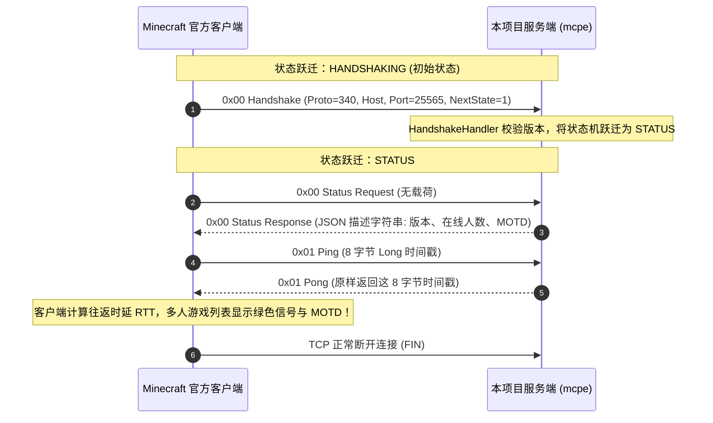

# Sprint 1 保姆级实战开发教程：Asio 异步网络基座、流式拆包与服务器列表展示（Network & Server List Ping）

> **目标协议**：Minecraft Java Edition 1.12.2（Protocol 340）  
> **当前阶段**：Sprint 1（TASK-1.1 至 TASK-1.8）  
> **面向读者**：刚完成 Sprint 0 基础设施，面对“**网络层怎么拆分**”、“**TCP 粘包半包如何处理**”、“**为什么 Asio 并发写会崩溃**”、“**官方启动器多人列表 Ping 是怎么实现的**”等实际工程挑战的开发者。  
> **文档宗旨**：坚决摒弃简陋的 Echo 式示例，以现代工业级 C++23 和 Standalone Asio 搭建网络骨架，深度剖析设计思路、技术选型对比及大厂高频面试核心考点。

---

## 目录

- [一、 心智模型跃迁与架构原理（是什么与为什么）](#一-心智模型跃迁与架构原理是什么与为什么)
  - [1.1 为什么选择 Standalone Asio 异步 Reactor 框架？](#11-为什么选择-standalone-asio-异步-reactor-框架)
  - [1.2 为什么 TCP 是纯字节流协议，没有“包”的概念？（粘包与半包真相）](#12-为什么-tcp-是纯字节流协议没有包的概念粘包与半包真相)
  - [1.3 为什么异步网络库必须维护发送队列（Write Queue）？](#13-为什么异步网络库必须维护发送队列write-queue)
  - [1.4 状态机隔离哲学：为什么 HANDSHAKING 严禁被 StatusHandler 越权处理？](#14-状态机隔离哲学为什么-handshaking-严禁被-statushandler-越权处理)
- [二、 底层协议硬核推演与时序解构（协议物理详解）](#二-底层协议硬核推演与时序解构协议物理详解)
  - [2.1 Minecraft 1.12.2 (Protocol 340) Server List Ping 完整交互时序](#21-minecraft-1122-protocol-340-server-list-ping-完整交互时序)
  - [2.2 VarInt 长度定界帧物理布局（Length + Packet ID + Payload）](#22-varint-长度定界帧物理布局length--packet-id--payload)
  - [2.3 Ping/Pong 8 字节大端整数时间戳机制（为什么不能当 VarInt 读？）](#23-pingpong-8-字节大端整数时间戳机制为什么不能当-varint-读)
  - [2.4 Status Response JSON AST 与富文本渲染规范](#24-status-response-json-ast-与富文本渲染规范)
- [三、 严格四层架构拓扑与模块职责划分](#三-严格四层架构拓扑与模块职责划分)
  - [3.1 Network 层与 Protocol 层的绝对隔离防线](#31-network-层与-protocol-层的绝对隔离防线)
  - [3.2 数据流向总览：一个字节从网卡到状态响应的完整一生](#32-数据流向总览一个字节从网卡到状态响应的完整一生)
  - [3.3 目录与源文件蓝图](#33-目录与源文件蓝图)
- [四、 任务逐步实现指南（怎么做：接口契约与代码落地）](#四-任务逐步实现指南怎么做接口契约与代码落地)
  - [TASK-1.1: Standalone Asio 异步 TcpServer 与端口监听骨架](#task-11-standalone-asio-异步-tcpserver-与端口监听骨架)
  - [TASK-1.2: TcpSession 智能指针保活与串行化发送队列](#task-12-tcpsession-智能指针保活与串行化发送队列)
  - [TASK-1.3: PacketFraming VarInt 长度定界流式拆包器（事务性回滚）](#task-13-packetframing-varint-长度定界流式拆包器事务性回滚)
  - [TASK-1.4: ConnectionState 状态机与 PacketRouter 路由器](#task-14-connectionstate-状态机与-packetrouter-路由器)
  - [TASK-1.5: HandshakeHandler 意图流转与协议版本校验](#task-15-handshakehandler-意图流转与协议版本校验)
  - [TASK-1.6: StatusHandler 处理 Request (0x00) 与动态 JSON 组装](#task-16-statushandler-处理-request-0x00-与动态-json-组装)
  - [TASK-1.7: StatusHandler 处理 Ping (0x01) 与原样 Pong 下发](#task-17-statushandler-处理-ping-0x01-与原样-pong-下发)
  - [TASK-1.8: 编写自动化 Python 探测脚本（scripts/test_ping.py）](#task-18-编写自动化-python-探测脚本scriptstest_pingpy)
- [五、 工业级避坑指南与高频面试核心考点](#五-工业级避坑指南与高频面试核心考点)
  - [5.1 工业避坑血泪史](#51-工业避坑血泪史)
  - [5.2 核心技术选型深度对比（Trade-offs 权衡矩阵）](#52-核心技术选型深度对比trade-offs-权衡矩阵)
    - [选型 1：Standalone Asio vs Boost.Asio vs Muduo vs Libuv vs 原生 Epoll](#选型-1standalone-asio-vs-boostasio-vs-muduo-vs-libuv-vs-原生-epoll)
    - [选型 2：多线程模型：单 Reactor 单线程 vs Multi-Reactor (One Loop Per Thread) vs Worker Pool](#选型-2多线程模型单-reactor-单线程-vs-multi-reactor-one-loop-per-thread-vs-worker-pool)
    - [选型 3：异步编程范式：Callback 回调 vs C++20 协程 (asio::awaitable) vs Future/Promise](#选型-3异步编程范式callback-回调-vs-c20-协程-asioawaitable-vs-futurepromise)
    - [选型 4：应用层定界拆包方案对比：定长包 vs 特殊结束符 vs 固定帧头 vs VarInt 变长帧头](#选型-4应用层定界拆包方案对比定长包-vs-特殊结束符-vs-固定帧头-vs-varint-变长帧头)
  - [5.3 高频面试核心考点与标准作答](#53-高频面试核心考点与标准作答)
- [六、 验收门禁与联调规范 (DoD)](#六-验收门禁与联调规范-dod)

---

## 一、 心智模型跃迁与架构原理（是什么与为什么）

### 1.1 为什么选择 Standalone Asio 异步 Reactor 框架？

* **是什么**：
  Asio 是 C++ 网络编程事实上的工业标准（C++ 网络库提案 Networking TS 的核心蓝本）。本项目采用 **Standalone Asio**（无 Boost 依赖的轻量头文件版本）。
* **为什么（痛点与对比）**：
  - **传统阻塞 I/O（BIO）**：每个连接分配一个 `std::thread`。在 1000 人并发下，1000 个线程的栈内存占用高达数 GB，线程上下文切换（Context Switch）直接打爆 CPU 调度器；
  - **原生 Linux `epoll`**：虽然高效，但直接裸写 `epoll_create/epoll_ctl/epoll_wait` 代码极其繁琐，难以优雅地跨平台移植，且定时器、信号管理、异步管道均需自行从零造轮子；
  - **Standalone Asio**：通过 `asio::io_context` 对底层 `epoll`（Linux）或 `kqueue`（macOS）/ `IOCP`（Windows）进行现代化封装。既具备原生 epoll 的极高吞吐，又提供了轻量、类型安全、RAII 驱动的抽象接口。

---

### 1.2 为什么 TCP 是纯字节流协议，没有“包”的概念？（粘包与半包真相）

* **是什么**：
  TCP 是一种**面向连接的、可靠的、基于字节流（Byte Stream）**的传输层协议。
  在 TCP 传输层看来，应用层发送的数据只是一串没有边界的字节（Byte 0, Byte 1, ...）。
* **为什么会产生粘包与半包**：
  1. **粘包（Packet Aggregation）**：发送方启用了 Nagle 算法（减少小包流量），或者接收方未能及时从内核套接字接收缓冲区读取，导致多个逻辑应用包在 TCP 接收缓冲区拼接在一起；
  2. **半包（Packet Fragmentation）**：应用层的一个完整逻辑包大小超过了 TCP 的 MSS（最大分段大小，通常为 1460 字节），IP 层触发分片，或者接收方 `read()` 时只读取到了部分数据。
* **架构解决思想**：
  传输层永远不负责识别逻辑边界。必须在应用层引入**定界协议（Framing Protocol）**。Minecraft 采用 **VarInt 长度前缀定界法**。

---

### 1.3 为什么异步网络库必须维护发送队列（Write Queue）？

* **是什么**：
  在 Asio 中，若想发送数据，通常调用 `asio::async_write(socket, buffer, handler)`。
* **为什么严禁并发调用 `async_write`**：
  ```
  [并发调用 async_write 引发的灾难]
  线程 A ──► async_write(socket, Packet1) ────┐
                                             ├──► 破坏 Asio 内部写缓冲状态，
  线程 B ──► async_write(socket, Packet2) ────┘     数据交叉穿插，触发内核断言崩溃！
  ```
  **Asio 规范铁律**：在同一个 `socket` 上，同一时刻**有且仅能有一个未完成（Outstanding）的 `async_write` 操作**！
* **怎么做（串行化写队列设计）**：
  `TcpSession` 内部维护一个 `std::deque<ByteBuffer> write_queue_` 和原子/线程局部的 `bool is_writing_` 标志：
  - 发送时：将数据包压入队列尾部；
  - 若 `!is_writing_`，标记 `is_writing_ = true`，并触发首包的 `async_write`；
  - 在写完成回调中：弹出已发送数据包。若队列非空，继续发送下一个包；若队列为空，重置 `is_writing_ = false`。

---

### 1.4 状态机隔离哲学：为什么 HANDSHAKING 严禁被 StatusHandler 越权处理？

* **红线规约**：
  Minecraft 连接具有明确的状态阶段：`HANDSHAKING`、`STATUS`、`LOGIN`、`PLAY`。
  很多开源实现（包括部分早期玩具服务端）为了省事，在握手包中直接返回服务器状态信息。
* **架构痛点**：
  握手包（`Handshake 0x00`）具有一个关键字段：`Next State`（`1` 代表切到 `STATUS` 进行列表探测；`2` 代表切到 `LOGIN` 准备登入游戏）。
  若让 `StatusHandler` 处理握手，会导致其职责蔓延，出现跨状态循环依赖。
  **工程铁律**：`HANDSHAKING` 状态只能由专职的 `HandshakeHandler` 独占处理，只负责解析协议版本、目标地址并跃迁状态机。

---

## 二、 底层协议硬核推演与时序解构（协议物理详解）

### 2.1 Minecraft 1.12.2 (Protocol 340) Server List Ping 完整交互时序



---

### 2.2 VarInt 长度定界帧物理布局（Length + Packet ID + Payload）

在 Minecraft 1.12.2 协议中，所有客户端与服务端之间交互的 TCP 数据帧，均由三个部分严密排布：

```
+-------------------+--------------------+------------------------+
|   Packet Length   |     Packet ID      |      Data Payload      |
|  (VarInt, 1~5B)   |   (VarInt, 1~5B)   |   (Byte[Length - ID])  |
+-------------------+--------------------+------------------------+
▲                   ▲
└── 拆包定界前缀 ───┘└── 真正的数据包体（Packet Body）───────────────┘
```

* **解析难点（非固定头长）**：
  很多传统协议有固定 4 字节的头长（如 `uint32_t len`）。但在 Minecraft 中，`Packet Length` 本身是一个 `VarInt`，其自身长度是动态的（1 到 5 字节不等）！
* **事务性回滚解码逻辑**：
  1. 探测接收缓冲区是否有足够字节解码出第一个 `VarInt`；
  2. 若数据不足（`DecodeError::kIncomplete`），**严禁移动读游标**，等待下一次 TCP 读取；
  3. 解出 `length` 后，检查 `readableBytes() >= length_bytes + length`；
  4. 若未完全收齐，同样保持游标不动；
  5. 仅当整个包完整到达时，才执行切片并前移游标。

---

### 2.3 Ping/Pong 8 字节大端整数时间戳机制（为什么不能当 VarInt 读？）

* **协议物理定义**：
  - `Ping (0x01)` 包体载荷：严格的 **64 位有符号整型 `int64_t`**（Java `long`），大端序存储，代表客户端发起探测时的单调纳秒或毫秒数；
  - `Pong (0x01)` 包体载荷：服务端必须**按原样（byte-for-byte）原封不动**地写回该 64 位整型。
* **致命踩坑点**：
  很多初学者误以为 Minecraft 里所有数字都是 `VarInt`，用 `readVarInt()` 去读 Ping 包。由于客户端发来的时间戳数值极大（例如毫秒数 `1716300000123`），强行按 VarInt 解析会引发越界或溢出截断，导致回发给客户端的 Pong 时间戳被破坏，客户端直接显示红叉或无限菊花探测中！

---

### 2.4 Status Response JSON AST 与富文本渲染规范

`Status Response (0x00)` 下发的字符串是一个标准的 JSON 对象：

```json
{
  "version": {
    "name": "1.12.2",
    "protocol": 340
  },
  "players": {
    "max": 100,
    "online": 0,
    "sample": []
  },
  "description": {
    "text": "§a[MCPE] §f高性能 C++23 游戏引擎 §7| §eProtocol 340"
  }
}
```

* **富文本颜色代码**：
  Minecraft 支持以分节符号 `§`（Unicode `\u00A7`，UTF-8 `0xC2 0xA7`）开头的颜色与样式代码：
  - `§a`：绿色（Green）
  - `§f`：白色（White）
  - `§7`：浅灰色（Gray）
  - `§e`：黄色（Yellow）

---

## 三、 严格四层架构拓扑与模块职责划分

### 3.1 Network 层与 Protocol 层的绝对隔离防线

```
┌─────────────────────────────────────────────────────────────┐
│ 3. Protocol 协议层 (src/protocol/)                          │
│    ConnectionState (FSM) / PacketRouter / HandshakeHandler  │
│    StatusHandler (Ping/Pong/MOTD)                           │
│    ★ 职责：负责 Packet ID 含义、业务流转、数据包反序列化   │
└──────────────────────────────▲──────────────────────────────┘
                               │ 传递整包 (ByteBuffer 零拷贝切片)
┌──────────────────────────────┴──────────────────────────────┐
│ 2. Network 网络层 (src/network/)                            │
│    TcpServer / TcpSession / PacketFraming                   │
│    ★ 铁律：纯粹负责 TCP 异步 I/O、按字节定界拆包。          │
│      严禁引入任何 Minecraft 协议状态机、Packet ID 或业务！   │
└─────────────────────────────────────────────────────────────┘
```

### 3.2 数据流向总览：一个字节从网卡到状态响应的完整一生

```
物理网卡
  │ (TCP 字节流)
  ▼
[asio::ip::tcp::socket::async_read_some]
  │ 读入 TcpSession 内部临时缓冲
  ▼
[TcpSession::recv_buf_] (累积接收缓冲区 ByteBuffer)
  │
  ▼ 循环调用拆包算法
[PacketFraming::slicePacket(recv_buf_)]
  │
  ├── 状态: kIncomplete ──► 保留数据，退出循环，等待下一次网络 I/O 触发
  │
  └── 成功切出: ByteBuffer packet (仅包含 ID + Payload)
        │
        ▼ 投递至协议路由器
  [PacketRouter::dispatch(session, packet)]
        │ 查表 / switch 状态机
        ▼
  [HandshakeHandler 或 StatusHandler]
        │ 组装响应包并调用
        ▼
  [TcpSession::sendPacket(response)]
        │ 排队推入串行队列
        ▼
  [asio::async_write] ──► 物理网卡下发
```

### 3.3 目录与源文件蓝图

```
src/
├── network/
│   ├── TcpServer.h / .cc         <-- Acceptor 端口监听与会话工厂
│   ├── TcpSession.h / .cc        <-- Socket 异步读写生命周期与发送队列
│   └── PacketFraming.h / .cc     <-- VarInt 长度定界拆包器
├── protocol/
│   ├── ConnectionState.h         <-- 握手/状态/登录/游玩 四态枚举
│   ├── PacketRouter.h / .cc      <-- 状态机路由器分发器
│   ├── HandshakeHandler.h / .cc  <-- 握手包处理与意图流转
│   └── StatusHandler.h / .cc     <-- MOTD 与 Ping/Pong 业务
tests/
├── test_framing.cc               <-- 粘包、半包、恶意包拆包单测
├── test_tcp_session.cc           <-- 异步写队列串行化单测
└── test_packet_router.cc         <-- 状态机分发单测
scripts/
└── test_ping.py                  <-- 免开客户端的极速 Python 探测脚本
```

---

### 四、 任务逐步实现指南（怎么做：接口契约与设计落地）

### TASK-1.1: Standalone Asio 异步 TcpServer 监听器与工厂模式设计

* **Acceptor 生命周期与事件循环绑定**：
  - `TcpServer` 持有 `asio::io_context&` 引用与 `asio::ip::tcp::acceptor` 实例；
  - 在指定端口（如 25565）开启 IPv4 监听，启动时进入运行态（`is_running_ = true`）；
* **套接字底层选项调优策略（TCP_NODELAY）**：
  - 在每次成功接受新的客户端连接套接字后，第一时间配置 `asio::ip::tcp::no_delay(true)` 禁用 Nagle 算法；
  - 杜绝小尺寸数据包（如 Ping/Pong 或玩家单步位移）因 TCP 延迟确认机制（Delayed ACK，约 40ms）引发的人工延迟抖动；
* **异步工厂与尾递归监听闭环**：
  - 采用现代 Asio 异步回调驱动模式：在 `acceptor_.async_accept` 回调中，若连接成功，将套接字所有权移动（`std::move`）构造独立的 `TcpSession` 会话对象；
  - 为会话挂接全局分包/路由处理器，并启动会话的异步读管线（`session->start()`）；
  - 无论本次连接是否成功，在回调结尾无条件发起下一次 `async_accept`，维持持续监听流水线。

---

### TASK-1.2: TcpSession 智能指针保活与串行化发送队列设计

* **生命周期延续模型（std::enable_shared_from_this）**：
  - 网络层连接具有天然的异步动态生命周期。`TcpSession` 必须公有继承 `std::enable_shared_from_this<TcpSession>`；
  - 在发起的每一个异步 I/O 操作（`async_read_some` 与 `async_write`）的回调闭包中，必须按值捕获 `self = shared_from_this()`；
  - **核心保障**：只要底层操作系统仍有未决（Outstanding）的 I/O 请求，引用计数就至少为 1，确保回调触发时 `this` 指针绝对有效，彻底消灭野指针与回调崩溃。
* **串行化写队列设计（Write Queue）**：
  - **并发写崩溃防御**：Asio 底层要求同一个套接字在同一时间只能存在一个未完成的 `async_write`；
  - **队列与投递契约**：
    - 内部维护 `std::deque<ByteBuffer> write_queue_`；
    - 外部线程或游戏主线程调用 `sendPacket(ByteBuffer)` 时，使用 `asio::post(socket_.get_executor(), ...)` 将写任务调度至套接字关联的 I/O 线程上下文中；
    - 若当前队列为空（`!write_in_progress`），则将包推入队尾并立即触发首包的 `async_write`；
    - 在异步写完成回调中弹出已送达的数据包。若队列中仍有积压数据，继续递归触发下一个包的下发；若队列完全排空，重置写入中标志位。

---

### TASK-1.3: PacketFraming VarInt 长度定界流式拆包器与事务回滚设计

* **流式拆包状态机与三阶段拓扑**：
  - **阶段 1：事务开启（RAII Mark）**：实例化 `ByteBuffer::Mark` 锁定当前的读游标位置；
  - **阶段 2：帧长探测与合法性防御**：
    - 尝试以 VarInt 解码帧长度 `packet_len`；
    - 若返回 `DecodeError::kIncomplete`，表明外层长度字段本身遭遇半包，直接退出，`Mark` 析构自动回滚游标；
    - 若长度 $\le 0$ 或超过安全上限（如 2MB），判定为恶意攻击或协议严重破损，返回 `FramingError::kMalformed` / `kPacketTooLarge`，直接通知会话踢出；
  - **阶段 3：整包载荷校验与零拷贝切片**：
    - 检查缓冲区剩余可读字节是否满足 `readableBytes() >= packet_len`；
    - 若不满足（半包状态），维持事务回滚，等待下一次 TCP 数据到达；
    - 若满足（整包齐全），显式调用 `mark.commit()` 提交事务，并通过 `readSlice(packet_len)` 零拷贝切出完整的子数据包。

---

### TASK-1.4: ConnectionState 状态机与 PacketRouter 路由器架构设计

* **协议生命周期四态模型**：
  - 强类型枚举 `ConnectionState`：`HANDSHAKING` (0)、`STATUS` (1)、`LOGIN` (2)、`PLAY` (3)；
  - 连接建立之初，会话初始状态严格锁定为 `HANDSHAKING`。
* **职责分离的路由器分派机制（PacketRouter）**：
  - 作为网络层与协议业务层的分界防火墙，仅负责解包分发；
  - 从 `PacketFraming` 提取出的包体中读取首个字段 `Packet ID`（VarInt）；
  - 根据当前会话的 `ConnectionState` 精准分发至专职处理器：
    - `HANDSHAKING` 独占交由 `HandshakeHandler`；
    - `STATUS` 独占交由 `StatusHandler`；
  - 任何状态不匹配的越权包或非法 ID，统一阻断并安全切断连接。

---

### TASK-1.5: HandshakeHandler 意图流转与协议版本校验设计契约

* **协议解包契约（0x00 Handshake）**：
  - 顺序反序列化四大字段：`Protocol Version`（VarInt）、`Server Address`（String(255)）、`Server Port`（Unsigned Short, 16位大端）、`Next State`（VarInt: 1=STATUS, 2=LOGIN）；
* **流转决策矩阵**：
  - 若 `Next State == 1`：当前会话意图为服务器列表探测，将其状态机更新为 `STATUS`；
  - 若 `Next State == 2`：当前会话意图为进入游戏，将其状态机更新为 `LOGIN`；
  - 若包含其他未定义状态代码或数据截断，直接关闭连接；
* **架构隔离红线**：
  - `HandshakeHandler` 严禁下发任何响应包，仅负责状态机跃迁，彻底与 `StatusHandler` 解耦。

---

### TASK-1.6: StatusHandler 处理 Request (0x00) 与动态 JSON 组装设计

* **请求消费契约**：
  - 消费客户端发送的 `0x00 Status Request`（该包载荷长度为 0，无需反序列化额外字段）；
* **响应组装与下发流水线（0x00 Status Response）**：
  - 动态组装服务端状态描述 JSON 抽象语法树（AST）：
    - `version`：指定展示版本文本与协议号（340）；
    - `players`：配置最大承载人数、当前在线人数及样本玩家列表；
    - `description`：组装带颜色代码的富文本 MOTD 介绍；
  - 将 JSON 字符串作为载荷写入 `ByteBuffer`，包头填充 `Packet ID = 0x00`；
  - 利用 `prependVarInt` 在头部前插包体总长度，推入写队列异步下发。

---

### TASK-1.7: StatusHandler 处理 Ping (0x01) 与原样 Pong 下发设计

* **时延采样协议契约**：
  - 消费客户端的 `0x01 Ping` 数据包；
  - 读取载荷中包含的 8 字节大端整数时间戳（`int64_t`）；
* **二进制镜像回显机制（0x01 Pong）**：
  - 严禁将该 8 字节时间戳当作变长整型压缩；
  - 构造 `Packet ID = 0x01` 的 Pong 数据包，以严格的大端 64 位有符号整型格式将收到的时间戳原封不动写回；
  - 客户端通过计算本地收到 Pong 的时间与发送 Ping 时间的差值，在列表上绘制网络延迟绿条。

---

### TASK-1.8: 编写自动化 Python 探测脚本与端到端回归标准

* **测试驱动开发（TDD）闭环设计**：
  - 在无需启动大型 Java 客户端与图形界面的前提下，通过轻量 Python 脚本建立原生 TCP 套接字；
  - 脚本按标准协议编解码 VarInt 与大端数据，端到端执行：
    1. 发送标准握手帧（意图为状态探测）；
    2. 发送状态查询包，接收并断言 MOTD JSON 格式与协议代号（340）合法；
    3. 发送毫秒级 Ping 时间戳，接收 Pong 包并断言 8 字节时间戳镜像一致；
  - 作为 CI 自动化流水线中的常驻轻量级测试用例，保障网络基座零回退。

---

## 五、 工业级避坑指南与高频面试核心考点

### 5.1 工业避坑血泪史
* ⚠️ **异步 Lambda 中捕获裸指针 `[this]` 导致野指针 Crash**：
  当客户端在网络 I/O 过程中突发断开，`TcpSession` 对象可能已被外部析构。若在 `async_read` 或 `async_write` 的回调中直接使用裸 `[this]`，回调被调度时访问已释放的内存，造成 SIGSEGV 崩溃！**铁律**：在异步回调中必须捕获 `self = shared_from_this()`，通过引用计数保证会话生命周期覆盖整个异步操作。
* ⚠️ **并发调用 `async_write` 导致 Asio 断言崩溃**：
  Asio 底层明确规定同一个 Socket 任何时刻只能有一个活跃的写操作。如果在业务逻辑中直接写 `async_write`，必然会在高并发时崩溃。必须实现串行写队列。
* ⚠️ **拆包器长度定界攻击漏洞**：
  如果客户端发送一个声明包长为 $2\text{GB}$（`0x7FFFFFFF`）的恶意包，若服务端直接按照该长度分配缓冲区，内存会瞬间被撑爆（OOM 崩溃）。必须设定硬性上限 `kMaxPacketSize`（如 2MB），超限直接掐断连接。
* ⚠️ **Ping 时间戳误用 VarInt 解码**：
  Ping/Pong 载荷是纯二进制 `int64_t`，非 VarInt。

---

### 5.2 核心技术选型深度对比（Trade-offs 权衡矩阵）

#### 选型 1：Standalone Asio vs Boost.Asio vs Muduo vs Libuv vs 原生 Epoll
| 维度 | Standalone Asio (本项目选型) | Boost.Asio | Muduo (陈硕) | Libuv (Node.js) | 原生 Linux Epoll |
| :--- | :--- | :--- | :--- | :--- | :--- |
| **依赖体量** | 仅头文件，零外部依赖 | 庞大，依赖 Boost 基础库 | 依赖 pthread 等，仅 Linux | C 语言纯库，跨平台 | 零依赖，Linux 独占 |
| **现代 C++ 支持** | 完美支持 C++20/23 (协程/Concepts) | 支持良好 | C++98/03 风格老旧 | 纯 C 回调风格 | 裸 C 接口 |
| **跨平台能力** | Linux/macOS/Windows (IOCP) | 全平台 | 仅限 Linux | 全平台 | 仅限 Linux |
| **学习与维护成本**| 中等（类型系统完备） | 较高（编译慢、依赖重） | 简单（适合教学） | 中等 | 极高（样板代码过多） |

#### 选型 2：多线程模型：单 Reactor 单线程 vs Multi-Reactor (One Loop Per Thread) vs Worker Pool
| 维度 | 单 Reactor 单线程 | Multi-Reactor (One Loop Per Thread) | 单 Reactor + Worker Pool (本项目架构) |
| :--- | :--- | :--- | :--- |
| **吞吐量** | 受限于单 CPU 核心 | 极高（平摊在多个核上） | 高（网络 I/O 线程池 + 单主逻辑线程） |
| **编程复杂度** | 极简（无需考虑线程安全） | 较高（需处理跨线程会话路由） | 适中（Actor 单写入者主循环） |
| **锁竞争** | 零竞争 | 线程间无竞争，但业务数据需分片 | **完全消除业务世界锁**（通过 MPSC 队列） |
| **适用场景** | 教学原型、轻量级网关 | 纯无状态反向代理（如 Nginx） | **MMO 游戏服务端、Minecraft 大厅** |

#### 选型 3：异步编程范式：Callback 回调 vs C++20 协程 (asio::awaitable) vs Future/Promise
| 维度 | Callback 异步回调 (本项目底层) | C++20 协程 (`asio::awaitable`) | `std::future / promise` |
| :--- | :--- | :--- | :--- |
| **控制流** | 容易陷入“回调地狱”（Callback Hell） | 同步书写风格，无缝异步执行 | 易阻塞调用线程，不适合事件驱动 |
| **栈内存开销** | 极小（栈帧按需销毁） | 需分配轻量 Coroutine Frame 堆块 | 需分配共享状态（Shared State） |
| **调试难度** | 堆栈回溯被打散，较难调试 | 堆栈连贯，极易排查 Bug | 异常排查容易 |

#### 选型 4：应用层定界拆包方案对比：定长包 vs 特殊结束符 vs 固定帧头 vs VarInt 变长帧头
| 维度 | 定长包 (Fixed Length) | 特殊结束符 (`\r\n`) | 固定帧头 (`uint32_t len`) | VarInt 变长帧头 (MC 协议) |
| :--- | :--- | :--- | :--- | :--- |
| **带宽浪费** | 严重（短消息也需补齐填充） | 需对载荷进行转义，增加解析成本 | 恒定占 4 字节 | **极致压缩**（短包仅占 1 字节） |
| **解析效率** | 极高（直接读固定偏移） | 慢（需逐字节扫描分隔符） | 极高（读 4 字节即可切片） | 高（需解析 1~5 字节 VarInt） |
| **二进制兼容** | 良好 | 较差（二进制载荷易与结束符冲突）| 极佳 | 极佳 |

---

### 5.3 高频面试核心考点与标准作答

* **Q1: 什么是 TCP 粘包和半包？为什么 TCP 会产生粘包，而 UDP 不会？如何优雅解决？**
  * **标准作答**：TCP 粘包与半包的根因在于 TCP 是流式传输协议，其底层是以字节为单位收发数据的，协议本身不包含应用层消息边界；而 UDP 是基于数据报（Datagram）的协议，IP 层或 UDP 首部包含完整的报文长度字段，接收方按报文单元交付，保留了明确的消息边界。在 TCP 应用层，解决粘包与半包的工业级方案有三种：定长消息、特殊分隔符、以及长度字段定界（Length-prefixed framing）。本项目采用 VarInt 长度定界，通过 `PacketFraming` 的 Mark 事务回滚机制，在半包时保留游标、在整包到达时执行零拷贝切片。
* **Q2: 为什么在 Asio 中同一个 Socket 上并发调用 `async_write` 会引发未定义行为？写队列是如何设计的？**
  * **标准作答**：Asio 的 `async_write` 是一个由多次底层的 `async_write_some` 组合而成的异步操作。若在上一次写操作未完成前再次发起写操作，多个异步写入操作会并发争抢同一个底层 socket，导致数据切片在发送缓冲区中乱序交织，破坏协议格式并引发内部断言崩溃。工业级设计通过 `write_queue_` 配合 `is_writing_` 标记实现串行化：每次外部请求发送时推入队列，若当前无写操作则启动发送首包；在异步写完成回调中出队并链式驱动下一包，直至队列排空。
* **Q3: 为什么 `TcpSession` 必须继承 `std::enable_shared_from_this`？在异步 Lambda 中捕获 `[this, self = shared_from_this()]` 的作用是什么？**
  * **标准作答**：在事件驱动的异步架构中，I/O 操作的发起与完成回调在时间上是解耦的。若客户端主动断开连接，外部管理者可能已经将该 Session 的 `shared_ptr` 移除并触发析构；若此时未在底层异步回调中持有强引用，回调被 Asio 唤醒执行时访问 `this` 就会引发悬垂指针野指针访问。通过继承 `enable_shared_from_this` 并在 Lambda 中值捕获 `self = shared_from_this()`，使得异步任务自身成为了该会话的一个强引用持有者，确保会话对象在所有未完成的异步操作执行完毕前绝不会被销毁。
* **Q4: 详细描述 epoll_wait 的内核工作机制以及网卡硬件中断到 Asio 回调触发的完整过程。**
  * **标准作答**：
    1. **网卡收包与中断**：网络电信号到达物理网卡，DMA 控制器将数据包直接写入主存环形缓冲区（Ring Buffer），网卡向 CPU 发送硬件硬中断；
    2. **内核软中断与网络栈处理**：CPU 响应硬中断并触发软中断（NET_RX_SOFTIRQ），驱动层调用 NAPI 轮询数据包，交由内核网络协议栈逐层解析 Ethernet -> IP -> TCP 校验与重组，最终将数据放入套接字的接收缓冲区（Socket Receive Buffer）；
    3. **唤醒等待队列**：内核网络栈调用 `sock_def_readable()` 唤醒绑定在该 socket 上的等待队列项，将其关联的 `epitem` 加入到对应 `epoll` 实例的就绪就绪链表（Ready List，`rdllist`）；
    4. **唤醒用户线程**：之前阻塞在 `epoll_wait` 上的 Asio 线程从睡眠状态被唤醒，`epoll_wait` 将就绪事件拷贝至用户空间；
    5. **Asio 驱动执行**：Asio 的 `io_context` 事件循环从 `epoll_wait` 返回，取出就绪的 socket 触发注册的异步读回调，驱动上层业务逻辑执行。
* **Q5: 优雅关闭连接（Graceful Shutdown）与直接 `close` 的区别是什么？四次挥手在服务端如何安全驱动？**
  * **标准作答**：直接调用 `close()` 会立即释放本地套接字文件描述符。如果此时发送缓冲区仍有未发完的数据，或者对方恰好在此时发送了数据，TCP 协议栈会直接发送一个 RST 强制复位报文，导致对方报 `Connection reset by peer` 异常，破坏通信完整性。优雅关闭通过调用 `socket::shutdown(shutdown_send)` 发送 FIN 报文通知对方我方已完成发送，进入 `FIN_WAIT_1` 状态；随后继续保持读取通道，等待对端消化完数据并回送 FIN 报文，待收到对方的 FIN（读取返回 EOF）后，才最终调用 `close()` 关闭套接字，平稳完成 TCP 四次挥手。

---

## 六、 验收门禁与联调规范 (DoD)

在宣布 Sprint 1 完成前，必须通过以下全部验收条件：

1. **编译门禁**：GCC 14 `-Wall -Wextra -Wpedantic` 零告警通过编译；
2. **单元测试通过**：
   - `test_framing`：覆盖单包、双包粘包拆分、三字节半包重组、2MB 恶意超大包拒绝断连测试；
   - `test_tcp_session`：覆盖多线程高并发下发时的写队列严格保序与无丢包测试；
   - `test_packet_router`：覆盖未握手直接发状态包的非法流转拦截测试；
3. **真实端到端探测闭环**：
   - 启动 `./bin/server` 监听 25565 端口；
   - 运行 `python3 scripts/test_ping.py`，输出响应耗时并在 5ms 内成功接收到 Status JSON 与原样 Pong；
   - 打开 Minecraft 1.12.2 官方客户端多人游戏列表，服务器条目正常呈现绿色延迟信号条、显示在线人数与富文本彩色 MOTD。
