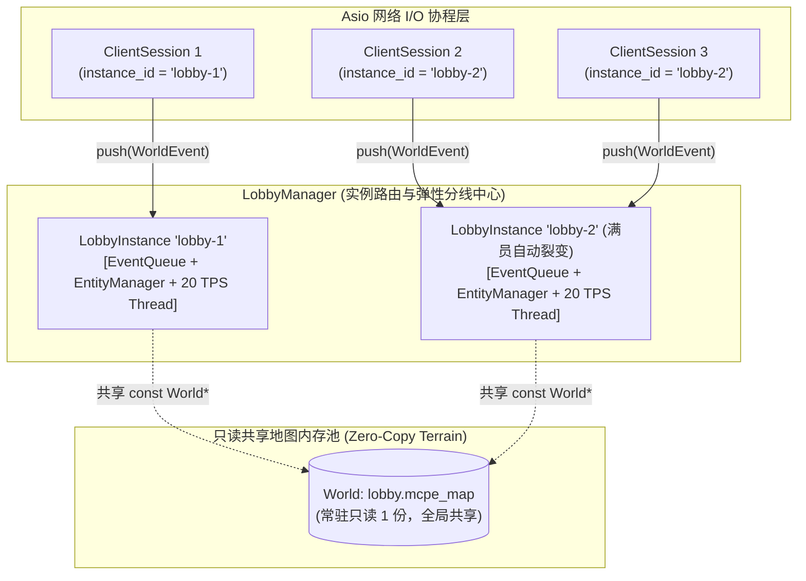

# Sprint 4 保姆级实战开发教程：双层 INI 配置体系、多实例并发 Actor 引擎与大厅动态分线 (INI Config, Multi-Instance Actor Engine & Lobby Sharding)

> **目标协议**：**Minecraft Java Edition 1.12.2（Protocol Version: 340）**  
> **前置里程碑**：Sprint 0~3（网络、登录、20 TPS 单世界联机）与 **Sprint 3.5（离线地图烘焙 `.mcpe_map`、`SpatialGrid` 九宫格 AOI、商业大厅机制、C++20 协程化与 `retainedSlice()` 零拷贝多播）** 已全部验收通过。  
> **本阶段核心目标**：将服务端从“单一大厅实例”全面升级为“**支持动态弹性分线的多实例大厅并发引擎**”！引入对齐 Cuberite 的 **`settings.ini` + `assets/maps/<map>.ini` 双层 INI 配置持久化体系**；在 `LoginHandler` 落地**全服总人数硬上限拦截**与**大厅满员自动裂变分线（`lobby-1`, `lobby-2`... 共享只读 `World` 区块内存）**；开辟清晰的 `src/lobby/` 大厅实例调度层（`LobbyInstance`、`LobbyManager`），采用**每实例独立 20 TPS Actor 线程模型**实现多大厅分线并发互不阻塞；打通 **`0x35 Respawn` 单连接跨分线无缝原子切换**！  
> **教学设计原则**：**透彻讲清“是什么、为什么、怎么做”**。严格遵守架构分层红线与单一职责原则（SRP），将大厅分线 Actor 与调度逻辑彻底内聚在 `src/lobby/`。  
> **预估工期**：3 ~ 4 天 | **核心任务数**：5 个微任务（TASK-4.1 ~ TASK-4.5）

## 一、 架构设计决策树总览（Grill-Me 共识基线）

在动手编写代码前，我们先锁定本阶段经过严密推演确立的 **4 大核心架构决策**：

| 决策维度 | 最终选定方案 | 核心架构收益与设计理由 |
| :--- | :--- | :--- |
| **1. 并发与线程模型** | **Per-Instance Actor 模型（对齐 Cuberite `cWorld`）** | 只读地形 `std::shared_ptr<const World>`（`.mcpe_map`）全局共享一份内存；每个大厅分线实例各自拥有独立的 `EventQueue` + `EntityManager`（含 `SpatialGrid`）+ `WorldTicker`（20 TPS 专属线程），实例间 100% 物理隔离、零锁争用。 |
| **2. 人数上限与大厅分线** | **全服硬上限拦截 + 动态弹性大厅分线 (`lobby-1..N`)** | `settings.ini` 配置 `server_max_players`（超限在 `LoginHandler` 发 `0x00 Disconnect` 拒绝连入）与 `lobby_max_players`（`lobby-1` 满员自动新建 `lobby-2` 实例并共享只读地图，支持 `/lobby [id]` 手动切线）。 |
| **3. 代码目录与层级边界** | **`src/world/`（空间底座）+ `src/lobby/`（大厅分线调度）** | `src/world/` 仅保留通用区块与 AOI 底座；`src/lobby/` 存放 `LobbyInstance` 与 `LobbyManager`，与底层网络层完全解耦。 |
| **4. 配置管理与持久化** | **根目录 `settings.ini` + 地图伴生 `assets/maps/<map>.ini`** | `settings.ini` 管理 `[Server]` 与 `[Lobby]` 全局/分线配额（首次启动自动生成，支持 `/setmaxplayers` 写回）；`<map>.ini` 管理单图出生点与 `fall_reset_y`（取代 `spawn.json`，支持 `/setspawn` 写回）。 |

## 二、 心智模型跃迁与底层原理（是什么与为什么）

### 2.1 为什么多大厅分线必须采用“只读地形共享 + 每实例独立 Actor 线程”？

* **是什么**：
  当服务器同时运行多个大厅分线（`lobby-1` ~ `lobby-N`）时，系统中存在多个并行的游戏空间实例。
  我们将每个实例拆解为两部分：
  1. **静态只读地形（Static Read-Only Terrain，`std::shared_ptr<const world::World>`）**：由 `.mcpe_map` 加载的区块方块数组 `ChunkSection`。由于大厅开启全局只读保护（禁止挖掘/放置破坏地图），地形在运行期是 **100% 不可变（Immutable）** 的；
  2. **动态实例状态（Dynamic Instance State，`lobby::LobbyInstance`）**：包含该实例内的在线玩家实体表 `EntityManager`、九宫格索引 `SpatialGrid`、跨线程事件队列 `EventQueue` 以及驱动它的 20 TPS 物理线程 `WorldTicker`。
* **为什么这样设计能同时兼顾 $\le 30\text{MB}$ 内存红线与高并发吞吐**：
  - **内存极致共享**：哪怕裂变出 10 个大厅分线实例，内存中依然**只有 1 份 `lobby.mcpe_map` 的 `World` 对象**！新增一个分线实例仅增加空的哈希表和队列，额外内存开销不到 **16 KB**；
  - **故障与负载绝对隔离**：`lobby-1` 的 50 名玩家同屏聊天移动，与 `lobby-2` 的玩家，运行在各自独立的 `WorldTicker` 线程上，彼此之间没有任何 `std::mutex` 锁竞争。

### 2.2 为什么需要双层人数上限（`server_max_players` vs `lobby_max_players`）？

* **痛点分析**：
  1. 如果没有**全服总人数上限（`server_max_players`）**，恶意压测流量无限制连入会导致宿主机文件描述符（FD）或带宽耗尽；
  2. 如果只有全服上限（例如 500 人）而没有**单大厅分线上限（`lobby_max_players`，如 50 人）**，500 名玩家全部挤在同一个 `lobby-1` 的出生点喷泉旁，客户端渲染 500 个皮肤模型会直接掉帧卡死（Client FPS Drop），且单区块九宫格广播退化为 500 人全量互发。
* **商业服标准解法**：
  - **第一道防线（`LoginHandler` 全服硬上限拦截）**：在收到 `0x00 Login Start` 时，检查 `client_manager->playerCount() >= settings.server.max_players`。若超限，直接下发 **Login 阶段的 `0x00 Disconnect`**（携带红色 JSON 提示 `"{"text":"服务器已满员，请稍后再试！","color":"red"}"`）并关闭连接；
  - **第二道分流（`LobbyManager` 动态弹性分线）**：玩家通过登录鉴权进入 `PLAY` 阶段时，`LobbyManager::acquireLobbyInstance()` 按序扫描现有大厅列表 `lobby-1, lobby-2, ...`：
    - 若找到首个 `playerCount() < lobby_max_players` 的分线，直接分配进入；
    - 若所有现有分线均已满员且分线总数 `< max_lobby_instances`，则动态创建新的 `LobbyInstance("lobby-" + next_id)`，挂载共享的 `lobby_world` 并启动其 20 TPS 线程！

### 2.3 玩家在不同大厅分线之间切换（`/lobby [id]`）时，如何保证跨线程与协议时序安全？

* **是什么**：
  当玩家在聊天栏输入 `/lobby 2` 手动切线（或某分线满员系统分流）时，玩家的 `ClientSession` 需要从**源分线 `lobby-1`（运行在线程 A）** 迁移到 **目标分线 `lobby-2`（运行在线程 B）**。
* **为什么不能直接在当前线程里同时操作两个实例的 `EntityManager`**：
  因为 `lobby-1` 的 `EntityManager` 归线程 A 独占写入，`lobby-2` 的 `EntityManager` 归线程 B 独占写入！若跨线程直接调用 `instanceB->entityManager().addPlayer(...)`，会立即破坏单写入者原则并引发迭代器崩溃。
* **怎么做（三步原子迁移与 `0x35 Respawn` 协议流水线）**：
  1. **步骤 1（从源实例摘除）**：向源实例 `Instance A` 的 `EventQueue` 投递 `PlayerLeaveEvent{session_id}`，由线程 A 在本 Tick 内安全将其从 `Instance A` 的 `EntityManager` 与 `SpatialGrid` 中移除，并向源实例九宫格邻居广播 `0x32 Destroy Entities` + `0x2E RemovePlayer`；
  2. **步骤 2（客户端协议层 `0x35` 刷屏与新地形下发）**：更新 `session->setCurrentInstance(instance_b)`，向该玩家依次发送：
     - 过渡维度 `0x35 Respawn (Dimension = -1 Nether)` + 目标维度 `0x35 Respawn (Dimension = 0 Overworld)`（彻底清空客户端旧分线的区块渲染缓存与旧实体残留）；
     - 目标实例 `Instance B` 出生点周围的 `0x20 Chunk Data` 区块流；
     - `0x46 Spawn Position`、`0x2C Player Abilities`、`0x47 Time Update` 以及定位到新分线出生点的 `0x2F Player Position And Look (Teleport ID)`；
  3. **步骤 3（注入目标实例）**：向目标实例 `Instance B` 的 `EventQueue` 投递 `PlayerJoinEvent{session_id, entity_id, username, uuid}`，由线程 B 在下一 Tick 安全将其注册进 `Instance B` 的 `EntityManager` 与 `SpatialGrid`，并与目标实例内的同屏玩家互发 `0x2E AddPlayer` + `0x05 SpawnPlayer`！

## 三、 严格四层架构拓扑与可扩展目录规划

### 3.1 新增 `src/lobby/` 后的工程目录全景图

严格遵循我们在设计拷问中敲定的分层结构，`src/world/` 保持为纯粹的空间物理底座，`src/lobby/` 承载实例调度与插件式小游戏扩展：

```text
mcpe/
├── settings.ini                             # [新增] 全局服务与大厅分线配额配置 (启动自动生成/读取)
├── assets/
│   └── maps/
│       ├── lobby.mcpe_map                   # 预烘焙浮空岛大厅二进制区块镜像
│       └── lobby.ini                        # [新增] 大厅地图伴生配置 (出生点坐标、朝向、fall_reset_y)
├── src/
│   ├── CMakeLists.txt                       # [更新] 纳入 common/IniConfig 与 lobby/ 模块
│   ├── common/
│   │   ├── ByteBuffer.h/.cc
│   │   ├── VarInt.h/.cc
│   │   ├── SpatialTypes.h                   # [扩充] 增加 AABB 三维轴对齐包围盒原语
│   │   └── IniConfig.h/.cc                  # [新增] 轻量零依赖 INI 解析与格式化写回工具
│   ├── network/                             # 纯异步 TCP 协程传输层 (零改动)
│   ├── world/                               # 纯空间物理底座层 (职责纯粹，不含具体游戏玩法)
│   │   ├── ChunkSection.h/.cc
│   │   ├── Chunk.h/.cc
│   │   ├── World.h/.cc                      # 负责 .mcpe_map 加载与 <map>.ini 基础元数据读写
│   │   ├── SpatialGrid.h/.cc                # 九宫格空间桶与差集计算
│   │   ├── EntityManager.h/.cc              # 单实例内实体生命周期与局部 AOI 多播
│   │   ├── EventQueue.h                     # 单实例 MPSC 双缓冲事件队列
│   │   └── WorldTicker.h/.cc                # 单实例 20 TPS 物理节拍器线程
│   ├── lobby/                               # [全新核心层] 大厅多实例并发分线调度框架
│   │   ├── LobbyInstance.h/.cc              # 大厅分线 Actor (封装 World, EventQueue, EntityManager, WorldTicker, 虚空拉回)
│   │   └── LobbyManager.h/.cc               # 全局大厅分线调度中心、弹性裂变器与跨分线 0x35 迁移协调器
│   ├── protocol/
│   │   ├── PacketTypes.h                    # [扩充] LoginDisconnect(0x00), Respawn(0x35), Title(0x48)
│   │   ├── GameTypes.h                      # [升级] 对接 settings.ini 配置结构
│   │   ├── ClientSession.h/.cc              # [升级] 维护 current_instance_id_ 路由指针
│   │   ├── LoginHandler.h/.cc               # [升级] 增加 server_max_players 满员 0x00 Disconnect 拦截
│   │   ├── PlayHandler.h/.cc                # [升级] 增加 switchPlayerWorld (0x35) 并按会话当前实例投递事件
│   │   └── ChatHandler.h/.cc                # [升级] 支持 /lobby [id], /lobbies, /help, /admin, /setmaxplayers, /setspawn
│   └── main.cc                              # [升级] 加载 settings.ini，初始化 LobbyManager 并挂载大厅地图
└── tests/
    ├── test_ini_config.cc                   # [新增] settings.ini 与 <map>.ini 读写往返单测
    └── test_lobby_sharding.cc               # [新增] 大厅满员自动裂变分线与全服人数上限拦截单测
```

### 3.2 多实例多线程 Actor 并发拓扑与跨分线切换



## 四、 任务逐步实现指南（怎么做：接口契约与代码落地）

### TASK-4.1: 双层 INI 配置文件解析与持久化体系 (`src/common/IniConfig.h/.cc`)

#### 1. 配置文件格式契约
* **根目录 `settings.ini`（全局服务与大厅分线配额）**：
  ```ini
  ; MCPE Server Global Configuration
  [Server]
  port = 25566
  max_players = 500
  motd = §aMCPE Microservice Cluster §7[C++23 / Multi-Instance]

  [Lobby]
  default_map = lobby
  max_players_per_instance = 50
  max_instances = 10
  view_distance = 5
  ```
* **地图伴生配置 `assets/maps/lobby.ini`（单图出生点与虚空掉落拉回阈值）**：
  ```ini
  [World]
  baked_file = assets/maps/lobby.mcpe_map
  spawn_x = 0.50
  spawn_y = 65.00
  spawn_z = 0.50
  spawn_yaw = 0.00
  spawn_pitch = 0.00
  fall_reset_y = 30.00
  ```

#### 2. `IniConfig` 核心接口落地 (`src/common/IniConfig.h`)
```cpp
#ifndef MCPE_COMMON_INI_CONFIG_H
#define MCPE_COMMON_INI_CONFIG_H

#include <cstdint>
#include <filesystem>
#include <map>
#include <optional>
#include <string>
#include <string_view>

#include "common/SpatialTypes.h"

namespace mcpe::common {

/**
 * @brief 轻量级零外部依赖 INI 配置文件读写器（对标 Cuberite cIniFile）
 *
 * 支持 Section/Key 大小写敏感或规范化读取、默认值回退、注释保留与原子写回磁盘。
 */
class IniConfig {
 public:
  IniConfig() = default;

  [[nodiscard]] bool loadFromFile(const std::filesystem::path& path);
  [[nodiscard]] bool saveToFile(const std::filesystem::path& path) const;

  [[nodiscard]] std::string getString(
      std::string_view section,
      std::string_view key,
      std::string_view default_val = ""
  ) const;

  [[nodiscard]] int32_t getInt(
      std::string_view section,
      std::string_view key,
      int32_t default_val = 0
  ) const;

  [[nodiscard]] double getDouble(
      std::string_view section,
      std::string_view key,
      double default_val = 0.0
  ) const;

  void setString(std::string_view section, std::string_view key, std::string_view value);
  void setInt(std::string_view section, std::string_view key, int32_t value);
  void setDouble(std::string_view section, std::string_view key, double value);

  /**
   * @brief 解析形如 "x, y, z" 的三维向量配置项
   */
  [[nodiscard]] std::optional<Vector3d> getVector3d(
      std::string_view section,
      std::string_view key
  ) const;

 private:
  std::map<std::string, std::map<std::string, std::string, std::less<>>, std::less<>> data_;
};

}  // namespace mcpe::common

#endif  // MCPE_COMMON_INI_CONFIG_H
```
在 `SpatialTypes.h` 中同步补齐 `AABB` 原语：
```cpp
struct AABB {
  Vector3d min_pt{};
  Vector3d max_pt{};

  [[nodiscard]] constexpr bool contains(const Vector3d& p) const noexcept {
    return (p.x >= min_pt.x && p.x <= max_pt.x) &&
           (p.y >= min_pt.y && p.y <= max_pt.y) &&
           (p.z >= min_pt.z && p.z <= max_pt.z);
  }
};
```

### TASK-4.2: 实例抽象基类 `IGameInstance` 与每实例独立 20 TPS 物理线程 (`src/lobby/LobbyInstance.h/.cc`)

#### 1. 设计原理：将 `EventQueue` + `EntityManager` + `WorldTicker` 聚合为独立 Actor
在 Sprint 3.5 中，`main.cc` 只创建了唯一的一套 `EventQueue`、`EntityManager` 和 `WorldTicker`。现在我们将这三者内聚到 `game::IGameInstance` 基类中：
- 每个 `IGameInstance` 持有一个只读共享的 `std::shared_ptr<const world::World> world_`；
- 内部独自拥有 `world::EventQueue event_queue_`、`world::EntityManager entity_manager_` 与 `std::unique_ptr<world::WorldTicker> ticker_`；
- 提供虚钩子函数 `onPlayerJoined(session_id, username)`、`onPlayerLeft(session_id)`、`onPlayerMoved(session_id, move_event)`、`onTick()`，供子类 `LobbyInstance` 重写各自的游戏规则！

#### 2. 核心代码落地 (`src/lobby/LobbyInstance.h`)
```cpp
#ifndef MCPE_LOBBY_LOBBY_INSTANCE_H
#define MCPE_LOBBY_LOBBY_INSTANCE_H

#include <atomic>
#include <cstdint>
#include <functional>
#include <memory>
#include <string>
#include <string_view>

#include "common/ByteBuffer.h"
#include "protocol/GameTypes.h"
#include "world/EntityManager.h"
#include "world/EventQueue.h"
#include "world/World.h"
#include "world/WorldTicker.h"

namespace mcpe::lobby {

/**
 * @brief 通用房间/实例生命周期状态枚举
 */
enum class InstanceState : uint8_t {
  Waiting = 0,    // 等待玩家加入
  Countdown = 1,  // 开局倒计时
  Playing = 2,    // 游戏进行中 (大厅常驻此状态)
  Ended = 3       // 结算与回收中
};

enum class InstanceType : uint8_t {
  Lobby = 0,
  CustomMinigame = 1
};

class IGameInstance {
 public:
  using PacketUnicastFn = std::function<void(uint64_t session_id, ByteBuffer packet)>;
  using TeleportPlayerFn = std::function<void(uint64_t session_id, const Vector3d& pos, const Rotation& rot)>;
  using ReturnToLobbyFn = std::function<void(uint64_t session_id)>;

  IGameInstance(
      std::string instance_id,
      InstanceType type,
      std::shared_ptr<const world::World> world,
      size_t max_players,
      PacketUnicastFn unicast_fn
  );

  virtual ~IGameInstance();

  /// 启动当前实例专属的 20 TPS 物理线程
  void start();

  /// 停止当前实例专属的 20 TPS 物理线程
  void stop();

  /// 供网络线程无锁/低锁投递玩家事件
  void pushEvent(world::WorldEvent event);

  /// 向当前实例内的所有在线玩家广播数据包（利用 retainedSlice 零拷贝）
  void broadcastInInstance(const ByteBuffer& packet, uint64_t except_sid = 0);

  /// 向指定玩家发送系统提示消息
  void sendSystemMessage(uint64_t session_id, std::string_view text);

  /// 向指定玩家发送快捷栏上方 ActionBar 动态提示 (Position = 2)
  void sendActionBar(uint64_t session_id, std::string_view text);

  [[nodiscard]] const std::string& instanceId() const noexcept { return instance_id_; }
  [[nodiscard]] InstanceType type() const noexcept { return type_; }
  [[nodiscard]] const world::World& world() const noexcept { return *world_; }
  [[nodiscard]] std::shared_ptr<const world::World> worldPtr() const noexcept { return world_; }

  [[nodiscard]] size_t playerCount() const noexcept {
    return player_count_.load(std::memory_order_relaxed);
  }
  [[nodiscard]] size_t maxPlayers() const noexcept { return max_players_; }
  [[nodiscard]] bool isFull() const noexcept { return playerCount() >= max_players_; }
  [[nodiscard]] InstanceState state() const noexcept { return state_; }

  void setTeleportCallback(TeleportPlayerFn fn) { teleport_fn_ = std::move(fn); }
  void setReturnToLobbyCallback(ReturnToLobbyFn fn) { return_lobby_fn_ = std::move(fn); }

 protected:
  // 供子类 (如 LobbyInstance 或自定义玩法子类) 覆写的 20 TPS 单线程安全钩子
  virtual void onPlayerJoined(uint64_t session_id, std::string_view username) {}
  virtual void onPlayerLeft(uint64_t session_id) {}
  virtual void onPlayerMoved(
      uint64_t session_id,
      world::PlayerMoveEvent& move_event
  ) = 0;
  virtual void onTick() {}

  std::string instance_id_;
  InstanceType type_;
  std::shared_ptr<const world::World> world_;
  size_t max_players_{50};
  std::atomic<size_t> player_count_{0};
  InstanceState state_{InstanceState::Playing};

  world::EventQueue event_queue_;
  world::EntityManager entity_manager_;
  std::unique_ptr<world::WorldTicker> ticker_;

  PacketUnicastFn unicast_fn_;
  TeleportPlayerFn teleport_fn_;
  ReturnToLobbyFn return_lobby_fn_;
};

}  // namespace mcpe::lobby

#endif  // MCPE_LOBBY_LOBBY_INSTANCE_H
```

> **架构亮点**：注意 `onPlayerMoved(uint64_t session_id, world::PlayerMoveEvent& move_event)` 接收的是**非 const 引用**！当子类在 `onPlayerMoved` 中检测到玩家跌落虚空触发 Fall Reset 时，直接调用 `teleport_fn_(session_id, reset_pos, reset_rot)` 下发 `0x2F`，并**当场修改 `move_event.position = reset_pos`**，随后基类继续将其交给 `entity_manager_.updatePlayerPosition()`，从而在实例线程内部 100% 闭环更新 `SpatialGrid` 九宫格归属！

### TASK-4.3: 大厅弹性分线管理器 `LobbyManager` 与 `LoginHandler` 全服满员拦截 (`src/lobby/LobbyManager.h/.cc`)

#### 1. `LoginHandler` 全服最大人数准入拦截 (`src/protocol/LoginHandler.cc`)
在 `LoginHandler::handleLoginStart` 读取并校验用户名合法性后，立即检查全服在线人数是否达到 `settings.ini` 中的 `[Server] max_players`：
```cpp
if (auto mgr = session->clientManager()) {
  const int32_t max_total = ServerConfig::global().max_players;
  if (static_cast<int32_t>(mgr->playerCount()) >= max_total) {
    spdlog::warn(
        "[LoginHandler] Server full ({}/{}), rejecting '{}' from {}",
        mgr->playerCount(), max_total, username, session->remoteAddress()
    );
    // 下发 Login 阶段 0x00 Disconnect 数据包 (携带 JSON Chat 原因)
    network::PacketWriter disconnect_writer(session, 0x00);
    disconnect_writer.appendString(
        std::format(R"({{"text":"§c服务器已满员 ({}/{})，请稍后再试！"}})", mgr->playerCount(), max_total)
    );
    disconnect_writer.flush();
    session->stop();
    return;
  }
}
```

#### 2. `LobbyManager` 大厅自动分线算法 (`src/lobby/LobbyManager.cc`)
`LobbyManager` 维护所有活跃的大厅分线 `lobbies_`（`lobby-1`, `lobby-2`, ...）：
```cpp
std::shared_ptr<IGameInstance> LobbyManager::acquireAvailableLobby() {
  std::lock_guard<std::mutex> lock(mutex_);

  // 1. 优先按序号寻找首个未满员的现有大厅分线 (如 lobby-1 未满则优先进 lobby-1，保证社交聚集度)
  for (const auto& lobby : lobbies_) {
    if (!lobby->isFull()) {
      return lobby;
    }
  }

  // 2. 所有现有大厅分线均已满员：检查是否允许裂变新大厅分线
  if (lobbies_.size() < max_lobby_instances_) {
    const size_t next_idx = lobbies_.size() + 1;
    const std::string new_id = std::format("lobby-{}", next_idx);
    auto new_lobby = std::make_shared<LobbyInstance>(
        new_id,
        lobby_world_,          // 共享只读 lobby.mcpe_map 内存！
        lobby_max_players_,
        lobby_fall_reset_y_,
        unicast_fn_
    );
    configureInstanceCallbacks(new_lobby);
    new_lobby->start();        // 启动该分线专属的 20 TPS 物理线程
    lobbies_.push_back(new_lobby);
    instances_by_id_[new_id] = new_lobby;

    spdlog::info(
        "[LobbyManager] All existing lobbies full! Spawned new shard '{}' (max_players={})",
        new_id, lobby_max_players_
    );
    return new_lobby;
  }

  // 3. 若已达到最大分线实例上限，回退返回人数最少的大厅分线
  return lobbies_.front();
}
```

### TASK-4.4: `0x35 Respawn` 单连接跨实例无缝切换流水线 (`LobbyManager::transferPlayer`)

当玩家执行 `/lobby 2` 或系统满员分流时，`LobbyManager::transferPlayer(session, target_instance_id)` 执行跨实例原子切换：

```cpp
bool LobbyManager::transferPlayer(
    const std::shared_ptr<protocol::ClientSession>& session,
    std::string_view target_instance_id
) {
  std::shared_ptr<IGameInstance> old_inst;
  std::shared_ptr<IGameInstance> new_inst;
  {
    std::lock_guard<std::mutex> lock(mutex_);
    auto it = instances_by_id_.find(std::string(target_instance_id));
    if (it == instances_by_id_.end()) return false;
    new_inst = it->second;

    auto old_it = instances_by_id_.find(session->currentInstanceId());
    if (old_it != instances_by_id_.end()) {
      old_inst = old_it->second;
    }
  }

  if (!new_inst || old_inst == new_inst) return false;

  // 1. 通知旧实例物理线程移除该玩家（自动向旧实例九宫格邻居广播 0x32 DestroyEntities 与 0x2E RemovePlayer）
  if (old_inst) {
    world::WorldEvent leave_ev;
    leave_ev.session_id = session->sessionId();
    leave_ev.entity_id = session->entityId();
    leave_ev.payload = world::PlayerLeaveEvent{};
    old_inst->pushEvent(std::move(leave_ev));
  }

  // 2. 更新会话路由绑定至新实例
  session->setCurrentInstanceId(new_inst->instanceId());

  // 3. 下发双 0x35 Respawn (Nether -1 -> Overworld 0) + 新实例 11x11 区块流 + 0x2F 起点传送
  const auto target_gamemode = protocol::GameMode::Adventure;
  protocol::PlayHandler::switchPlayerWorld(session, new_inst->world(), target_gamemode);

  // 4. 向新实例物理线程投递 PlayerJoinEvent（自动在新实例九宫格内触发 0x2E AddPlayer 与 0x05 SpawnPlayer）
  world::WorldEvent join_ev;
  join_ev.session_id = session->sessionId();
  join_ev.entity_id = session->entityId();
  world::PlayerJoinEvent join_payload;
  join_payload.setName(session->username());
  join_payload.uuid = session->uuidBytes();
  join_ev.payload = std::move(join_payload);
  new_inst->pushEvent(std::move(join_ev));

  spdlog::info(
      "[LobbyManager] Transferred player '{}' (SID {}) from '{}' -> '{}'",
      session->username(),
      session->sessionId(),
      old_inst ? old_inst->instanceId() : "none",
      new_inst->instanceId()
  );
  return true;
}
```

### TASK-4.5: 快捷指令路由扩展与自动化测试矩阵 (`ChatHandler` & `tests/`)

#### 1. `ChatHandler` 新增多实例与配置持久化指令
在 `ChatHandler::handleCommand` 中对接 `LobbyManager` 与 `IniConfig`：
- `/help`：系统富文本输出可用指令帮助列表；
- `/lobby [id]` 或 `/leave`：若不带参数则调用 `acquireAvailableLobby()` 返回未满员大厅分线；若指定编号（如 `/lobby 2`）且未满员则切入指定大厅分线；
- `/lobbies`：展示所有活跃大厅分线状态（如 `lobby-1 [50/50 满员]`, `lobby-2 [12/50 空闲]`）；
- `/admin auth <secret>` / `/admin deauth` / `/admin dev [on|off]`：管理员鉴权认证与调试飞行开关；
- `/setmaxplayers <server_max> <lobby_max>`：动态更新内存配额并立即调用 `IniConfig::saveToFile("settings.ini")` 持久化写回磁盘；
- `/setspawn`：从当前实例 `EntityManager` 获取玩家权威坐标，更新当前地图对应的 `assets/maps/<map>.ini` 并写回磁盘。

## 五、 工业级避坑指南与高频面试核心考点

### 5.1 工业避坑血泪史

* **坑 1：跨实例切换时旧实例的 `PlayerLeaveEvent` 与新实例的 `PlayerJoinEvent` 乱序竞态**
  - **现象**：玩家从 `lobby-1` 切往 `lobby-2` 时，若不先更新 `session->setCurrentInstanceId()`，客户端在切换瞬间上行的残余移动包仍会被路由进 `lobby-1`，或者旧客户端未收到 `0x32 DestroyEntities` 导致大厅残留假人。
  - **正解**：严格按照 **`old_inst->pushEvent(Leave)` $\to$ 更新 `session->setCurrentInstanceId(new_id)` $\to$ 下发 `0x35 Respawn` + 新区块 + `0x2F`（生成新 `Teleport ID` 拦截切换途中的旧坐标移动包！） $\to$ `new_inst->pushEvent(Join)`** 的四步顺序执行。因为 `0x2F` 更新了 `pendingTeleportId()`，在客户端确认新世界出生点前，任何在途的旧世界移动包都会被 `PlayHandler` 的未确认传送屏障安全过滤。
* **坑 2：`0x35 Respawn` 同维度切世界导致客户端地形残留不刷新**
  - **现象**：源分线是主世界（`Dimension = 0`），目标分线也是主世界（`Dimension = 0`）。若只发一个 `Dimension = 0` 的 `0x35 Respawn`，1.12.2 原版客户端会跳过部分渲染缓存清理，导致旧分线方块残留在新分线半空中。
  - **正解**：同维度切世界时，连续下发一个过渡维度包 `Respawn(Dimension = -1)` 紧接着 `Respawn(Dimension = 0)`，客户端 100% 清空旧区块与实体表。
* **坑 3：多个实例析构时的线程安全退出顺序**
  - **现象**：服务器关闭时，若先销毁 `ClientManager` 或 `World`，而各个 `LobbyInstance` 的 `WorldTicker` 线程还在执行 `tick()`，会引发悬空引用崩溃。
  - **正解**：在 `LobbyManager::stopAll()`（及 `LobbyInstance::~LobbyInstance()`）中，必须先对所有实例调用 `ticker_->stop()` 等待 `std::thread::join()` 完成，确保所有 20 TPS 物理线程彻底停机后，再销毁会话与地图资源。

### 5.2 核心技术选型深度对比（Trade-offs 权衡矩阵）

#### 选型 1：多实例并发模型：全局单线程轮询 vs 每实例独立 Actor 线程（Per-Instance Thread）

| 评价维度 | 全局单线程 Tick 所有房间 | 每实例独立 Actor 线程 (本项目采用，对齐 Cuberite) |
| :--- | :--- | :--- |
| **多核 CPU 利用率** | 仅能吃满单核，10 个房间累计耗时超过 50ms 即全服掉帧 | **天然多核并行**，操作系统调度器将不同大厅分线均匀分布至多核 |
| **故障与卡顿隔离** | 单个分线计算复杂会直接拖慢主大厅所有玩家 | **100% 物理隔离**，任一分线实例负载波动对其他分线零影响 |
| **内存与同步开销** | 零锁，但单队列争用剧烈 | 每个实例独立 `EventQueue` 分散生产者锁压力，只读共享 `World` 零额外区块内存 |

#### 选型 2：微服务架构职责收敛（单一职责原则 SRP）

大厅微服务只关注分线管理、AOI 视界、聊天多播与跨服网关：
1. `src/network/`、`src/common/`、`src/world/`：纯粹的基础设施与空间底座；
2. `src/lobby/`：高度内聚的大厅 Actor 实例管理与调度；
3. 原版复杂玩法（如红石、战斗、破坏、小游戏）全部由下游专用 Java/Bedrock 子服承担，通过 BungeeCord 路由无缝跨服转接。
真正做到**小而美、高并发、毫秒冷启动**！

### 5.3 高频面试核心考点与标准作答

* **Q1：你们的大厅动态分线是怎么设计的？如果一个大厅人满了怎么处理？**
  - **作答**：我们借鉴了 Cuberite 和商业群组服的 Actor 实例隔离设计。静态的地图区块数据（`World`）从 `.mcpe_map` 加载后作为 `std::shared_ptr<const World>` 全局只读共享；而运行时的动态状态（`EventQueue`、`EntityManager`、`SpatialGrid` 和 20 TPS `WorldTicker` 线程）被封装在 `LobbyInstance` 中。我们在 `settings.ini` 中配置了双层上限：全服总上限 `server_max_players` 在 `LoginHandler` 阶段做 `0x00 Disconnect` 准入保护；单大厅上限 `lobby_max_players`（如 50 人）由 `LobbyManager` 管控，当 `lobby-1` 满 50 人时自动裂变创建 `lobby-2` 实例并挂载同一个只读 `World` 指针，新建一个分线仅需不到 16KB 内存，且不同分线运行在各自独立的 20 TPS 线程上互不阻塞。
* **Q2：玩家在不同大厅分线之间切换时，底层发生了什么？怎么保证多线程切换不崩溃？**
  - **作答**：整个切换在单条 TCP 连接内通过四步异步消息传递完成，没有任何跨线程直接写内存的操作：① 向原大厅实例的 MPSC `EventQueue` 投递 `PlayerLeaveEvent`，由原大厅线程安全移除实体并向原九宫格邻居广播 `0x32 DestroyEntities`；② 切换 `ClientSession` 绑定的 `current_instance_id`；③ 在协议层连续下发 `0x35 Respawn (-1 -> 0)` 清空客户端区块缓存，流式下发大厅区块与 `0x2F` 出生点传送包（刷新 `Teleport ID` 屏障过滤在途旧移动包）；④ 向目标大厅实例的 `EventQueue` 投递 `PlayerJoinEvent`，由目标大厅线程将其纳入目标九宫格 AOI 网格并同步周围实体。

## 六、 验收门禁与端到端联调规范 (DoD)

在宣布 Sprint 4 完成前，必须通过以下全部验收条件：

1. **编译与配置生成门禁**：
   - GCC 14 `-Wall -Wextra -Wpedantic` 零告警编译通过；
   - 首次启动 `./bin/mcpe_server` 自动在根目录生成 `settings.ini`，并正确读取 `assets/maps/lobby.ini`。
2. **自动化单元测试矩阵（CTest 100% 通过）**：
   - `test_ini_config`：验证 `settings.ini` 与 `<map>.ini` 的读写往返及三维向量/AABB 解析；
   - `test_lobby_sharding`：设置 `lobby_max_players = 2, server_max_players = 4`，模拟第 1、2 名玩家进入 `lobby-1`，断言第 3、4 名玩家自动触发裂变分配至 `lobby-2`，第 5 名玩家在登录阶段收到 `0x00 Disconnect` 被拒；
3. **多客户端实机联调闭环**：
   - 客户端 A 与 B 连入大厅，输入 `/lobbies` 查看各分线在线人数；
   - 输入 `/lobby 2` 后屏幕闪切约 0.2 秒无缝切入分线 2；
   - 双方在大厅同屏可见，聊天与九宫格 AOI 移动广播顺畅；
   - 中途跳下虚空瞬间触发 Fall Reset 拉回大厅出生点。
