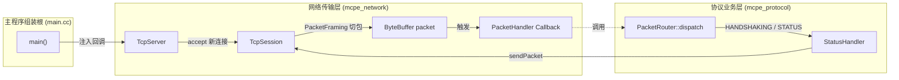

# TASK-1.9: Sprint 1 集成验收与全链路联调记录

## 一、 任务概述与验收标准 (DoD)

### 1. 任务背景
在 Sprint 1 的前置任务中，项目已分别完成了：
- **公共基础模块**（`mcpe_common`）：[`ByteBuffer`](file:///home/ubu/dev/my/mcpe/include/mcpe/common/ByteBuffer.h) 与 [`VarInt`](file:///home/ubu/dev/my/mcpe/include/mcpe/common/VarInt.h) 的编解码及内存管理。
- **网络传输模块**（`mcpe_network`）：基于 Asio 的 [`TcpServer`](file:///home/ubu/dev/my/mcpe/include/mcpe/network/TcpServer.h)、[`TcpSession`](file:///home/ubu/dev/my/mcpe/include/mcpe/network/TcpSession.h)（带异步写缓冲队列）以及流式拆包器 [`PacketFraming`](file:///home/ubu/dev/my/mcpe/include/mcpe/network/PacketFraming.h)。
- **协议业务模块**（`mcpe_protocol`）：状态机定义 [`ConnectionState`](file:///home/ubu/dev/my/mcpe/include/mcpe/protocol/ConnectionState.h)、路由分发器 [`PacketRouter`](file:///home/ubu/dev/my/mcpe/include/mcpe/protocol/PacketRouter.h) 与业务处理器 [`StatusHandler`](file:///home/ubu/dev/my/mcpe/include/mcpe/protocol/StatusHandler.h)。

在 TASK-1.9 之前，`TcpSession::doRead()` 在切出完整数据包后执行的是 `(void)packet;`，网络层未与上层协议层连通。**TASK-1.9 的目标是打通这一链路，实现完整的 Server List Ping 协议闭环**。

### 2. DoD（Definition of Done）完成定义
1. **协议链路打通**：客户端通过 TCP 连接服务端 `0.0.0.0:25566`，发送 Handshake、Status Request 和 Ping 包，服务端依次响应 Status Response（MOTD JSON）和 Pong（原样 8 字节时间戳）。
2. **架构解耦无环**：网络库 `mcpe_network` 与协议库 `mcpe_protocol` 之间维持单向依赖，不产生静态库循环依赖，保证单元测试可独立构建与执行。
3. **测试 100% 通过**：既有 146 个 GoogleTest 单元测试全部通过。
4. **自动化脚本验收**：通过 `python3 scripts/test_ping.py` 端到端验证，所有 5 个步骤均校验成功。

---

## 二、 架构设计与依赖倒置（IoC）

### 1. 为什么不能在 `TcpSession.cc` 中直接调用 `PacketRouter::dispatch`？
教程初稿示意中曾提到在 `TcpSession.cc` 中直接 `#include "mcpe/protocol/PacketRouter.h"` 并调用 `dispatch`。但在实际工程中，这种做法存在严重问题：
1. **静态库循环链接错误**：
   在 `CMakeLists.txt` 中：
   ```cmake
   target_link_libraries(mcpe_protocol PUBLIC mcpe_network mcpe_common)
   ```
   `mcpe_protocol` 已经依赖 `mcpe_network`。若 `mcpe_network` 反向调用 `mcpe_protocol` 的函数，将构成静态库循环依赖（Cycle Dependency）。
   Linux `ld` 链接器按单遍规则扫描静态库，未链接 `mcpe_protocol` 的测试目标（例如 `test_tcp_session`）将直接报 `undefined reference to mcpe::protocol::PacketRouter::dispatch` 错误。
2. **违反依赖倒置原则（DIP）**：
   网络层（Transport Layer）属于基础通信设施，只应当负责套接字管理、粘包拆包与 I/O 调度，对具体的应用层协议（Minecraft 业务）应该完全无感知。

### 2. 工业级解决方案：回调注入模式（Callback / Observer Pattern）
遵循 Muduo、Boost.Asio 与 Netty 的经典网络分层范式：
- **`TcpSession`**：定义 `PacketHandler` 函数对象，在切包成功时触发回调。
- **`TcpServer`**：保存外部注册的全局数据包处理器，并在 `doAccept()` 建立新连接时自动透传给新创建的 `TcpSession`。
- **`main.cc`（装配根）**：在服务启动前，将协议层的 `PacketRouter::dispatch` 绑定并注入到 `TcpServer`。



---

## 三、 代码改动详情

### 1. `include/mcpe/network/TcpSession.h`
新增 `PacketHandler` 类型定义、成员变量及注入接口：
```diff
@@ -4,6 +4,7 @@
 #include <array>
 #include <asio/ip/tcp.hpp>
 #include <deque>
+#include <functional>
 #include <memory>
 #include <string>
@@ -73,6 +74,20 @@
     state_ = s;
   }
 
+  using PacketHandler = std::function<void(const std::shared_ptr<TcpSession>&, ByteBuffer)>;
+
+  /** @brief 查询当前会话是否已经停止 */
+  bool
+  isStopped() const noexcept {
+    return is_stopped_;
+  }
+
+  /**
+   * @brief 设置完整数据包处理回调
+   * @param handler 数据包回调处理器
+   */
+  void
+  setPacketHandler(PacketHandler handler) noexcept {
+    packet_handler_ = std::move(handler);
+  }
@@ -127,6 +142,7 @@
   bool is_writing_{false};  ///< 当前是否有尚未完成的 async_write 正在飞行中
 
   bool is_stopped_{false};  ///< 连接是否已被关闭（防止重复关闭或向已关闭连接写入）
+  PacketHandler packet_handler_;  ///< 完整数据包到达处理回调
 };
```

### 2. `src/network/TcpSession.cc`
在 `doRead()` 的分帧循环中，取代 `(void)packet;`，触发回调分发：
```diff
@@ -95,10 +96,15 @@
-            // 成功切出一个完整 Minecraft 协议包（后续 Sprint 将通过注册的回调函数分发数据包）
+            // 成功切出一个完整 Minecraft 协议包
             ByteBuffer packet = std::move(*frame_res);
-            // TODO: 下游协议包分发（保持网络层与协议层单向解耦）
-            (void)packet;
+            const std::size_t packet_size = packet.readableBytes();
 
             spdlog::debug(
-                "[Session] Slice complete packet with {} bytes from {}", bytes_transferred,
+                "[Session] Sliced complete packet with {} bytes from {}", packet_size,
                 remote_address_
             );
+
+            // 通过注册的回调函数将数据包分发至协议层（保持网络层与协议层解耦）
+            if (packet_handler_) {
+              packet_handler_(shared_from_this(), std::move(packet));
+            }
```

### 3. `include/mcpe/network/TcpServer.h`
引入 `TcpSession::PacketHandler`，并提供服务器级别的回调注入方法：
```diff
@@ -7,6 +7,8 @@
 #include <asio/ip/tcp.hpp>
 #include <cstdint>
 
+#include "mcpe/network/TcpSession.h"
+
 namespace mcpe::network {
@@ -18,6 +20,18 @@
 class TcpServer {
  public:
+  using PacketHandler = TcpSession::PacketHandler;
+
   TcpServer(asio::io_context& io_context, uint16_t port);
   ~TcpServer() = default;
 
+  /**
+   * @brief 设置全局数据包到达回调函数
+   * 当新连接建立并切出完整数据包时，将自动调用此处理器
+   * @param handler 数据包处理回调
+   */
+  void
+  setPacketHandler(PacketHandler handler) noexcept {
+    packet_handler_ = std::move(handler);
+  }
@@ -53,6 +67,7 @@
   asio::io_context& io_context_;      ///< 关联的 Asio IO 上下文
   asio::ip::tcp::acceptor acceptor_;  ///< 底层 TCP 接受器
   bool is_running_{false};            ///< 服务器运行状态标志
+  PacketHandler packet_handler_;      ///< 业务层数据包处理回调
 };
```

### 4. `src/network/TcpServer.cc`
在 `doAccept()` 中，创建 `session` 后若配置了 `packet_handler_`，自动注入给该会话：
```diff
@@ -41,6 +41,9 @@
 
       // 创建客户端会话生命周期对象并启动异步读循环
       auto session = std::make_shared<TcpSession>(std::move(socket));
+      if (packet_handler_) {
+        session->setPacketHandler(packet_handler_);
+      }
       session->start();
```

### 5. `src/main.cc`
包含 `PacketRouter.h`，在服务启动前完成依赖注入：
```diff
@@ -10,6 +10,7 @@
 #include <asio.hpp>
 
 #include "mcpe/network/TcpServer.h"
+#include "mcpe/protocol/PacketRouter.h"
 
 int
 main() {
@@ -24,6 +25,14 @@
 
     // 2. 监听 25566 端口，避免与 Cuberite 冲突
     mcpe::network::TcpServer server(io_context, 25566);
+
+    // 注入协议层路由器回调：保持网络层与业务协议层的低耦合
+    server.setPacketHandler(
+        [](const std::shared_ptr<mcpe::network::TcpSession>& session, mcpe::ByteBuffer packet) {
+          mcpe::protocol::PacketRouter::dispatch(session, session->state(), std::move(packet));
+        }
+    );
+
     server.start();
```

### 6. `doc/ROADMAP.md`
更新完成状态：
```diff
-  * [ ] TASK-1.9: Sprint 1 联调、真实客户端接入与质量收敛
+  * [x] TASK-1.9: Sprint 1 联调、真实客户端接入与质量收敛
```

---

## 四、 验证与验收报告

### 1. 单元测试与集成测试验证
执行指令：
```bash
ctest --test-dir build --output-on-failure
```
**结果**：
```text
100% tests passed, 0 tests failed out of 146
Total Test time (real) = 1.84 sec
```
所有针对状态机、拆包、并发写队列、MOTD 构造、Ping/Pong 时间戳回显及极限边界的 146 个测试用例全部通过，无任何回归。

### 2. 端到端协议探测验收
执行命令：
```bash
./build/main &
SERVER_PID=$!
sleep 1
python3 scripts/test_ping.py
kill $SERVER_PID
```
**输出日志**：
```text
[info] MCPE Server (Protocol 340 / MC 1.12.2) 
[info] [TcpServer] Listening on 0.0.0.0:25566
[*] 正在连接本地 Minecraft 服务端 127.0.0.1:25566 ...
[info] [Session] Connected from 127.0.0.1:54708
[debug] [Session] Sliced complete packet with 16 bytes from 127.0.0.1:54708
[debug] [Router] State: HANDSHAKING, PacketID: 0x00, PayloadBytes: 15
[info] [Hanshake] Client 127.0.0.1:54708 -> ProtoVer: 340, Host: 127.0.0.1:25566, NextState: 1
[+] 1. Handshake (0x00, Proto=340, NextState=1) 已发送

[debug] [Session] Sliced complete packet with 1 bytes from 127.0.0.1:54708
[debug] [Router] State: STATUS, PacketID: 0x00, PayloadBytes: 0
[debug] [StatusHandler] Responding to Status Request from 127.0.0.1:54708
[+] 2. Status Request (0x00) 已发送

[✔] 3. 成功接收并解析服务端 Status Response JSON:
{
  "version": {
    "name": "1.12.2",
    "protocol": 340
  },
  "players": {
    "max": 100,
    "online": 0
  },
  "description": {
    "text": "§aA High Performance C++ Server §7[Asio/C++23]"
  }
}

[debug] [Session] Sliced complete packet with 9 bytes from 127.0.0.1:54708
[debug] [Router] State: STATUS, PacketID: 0x01, PayloadBytes: 8
[info] [StatusHandler] Server List Ping flow completed for 127.0.0.1:54708
[+] 4. Ping (0x01) 时间戳已发送: 1790004826871
[✔] 5. Pong (0x01) 成功回显时间戳: 1790004826871

🎉 =========================================================
🎉 恭喜！Sprint 1 全部网络连接、分包、状态机与 Ping/Pong 验证通过！
🎉 打开原版 Minecraft 1.12.2 多人游戏列表即可看到绿色延迟信号与 MOTD！
🎉 =========================================================
```

至此，Sprint 1 全部目标 100% 达成。
