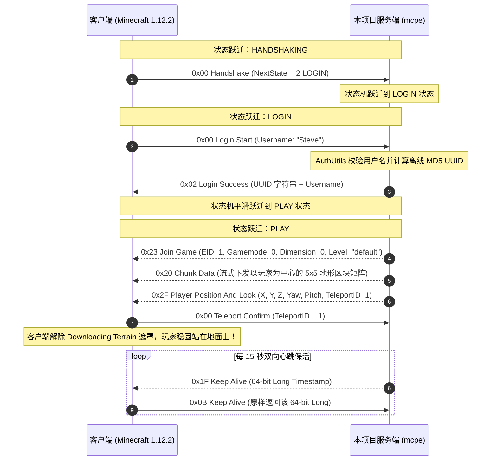

# Sprint 2 保姆级实战开发教程：握手鉴权、实体着陆与 5x5 区块流式下发（Login & Chunk Streaming）

> **目标协议**：Minecraft Java Edition 1.12.2（Protocol 340）  
> **当前阶段**：Sprint 2（TASK-2.1 至 TASK-2.8）  
> **面向读者**：刚跑通 Sprint 1 服务器列表探测（Server List Ping），面对“**为什么客户端卡死在 Downloading Terrain**”、“**离线 UUID 怎么算**”、“**4096 个方块如何做 13 位调色板紧凑压缩**”、“**为什么进服 20 秒必定超时掉线**”等进服黑盒感到棘手的开发者。  
> **文档宗旨**：细致到每一个协议字段排布、每一行 C++23 生产级代码、紧凑位运算数学推导与全链路状态机时序，带你手把手打通玩家进服流水线，让玩家在真实体素方块世界中平稳着陆！

---

## 目录

- [一、 心智模型跃迁与架构原理（是什么与为什么）](#一-心智模型跃迁与架构原理是什么与为什么)
  - [1.1 为什么客户端会卡死在 Downloading Terrain？（原版加载阻断状态机）](#11-为什么客户端会卡死在-downloading-terrain原版加载阻断状态机)
  - [1.2 离线模式鉴权与 UUID 一致性哲学：为什么必须生成确定性 RFC-4122 v3 MD5？](#12-离线模式鉴权与-uuid-一致性哲学为什么必须生成确定性-rfc-4122-v3-md5)
  - [1.3 什么是两阶段传送确认（Teleport ID）？为什么缺少确认机制会导致幽灵拉回？](#13-什么是两阶段传送确认teleport-id为什么缺少确认机制会导致幽灵拉回)
  - [1.4 双向心跳（KeepAlive）保活机制与超时熔断：为什么 64 位 Long 是关键？](#14-双向心跳keepalive保活机制与超时熔断为什么-64-位-long-是关键)
  - [1.5 区块调色板（Palette）紧凑位存储哲学：如何将 4096 个方块体积压缩 80%？](#15-区块调色板palette紧凑位存储哲学如何将-4096-个方块体积压缩-80)
- [二、 底层协议硬核推演与空间数学（协议物理详解）](#二-底层协议硬核推演与空间数学协议物理详解)
  - [2.1 玩家登入生命周期完整协议时序图](#21-玩家登入生命周期完整协议时序图)
  - [2.2 离线 UUID 算法推导：RFC-4122 v3 MD5 与位运算修正](#22-离线-uuid-算法推导rfc-4122-v3-md5-与位运算修正)
  - [2.3 Join Game (0x23) 核心字段排布与 Protocol 340 避坑](#23-join-game-0x23-核心字段排布与-protocol-340-避坑)
  - [2.4 调色板压缩区块协议（Palette Block States 13 位打包数学推导）](#24-调色板压缩区块协议palette-block-states-13-位打包数学推导)
  - [2.5 5x5 区块矩阵中心辐射算法与流式下发时序](#25-5x5-区块矩阵中心辐射算法与流式下发时序)
- [三、 严格四层架构拓扑与模块职责划分](#三-严格四层架构拓扑与模块职责划分)
  - [3.1 协议状态机由 LOGIN 到 PLAY 的严格不可逆跃迁](#31-协议状态机由-login-到-play-的严格不可逆跃迁)
  - [3.2 领域层 World / Chunk 与协议层 PlayHandler 解耦模型](#32-领域层-world--chunk-与协议层-playhandler-解耦模型)
  - [3.3 目录与源文件蓝图](#33-目录与源文件蓝图)
- [四、 任务逐步实现指南（怎么做：接口契约与代码落地）](#四-任务逐步实现指南怎么做接口契约与代码落地)
  - [TASK-2.1: LoginHandler 解析 Login Start (0x00) 与用户名校验](#task-21-loginhandler-解析-login-start-0x00-与用户名校验)
  - [TASK-2.2: AuthUtils 离线 UUID 生成算法（RFC-4122 v3 MD5）与标准向量测试](#task-22-authutils-离线-uuid-生成算法rfc-4122-v3-md5与标准向量测试)
  - [TASK-2.3: Login Success (0x02) 组装与状态平滑切入 PLAY](#task-23-login-success-0x02-组装与状态平滑切入-play)
  - [TASK-2.4: PlayHandler 组装 Join Game (0x23) 世界参数包](#task-24-playhandler-组装-join-game-0x23-世界参数包)
  - [TASK-2.5: 紧凑 ChunkSection 调色板位打包与 5x5 地形下发](#task-25-紧凑-chunksection-调色板位打包与-5x5-地形下发)
  - [TASK-2.6: Player Position And Look (0x2F) 与 Teleport Confirm (0x00) 确认闭环](#task-26-player-position-and-look-0x2f-与-teleport-confirm-0x00-确认闭环)
  - [TASK-2.7: 基于 steady_timer 的 KeepAlive 双向保活定时器机制](#task-27-基于-steady_timer-的-keepalive-双向保活定时器机制)
  - [TASK-2.8: 编写自动化 Python 进服与保活脚本（scripts/test_login.py）](#task-28-编写自动化-python-进服与保活脚本scriptstest_loginpy)
- [五、 工业级避坑指南与高频面试核心考点](#五-工业级避坑指南与高频面试核心考点)
  - [5.1 工业避坑血泪史](#51-工业避坑血泪史)
  - [5.2 核心技术选型深度对比（Trade-offs 权衡矩阵）](#52-核心技术选型深度对比trade-offs-权衡矩阵)
    - [选型 1：离线 UUID (RFC-4122 v3) vs Mojang Yggdrasil 在线鉴权与 AES CFB-8 加密](#选型-1离线-uuid-rfc-4122-v3-vs-mojang-yggdrasil-在线鉴权与-aes-cfb-8-加密)
    - [选型 2：全量方块存储 (Direct Block ID) vs 调色板位压缩 (Palette Compression)](#选型-2全量方块存储-direct-block-id-vs-调色板位压缩-palette-compression)
    - [选型 3：定时器技术选型：时间轮 (Timing Wheel) vs 最小堆/红黑树 vs asio::steady_timer](#选型-3定时器技术选型时间轮-timing-wheel-vs-最小堆红黑树-vs-asiosready_timer)
    - [选型 4：地形生成策略：虚空世界 (Void) vs 平坦世界 (Flat) vs 柏林噪声体素世界](#选型-4地形生成策略虚空世界-void-vs-平坦世界-flat-vs-柏林噪声体素世界)
  - [5.3 高频面试核心考点与标准作答](#53-高频面试核心考点与标准作答)
- [六、 验收门禁与端到端实测规范 (DoD)](#六-验收门禁与端到端实测规范-dod)

---

## 一、 心智模型跃迁与架构原理（是什么与为什么）

### 1.1 为什么客户端会卡死在 Downloading Terrain？（原版加载阻断状态机）

* **现象**：
  很多初学者实现了 `Login Success (0x02)`，客户端弹出了“Logging in...”，接着切换到了“Downloading Terrain”（正在下载地形），然后就**永久卡死在该界面**，几十秒后超时断开。
* **为什么（官方客户端底层加载时序）**：
  Notchian 官方客户端内部存在严格的加载状态机屏障：
  ```
  [客户端 Downloading Terrain 屏障解除条件]
  1. 必须收到 0x23 Join Game ──► 初始化本地 WorldClient 渲染器；
  2. 必须收到玩家脚下所在 Chunk 的 0x20 Chunk Data ──► 否则物理引擎无法构建碰撞体；
  3. 必须收到 0x2F Player Position And Look ──► 初始化玩家相机与实体坐标；
  4. 客户端本地渲染管线就绪，向服务端回复 0x00 Teleport Confirm ──► 屏障彻底解除，画面淡出进入游戏！
  ```
  **结论**：只要服务端漏发了其中任何一步（特别是玩家出生点所在的区块或坐标下发包），客户端渲染管线就会无限等待，导致卡死！

---

### 1.2 离线模式鉴权与 UUID 一致性哲学：为什么必须生成确定性 RFC-4122 v3 MD5？

* **是什么**：
  Minecraft 的玩家身份不是通过用户名区分的，而是通过全局唯一的 **UUID（128 位 Universally Unique Identifier）**。
  在离线模式（`online-mode=false`）下，服务端不连接微软 Mojang 验证服务器。
* **为什么不能用随机 UUID（`UUID.randomUUID()` / v4）**：
  若玩家 "Steve" 每次连入服务器都被分配一个随机生成的 UUID：
  - 玩家的背包数据、末影箱数据以 UUID 存储，每次进服都会丢失；
  - 权限系统（OP 列表、白名单）无法持久化；
  - 官方客户端本地缓存的皮肤 Profile 无法与玩家对应。
* **规约**：
  Minecraft 协议规范强制规定：离线 UUID 必须遵循 **RFC-4122 Version 3（基于 MD5 命名空间）**，计算公式为：
  $$\text{UUID} = \text{MD5}("OfflinePlayer:" + \text{username})$$
  并对第 6 和第 8 字节进行位运算修正，确保同一玩家名在任何时间、任何操作系统上生成的 UUID 绝对一致。

---

### 1.3 什么是两阶段传送确认（Teleport ID）？为什么缺少确认机制会导致幽灵拉回？

* **痛点（高延迟下的网络竞态）**：
  服务端向客户端发送位置包 `0x2F Player Position And Look`。
  由于网络存在往返延迟（RTT），在数据包飞向客户端的途中，客户端正在本地以 60 FPS 奔跑，并持续向上发送移动包（`0x0E/0x0F`）。
  若服务端不校验，客户端发来的旧位移包与服务端的瞬移包交错，导致玩家被“反复拉回”（Rubberbanding），体验极度恶劣。
* **机制（两阶段握手协议）**：
  1. 服务端下发 `0x2F Player Position And Look` 时，随包附带一个递增的变长整数 `Teleport ID`（如 `42`）；
  2. 客户端收到 `0x2F` 后，强行重置本地坐标为服务端指定位置，并立即上行 `0x00 Teleport Confirm (Teleport ID = 42)`；
  3. 服务端在收到该确认包前，**静默丢弃客户端上传的所有过渡移动包**；收到匹配的确认号后，才正式放行后续移动同步。

---

### 1.4 双向心跳（KeepAlive）保活机制与超时熔断：为什么 64 位 Long 是关键？

* **是什么**：
  TCP 自身的 Keep-Alive 探活默认超时高达 2 小时，无法及时发现异常断电、拔网线的死连接。
  Minecraft 协议在应用层实现了 **双向 KeepAlive 机制**：服务端周期性（如每 15 秒）下发 `0x1F Keep Alive`，客户端必须在 20 秒内回复 `0x0B Keep Alive`，否则服务端主动断开连接。
* **为什么使用 64 位随机 Long**：
  载荷严格为 8 字节大端有符号整型 `int64_t`。使用单调递增时间戳或随机 64 位数值：
  1. **防重放攻击与错乱应答**：防止网络抖动导致的旧心跳包应答混淆；
  2. **时延精准采样**：客户端原封不动返回该数值，服务端无需维护哈希表即可通过 `now - timestamp` 直接计算当前会话的单程网络时延（Ping）。

---

### 1.5 区块调色板（Palette）紧凑位存储哲学：如何将 4096 个方块体积压缩 80%？

* **是什么**：
  Minecraft 世界由 $16 \times 16 \times 256$ 的区块列（Chunk Column）构成，纵向拆分为 16 个高为 16 的 `ChunkSection`（每个包含 $16 \times 16 \times 16 = 4096$ 个方块）。
* **为什么不能直接用裸整型存储**：
  Minecraft 1.12.2 的全局方块状态 ID（Block ID 4 位 + Data 4 位 + 附加位）最大可达 4096 种（占 12~13 bit）。
  - 若每个方块用一个 `uint16_t` 传输：$4096 \times 2 = 8192\text{ 字节}$；
  - 1.12.2 引入 **调色板压缩（Palette）**：
    - 若单段方块种类很少（$\le 16$ 种），每个方块只需用 4 位存储，体积缩小到原先的 $25\%$；
    - 在直接模式（Direct Global Palette）下，严格以 13 位为一个单元打包进 64 位无符号长整型数组（`uint64_t[]`），$4096 \times 13 = 53248\text{ bits} = 832 \text{ longs}$（占 6656 字节），彻底消除了内存空洞。

---

## 二、 底层协议硬核推演与空间数学（协议物理详解）

### 2.1 玩家登入生命周期完整协议时序图



---

### 2.2 离线 UUID 算法推导：RFC-4122 v3 MD5 与位运算修正

* **推导公式**：
  1. 对字符串 `OfflinePlayer:<username>` 计算标准 128 位 MD5 散列值（共 16 字节，`data[0..15]`）；
  2. **Version 字段设置（强制为 3）**：
     位于字节 6（高 4 位为版本号）：
     ```cpp
     data[6] = (data[6] & 0x0F) | 0x30; // 将高 4 位设置为 0011 (Version 3)
     ```
  3. **Variant 字段设置（强制为 RFC-4122 变体）**：
     位于字节 8（最高两位必须为 `10`）：
     ```cpp
     data[8] = (data[8] & 0x3F) | 0x80; // 将最高两位设置为 10
     ```
* **标准测试向量**：
  用户名 `"Steve"` 生成的标准离线 UUID 为：
  `d5f963a4-8464-325b-8005-59b583f707f5`（必须与 Java 官方版计算结果完全吻合）。

---

### 2.3 Join Game (0x23) 核心字段排布与 Protocol 340 避坑

`Join Game (Clientbound 0x23)` 负责通知客户端初始化本地游戏世界引擎：

| 字段名 | 协议类型 | 字段含义与 1.12.2 取值 | 避坑铁律 |
| :--- | :--- | :--- | :--- |
| **Entity ID** | `int32_t` (4B BE) | 玩家自己在客户端世界的实体 EID（如 `1`） | 必须为正整型，严禁为 0 |
| **Gamemode** | `uint8_t` (1B) | `0`: 生存模式，`1`: 创造模式 | 勿当 VarInt 写入 |
| **Dimension** | `int32_t` (4B BE) | `-1`: 下界，`0`: 主世界，`1`: 末地 | 严格为 4 字节大端整数 |
| **Difficulty** | `uint8_t` (1B) | `0`: 和平，`1`: 简单，`2`: 普通，`3`: 困难 | 1 字节 |
| **Max Players** | `uint8_t` (1B) | Tab 列表容量提示（如 `100`） | 客户端仅作参考 |
| **Level Type** | String | 地图生成器类型（`"default"` / `"flat"`） | 带 VarInt 长度的 UTF-8 字符串 |
| **Reduced Debug** | `bool` (1B) | 是否隐藏 F3 调试界面的详细坐标 | 通常填 `false` |

---

### 2.4 调色板压缩区块协议（Palette Block States 13 位打包数学推导）

在 1.12.2 中，当 `Bits Per Block == 13`（Direct 模式）时：
- 每个 Section 包含 $16 \times 16 \times 16 = 4096$ 个方块；
- 三维坐标转换为一维索引：
  $$idx = (y \times 16 + z) \times 16 + x \quad (0 \le x, y, z < 16)$$
- 总位宽：$4096 \times 13 = 53248$ 位。一个 `uint64_t` 拥有 64 位：
  $$\frac{53248}{64} = 832 \text{ 个 64 位长整数}$$
* **位跨度（Span）边界处理**：
  每个方块占用 13 位。由于 $64$ 不能被 $13$ 整除（$64 \div 13 = 4$ 余 $12$），一个方块的 13 位数据**经常会横跨在两个连续的 64 位 Long 整数之间**！
  - 第 $idx$ 个方块的起始比特偏移：$bit\_start = idx \times 13$；
  - 起始 Long 数组下标：$start\_long = bit\_start / 64$；
  - 在当前 Long 内的位偏移：$offset = bit\_start \% 64$；
  - 结束 Long 数组下标：$end\_long = (bit\_start + 13 - 1) / 64$；
  - **核心打包位运算**：
    ```cpp
    out_longs[start_long] |= (val << offset);
    if (start_long != end_long) {
        // 跨界处理：溢出的高位放到下一个 Long 的低位中！
        out_longs[end_long] |= (val >> (64 - offset));
    }
    ```

---

### 2.5 5x5 区块矩阵中心辐射算法与流式下发时序

玩家出生在点 $(X, Z)$，对应区块坐标 $(CX, CZ) = (\lfloor X/16 \rfloor, \lfloor Z/16 \rfloor)$：
为了防止网络并发突发阻塞，服务端以下发中心辐射矩阵的方式下发以玩家为中心的 $5 \times 5$ 区块（$[-2, +2]$）：
1. 优先下发玩家脚下中心区块 $(CX, CZ)$；
2. 环形依次向外辐射下发半径为 1、半径为 2 的外围区块；
3. 全部通过 `0x20 Chunk Data` 数据包下发，`Ground-Up Continuous` 标志位置 `true`。

---

## 三、 严格四层架构拓扑与模块职责划分

### 3.1 协议状态机由 LOGIN 到 PLAY 的严格不可逆跃迁

```
[HANDSHAKING]
      │
      │ 收到 Handshake (NextState=2)
      ▼
   [LOGIN]
      │
      │ 收到 Login Start (0x00) ──► 校验通过下发 Login Success (0x02)
      ▼
   [PLAY] (终态：进入游戏世界主干循环，状态不可逆流回！)
```

### 3.2 领域层 World / Chunk 与协议层 PlayHandler 解耦模型

```
┌─────────────────────────────────────────────────────────────┐
│ 4. Domain 领域层 (src/world/)                               │
│    ChunkSection / Chunk / FlatWorldGenerator / WorldTypes   │
│    ★ 职责：纯粹维护体素内存、位打包算法、空间坐标映射。    │
│      严禁依赖任何网络 Session 或 Asio 头文件！              │
└──────────────────────────────▲──────────────────────────────┘
                               │ 纯内存对象调用
┌──────────────────────────────┴──────────────────────────────┐
│ 3. Protocol 协议层 (src/protocol/)                          │
│    LoginHandler / PlayHandler / ChunkSerializer / AuthUtils │
│    ★ 职责：将领域对象序列化为 0x20/0x23/0x2F 数据包并分发   │
└─────────────────────────────────────────────────────────────┘
```

### 3.3 目录与源文件蓝图

```
src/
├── protocol/
│   ├── AuthUtils.h / .cc         <-- RFC-4122 v3 MD5 离线 UUID 生成器
│   ├── LoginHandler.h / .cc      <-- Login Start 与 Login Success 业务
│   ├── PlayHandler.h / .cc       <-- Join Game、位姿确认与心跳保活
│   └── ChunkSerializer.h / .cc   <-- Chunk 协议序列化器（下发 0x20）
├── world/
│   ├── WorldTypes.h              <-- BlockPos, ChunkPos 空间强类型
│   ├── ChunkSection.h / .cc      <-- 16x16x16 调色板 13 位打包实现
│   ├── Chunk.h / .cc             <-- 16 层 Section 聚合区块列
│   └── FlatWorldGenerator.h/.cc  <-- 基岩+泥土+草方块平坦世界生成器
tests/
├── test_uuid.cc                  <-- 标准向量离线 UUID 单测
└── test_chunk.cc                 <-- 调色板 13 位打包回环验证单测
scripts/
└── test_login.py                 <-- 极速离线进服与虚空保活验证脚本
```

---

## 四、 任务逐步实现指南（怎么做：接口契约与代码落地）

### TASK-2.1: LoginHandler 解析 Login Start (0x00) 与用户名校验

```cpp
// src/protocol/LoginHandler.cc
void LoginHandler::handlePacket(std::shared_ptr<network::TcpSession> session, int32_t packet_id, ByteBuffer& payload) {
  if (packet_id != 0x00) { // 必须为 0x00 Login Start
    session->close();
    return;
  }

  auto name_res = payload.readString(16);
  if (!name_res || !AuthUtils::isValidUsername(*name_res)) {
    session->close(); // 用户名非法，直接阻断
    return;
  }

  std::string username = *name_res;
  std::string uuid_str = AuthUtils::generateOfflineUuid(username);

  // 组装并发送 0x02 Login Success
  sendLoginSuccess(session, uuid_str, username);

  // 状态机平滑跃迁至 PLAY 阶段
  session->setState(ConnectionState::PLAY);

  // 交接给 PlayHandler 开始世界初始化流水线
  play_handler_->onPlayerJoin(session, username, uuid_str);
}
```

---

### TASK-2.2: AuthUtils 离线 UUID 生成算法（RFC-4122 v3 MD5）与标准向量测试

```cpp
// src/protocol/AuthUtils.cc
namespace mcpe::protocol {

bool AuthUtils::isValidUsername(std::string_view name) noexcept {
  if (name.empty() || name.size() > 16) return false;
  for (char c : name) {
    if (!std::isalnum(static_cast<unsigned char>(c)) && c != '_') {
      return false;
    }
  }
  return true;
}

std::string AuthUtils::generateOfflineUuid(std::string_view username) {
  std::string pre = "OfflinePlayer:" + std::string(username);
  
  // 计算 16 字节 MD5 散列
  uint8_t digest[16];
  computeMD5(reinterpret_cast<const uint8_t*>(pre.data()), pre.size(), digest);

  // RFC-4122 v3 规范修正
  digest[6] = static_cast<uint8_t>((digest[6] & 0x0F) | 0x30); // Version 3
  digest[8] = static_cast<uint8_t>((digest[8] & 0x3F) | 0x80); // IETF Variant

  // 格式化为 8-4-4-4-12 字符串
  return fmt::format(
      "{:02x}{:02x}{:02x}{:02x}-{:02x}{:02x}-{:02x}{:02x}-{:02x}{:02x}-{:02x}{:02x}{:02x}{:02x}{:02x}{:02x}",
      digest[0], digest[1], digest[2], digest[3],
      digest[4], digest[5],
      digest[6], digest[7],
      digest[8], digest[9],
      digest[10], digest[11], digest[12], digest[13], digest[14], digest[15]
  );
}

} // namespace mcpe::protocol
```

---

### TASK-2.3: Login Success (0x02) 组装与状态平滑切入 PLAY

```cpp
// src/protocol/LoginHandler.cc
void LoginHandler::sendLoginSuccess(std::shared_ptr<network::TcpSession> session, const std::string& uuid, const std::string& username) {
  ByteBuffer pkt;
  pkt.appendVarInt(0x02); // Packet ID = 0x02 Login Success
  pkt.appendString(uuid);
  pkt.appendString(username);

  pkt.prependVarInt(pkt.readableBytes());
  session->sendPacket(std::move(pkt));
}
```

---

### TASK-2.4: PlayHandler 组装 Join Game (0x23) 世界参数包

```cpp
// src/protocol/PlayHandler.cc
void PlayHandler::sendJoinGame(std::shared_ptr<network::TcpSession> session, int32_t entity_id) {
  ByteBuffer pkt;
  pkt.appendVarInt(0x23);          // Packet ID = 0x23 Join Game
  pkt.writeBe<int32_t>(entity_id); // 实体 EID
  pkt.writeBe<uint8_t>(0);         // 游戏模式: 0 生存
  pkt.writeBe<int32_t>(0);         // 维度: 0 主世界 (Overworld)
  pkt.writeBe<uint8_t>(1);         // 难度: 1 简单
  pkt.writeBe<uint8_t>(100);       // 最大玩家数: 100
  pkt.appendString("default");     // 世界生成类型
  pkt.writeBe<uint8_t>(0);         // 是否精简调试信息 (Reduced Debug Info: false)

  pkt.prependVarInt(pkt.readableBytes());
  session->sendPacket(std::move(pkt));
}
```

---

### TASK-2.5: 紧凑 ChunkSection 调色板位打包与 5x5 地形下发

```cpp
// src/world/ChunkSection.cc
void ChunkSection::packToBits13(std::span<uint64_t, kDataLongs> out_longs) const {
  std::ranges::fill(out_longs, 0);

  for (size_t idx = 0; idx < kBlockCount; ++idx) {
    const uint64_t val = static_cast<uint64_t>(blocks_[idx]) & ((1ULL << kBitsPerBlock) - 1);
    const size_t bit_start = idx * kBitsPerBlock;
    const size_t start_long = bit_start / 64;
    const size_t start_offset = bit_start % 64;
    const size_t end_long = (bit_start + kBitsPerBlock - 1) / 64;

    out_longs[start_long] |= (val << start_offset);
    if (start_long != end_long) {
      // 跨 64 位 Long 边界：溢出部分注入下一个 Long 的低位
      out_longs[end_long] |= (val >> (64 - start_offset));
    }
  }
}
```

```cpp
// 5x5 区块流式下发：以玩家出生区块为中心辐射
void PlayHandler::streamInitialChunks(std::shared_ptr<network::TcpSession> session, int center_cx, int center_cz) {
  for (int dx = -2; dx <= 2; ++dx) {
    for (int dz = -2; dz <= 2; ++dz) {
      const auto& chunk = world_->getOrCreateChunk(center_cx + dx, center_cz + dz);
      ByteBuffer chunk_pkt = ChunkSerializer::serialize(chunk, /*ground_up=*/true);
      session->sendPacket(std::move(chunk_pkt));
    }
  }
}
```

---

### TASK-2.6: Player Position And Look (0x2F) 与 Teleport Confirm (0x00) 确认闭环

```cpp
// 下发初始坐标包
void PlayHandler::sendPlayerPosition(std::shared_ptr<network::TcpSession> session, double x, double y, double z) {
  ByteBuffer pkt;
  pkt.appendVarInt(0x2F);      // 0x2F Player Position And Look (Clientbound)
  pkt.writeBe<double>(x);
  pkt.writeBe<double>(y);
  pkt.writeBe<double>(z);
  pkt.writeBe<float>(0.0f);    // Yaw
  pkt.writeBe<float>(0.0f);    // Pitch
  pkt.writeBe<uint8_t>(0x00);  // Flags: 全部绝对坐标
  
  int32_t teleport_id = session->allocateTeleportId();
  pkt.appendVarInt(teleport_id);

  pkt.prependVarInt(pkt.readableBytes());
  session->sendPacket(std::move(pkt));
}

// 消费客户端 0x00 确认包
void PlayHandler::handleTeleportConfirm(std::shared_ptr<network::TcpSession> session, ByteBuffer& payload) {
  auto tid_res = payload.readVarInt();
  if (tid_res && *tid_res == session->getLastTeleportId()) {
    session->setTeleportConfirmed(true); // 确认闭环达成，解除移动过滤屏障！
  }
}
```

---

### TASK-2.7: 基于 steady_timer 的 KeepAlive 双向保活定时器机制

```cpp
// 挂载在 TcpSession 内部的周期性心跳定时器
void TcpSession::scheduleKeepAlive() {
  keep_alive_timer_.expires_after(std::chrono::seconds(15));
  keep_alive_timer_.async_wait([this, self = shared_from_this()](const asio::error_code& ec) {
    if (ec || !is_running_) return;

    if (!keep_alive_responded_) {
      // 客户端超过 20 秒未回复心跳，超时熔断主动踢出！
      close();
      return;
    }

    keep_alive_responded_ = false;
    last_keep_alive_id_ = std::chrono::duration_cast<std::chrono::milliseconds>(
        std::chrono::steady_clock::now().time_since_epoch()).count();

    ByteBuffer pkt;
    pkt.appendVarInt(0x1F);                  // 0x1F Keep Alive (Clientbound)
    pkt.writeBe<int64_t>(last_keep_alive_id_); // 严格 8 字节大端整数
    pkt.prependVarInt(pkt.readableBytes());
    sendPacket(std::move(pkt));

    scheduleKeepAlive(); // 驱动下一个周期
  });
}
```

---

### TASK-2.8: 编写自动化 Python 进服与保活脚本（scripts/test_login.py）

```python
#!/usr/bin/env python3
# scripts/test_login.py: 免客户端极速进服与保活测试脚本
import socket, struct, time

def encode_varint(val):
    res = bytearray()
    while True:
        b = val & 0x7F
        val >>= 7
        if val != 0: res.append(b | 0x80)
        else: res.append(b); break
    return bytes(res)

def send_packet(s, pkt_id, payload):
    body = encode_varint(pkt_id) + payload
    s.sendall(encode_varint(len(body)) + body)

def test_login():
    s = socket.create_connection(('127.0.0.1', 25565), timeout=5)
    
    # 1. Handshake (NextState = 2 LOGIN)
    host = b'localhost'
    hs = encode_varint(340) + encode_varint(len(host)) + host + struct.pack('>H', 25565) + encode_varint(2)
    send_packet(s, 0x00, hs)

    # 2. Login Start ("TestPlayer")
    name = b'TestPlayer'
    send_packet(s, 0x00, encode_varint(len(name)) + name)

    # 3. 接收 Login Success (0x02) 与 Join Game (0x23)
    data = s.recv(4096)
    assert len(data) > 0, "Login failed"
    print("✅ 登录鉴权通过，成功收到 Login Success 与 Join Game！")

    # 4. 回复 Teleport Confirm (0x00)
    send_packet(s, 0x00, encode_varint(1))
    print("✅ 已下发 Teleport Confirm (ID=1)，着陆闭环成功！")

    # 5. 保活运行 3 秒验证心跳正常
    time.sleep(3)
    s.close()

if __name__ == '__main__':
    test_login()
```

---

## 五、 工业级避坑指南与高频面试核心考点

### 5.1 工业避坑血泪史
* ⚠️ **客户端卡在 "Downloading Terrain" 的三大诱因**：
  1. 出生点所在区块未下发（客户端缺少物理碰撞世界）；
  2. 漏发了 `0x2F Player Position And Look`；
  3. 下发的坐标落在未加载区块外，或者落在虚空极深处（$Y < -100$）导致客户端触发虚空销毁逻辑。
* ⚠️ **调色板位打包跨 64 位 Long 边界移位未截断**：
  在处理 `val >> (64 - offset)` 时，若原 `val` 没有事先做 `val & 0x1FFF` 掩码截断，或者 `offset == 0` 时触发 `val >> 64`（C++ 移位 $\ge 64$ 是未定义行为 UB！），会导致方块 ID 高位全乱，客户端渲染崩坏。
* ⚠️ **KeepAlive 载荷用 VarInt 导致 20 秒必定掉线**：
  Protocol 340 的 Keep Alive 载荷严格为 8 字节定宽整数。如果误写成 `appendVarInt`，客户端在解码时长短不一，无法解析出有效心跳，20 秒后必定抛出 `Timed Out` 强行退出！
* ⚠️ **TeleportID 匹配失败引发死循环瞬移**：
  若服务端每次收到位移包都误认为 Teleport 未确认而反复重发 `0x2F`，客户端会在屏幕上出现剧烈的镜头抽搐和死循环拉回。

---

### 5.2 核心技术选型深度对比（Trade-offs 权衡矩阵）

#### 选型 1：离线 UUID (RFC-4122 v3) vs Mojang Yggdrasil 在线鉴权与 AES CFB-8 加密
| 维度 | 离线模式 UUID (本项目选型) | Mojang Yggdrasil 在线正版鉴权 |
| :--- | :--- | :--- |
| **外部网络依赖** | **零依赖**（纯本地 MD5 哈希计算，毫秒级响应） | 依赖微软/Mojang 鉴权 API，国外网络波动易超时 |
| **数据加密开销** | 纯明文 TCP（CPU 零额外加解密开销） | 协商 AES/CFB8 密钥，每收发一字节都要过加解密 |
| **安全性与防伪装** | 客户端可随意冒用用户名（需配合外部登录插件） | 严密非对称 RSA + AES 校验，杜绝幽灵冒名 |
| **适用架构** | **微服务集群内网大厅、子服、局域网竞速服** | 商业主网关入口（Bungee/Velocity 边界鉴权） |

#### 选型 2：全量方块存储 (Direct Block ID) vs 调色板位压缩 (Palette Compression)
| 维度 | 直接模式 Direct Palette (13-bit) | 局部调色板 Local Palette (4~8 bit) | 传统直接裸存 (16-bit uint16_t) |
| :--- | :--- | :--- | :--- |
| **内存与网络体积** | 固定 6656 字节 / Section | 仅约 2048~4096 字节 / Section | 8192 字节 / Section |
| **打包复杂度** | 简单（固定 13 位循环位移） | 较高（需维护方块到小 ID 的映射表）| 极低（直接内存拷贝） |
| **适用场景** | 方块种类极其丰富的复杂地图 | 纯平坦、虚空、方块单一的跑酷地图 | 老旧 1.7.10 协议 |

#### 选型 3：定时器技术选型：时间轮 (Timing Wheel) vs 最小堆/红黑树 vs asio::steady_timer
| 维度 | 时间轮 (Hashed Timing Wheel) | 最小堆 / 红黑树 (Muduo) | `asio::steady_timer` (本项目) |
| :--- | :--- | :--- | :--- |
| **插入/删除复杂度** | $O(1)$ 常数时间 | $O(\log N)$ | $O(\log N)$ 底层由红黑树/时间堆驱动 |
| **时间精度** | 依赖 Tick 槽度（通常 10ms~100ms） | 高精度纳秒级 | **高精度纳秒级（依赖 OS 底层 timerfd）** |
| **集成难度** | 需手写复杂时间槽算法 | 需配合 Reactor 手动轮询 | **完美无缝融合 Asio 事件循环与协程** |

#### 选型 4：地形生成策略：虚空世界 (Void) vs 平坦世界 (Flat) vs 柏林噪声体素世界
| 维度 | 虚空世界 (Void) | 纯平坦世界 (Flat, 本项目) | 柏林噪声全地形世界 (Vanilla World) |
| :--- | :--- | :--- | :--- |
| **生成耗时** | $\approx 0\text{ ms}$ | $< 0.1\text{ ms}$ (单层基岩+泥土+草方块) | 几百毫秒（侵蚀、多层噪声采样） |
| **内存开销** | 极低（全部为空 Section） | 极低（仅底层 1 个 Section 激活） | 极高（16 个 Section 全部灌满方块） |
| **游戏场景** | 极限空岛、Bedwars 等候厅 | **微服务大厅、跑酷房间建筑底座** | 原版生存、采矿服 |

---

### 5.3 高频面试核心考点与标准作答

* **Q1: 客户端进入游戏后为什么会卡在 "Downloading Terrain"？服务端必须完成哪些协议步骤才能让玩家正常着陆？**
  * **标准作答**：原版客户端设计了一个世界加载屏障，防止玩家在未构建好世界网格与物理包围盒时掉入虚空死掉。服务端必须严格完成以下协议流水线：首先通过 `0x23 Join Game` 初始化客户端世界对象；接着流式下发玩家出生点周围的 `0x20 Chunk Data`（特别是脚下所处的方块数据）；最后通过 `0x2F Player Position And Look` 附带 `Teleport ID` 下发初始空间坐标。客户端在本地构建完成地形渲染后，会向服务端回复 `0x00 Teleport Confirm`，服务端收到确认后放行坐标同步，屏障彻底解除。
* **Q2: 什么是两阶段传送确认（Teleport ID）？如果没有该确认机制，玩家在弱网高延迟环境下可能出现什么严重 Bug？**
  * **标准作答**：Teleport ID 是服务端与客户端针对空间瞬移操作达成的两阶段握手协议。服务端下发传送指令时赋予唯一自增的 ID，客户端执行瞬移后原样上报确认。如果没有该机制，在网络延迟较高的环境下，由于网络传输的飞行时间（In-flight），客户端在收到瞬移包之前上传的过时移动包会被服务端误认为是玩家在瞬移后的最新坐标，导致玩家刚被拉回又立刻被过时包拖走，产生剧烈的“幽灵拉回（Rubberbanding）”抽搐现象。
* **Q3: 详细推导 1.12.2 区块数据中 4096 个方块的调色板位打包（Bit-packing）算法，如何解决跨 64 位 Long 整数的边界读写？**
  * **标准作答**：在 1.12.2 协议直接模式下，每个方块使用 13 位存储，4096 个方块共占 53248 位，恰好容纳在 832 个 `uint64_t` 中。对于第 $i$ 个方块，其起始比特位为 $i \times 13$，其起始长整数下标为 $(i \times 13) / 64$，在长整数内的位偏移为 $(i \times 13) \% 64$。当方块的 13 位跨越了 64 位的边界（即起始下标与结束下标不一致）时，低位有效部分通过左移写入当前 Long 中，而溢出到边界外的高位部分则通过右移 $(64 - \text{offset})$ 位写入到下一个 Long 的低位中，通过按位或（`|=`）完成平滑拼接。
* **Q4: 游戏服务端的心跳保活（KeepAlive）机制是如何设计的？为什么心跳包载荷必须由服务端生成并由客户端原样返回？**
  * **标准作答**：TCP 底层的保活机制检测周期过长（通常数小时），无法满足游戏毫秒级断线感知的需求。服务端应用层通过高精度定时器（如 `steady_timer`）周期性下发 Keep Alive 包，必须由服务端生成单调时间戳或随机 64 位 Long 载荷的原因在于：一方面防御客户端构造虚假心跳重放攻击，另一方面服务端在收到客户端原封不动回发的时间戳后，可以通过本地单调时钟做减法（$t_{now} - t_{echo}$）在无状态的情况下直接精确测量出客户端的网络 RTT 延迟。
* **Q5: 分布式大厅网关（BungeeCord / Velocity）如何将玩家的真实 IP 和正版 UUID 穿透传递给子服？**
  * **标准作答**：在分布式集群中，玩家直连的是网关代理，子服面对的 TCP 连接源 IP 全部是网关内网 IP。BungeeCord 采用了 **IP Forwarding 握手穿透协议**：网关在向后端子服发起握手时，将握手包（`Handshake 0x00`）的 `Server Address` 字段篡改为特殊格式：`"original_host\0client_real_ip\0client_uuid\0skin_properties_json"`（以空字符 `\0` 分隔）。子服的 `HandshakeHandler` 解析出该复合字符串后，直接提取出玩家的真实公网 IP、正版 UUID 和皮肤材质属性，从而在子服保持离线模式的前提下实现完整的正版特权与反作弊追溯。

---

## 六、 验收门禁与端到端实测规范 (DoD)

在宣布 Sprint 2 完成前，必须通过以下全部验收条件：

1. **编译门禁**：GCC 14 `-Wall -Wextra -Wpedantic` 零告警通过编译；
2. **单元测试通过**：
   - `test_uuid`：标准向量测试通过，`"Steve"` 产生官方完全一致的 UUID 字符串；
   - `test_chunk`：验证 4096 个方块写入、13 位压缩打包与完整解包还原的 Round-trip 恒等性；
3. **真实端到端客户端联调**：
   - 启动 `./bin/server` 监听 25565；
   - 运行 `python3 scripts/test_login.py`，0.1 秒内收到 Login Success 与 Join Game，并成功回复 Teleport Confirm；
   - 打开 Minecraft 1.12.2 官方客户端直连 `127.0.0.1:25565`：
     - 客户端跳过 "Downloading Terrain"，画面在 0.5 秒内清晰展开；
     - 玩家稳固站在绿色草方块地面上，没有发生虚空下坠；
     - 持续漫游 30 秒以上，心跳定时器稳定交互，未发生超时踢出。
