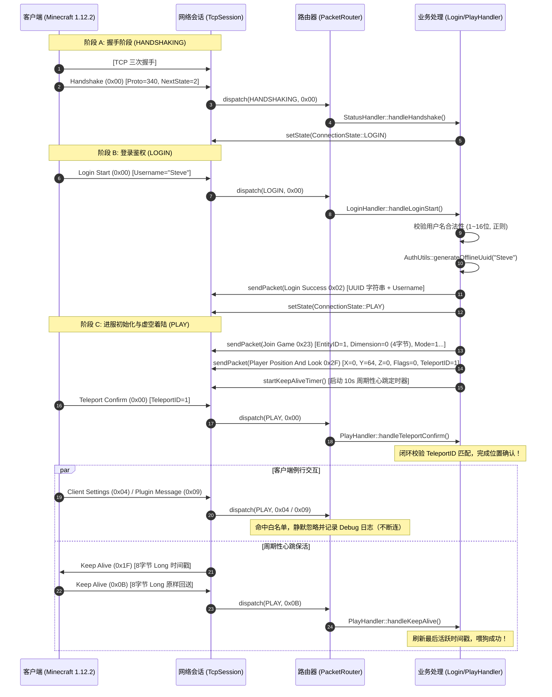

# Sprint 2 保姆级实战开发教程：会话生命周期与虚空进服（Login & Void Spawn）

> **目标协议**：Minecraft Java Edition 1.12.2（Protocol 340）  
> **当前阶段**：Sprint 2（TASK-2.1 至 TASK-2.7）  
> **面向读者**：刚完成 Sprint 1（已跑通 Server List Ping 与 Asio 网络骨架），面对“**如何让玩家真正连进游戏**”、“**为什么客户端卡死在 Downloading Terrain**”、“**离线 UUID 怎么算**”、“**为什么进服 20 秒必被踢**”等问题无从下手的开发者。  
> **文档宗旨**：细致到每一个数据包的十六进制字段排布、每一行 C++23 实现代码、每一个定时器闭环机制与自动化测试脚本，带你亲手打通进服流水线，让玩家在深蓝虚空世界中稳固着陆！

---

## 目录

- [一、 全局文件与目录蓝图（一眼看清在哪个目录建什么、改什么）](#一-全局文件与目录蓝图一眼看清在哪个目录建什么改什么)
- [二、 数据流向与状态机时序总览](#二-数据流向与状态机时序总览)
- [三、 任务逐步实现指南](#三-任务逐步实现指南)
  - [TASK-2.1: Login Start (0x00) 解析与玩家名合法性校验](#task-21-login-start-0x00-解析与玩家名合法性校验)
  - [TASK-2.2: 离线模式 UUID 生成算法（RFC-4122 v3 MD5）与单元测试](#task-22-离线模式-uuid-生成算法rfc-4122-v3-md5与单元测试)
  - [TASK-2.3: Login Success (0x02) 响应与状态切入 PLAY](#task-23-login-success-0x02-响应与状态切入-play)
  - [TASK-2.4: Join Game (0x23) 世界参数包组装（Protocol 340 深度避坑）](#task-24-join-game-0x23-世界参数包组装protocol-340-深度避坑)
  - [TASK-2.5: Player Position And Look (0x2F) 出生点下发与 Teleport Confirm 闭环](#task-25-player-position-and-look-0x2f-出生点下发与-teleport-confirm-闭环)
  - [TASK-2.6: Keep Alive 心跳保活定时器机制（双向 8 字节 Long）](#task-26-keep-alive-心跳保活定时器机制双向-8-字节-long)
  - [TASK-2.7: Sprint 2 集成验收与虚空漫步测试](#task-27-sprint-2-集成验收与虚空漫步测试)
- [四、 自动化调试利器：Python 极速进服与虚空保活验证脚本](#四-自动化调试利器python-极速进服与虚空保活验证脚本)
- [五、 Sprint 2 避坑与面试高频考点速查表](#五-sprint-2-避坑与面试高频考点速查表)
- [六、 权威源码对照与推荐参考资源（Cuberite & Muduo 精准导读）](#六-权威源码对照与推荐参考资源cuberite--muduo-精准导读)
  - [6.1 Cuberite 开源仓库精确定位与对照清单](#61-cuberite-开源仓库精确定位与对照清单)
  - [6.2 学其精华：Cuberite 的登录与协议流转设计](#62-学其精华cuberite-的登录与协议流转设计)
  - [6.3 弃其糟粕：Cuberite 的历史缺陷与本项目现代 C++23 升级](#63-弃其糟粕cuberite-的历史缺陷与本项目现代-c23-升级)
  - [6.4 定时器机制深度对比：Muduo TimerQueue vs Asio steady_timer 协程化](#64-定时器机制深度对比muduo-timerqueue-vs-asio-steadytimer-协程化)

---

## 一、 全局文件与目录蓝图（一眼看清在哪个目录建什么、改什么）

在动手编写 Sprint 2 代码前，明确本次新增与需要改造的文件清单：

```
mcpe/
├── CMakeLists.txt                              <-- 【修改】注册 uuid 单测与新增源文件
├── include/mcpe/
│   ├── common/
│   │   ├── ByteBuffer.h                        <-- 【已有】
│   │   └── VarInt.h                            <-- 【已有】
│   ├── network/
│   │   ├── TcpSession.h                        <-- 【修改】挂载 steady_timer 协程心跳、玩家身份字段与 TeleportID
│   │   ├── TcpServer.h                         <-- 【已有】
│   │   └── PacketFraming.h                     <-- 【已有】
│   └── protocol/
│       ├── ConnectionState.h                   <-- 【已有】
│       ├── PacketRouter.h                      <-- 【修改】注册 LOGIN 与 PLAY 状态路由器分支
│       ├── StatusHandler.h                     <-- 【已有】Sprint 1 产出
│       ├── AuthUtils.h                         <-- 【新建】离线模式 UUID 生成工具 (RFC-4122 v3 MD5)
│       ├── LoginHandler.h                      <-- 【新建】处理 Login Start 并下发 Login Success
│       └── PlayHandler.h                       <-- 【新建】组装 Join Game、出生点、Teleport 确认、心跳处理
├── src/
│   ├── network/
│   │   └── TcpSession.cc                       <-- 【修改】实现 KeepAlive 定时器调度与超时断开看门狗
│   └── protocol/
│       ├── PacketRouter.cc                     <-- 【修改】分发 LOGIN(0x00) 及 PLAY(0x00, 0x0B, 白名单)
│       ├── AuthUtils.cc                        <-- 【新建】MD5 哈希与 UUID 格式化实现
│       ├── LoginHandler.cc                     <-- 【新建】玩家名校验、离线 UUID 绑定与切状态
│       └── PlayHandler.cc                      <-- 【新建】进服三件套组装与 Teleport/KeepAlive 响应
├── tests/
│   ├── test_uuid.cc                            <-- 【新建】离线 UUID 标准向量单元测试（对齐官方原版）
│   ├── test_bytebuffer.cc                      <-- 【已有】
│   ├── test_varint.cc                          <-- 【已有】
│   ├── test_framing.cc                         <-- 【已有】
│   └── test_packet_router.cc                   <-- 【已有】
└── scripts/
    ├── test_ping.py                            <-- 【已有】Sprint 1 产出
    └── test_login.py                           <-- 【新建】免客户端的极速登录进服与虚空保活测试脚本
```

---

## 二、 数据流向与状态机时序总览

下图展示玩家从点击加入服务器到成功进入虚空世界漫游的完整协议时序与状态跃迁：



---

## 三、 任务逐步实现指南

---

### TASK-2.1: `Login Start (0x00)` 解析与玩家名合法性校验

#### 1. 协议定义
* **状态**：`ConnectionState::LOGIN`
* **Packet ID**：`0x00`
* **字段排列**：
  1. `Username`：`String (16)`（前缀 VarInt 字节长度，后跟 UTF-8 编码的玩家名称）。

#### 2. 设计契约与防御性校验
根据 Minecraft 官方规范，玩家用户名必须满足：
1. 长度在 **1 到 16** 个字符之间。
2. 字符集仅允许 ASCII 字母、数字以及下划线（`^[a-zA-Z0-9_]{1,16}$`）。
3. 若字段解析失败或用户名非法，打印安全告警并立即调用 `session->stop()` 断开连接，防御注入攻击。

#### 3. 代码实现
详见下文 `LoginHandler.h` 与 `LoginHandler.cc`。

---

### TASK-2.2: 离线模式 UUID 生成算法（RFC-4122 v3 MD5）与单元测试

#### 1. 为什么不能用随机 UUID？
* 原版 Minecraft 服务端在 `online-mode=false`（离线模式）下，玩家的 UUID 必须是**确定性且幂等的**。无论玩家断开重连多少次，相同用户名必须生成完全相同的 UUID，这样玩家在服务端的背包、权限、成就才能正确挂载！
* 原版标准算法：
  $$\text{UUID} = \text{RFC-4122 Version 3 UUID}(\text{"OfflinePlayer:"} + \text{username})$$
* 其底层即为标准 **MD5** 哈希计算，并将第 6、第 8 字节置为 RFC-4122 v3 与 IETF Variant 规范位。

#### 2. RFC-4122 Version 3 位操作规范
在计算出 16 字节的 MD5 摘要 `digest` 后：
1. **版本号 (Version 3)**：将 `digest[6]` 的高 4 位清零并置为 `3`：
   $$\text{digest}[6] = (\text{digest}[6] \ \& \ 0\text{x}0\text{F}) \ | \ 0\text{x}30$$
2. **变体位 (IETF Variant)**：将 `digest[8]` 的高 2 位清零并置为 `10_2`（`0x80`）：
   $$\text{digest}[8] = (\text{digest}[8] \ \& \ 0\text{x}3\text{F}) \ | \ 0\text{x}80$$
3. **格式化输出**：格式化为包含 4 个连字符的 36 字符十六进制标准字符串：
   $$\text{8-4-4-4-12} \implies \texttt{xxxxxxxx-xxxx-xxxx-xxxx-xxxxxxxxxxxx}$$

#### 3. 权威测试向量（Test Vectors）
官方原版服务端对于以下经典用户名的计算结果：
* `"Steve"` $\implies$ `5627dd98-e6be-3c21-b8a8-e92344183641`
* `"Alex"`  $\implies$ `36532b5e-c442-3dbb-a24c-c7e55d0f979a`

#### 4. 在哪个目录创建什么文件
1. 创建头文件：`include/mcpe/protocol/AuthUtils.h`
2. 创建源文件：`src/protocol/AuthUtils.cc`
3. 创建单测：`tests/test_uuid.cc`

##### ① `include/mcpe/protocol/AuthUtils.h`
```cpp
#ifndef AUTHUTILS_H
#define AUTHUTILS_H

#include <string>
#include <string_view>

namespace mcpe::protocol {

class AuthUtils {
 public:
  /**
   * @brief 校验玩家用户名是否符合 Minecraft 原版规范
   * 规范：1~16 个字符，仅包含 a-z, A-Z, 0-9, _
   */
  static bool isValidUsername(std::string_view name) noexcept;

  /**
   * @brief 计算符合 RFC-4122 v3 标准的离线模式玩家 UUID
   * 计算公式: MD5("OfflinePlayer:" + username) 并设置 version=3 与 IETF variant
   * 
   * @param username 玩家名 (如 "Steve")
   * @return 36 字符的标准 UUID 字符串 (如 "5627dd98-e6be-3c21-b8a8-e92344183641")
   */
  static std::string generateOfflineUuid(std::string_view username);
};

}  // namespace mcpe::protocol

#endif  // AUTHUTILS_H
```

##### ② `src/protocol/AuthUtils.cc`
为避免引入臃肿的三方密码库，此处提供一个自包含、高内聚的标准 MD5 算法实现：
```cpp
#include "mcpe/protocol/AuthUtils.h"

#include <array>
#include <cstdint>
#include <cstring>
#include <format>

namespace mcpe::protocol {

namespace {

// 标准 MD5 核心实现（自包含无外部依赖）
struct MD5Context {
  uint32_t state[4]{0x67452301, 0xefcdab89, 0x98badcfe, 0x10325476};
  uint32_t count[2]{0, 0};
  uint8_t buffer[64]{0};
};

#define F(x, y, z) (((x) & (y)) | ((~x) & (z)))
#define G(x, y, z) (((x) & (z)) | ((y) & (~z)))
#define H(x, y, z) ((x) ^ (y) ^ (z))
#define I(x, y, z) ((y) ^ ((x) | (~z)))
#define ROTATE_LEFT(x, n) (((x) << (n)) | ((x) >> (32 - (n))))

#define FF(a, b, c, d, x, s, ac) { \
    (a) += F((b), (c), (d)) + (x) + (uint32_t)(ac); \
    (a) = ROTATE_LEFT((a), (s)); \
    (a) += (b); \
}
#define GG(a, b, c, d, x, s, ac) { \
    (a) += G((b), (c), (d)) + (x) + (uint32_t)(ac); \
    (a) = ROTATE_LEFT((a), (s)); \
    (a) += (b); \
}
#define HH(a, b, c, d, x, s, ac) { \
    (a) += H((b), (c), (d)) + (x) + (uint32_t)(ac); \
    (a) = ROTATE_LEFT((a), (s)); \
    (a) += (b); \
}
#define II(a, b, c, d, x, s, ac) { \
    (a) += I((b), (c), (d)) + (x) + (uint32_t)(ac); \
    (a) = ROTATE_LEFT((a), (s)); \
    (a) += (b); \
}

void md5Transform(uint32_t state[4], const uint8_t block[64]) {
  uint32_t a = state[0], b = state[1], c = state[2], d = state[3], x[16];
  for (int i = 0, j = 0; i < 16; ++i, j += 4) {
    x[i] = (static_cast<uint32_t>(block[j])) |
           (static_cast<uint32_t>(block[j + 1]) << 8) |
           (static_cast<uint32_t>(block[j + 2]) << 16) |
           (static_cast<uint32_t>(block[j + 3]) << 24);
  }

  // Round 1
  FF(a, b, c, d, x[ 0],  7, 0xd76aa478); FF(d, a, b, c, x[ 1], 12, 0xe8c7b756);
  FF(c, d, a, b, x[ 2], 17, 0x242070db); FF(b, c, d, a, x[ 3], 22, 0xc1bdceee);
  FF(a, b, c, d, x[ 4],  7, 0xf57c0faf); FF(d, a, b, c, x[ 5], 12, 0x4787c62a);
  FF(c, d, a, b, x[ 6], 17, 0xa8304613); FF(b, c, d, a, x[ 7], 22, 0xfd469501);
  FF(a, b, c, d, x[ 8],  7, 0x698098d8); FF(d, a, b, c, x[ 9], 12, 0x8b44f7af);
  FF(c, d, a, b, x[10], 17, 0xffff5bb1); FF(b, c, d, a, x[11], 22, 0x895cd7be);
  FF(a, b, c, d, x[12],  7, 0x6b901122); FF(d, a, b, c, x[13], 12, 0xfd987193);
  FF(c, d, a, b, x[14], 17, 0xa679438e); FF(b, c, d, a, x[15], 22, 0x49b40821);

  // Round 2
  GG(a, b, c, d, x[ 1],  5, 0xf61e2562); GG(d, a, b, c, x[ 6],  9, 0xc040b340);
  GG(c, d, a, b, x[11], 14, 0x265e5a51); GG(b, c, d, a, x[ 0], 20, 0xe9b6c7aa);
  GG(a, b, c, d, x[ 5],  5, 0xd62f105d); GG(d, a, b, c, x[10],  9, 0x02441453);
  GG(c, d, a, b, x[15], 14, 0xd8a1e681); GG(b, c, d, a, x[ 4], 20, 0xe7d3fbc8);
  GG(a, b, c, d, x[ 9],  5, 0x21e1cde6); GG(d, a, b, c, x[14],  9, 0xc33707d6);
  GG(c, d, a, b, x[ 3], 14, 0xf4d50d87); GG(b, c, d, a, x[ 8], 20, 0x455a14ed);
  GG(a, b, c, d, x[13],  5, 0xa9e3e905); GG(d, a, b, c, x[ 2],  9, 0xfcefa3f8);
  GG(c, d, a, b, x[ 7], 14, 0x676f02d9); GG(b, c, d, a, x[12], 20, 0x8d2a4c8a);

  // Round 3
  HH(a, b, c, d, x[ 5],  4, 0xfffa3942); HH(d, a, b, c, x[ 8], 11, 0x8771f681);
  HH(c, d, a, b, x[11], 16, 0x6d9d6122); HH(b, c, d, a, x[14], 23, 0xfde5380c);
  HH(a, b, c, d, x[ 1],  4, 0xa4beea44); HH(d, a, b, c, x[ 4], 11, 0x4bdecfa9);
  HH(c, d, a, b, x[ 7], 16, 0xf6bb4b60); HH(b, c, d, a, x[10], 23, 0xbebfbc70);
  HH(a, b, c, d, x[13],  4, 0x289b7ec6); HH(d, a, b, c, x[ 0], 11, 0xeaa127fa);
  HH(c, d, a, b, x[ 3], 16, 0xd4ef3085); HH(b, c, d, a, x[ 6], 23, 0x04881d05);
  HH(a, b, c, d, x[ 9],  4, 0xd9d4d039); HH(d, a, b, c, x[12], 11, 0xe6db99e5);
  HH(c, d, a, b, x[15], 16, 0x1fa27cf8); HH(b, c, d, a, x[ 2], 23, 0xc4ac5665);

  // Round 4
  II(a, b, c, d, x[ 0],  6, 0xf4292244); II(d, a, b, c, x[ 7], 10, 0x432aff97);
  II(c, d, a, b, x[14], 15, 0xab9423a7); II(b, c, d, a, x[ 5], 21, 0xfc93a039);
  II(a, b, c, d, x[12],  6, 0x655b59c3); II(d, a, b, c, x[ 3], 10, 0x8f0ccc92);
  II(c, d, a, b, x[10], 15, 0xffeff47d); II(b, c, d, a, x[ 1], 21, 0x85845dd1);
  II(a, b, c, d, x[ 8],  6, 0x6fa87e4f); II(d, a, b, c, x[15], 10, 0xfe2ce6e0);
  II(c, d, a, b, x[ 6], 15, 0xa3014314); II(b, c, d, a, x[13], 21, 0x4e0811a1);
  II(a, b, c, d, x[ 4],  6, 0xf7537e82); II(d, a, b, c, x[11], 10, 0xbd3af235);
  II(c, d, a, b, x[ 2], 15, 0x2ad7d2bb); II(b, c, d, a, x[ 9], 21, 0xeb86d391);

  state[0] += a; state[1] += b; state[2] += c; state[3] += d;
}

void md5Update(MD5Context* ctx, const uint8_t* input, size_t len) {
  size_t index = (ctx->count[0] >> 3) & 0x3F;
  if ((ctx->count[0] += static_cast<uint32_t>(len << 3)) < static_cast<uint32_t>(len << 3)) {
    ctx->count[1]++;
  }
  ctx->count[1] += static_cast<uint32_t>(len >> 29);

  size_t partLen = 64 - index;
  size_t i = 0;
  if (len >= partLen) {
    std::memcpy(&ctx->buffer[index], input, partLen);
    md5Transform(ctx->state, ctx->buffer);
    for (i = partLen; i + 63 < len; i += 64) {
      md5Transform(ctx->state, &input[i]);
    }
    index = 0;
  }
  std::memcpy(&ctx->buffer[index], &input[i], len - i);
}

void md5Final(MD5Context* ctx, uint8_t digest[16]) {
  static const uint8_t PADDING[64] = {0x80};
  uint8_t bits[8];
  for (int i = 0, j = 0; i < 2; ++i, j += 4) {
    bits[j]     = static_cast<uint8_t>(ctx->count[i] & 0xFF);
    bits[j + 1] = static_cast<uint8_t>((ctx->count[i] >> 8) & 0xFF);
    bits[j + 2] = static_cast<uint8_t>((ctx->count[i] >> 16) & 0xFF);
    bits[j + 3] = static_cast<uint8_t>((ctx->count[i] >> 24) & 0xFF);
  }

  size_t index = (ctx->count[0] >> 3) & 0x3F;
  size_t padLen = (index < 56) ? (56 - index) : (120 - index);
  md5Update(ctx, PADDING, padLen);
  md5Update(ctx, bits, 8);

  for (int i = 0, j = 0; i < 4; ++i, j += 4) {
    digest[j]     = static_cast<uint8_t>(ctx->state[i] & 0xFF);
    digest[j + 1] = static_cast<uint8_t>((ctx->state[i] >> 8) & 0xFF);
    digest[j + 2] = static_cast<uint8_t>((ctx->state[i] >> 16) & 0xFF);
    digest[j + 3] = static_cast<uint8_t>((ctx->state[i] >> 24) & 0xFF);
  }
}

}  // namespace

bool AuthUtils::isValidUsername(std::string_view name) noexcept {
  if (name.empty() || name.size() > 16) {
    return false;
  }
  for (char ch : name) {
    if (!((ch >= 'a' && ch <= 'z') || (ch >= 'A' && ch <= 'Z') ||
          (ch >= '0' && ch <= '9') || ch == '_')) {
      return false;
    }
  }
  return true;
}

std::string AuthUtils::generateOfflineUuid(std::string_view username) {
  const std::string source = std::format("OfflinePlayer:{}", username);
  
  MD5Context ctx;
  md5Update(&ctx, reinterpret_cast<const uint8_t*>(source.data()), source.size());
  std::array<uint8_t, 16> digest;
  md5Final(&ctx, digest.data());

  // RFC-4122 v3 规范位调整:
  // 1. 设置 Version 为 3 (MD5 based) -> digest[6] 的高 4 位设为 0011 (0x3)
  digest[6] = (digest[6] & 0x0F) | 0x30;
  // 2. 设置 Variant 为 IETF (10xx) -> digest[8] 的高 2 位设为 10 (0x80)
  digest[8] = (digest[8] & 0x3F) | 0x80;

  // 格式化为 8-4-4-4-12 带连字符的 36 字符标准小写字符串
  return std::format(
      "{:02x}{:02x}{:02x}{:02x}-{:02x}{:02x}-{:02x}{:02x}-{:02x}{:02x}-{:02x}{:02x}{:02x}{:02x}{:02x}{:02x}",
      digest[0], digest[1], digest[2], digest[3],
      digest[4], digest[5],
      digest[6], digest[7],
      digest[8], digest[9],
      digest[10], digest[11], digest[12], digest[13], digest[14], digest[15]
  );
}

}  // namespace mcpe::protocol
```

##### ③ 单元测试 `tests/test_uuid.cc`
```cpp
#include <gtest/gtest.h>
#include "mcpe/protocol/AuthUtils.h"

using namespace mcpe::protocol;

TEST(AuthUtilsTest, ValidateUsername) {
  EXPECT_TRUE(AuthUtils::isValidUsername("Steve"));
  EXPECT_TRUE(AuthUtils::isValidUsername("Alex"));
  EXPECT_TRUE(AuthUtils::isValidUsername("Player_123"));
  EXPECT_TRUE(AuthUtils::isValidUsername("A"));
  EXPECT_TRUE(AuthUtils::isValidUsername("1234567890123456"));  // 16 字节合法

  EXPECT_FALSE(AuthUtils::isValidUsername(""));                 // 空名非法
  EXPECT_FALSE(AuthUtils::isValidUsername("12345678901234567")); // >16 字节非法
  EXPECT_FALSE(AuthUtils::isValidUsername("Steve!"));           // 包含特殊字符
  EXPECT_FALSE(AuthUtils::isValidUsername("Alex "));            // 包含空格
  EXPECT_FALSE(AuthUtils::isValidUsername("中文玩家"));         // 包含非 ASCII
}

TEST(AuthUtilsTest, OfficialOfflineUuidVectors) {
  // 原版 Minecraft 官方离线计算基准对齐测试
  EXPECT_EQ(AuthUtils::generateOfflineUuid("Steve"), "5627dd98-e6be-3c21-b8a8-e92344183641");
  EXPECT_EQ(AuthUtils::generateOfflineUuid("Alex"), "36532b5e-c442-3dbb-a24c-c7e55d0f979a");
}
```

---

### TASK-2.3: `Login Success (0x02)` 响应与状态切入 `PLAY`

#### 1. 协议定义
* **状态**：`ConnectionState::LOGIN` $\to$ `ConnectionState::PLAY`
* **Packet ID**：`0x02`
* **载荷字段**：
  1. `UUID`：`String (36)`（带连字符的标准 36 字符字符串，如 `"5627dd98-e6be-3c21-b8a8-e92344183641"`）。
  2. `Username`：`String (16)`（玩家名称）。

> [!NOTE]
> ⚠️ **协议特殊性**：`Login Success` 是整个 Minecraft 协议中**唯一**将 UUID 作为 36 字符字符串传输的包！后续 `PLAY` 状态中的所有包（如 `Spawn Player`、`Player List Item`）里的 UUID 均为 16 字节原始二进制数组。

#### 2. 在哪个目录创建什么文件
1. 创建头文件：`include/mcpe/protocol/LoginHandler.h`
2. 创建源文件：`src/protocol/LoginHandler.cc`

##### ① `include/mcpe/protocol/LoginHandler.h`
```cpp
#ifndef LOGINHANDLER_H
#define LOGINHANDLER_H

#include <memory>
#include "mcpe/common/ByteBuffer.h"

namespace mcpe::network {
class TcpSession;
}

namespace mcpe::protocol {

class LoginHandler {
 public:
  /**
   * @brief 处理 LOGIN 阶段的 Login Start (0x00) 包
   */
  static void handleLoginStart(
      const std::shared_ptr<network::TcpSession>& session,
      ByteBuffer& payload
  );
};

}  // namespace mcpe::protocol

#endif  // LOGINHANDLER_H
```

##### ② `src/protocol/LoginHandler.cc`
```cpp
#include "mcpe/protocol/LoginHandler.h"
#include <spdlog/spdlog.h>
#include "mcpe/network/TcpSession.h"
#include "mcpe/protocol/AuthUtils.h"
#include "mcpe/protocol/ConnectionState.h"
#include "mcpe/protocol/PlayHandler.h"

namespace mcpe::protocol {

void LoginHandler::handleLoginStart(
    const std::shared_ptr<network::TcpSession>& session,
    ByteBuffer& payload
) {
  // 1. 读取玩家用户名
  auto username_res = payload.readString(16);
  if (!username_res) {
    spdlog::warn("[LoginHandler] Failed to read username from {}", session->remoteAddress());
    session->stop();
    return;
  }

  const std::string username = *username_res;

  // 2. 校验用户名合法性
  if (!AuthUtils::isValidUsername(username)) {
    spdlog::warn("[LoginHandler] Illegal username '{}' from {}, disconnecting!", username, session->remoteAddress());
    session->stop();
    return;
  }

  // 3. 计算标准离线 UUID
  const std::string uuid_str = AuthUtils::generateOfflineUuid(username);
  session->setUsername(username);
  session->setUuid(uuid_str);

  spdlog::info("[LoginHandler] Player logged in: {} (UUID: {}) from {}",
               username, uuid_str, session->remoteAddress());

  // 4. 组装并下发 Login Success (0x02) 数据包
  ByteBuffer body;
  body.appendVarInt(0x02);          // Packet ID = 0x02 (Login Success)
  body.appendString(uuid_str);      // 36 字符 UUID 字符串
  body.appendString(username);      // 玩家名称

  ByteBuffer packet;
  packet.appendVarInt(static_cast<int32_t>(body.readableBytes()));
  packet.append(body.peek(), body.readableBytes());
  session->sendPacket(std::move(packet));

  // 5. 立即切入 PLAY 状态
  session->setState(ConnectionState::PLAY);

  // 6. 顺理成章触发进服三部曲后续世界参数与出生点下发 (TASK-2.4 & 2.5)
  PlayHandler::onPlayerJoin(session);
}

}  // namespace mcpe::protocol
```

---

### TASK-2.4: `Join Game (0x23)` 世界参数包组装（Protocol 340 深度避坑）

#### 1. 协议定义与严格字段排布（Protocol 340 / MC 1.12.2）
客户端收到 `Login Success` 切入 `PLAY` 后，服务端下发的第一个必须是 `Join Game` 数据包：

| 顺序 | 字段名称 | 协议类型 | 1.12.2 取值 | 说明与避坑铁律 |
| :--- | :--- | :--- | :--- | :--- |
| 1 | **Entity ID** | `Int` (大端 4 字节) | `1` (或会话自增全局正整数) | 客户端玩家在世界里的唯一实体 ID，禁止填 0 |
| 2 | **Gamemode** | `Unsigned Byte` (1 字节) | `1` (创造模式) | `0`:生存, `1`:创造, `2`:冒险, `3`:旁观；bit3 `0x08` 为极限模式 |
| 3 | **Dimension** | **`Int` (大端 4 字节)** | `0` (主世界) | ⚠️ **头号大坑**：1.12.2 变为 4 字节大端整数！`-1`:下界, `0`:主世界, `1`:末地。**若误写为 1.8 的 int8，后续全错位！** |
| 4 | **Difficulty** | `Unsigned Byte` (1 字节) | `1` (简单) | `0`:和平, `1`:简单, `2`:普通, `3`:困难 |
| 5 | **Max Players** | `Unsigned Byte` (1 字节) | `100` | 原版客户端已忽略该数值的显示 |
| 6 | **Level Type** | `String` (VarInt 前缀) | `"flat"` | 世界生成类型（可选 `"default"`, `"flat"`, `"largeBiomes"`） |
| 7 | **Reduced Debug Info** | `Boolean` (1 字节) | `false` (`0x00`) | 若设为 `true`，玩家按 F3 无法查看坐标和调试信息 |

> [!CAUTION]
> **1.8 迁移 1.12.2 最致命的陷阱**：
> 1. `Join Game` 的 Packet ID 在 1.8 中是 `0x01`，而在 **1.12.2（protocol 340）中变更为 `0x23`**！
> 2. `Dimension` 字段从 1 字节 `int8` 变更为 **4 字节 `int32`**！漏读/错写 3 个字节会直接导致客户端控制台抛出 `io.netty.handler.codec.DecoderException` 并闪退！

---

### TASK-2.5: `Player Position And Look (0x2F)` 出生点下发与 `Teleport Confirm` 闭环

#### 1. 为什么它是跳过 "Downloading Terrain" 的关键？
客户端在收到 `Join Game` 后，界面会一直停留在 **"Downloading Terrain"（正在下载地形）**。  
**只有当客户端收到服务端下发的 `Player Position And Look (0x2F)` 出生点包时，客户端才会彻底关闭该等待界面，初始化本地渲染世界并显示画面！**

#### 2. 服务端下发出生点字段规范（Protocol 340: `0x2F`）
1. $X$: `Double`（8 字节大端双精度浮点数，设为 `0.0`）
2. $Y$: `Double`（8 字节大端双精度浮点数，设为 `64.0`）
3. $Z$: `Double`（8 字节大端双精度浮点数，设为 `0.0`）
4. $Yaw$: `Float`（4 字节大端单精度浮点数，设为 `0.0f`）
5. $Pitch$: `Float`（4 字节大端单精度浮点数，设为 `0.0f`）
6. $Flags$: `Byte`（`0x00`：标记所有分量均为**绝对坐标**。位掩码：`0x01` X相对, `0x02` Y相对, `0x04` Z相对, `0x08` Y_ROT, `0x10` X_ROT）
7. **`Teleport ID`**: **`VarInt`（1.9+ 全新强制字段）**：
   * 服务端每向客户端发送一次位置校准/出生点，分配一个自增的 `Teleport ID`（从 1 开始）。
   * **客户端收到后，必须立刻向服务端回传 `Teleport Confirm (0x00)`**，告知该 ID 的传送已被确认。

#### 3. 客户端回传 `Teleport Confirm (0x00)` 闭环
* **状态**：`ConnectionState::PLAY`
* **Packet ID**：`0x00`（Serverbound）
* **载荷**：`Teleport ID: VarInt`
* 服务端校验该 ID 是否等于当前会话等待确认的 `pending_teleport_id_`，匹配后清空待确认状态。

---

### TASK-2.6: `Keep Alive` 心跳保活定时器机制（双向 8 字节 Long）

#### 1. Minecraft 严苛的 20 秒超时机制
* Minecraft 客户端与服务端均内置有心跳死人检测（Deadman Watchdog）。
* 若客户端进服后 **20 秒内没有收到服务端的 `Keep Alive` 包**，客户端会直接红字断开并提示 `Timed out`！
* 反之，若服务端发出了心跳，但客户端超过 20 秒未应答，服务端也应主动斩断假死连接。

#### 2. Protocol 340 心跳包格式
* **服务端下发（Clientbound）**：Packet ID **`0x1F`**，载荷为 **`Long`（8 字节大端整数）**。
* **客户端应答（Serverbound）**：Packet ID **`0x0B`**，载荷为 **`Long`（8 字节大端整数）**。

> [!CAUTION]
> ⚠️ **类型陷阱**：1.8（protocol 47）中心跳 ID 是 `VarInt`，但在 **1.12.2（protocol 340）中彻底改为了 8 字节定长整数 `Long`**！如果错写成 `VarInt`，客户端在解包时字节流整体错位，引发闪退，且服务端日志完全看不出报错！

#### 3. 代码实现：PlayHandler 与 TcpSession 心跳联动

##### ① `include/mcpe/protocol/PlayHandler.h`
```cpp
#ifndef PLAYHANDLER_H
#define PLAYHANDLER_H

#include <memory>
#include <cstdint>
#include "mcpe/common/ByteBuffer.h"

namespace mcpe::network {
class TcpSession;
}

namespace mcpe::protocol {

class PlayHandler {
 public:
  /** @brief 玩家鉴权通过后调用：下发 Join Game、出生点并启动保活心跳 */
  static void onPlayerJoin(const std::shared_ptr<network::TcpSession>& session);

  /** @brief 下发 Join Game (0x23) 世界参数包 */
  static void sendJoinGame(const std::shared_ptr<network::TcpSession>& session, int32_t entity_id);

  /** @brief 下发 Player Position And Look (0x2F) 出生点包 */
  static void sendPlayerPositionAndLook(
      const std::shared_ptr<network::TcpSession>& session,
      double x, double y, double z,
      float yaw, float pitch,
      uint8_t flags, int32_t teleport_id
  );

  /** @brief 处理客户端回传的 Teleport Confirm (0x00) */
  static void handleTeleportConfirm(
      const std::shared_ptr<network::TcpSession>& session,
      ByteBuffer& payload
  );

  /** @brief 处理客户端应答的 Keep Alive (0x0B) */
  static void handleKeepAlive(
      const std::shared_ptr<network::TcpSession>& session,
      ByteBuffer& payload
  );
};

}  // namespace mcpe::protocol

#endif  // PLAYHANDLER_H
```

##### ② `src/protocol/PlayHandler.cc`
```cpp
#include "mcpe/protocol/PlayHandler.h"
#include <spdlog/spdlog.h>
#include <chrono>
#include "mcpe/network/TcpSession.h"

namespace mcpe::protocol {

void PlayHandler::onPlayerJoin(const std::shared_ptr<network::TcpSession>& session) {
  // 1. 分配一个 Entity ID 并下发 Join Game (0x23)
  const int32_t entity_id = 1;
  session->setEntityId(entity_id);
  sendJoinGame(session, entity_id);

  // 2. 下发初始虚空出生点 Player Position And Look (0x2F)
  const int32_t teleport_id = session->nextTeleportId();
  sendPlayerPositionAndLook(
      session,
      0.0, 64.0, 0.0,   // X, Y, Z (创造模式悬浮在 Y=64)
      0.0f, 0.0f,       // Yaw, Pitch
      0x00,             // 全绝对坐标
      teleport_id
  );

  // 3. 挂载 Asio 周期性心跳定时器
  session->startKeepAliveTimer();
}

void PlayHandler::sendJoinGame(const std::shared_ptr<network::TcpSession>& session, int32_t entity_id) {
  ByteBuffer body;
  body.appendVarInt(0x23);                // Packet ID = 0x23 (Join Game in 1.12.2)
  body.writeBe<int32_t>(entity_id);       // Entity ID (Int 4B)
  body.writeBe<uint8_t>(1);               // Gamemode = 1 (Creative 创造模式，防虚空摔死)
  body.writeBe<int32_t>(0);               // Dimension = 0 (主世界 Overworld，⚠️ 必须 4 字节 Int！)
  body.writeBe<uint8_t>(1);               // Difficulty = 1 (Easy 简单)
  body.writeBe<uint8_t>(100);             // Max Players = 100
  body.appendString("flat");              // Level Type = "flat"
  body.writeBe<uint8_t>(0);               // Reduced Debug Info = false (保留 F3 调试信息)

  ByteBuffer packet;
  packet.appendVarInt(static_cast<int32_t>(body.readableBytes()));
  packet.append(body.peek(), body.readableBytes());
  session->sendPacket(std::move(packet));

  spdlog::info("[PlayHandler] Sent Join Game (0x23) to {}", session->remoteAddress());
}

void PlayHandler::sendPlayerPositionAndLook(
    const std::shared_ptr<network::TcpSession>& session,
    double x, double y, double z,
    float yaw, float pitch,
    uint8_t flags, int32_t teleport_id
) {
  ByteBuffer body;
  body.appendVarInt(0x2F);                // Packet ID = 0x2F (PPAL in 1.12.2)
  body.writeBe<double>(x);                // Double (8 字节)
  body.writeBe<double>(y);                // Double (8 字节)
  body.writeBe<double>(z);                // Double (8 字节)
  body.writeBe<float>(yaw);               // Float (4 字节)
  body.writeBe<float>(pitch);             // Float (4 字节)
  body.writeBe<uint8_t>(flags);           // 0x00 为绝对坐标
  body.appendVarInt(teleport_id);         // VarInt (1.9+ 新增强制确认字段)

  ByteBuffer packet;
  packet.appendVarInt(static_cast<int32_t>(body.readableBytes()));
  packet.append(body.peek(), body.readableBytes());
  session->sendPacket(std::move(packet));

  spdlog::info("[PlayHandler] Sent Spawn Position (0x2F) to {}, TeleportID: {}",
               session->remoteAddress(), teleport_id);
}

void PlayHandler::handleTeleportConfirm(
    const std::shared_ptr<network::TcpSession>& session,
    ByteBuffer& payload
) {
  auto id_res = payload.readVarInt();
  if (!id_res) {
    spdlog::warn("[PlayHandler] Malformed Teleport Confirm from {}", session->remoteAddress());
    session->stop();
    return;
  }

  const int32_t confirmed_id = *id_res;
  if (confirmed_id == session->pendingTeleportId()) {
    session->clearPendingTeleportId();
    spdlog::info("[PlayHandler] Teleport confirmed by {} (ID: {})",
                 session->remoteAddress(), confirmed_id);
  } else {
    spdlog::warn("[PlayHandler] Teleport ID mismatch from {}: expected {}, got {}",
                 session->remoteAddress(), session->pendingTeleportId(), confirmed_id);
  }
}

void PlayHandler::handleKeepAlive(
    const std::shared_ptr<network::TcpSession>& session,
    ByteBuffer& payload
) {
  // ⚠️ 1.12.2 铁律：Keep Alive 载荷必须是 8 字节大端整数 readBe<int64_t>()
  auto id_res = payload.readBe<int64_t>();
  if (!id_res) {
    spdlog::warn("[PlayHandler] Malformed Keep Alive echo from {}", session->remoteAddress());
    session->stop();
    return;
  }

  const int64_t keep_alive_id = *id_res;
  session->onKeepAliveResponse(keep_alive_id);
}

}  // namespace mcpe::protocol
```

##### ③ 修改 `include/mcpe/network/TcpSession.h` 挂载心跳与上下文
```cpp
// 在 include/mcpe/network/TcpSession.h 中：
#include <asio/steady_timer.hpp>
#include <chrono>

class TcpSession : public std::enable_shared_from_this<TcpSession> {
 public:
  // ... 保留原有成员函数 ...

  const std::string& username() const noexcept { return username_; }
  void setUsername(std::string name) { username_ = std::move(name); }

  const std::string& uuid() const noexcept { return uuid_; }
  void setUuid(std::string uuid) { uuid_ = std::move(uuid); }

  int32_t entityId() const noexcept { return entity_id_; }
  void setEntityId(int32_t id) noexcept { entity_id_ = id; }

  int32_t nextTeleportId() noexcept {
    pending_teleport_id_ = ++teleport_counter_;
    return pending_teleport_id_;
  }
  int32_t pendingTeleportId() const noexcept { return pending_teleport_id_; }
  void clearPendingTeleportId() noexcept { pending_teleport_id_ = -1; }

  // 启动 10 秒周期性心跳保活协程
  void startKeepAliveTimer();

  // 收到客户端心跳回送
  void onKeepAliveResponse(int64_t id);

 private:
  // 协程驱动的心跳保活循环（告别回调伪递归，顺序 while 循环）
  asio::awaitable<void> keepAliveLoop();
  void sendKeepAlive();

  std::string username_;
  std::string uuid_;
  int32_t entity_id_{0};

  int32_t teleport_counter_{0};
  int32_t pending_teleport_id_{-1};

  // 心跳保活组件
  asio::steady_timer keep_alive_timer_;
  int64_t last_keep_alive_id_{0};
  std::chrono::steady_clock::time_point last_alive_time_;
  bool awaiting_keep_alive_{false};
};
```

##### ④ 修改 `src/network/TcpSession.cc` 实现心跳循环
```cpp
// 在 TcpSession::TcpSession 构造函数中初始化 timer:
TcpSession::TcpSession(asio::ip::tcp::socket socket)
    : socket_(std::move(socket)),
      keep_alive_timer_(socket_.get_executor()) {
  // ... 原有初始化 ...
  last_alive_time_ = std::chrono::steady_clock::now();
}

void TcpSession::stop() {
  if (is_stopped_) return;
  is_stopped_ = true;

  asio::error_code ec;
  // 取消定时器，促使挂起中的 keepAliveLoop 协程立即唤醒退出
  keep_alive_timer_.cancel(ec);
  socket_.close(ec);
  if (ec) {
    spdlog::debug("[Session] Error closing socket {}: {}", remote_address_, ec.message());
  }
}

void TcpSession::startKeepAliveTimer() {
  last_alive_time_ = std::chrono::steady_clock::now();
  // 启动独立的保活心跳协程
  asio::co_spawn(
      socket_.get_executor(),
      std::bind_front(&TcpSession::keepAliveLoop, shared_from_this()),
      asio::detached
  );
}

asio::awaitable<void> TcpSession::keepAliveLoop() {
  // 在协程帧中持有 shared_ptr，生命周期自保
  auto self = shared_from_this();

  while (!is_stopped_) {
    keep_alive_timer_.expires_after(std::chrono::seconds(10));
    // 异步挂起 10 秒，等待定时器到期或被 cancel 唤醒
    auto [ec] = co_await keep_alive_timer_.async_wait(asio::as_tuple(asio::use_awaitable));
    if (is_stopped_ || ec) {
      break; // 连接已断开或定时器被 cancel，优雅退出协程
    }

    // 超时看门狗：检查是否超过 20 秒未收到任何客户端心跳响应
    const auto now = std::chrono::steady_clock::now();
    const auto elapsed =
        std::chrono::duration_cast<std::chrono::seconds>(now - last_alive_time_).count();
    if (elapsed > 20) {
      spdlog::warn(
          "[Session] Client {} keep-alive timeout ({}s > 20s), kicking!", remote_address_, elapsed
      );
      stop();
      break;
    }

    sendKeepAlive();
  }
  co_return;
}

void TcpSession::sendKeepAlive() {
  // 使用当前毫秒时间戳作为心跳 ID
  const int64_t now_ms = std::chrono::duration_cast<std::chrono::milliseconds>(
      std::chrono::system_clock::now().time_since_epoch()).count();
  last_keep_alive_id_ = now_ms;
  awaiting_keep_alive_ = true;

  ByteBuffer body;
  body.appendVarInt(0x1F);              // Packet ID = 0x1F (Keep Alive clientbound)
  body.writeBe<int64_t>(now_ms);        // 8 字节大端整数 Long

  ByteBuffer packet;
  packet.appendVarInt(static_cast<int32_t>(body.readableBytes()));
  packet.append(body.peek(), body.readableBytes());
  sendPacket(std::move(packet));

  spdlog::debug("[Session] Sent Keep Alive 0x1F to {}, ID: {}", remote_address_, now_ms);
}

void TcpSession::onKeepAliveResponse(int64_t id) {
  if (id == last_keep_alive_id_) {
    last_alive_time_ = std::chrono::steady_clock::now();
    awaiting_keep_alive_ = false;
    spdlog::debug("[Session] Received valid Keep Alive echo from {}, ID: {}", remote_address_, id);
  } else {
    spdlog::warn("[Session] Keep alive ID mismatch from {}: expected {}, got {}",
                 remote_address_, last_keep_alive_id_, id);
  }
}
```

##### ⑤ 更新 `src/protocol/PacketRouter.cc` 路由注册
```cpp
#include "mcpe/protocol/LoginHandler.h"
#include "mcpe/protocol/PlayHandler.h"

// 在 PacketRouter::dispatch 的 switch (state) 中更新：

case ConnectionState::LOGIN:
  if (packet_id == 0x00) {
    LoginHandler::handleLoginStart(session, packet);
  } else {
    spdlog::warn("[Router] Unknown packet in LOGIN: 0x{:02X}", packet_id);
    session->stop();
  }
  break;

case ConnectionState::PLAY:
  if (packet_id == 0x00) {
    PlayHandler::handleTeleportConfirm(session, packet);
  } else if (packet_id == 0x0B) {
    PlayHandler::handleKeepAlive(session, packet);
  } else {
    // 白名单容忍原版客户端高频例行报文（语言、视距、皮肤偏好、快捷栏切换等）
    switch (packet_id) {
      case 0x03: // Client Status
      case 0x04: // Client Settings
      case 0x05: // Confirm Transaction
      case 0x08: // Close Window
      case 0x09: // Plugin Message (MC|Brand)
      case 0x13: // Player Abilities
      case 0x15: // Entity Action
      case 0x18: // Resource Pack Status
      case 0x1A: // Held Item Change
        spdlog::debug("[Router] Ignored routine PLAY packet 0x{:02X}", packet_id);
        break;
      default:
        spdlog::warn("[Router] Unhandled PLAY packet 0x{:02X} from {}", packet_id, session->remoteAddress());
        session->stop();
        break;
    }
  }
  break;
```

---

### TASK-2.7: Sprint 2 集成验收与虚空漫步测试

#### 1. 更新 `CMakeLists.txt`
在 `CMakeLists.txt` 中将新增源文件与测试加入编译：
```cmake
# 更新 mcpe_protocol 库源文件
add_library(mcpe_protocol STATIC
    src/protocol/PacketRouter.cc
    src/protocol/StatusHandler.cc
    src/protocol/AuthUtils.cc
    src/protocol/LoginHandler.cc
    src/protocol/PlayHandler.cc
)

# 注册 test_uuid 单测
add_executable(test_uuid tests/test_uuid.cc)
target_link_libraries(test_uuid PRIVATE mcpe_protocol mcpe_common GTest::gtest_main)
gtest_discover_tests(test_uuid)
```

#### 2. 编译与单元测试
```bash
# 1. 编译全工程
cmake --build build -j4

# 2. 运行所有单测（确保 test_uuid 与之前 146 个单测全部 100% 通过）
ctest --test-dir build --output-on-failure
```

---

## 四、 自动化调试利器：Python 极速进服与虚空保活验证脚本

在打开 Minecraft 游戏客户端之前，直接使用下方自动化 Python 脚本：一秒模拟握手、登录、接收进服三件套、应答 Teleport 确认并循环响应保活心跳！

创建脚本文件：`scripts/test_login.py`

```python
#!/usr/bin/env python3
# scripts/test_login.py - 极速 Login & Void Spawn 进服与心跳保活验证脚本
import socket
import struct
import time
import sys

def encode_varint(val: int) -> bytes:
    res = bytearray()
    while True:
        b = val & 0x7F
        val >>= 7
        if val != 0:
            b |= 0x80
        res.append(b)
        if val == 0:
            break
    return bytes(res)

def read_varint(s: socket.socket) -> int:
    val = 0
    for i in range(5):
        chunk = s.recv(1)
        if not chunk:
            raise ConnectionResetError("Socket closed prematurely while reading VarInt")
        b = chunk[0]
        val |= (b & 0x7F) << (7 * i)
        if (b & 0x80) == 0:
            return val
    raise ValueError("VarInt exceeds 5 bytes")

def read_string(s: socket.socket) -> str:
    length = read_varint(s)
    data = b""
    while len(data) < length:
        chunk = s.recv(length - len(data))
        if not chunk:
            raise ConnectionResetError("Socket closed while reading string")
        data += chunk
    return data.decode("utf-8")

def recv_exact(s: socket.socket, n: int) -> bytes:
    buf = b""
    while len(buf) < n:
        chunk = s.recv(n - len(buf))
        if not chunk:
            raise ConnectionResetError(f"Socket closed while reading {n} bytes")
        buf += chunk
    return buf

print("[*] 正在连接本地服务端 127.0.0.1:25566 ...")
sock = socket.create_connection(('127.0.0.1', 25566), timeout=15.0)

# ==========================================
# 1. 发送 Handshake 包 (NextState = 2, LOGIN)
# ==========================================
host = b"127.0.0.1"
handshake = (
    encode_varint(0x00) +               # Packet ID = 0x00
    encode_varint(340) +                # Protocol 340 (MC 1.12.2)
    encode_varint(len(host)) + host +   # Host
    struct.pack('>H', 25566) +          # Port
    encode_varint(2)                    # NextState = 2 (LOGIN)
)
sock.sendall(encode_varint(len(handshake)) + handshake)
print("[+] 1. Handshake (NextState=2) 发送完成")

# ==========================================
# 2. 发送 Login Start 包 (Username = "Steve")
# ==========================================
username = "Steve"
user_bytes = username.encode('utf-8')
login_start = (
    encode_varint(0x00) +
    encode_varint(len(user_bytes)) + user_bytes
)
sock.sendall(encode_varint(len(login_start)) + login_start)
print(f"[+] 2. Login Start (Username='{username}') 发送完成")

# ==========================================
# 3. 接收 Login Success (0x02)
# ==========================================
p_len = read_varint(sock)
p_id = read_varint(sock)
assert p_id == 0x02, f"Expected 0x02 (Login Success), got 0x{p_id:02X}"
uuid_str = read_string(sock)
name_str = read_string(sock)
print(f"\n[✔] 3. 收到 Login Success! UUID: {uuid_str}, Name: {name_str}")
assert uuid_str == "5627dd98-e6be-3c21-b8a8-e92344183641", f"UUID 不匹配: {uuid_str}"
assert name_str == "Steve", f"玩家名不匹配: {name_str}"

# ==========================================
# 4. 接收 Join Game (0x23)
# ==========================================
p_len = read_varint(sock)
p_id = read_varint(sock)
assert p_id == 0x23, f"Expected 0x23 (Join Game), got 0x{p_id:02X}"
entity_id = struct.unpack('>i', recv_exact(sock, 4))[0]
gamemode = struct.unpack('>B', recv_exact(sock, 1))[0]
dimension = struct.unpack('>i', recv_exact(sock, 4))[0] # ⚠️ 必须是 4 字节 Int
difficulty = struct.unpack('>B', recv_exact(sock, 1))[0]
max_players = struct.unpack('>B', recv_exact(sock, 1))[0]
level_type = read_string(sock)
reduced_debug = struct.unpack('>?', recv_exact(sock, 1))[0]

print(f"\n[✔] 4. 收到 Join Game (0x23):")
print(f"    - EntityID: {entity_id}, Gamemode: {gamemode}")
print(f"    - Dimension: {dimension} (4-byte Int), Difficulty: {difficulty}")
print(f"    - LevelType: '{level_type}', ReducedDebug: {reduced_debug}")
assert dimension == 0, f"Dimension 预期为 0(主世界), 实际为 {dimension}"

# ==========================================
# 5. 接收 Player Position And Look (0x2F)
# ==========================================
p_len = read_varint(sock)
p_id = read_varint(sock)
assert p_id == 0x2F, f"Expected 0x2F (PPAL), got 0x{p_id:02X}"
x, y, z = struct.unpack('>ddd', recv_exact(sock, 24))
yaw, pitch = struct.unpack('>ff', recv_exact(sock, 8))
flags = struct.unpack('>B', recv_exact(sock, 1))[0]
teleport_id = read_varint(sock)

print(f"\n[✔] 5. 收到 Player Position And Look (0x2F):")
print(f"    - Coordinates: ({x:.1f}, {y:.1f}, {z:.1f})")
print(f"    - Yaw: {yaw:.1f}, Pitch: {pitch:.1f}, Flags: 0x{flags:02X}")
print(f"    - Teleport ID: {teleport_id}")
assert teleport_id > 0, "Teleport ID 必须大于 0"

# ==========================================
# 6. 回传 Teleport Confirm (0x00) 与 Client Settings (0x04)
# ==========================================
tp_confirm = encode_varint(0x00) + encode_varint(teleport_id)
sock.sendall(encode_varint(len(tp_confirm)) + tp_confirm)
print(f"[+] 6. Teleport Confirm (ID={teleport_id}) 已回传")

# 模拟客户端例行包 Client Settings (0x04)
client_settings = (
    encode_varint(0x04) +
    encode_varint(len("zh_CN")) + b"zh_CN" + # locale
    struct.pack('>B', 10) +                  # view distance
    encode_varint(0) +                       # chat mode
    struct.pack('>?', True) +                # chat colors
    struct.pack('>B', 0x7F) +                # skin parts
    encode_varint(1)                         # main hand (right)
)
sock.sendall(encode_varint(len(client_settings)) + client_settings)
print("[+] 7. 模拟客户端发送例行包 Client Settings (0x04)")

# ==========================================
# 7. 心跳保活测试：等待并应答服务端的 Keep Alive (0x1F)
# ==========================================
print("\n[*] 8. 等待服务端下发周期性心跳 (最多等待 12 秒) ...")
sock.settimeout(12.0)
keep_alive_success = False

start_time = time.time()
while time.time() - start_time < 12.0:
    try:
        p_len = read_varint(sock)
        p_id = read_varint(sock)
        if p_id == 0x1F:
            ka_id = struct.unpack('>q', recv_exact(sock, 8))[0]
            print(f"[✔] 收到服务端 Keep Alive (0x1F), ID: {ka_id}")
            
            # 回传 Keep Alive (0x0B)
            echo_payload = encode_varint(0x0B) + struct.pack('>q', ka_id)
            sock.sendall(encode_varint(len(echo_payload)) + echo_payload)
            print(f"[+] Keep Alive (0x0B) 原样回送成功 (ID: {ka_id})")
            keep_alive_success = True
            break
        else:
            print(f"[i] 收到其他数据包 0x{p_id:02X}, 跳过载荷 {p_len - 1} 字节")
            recv_exact(sock, p_len - 1)
    except socket.timeout:
        break

assert keep_alive_success, "未在 12 秒内收到服务端的有效 Keep Alive (0x1F) 心跳！"

print("\n" + "=" * 55)
print("🎉 恭喜！Sprint 2 进服流水线与保活闭环 100% 验收通过！")
print("=" * 55)
sock.close()
```

---

## 五、 Sprint 2 避坑与面试高频考点速查表

| 序号 | 经典故障现象 | 根本诱因深度剖析 | 工业级解决方案 |
| :--- | :--- | :--- | :--- |
| **1** | **客户端死锁卡在 "Downloading Terrain"** | 服务端在 `Join Game` 之后**漏发了 `Player Position And Look`**，或者坐标包字段缺少 1.12.2 新增的 `Teleport ID: VarInt`。客户端未能确认出生位置，渲染管线永远挂起。 | 严格下发 `Player Position And Look (0x2F)`，尾部携带自增 `Teleport ID`，并在 `PLAY` 路由中消费客户端回传的 `Teleport Confirm (0x00)`。 |
| **2** | **进服 20 秒必掉线，客户端报 `Timed out`** | 未实现定时保活心跳，或客户端回传心跳后服务端未做时间戳刷新。 | 在 Session 中挂载 `asio::steady_timer`，每 10 秒下发 `0x1F`，收到 `0x0B` 回应刷新 `last_alive_time_`，并在 >20 秒未响应时作为看门狗踢除假死连接。 |
| **3** | **客户端闪退，报 `DecoderException`** | **心跳包载荷类型混淆**：把 1.12.2 的 8 字节 `Long` 误写成了 1.8 的 `VarInt`；或者把 `Dimension`（主世界）误写成了 1 字节 `int8`。 | 协议铁律：1.12.2 的 `Keep Alive`（`0x1F` / `0x0B`）载荷必须是 **`Long`（`writeBe<int64_t>`）**；`Join Game` 的 `Dimension` 严格为 **4 字节 `int32`**。 |
| **4** | **进服一秒内莫名断连（服务端日志提示 unhandled packet）** | 原版客户端在进服第一秒内会自动发送 `Client Settings (0x04)` 与 `Plugin Message (0x09 MC\|Brand)`。若路由器遇到未知包就强制断开，属于“自伤式踢人”。 | 在 `PacketRouter` 的 `PLAY` 状态中显式登记原版客户端例行报文白名单（`0x03, 0x04, 0x05, 0x08, 0x09, 0x13, 0x1A`），仅打 Debug 日志，绝不断线。 |
| **5** | **玩家坐标飞出世界或镜头抽搐** | 浮点数大小写混乱（如将 `Double` 误写为 `Float`），或 `Player Position And Look` 的 `Flags` 填了非零值被客户端误当相对位移。 | 严格核对：坐标 $X, Y, Z$ 必为 **8 字节 `Double`**，视角 $Yaw, Pitch$ 必为 **4 字节 `Float`**；`Flags` 必须填 `0x00`（绝对坐标）。 |
| **6** | **Asio 定时器协程生命周期与取消** | 协程内部若未在栈帧中持有 `shared_from_this()`，挂起期间 session 被外部释放会导致恢复后产生野指针崩溃；或者在 `stop()` 时未 `cancel` 定时器导致协程无法及时退出。 | 协程入口第一行无脑执行 `auto self = shared_from_this();`；在 `stop()` 中显式调用 `keep_alive_timer_.cancel()`，促使 `co_await async_wait` 立即返回并优雅退出 `while` 循环。 |

---

## 六、 权威源码对照与推荐参考资源（Cuberite & Muduo 精准导读）

---

### 6.1 Cuberite 开源仓库精确定位与对照清单

> 本地或官方仓库：`https://github.com/cuberite/cuberite`

| Sprint 2 核心任务 | Cuberite 对应源文件路径 | 核心类与函数 | 对照学习精要 |
| :--- | :--- | :--- | :--- |
| **TASK-2.1: 登录开始与玩家名** | `src/Protocol/Protocol_1_8.cpp` | `cProtocol_1_8_0::HandlePacketLoginStart()` | 查看 Cuberite 如何提取玩家名称、并在离线模式下跳过正版验证直接进入进服流程。 |
| **TASK-2.2: 离线 UUID 生成** | `src/UUID.cpp` | `cUUID::GenerateOfflinePlayerUUID()`<br>`cUUID::GenerateVersion3()` | **必读标准**：查看其第 263~277 行如何对 `OfflinePlayer:玩家名` 计算 MD5，并将第 6、第 8 字节设置 Version 3 与 Variant。 |
| **TASK-2.3: Login Success 下发** | `src/Protocol/Protocol_1_8.cpp` | `cProtocol_1_8_0::SendLoginSuccess()` | 查看其第 857~875 行如何下发 36 字符带连字符的长 UUID 字符串与 Username，并切换状态为 Game。 |
| **TASK-2.4: Join Game 世界包** | `src/Protocol/Protocol_1_9.cpp` | `cProtocol_1_9_1::SendLogin()` | **关键历史证据**：查看第 2369 行源码注释 `Pkt.WriteBEInt32(...); // This is the change from 1.9.0 (Int8 to Int32)`，坐实维度为 4 字节大端整数！ |
| **TASK-2.5: 出生点与 Teleport 闭环** | `src/Protocol/Protocol_1_9.cpp` | `cProtocol_1_9_0::SendPlayerMoveLook()`<br>`cProtocol_1_9_0::HandleConfirmTeleport()` | 查看其第 473~500 行自增 `m_OutstandingTeleportId`，并在第 968~977 行比对客户端回传的 TeleportID。 |
| **TASK-2.6: Keep Alive 保活机制** | `src/Protocol/Protocol_1_12.cpp` | `cProtocol_1_12_2::HandlePacketKeepAlive()` | **类型铁证**：查看第 1315~1325 行 `HANDLE_READ(a_ByteBuffer, ReadBEInt64, Int64, KeepAliveID);`，再次证实 1.12.2 必须是 **8 字节大端整数**！ |

---

### 6.2 学其精华：Cuberite 的登录与协议流转设计

1. **版本继承链下的增量重载（Differential Protocol Layering）**：
   * Cuberite 的协议层从 `Protocol_1_8` 一路继承到 `Protocol_1_12_2`。
   * 基础数据（如 `Login Success`、字符串封装）全部在基类 `Protocol_1_8.cpp` 稳定复用；而面对 `Dimension` 变为 4 字节的修改，仅在 `Protocol_1_9_1` 的 `SendLogin` 中覆写；面对 `Keep Alive` 改为 8 字节的修改，仅在 `Protocol_1_12_2` 中覆写。这种面向对象多态设计使得协议适配极具层次感。
2. **传送确认看门狗（Teleport Confirmation Guard）**：
   * 在 Cuberite 的 `cProtocol_1_9_0` 中，下发位置后将 `m_IsTeleportIdConfirmed` 置为 `false`；在收到客户端的 `Teleport Confirm` 之前，丢弃客户端发来的一切杂乱移动包，防止位置抖动或作弊。

---

### 6.3 弃其糟粕：Cuberite 的历史缺陷与本项目现代 C++23 升级

| 架构维度 | Cuberite 的历史做法 | 存在的隐患与缺陷 | 本项目现代 C++23 做法 |
| :--- | :--- | :--- | :--- |
| **心跳定时驱动** | 依赖全局主线程 20 TPS 循环每秒轮询每个 Session | 网络保活与世界主线程耦合；若世界卡顿，心跳随之延迟下发导致客户端误判超时。 | 基于 **Asio Proactor 原生 `steady_timer` + C++20 协程 `keepAliveLoop`** 顺序循环，与世界主循环彻底解耦，消除传统回调伪递归。 |
| **UUID 字符串拼接** | 传统的 C 风格指针加减与多次内存重分配插入连字符 | 产生堆内存碎片，代码冗长难读。 | 使用 C++23 原生 **`std::format`** 直接通过格式化串优雅高效输出，零临时分配。 |
| **生命周期管理** | 手动互斥锁 + 裸指针清理 | 异步回调或定时器触发时极易发生悬空指针。 | 全面采用 **`std::enable_shared_from_this`** 智能指针自保哲学，从根本上杜绝野指针与 UAF 漏洞。 |

---

### 6.4 定时器机制深度对比：Muduo `TimerQueue` vs Asio `steady_timer` 协程化

* **Muduo 的做法**：
  * 基于 Linux 底层 `timerfd_create` 系统调用，将定时器转换为可读文件描述符，挂载在 `epoll` 上。
  * 内部使用 `std::set<std::pair<Timestamp, Timer*>>` 组织红黑树最小堆，管理所有定时任务。
* **Asio 协程定时器的做法（本项目现代 C++23 升级版）**：
  * `asio::steady_timer` 封装了操作系统的最高精度单调时钟。
  * 彻底告别传统回调的 `async_wait([self](ec) { scheduleNext(); })` 伪递归与闭包捕获！
  * 我们直接使用 `co_await timer.async_wait(asio::as_tuple(asio::use_awaitable))`，像写同步代码一样线性休眠：
    ```cpp
    while (!is_stopped_) {
      timer.expires_after(std::chrono::seconds(10));
      co_await timer.async_wait(asio::as_tuple(asio::use_awaitable));
      sendKeepAlive();
    }
    ```
  * **心智转换**：
    1. **顺序心智**：无需在回调末尾手动重新调度下一轮，标准的 `while` 循环即可持续泵送；
    2. **生命周期天然安全**：协程栈帧持有 `self`，在协程执行期间对象绝不会被析构；
    3. **即时响应取消**：当连接主动关闭时，`timer.cancel()` 会立即中断当前的 `co_await` 并返回错误码退出循环，资源瞬间优雅回收。
