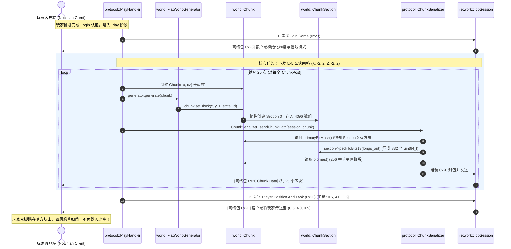

# Sprint 3 保姆级实战开发教程：区块内存模型与超平坦地形下发（Chunk & World Sync）

> **目标协议**：Minecraft Java Edition 1.12.2（Protocol 340）  
> **前置里程碑**：Sprint 1（网络基座与 Server List Ping）、Sprint 2（登录鉴权与虚空漫游）及全链路四层解耦重构（Netty COW 切片、PacketWriter RAII、ClientManager）已全部验收通过。  
> **本阶段核心目标**：从“虚空漂浮”跃迁至“脚踏实地”！构建世界领域层（Domain Layer）内存模型，实现 1.12.2 协议专有的 13 位跨 Long 直接调色板位压缩算法，完成超平坦世界生成器与 0x20 区块数据包序列化，向进服玩家成片分发出生点网格，让玩家稳固着陆在阳光明媚的草方块大地上！  
> **教学设计原则**：**自顶向下（Top-Down）建立心智蓝图，自底向上（Bottom-Up）编码夯实地基**。先搞清楚每一层的业务意图和调用关系，再动手敲每一行底层算法！  
> **预估工期**：4 ~ 5 天 | **总任务数**：6 个核心微任务

---

## 目录

- [一、 心智模型跃迁：从“网络流”到“三维空间几何”](#一-心智模型跃迁从网络流到三维空间几何)
- [二、 严格四层架构拓扑与新建文件蓝图](#二-严格四层架构拓扑与新建文件蓝图)
- [三、 Top-Down 自顶向下全景链路与职责地图（必读核心）](#三-top-down-自顶向下全景链路与职责地图必读核心)
  - [3.1 终局视角：玩家进服时序图与调用链](#31-终局视角玩家进服时序图与调用链)
  - [3.2 五大类职责矩阵与依赖拓扑](#32-五大类职责矩阵与依赖拓扑)
  - [3.3 每个类与核心函数“做什么”深度拆解（函数速查卡片）](#33-每个类与核心函数做什么深度拆解函数速查卡片)
- [四、 空间数学与二进制底层原理推演（数学硬核）](#四-空间数学与二进制底层原理推演数学硬核)
  - [4.1 坐标系映射与负数算术右移陷阱](#41-坐标系映射与负数算术右移陷阱)
  - [4.2 空间局部性寻址公式设计](#42-空间局部性寻址公式设计)
  - [4.3 1.12.2 全局调色板与 13 位跨 Long 位压缩算法](#43-1122-全局调色板与-13-位跨-long-位压缩算法)
  - [4.4 光照排布与单 Section 黄金字节数魔数（10756 与 11012）](#44-光照排布与单-section-黄金字节数魔数10756-与-11012)
- [五、 任务逐步实现指南（代码与接口契约）](#五-任务逐步实现指南代码与接口契约)
  - [TASK-3.1: 空间数学与坐标系工具 (`WorldTypes.h`)](#task-31-空间数学与坐标系工具-worldtypesh)
  - [TASK-3.2: `ChunkSection` 连续内存模型与寻址 (`ChunkSection.h/.cc`)](#task-32-chunksection-连续内存模型与寻址-chunksectionhcc)
  - [TASK-3.3: `Chunk` 垂直柱状容器与超平坦生成器 (`Chunk.h/.cc`, `FlatWorldGenerator.h/.cc`)](#task-33-chunk-垂直柱状容器与超平坦生成器-chunkhcc-flatworldgeneratorhcc)
  - [TASK-3.4: 协议层 `Chunk Data (0x20)` 二进制序列化 (`ChunkSerializer.h/.cc`)](#task-34-协议层-chunk-data-0x20-二进制序列化-chunkserializerhcc)
  - [TASK-3.5: 出生点视距网格下发与玩家物理着陆 (`PlayHandler.cc`)](#task-35-出生点视距网格下发与玩家物理着陆-playhandlercc)
  - [TASK-3.6: 单元测试覆盖与自动化验收脚本 (`test_chunk.cc`, `test_chunk.py`)](#task-36-单元测试覆盖与自动化验收脚本-test_chunkcc-test_chunkpy)
- [六、 工业级避坑指南与高频面试核心考点](#六-工业级避坑指南与高频面试核心考点)
- [七、 工业标杆（Cuberite）深度架构源码对照](#七-工业标杆cuberite深度架构源码对照)

---

## 一、 心智模型跃迁：从“网络流”到“三维空间几何”

在 Sprint 1 与 Sprint 2 中，我们关注的焦点是 **字节流生命周期** 与 **会话状态机**（握手、分帧、离线鉴权、心跳）。客户端虽然能够进服，但屏幕上是一片荒芜深邃的虚空，玩家稍有不慎就会掉入 $Y < 0$ 的深渊不断掉血。

**Sprint 3 标志着项目正式踏入 MMORPG / 游戏引擎的核心腹地——空间计算与世界数据结构。**
* 现实世界是连续的三维欧氏空间；
* Minecraft 的世界被离散化为三层网格系统：
  1. **方块（Block）**：最小离散单元，坐标 $(X, Y, Z)$；
  2. **区块子段（ChunkSection）**：$16 \times 16 \times 16 = 4096$ 个方块的立方体，内存连续排布与网络传输的基本单元；
  3. **区块列（Chunk Column / Chunk）**：垂直方向由 16 个 ChunkSection 垂直堆叠而成（$Y=0 \sim 255$），覆盖 $16 \times 256 \times 16$ 区域。

```
       Y=256 ┌───────────────────────────┐
             │ ChunkSection 15 (16x16x16)│
             ├───────────────────────────┤
             │           ......          │
             ├───────────────────────────┤
             │ ChunkSection 1  (16x16x16)│
             ├───────────────────────────┤
        Y=0  │ ChunkSection 0  (16x16x16)│ ──► [基岩(Y=0) / 泥土(Y=1..2) / 草方块(Y=3)]
             └───────────────────────────┘
                16 x 16 (X, Z 轴网格)
```

---

## 二、 严格四层架构拓扑与新建文件蓝图

依据本项目确立的不可逾越的 [MCPE 工业级架构规范](../../AGENTS.md)，本 Sprint 新增的领域逻辑必须严格收敛在 **第四层（Domain Layer `src/world/`）**，网络与协议层只负责调度与序列化，绝不可让网络套接字直接渗透进世界模型！

```
mcpe/
├── CMakeLists.txt                                  <-- 注册新增的 world 目标与单元测试
├── src/
│   ├── common/                                     <-- 【第一层: 基础工具】ByteBuffer, VarInt
│   ├── network/                                    <-- 【第二层: 网络传输】TcpSession, PacketFraming, PacketWriter
│   ├── protocol/                                   <-- 【第三层: 协议与会话】
│   │   ├── PlayHandler.h / .cc                     <-- 【修改】在玩家进服时下发 5x5 区块网格
│   │   └── ChunkSerializer.h / .cc                 <-- 【新建】专职将 Chunk 内存序列化为 0x20 二进制流
│   └── world/                                      <-- 【第四层: 纯游戏领域层 (新建目录)】
│       ├── WorldTypes.h                            <-- 【新建】空间坐标原语 (BlockPos, ChunkPos) 与数学位运算
│       ├── ChunkSection.h / .cc                    <-- 【新建】16x16x16 单段立方体连续内存与寻址
│       ├── Chunk.h / .cc                           <-- 【新建】16 个 Section 柱状聚合与生物群系存储
│       └── FlatWorldGenerator.h / .cc              <-- 【新建】超平坦地形生成器业务逻辑
├── tests/
│   └── test_chunk.cc                               <-- 【新建】坐标数学、Section 寻址与位压缩编解码往返单测
└── scripts/
    └── test_chunk.py                               <-- 【新建】Python 自动化抓包验证 0x20 Chunk Data 报文
```

---

## 三、 Top-Down 自顶向下全景链路与职责地图（必读核心）

> 💡 **为什么需要自顶向下（Top-Down）思维？**  
> 如果一上来就去读“13 位跨 Long 压缩”或者“`& 0x0F` 局部坐标”，你会陷入具体的底层数学细节而迷失方向：“我为什么要写这个函数？谁在调用它？它到底在为游戏的哪个功能服务？”  
> **正确的理解路径是：先看玩家进服需要看到什么，再看网络层发了什么包，最后层层向下推导数据从何而来！**

### 3.1 终局视角：玩家进服时序图与调用链

当玩家在客户端输入服务器 IP 点击进服，经历了 Handshake 与 Login 鉴权后，服务端的状态机切换到了 `PLAY` 状态。此时，整个系统按照如下时序自顶向下流转：



---

### 3.2 五大类职责矩阵与依赖拓扑

整个 Sprint 3 涉及的模块清晰分为 5 层，自上而下单向依赖：

```
【第一层：业务编排】PlayHandler (触发世界生成与下发)
       │
       ▼
【第二层：协议序列化】ChunkSerializer (把 Chunk 对象翻译为 0x20 二进制流)
       │
       ├─────────────────────────────────┐
       ▼                                 ▼
【第三层：世界领域容器】Chunk              【生成器】FlatWorldGenerator
       │ (持有 16 个)                      │ (填充 Chunk)
       ▼                                 │
【第四层：子区块紧凑内存】ChunkSection ◄────┘
       │
       ▼
【第五层：基础坐标与数学】WorldTypes (BlockPos, ChunkPos, 位运算)
```

| 类名 / 文件 | 所在层级 | 核心职责（一句话概括） | 上游调用方 | 下游依赖 |
| :--- | :--- | :--- | :--- | :--- |
| **`PlayHandler`** | 协议业务编排 | **总指挥官**：在玩家加入时，调用生成器与序列化器，下发 25 个区块与初始传送坐标。 | `ClientSession` 状态机 | `FlatWorldGenerator`, `ChunkSerializer` |
| **`ChunkSerializer`** | 协议编解码 | **翻译官**：只负责将纯粹的 `Chunk` 领域对象，按照 1.12.2 官方二进制格式封包为 `0x20` 报文并发送。 | `PlayHandler` | `Chunk`, `ChunkSection`, `PacketWriter` |
| **`FlatWorldGenerator`**| 世界领域逻辑 | **地形创世神**：根据固定规则（$Y=0$ 基岩、$Y=1\sim 2$ 泥土、$Y=3$ 草方块）向 `Chunk` 写入方块。 | `PlayHandler` | `Chunk`, `WorldTypes` |
| **`Chunk`** | 世界领域容器 | **垂直区块柱容器**：管理 $16 \times 256 \times 16$ 空间，持有 16 个 `ChunkSection`（空段保持 `nullptr`）和 256 字节 Biome。 | `PlayHandler`, `ChunkSerializer`, `Generator` | `ChunkSection`, `WorldTypes` |
| **`ChunkSection`** | 世界领域容器 | **单段立方体内存**：管理 $16 \times 16 \times 16$ 方块的紧凑一维数组（4096 元素），负责 13-bit 跨 Long 压缩打包。 | `Chunk` | `WorldTypes` |
| **`WorldTypes.h`** | 底层空间数学 | **纯无状态工具箱**：坐标类型定义（`BlockPos`, `ChunkPos`）、局部坐标映射与 `sectionBlockIndex` 内存寻址。 | 所有上层模块 | 仅依赖标准库 |

---

### 3.3 每个类与核心函数“做什么”深度拆解（函数速查卡片）

#### 🏷️ 1. `PlayHandler`（协议业务编排）
* **`void onPlayerJoin(std::shared_ptr<TcpSession> session)`**
  * **调用时机**：玩家刚刚完成登录认证切换至 `PLAY` 状态时。
  * **输入**：当前玩家的网络连接 `session`。
  * **要做什么**：
    1. 发送 `Join Game (0x23)`；
    2. 双重循环生成 $X \in [-2, 2], Z \in [-2, 2]$ 共 25 个区块，通过 `ChunkSerializer::sendChunkData` 发给客户端；
    3. 发送 `Player Position And Look (0x2F)`，传送至 $(0.5, 4.0, 0.5)$；
  * **输出**：向客户端输出一系列网络数据包。

#### 🏷️ 2. `ChunkSerializer`（协议二进制序列化）
* **`static void sendChunkData(std::shared_ptr<TcpSession> session, const Chunk& chunk, bool ground_up = true)`**
  * **调用时机**：需要向客户端同步某个区块的方块数据时。
  * **输入**：网络 `session`、领域对象 `chunk`、是否全新加载 `ground_up`（首次进入填 `true`）。
  * **要做什么**：
    1. 计算出站包大小，使用 `PacketWriter<0x20>` 构建报文；
    2. 写入 `chunk.x()`、`chunk.z()` 和 `ground_up`；
    3. 写入 `chunk.primaryBitMask()`；
    4. 写入 `Data Size`（单段平原固定为 11012 字节）；
    5. 遍历非空段，调用 `section->packToBits13(longs)` 填入 832 个大端整数，紧接着追加 2048 字节方块光（全 0）与 2048 字节天空光（全 0xFF）；
    6. 追加 256 字节的 `chunk.biomes()`；
    7. 追加方块实体数量（VarInt 0）；
  * **输出**：底层调用 `session->sendPacket` 发送 TCP 数据流。

#### 🏷️ 3. `FlatWorldGenerator`（超平坦世界生成器）
* **`void generate(Chunk& chunk)`**
  * **调用时机**：需要为新区块赋予方块内容时。
  * **输入**：一个空白的 `Chunk` 引用。
  * **要做什么**：
    双重循环遍历 $x \in [0, 15], z \in [0, 15]$：
    * `chunk.setBlock(x, 0, z, BlockStates::kBedrock);` （最底层基岩，不可破坏）
    * `chunk.setBlock(x, 1, z, BlockStates::kDirt);`    （泥土层）
    * `chunk.setBlock(x, 2, z, BlockStates::kDirt);`    （泥土层）
    * `chunk.setBlock(x, 3, z, BlockStates::kGrass);`   （顶层青翠草方块）
    * $Y \ge 4$ 全是空气，**不需要调用任何方法**（保持未分配状态，节约内存！）。
  * **输出**：被填充好方块的 `chunk` 对象。

#### 🏷️ 4. `Chunk`（垂直区块柱容器）
* **`Chunk(int32_t x, int32_t z)`**：构造函数，记录坐标，将 16 个 Section 指针初始化为 `nullptr`，Biome 数组初始化为 `0x01`（Plains）。
* **`void setBlock(int32_t x, int32_t y, int32_t z, uint16_t state)`**：
  * 计算该方块落在第几个 Section（`y >> 4`）；
  * **惰性分配**：若 `sections_[sec_idx] == nullptr`，先执行 `sections_[sec_idx] = std::make_unique<ChunkSection>()`；
  * 调用该段的 `setBlock(x & 15, y & 15, z & 15, state)`。
* **`uint16_t getBlock(int32_t x, int32_t y, int32_t z) const`**：
  * 若对应 Section 为 `nullptr`，直接返回 `BlockStates::kAir`（空气）；否则委派给该 Section 查询。
* **`uint16_t primaryBitMask() const`**：
  * 遍历 16 个段指针，若 `sections_[i] != nullptr && !sections_[i]->isEmpty()`，则将结果掩码的第 $i$ 位置为 1。
* **`const ChunkSection* getSection(size_t index) const`**：只读返回第 `index` 个段指针（供序列化器遍历）。

#### 🏷️ 5. `ChunkSection`（单段连续内存与位压缩）
* **`ChunkSection()`**：构造函数，将 `blocks_` 4096 数组清空（全设为空气 `kAir`），`non_air_count_ = 0`。
* **`void setBlock(int32_t lx, int32_t ly, int32_t lz, uint16_t state_id)`**：
  * 通过 `sectionBlockIndex(lx, ly, lz)` 算出下标 $[0, 4095]$；
  * 如果原位置是空气、新位置不是空气，`non_air_count_++`；反之递减；
  * 更新 `blocks_[idx] = state_id`。
* **`uint16_t getBlock(...) const`**：直接读取 `blocks_[idx]`。
* **`void packToBits13(std::span<uint64_t, 832> out_longs) const`**：
  * 将 4096 个 13-bit 的 State ID 按协议紧密连续打包为 832 个 `uint64_t`。
  * 处理条目跨越两个 64 位整数边界的溢出位移运算。
* **`bool isEmpty() const`**：返回 `non_air_count_ == 0`，供上层判断是否需要下发或释放。

#### 🏷️ 6. `WorldTypes.h`（底层数学与类型基石）
* **`ChunkPos`**：二元组 `(x, z)`，重载 `operator==`，提供 `std::hash` 特化。
* **`BlockPos`**：三元组 `(x, y, z)`，提供转换为 Chunk 坐标（`>> 4`）、局部坐标（`& 0x0F`）和 Section 编号（`y >> 4`）的工具方法。
* **`sectionBlockIndex(x, y, z)`**：根据 $(y \ll 8) \mid (z \ll 4) \mid x$ 算出单 Section 内的一维数组下标。
* **`toGlobalState(block_id, meta)`**：根据 $(block\_id \ll 4) \mid meta$ 组装 1.12.2 的全局调色板 State ID。

---

## 四、 空间数学与二进制底层原理推演（数学硬核）

### 4.1 坐标系映射与负数算术右移陷阱

一个世界绝对坐标 $(X, Y, Z)$ 落在哪个区块 $(ChunkX, ChunkZ)$ 中？
在数学上，区块坐标是世界坐标除以 16 并**向下取整（Floor）**：
$$\text{ChunkX} = \lfloor X / 16 \rfloor$$

> ⚠️ **新手灾难性陷阱**：
> C/C++ 语言标准规定，有符号整数的除法 `/` 采用 **Truncate toward zero（向零截断）**！
> * $15 / 16 = 0$（正确，属于区块 0）
> * $-1 / 16 = 0$（**错误！** 数学上 $\lfloor -1 / 16 \rfloor = -1$，但在 C++ 中算成了 0！这会导致负数坐标的玩家看到的区块错位整整 16 格！）

**工业级最优解法**：在二进制补码表示下，使用**算术右移（Arithmetic Right Shift）**：
```cpp
constexpr int32_t toChunkCoord(int32_t val) noexcept {
    return val >> 4; // 计算机硬件级天然而正确的向下取整！例如 -1 >> 4 == -1
}
constexpr int32_t toLocalCoord(int32_t val) noexcept {
    return val & 0x0F; // 等价于 val mod 16，提取 0~15 的局部坐标
}
```

### 4.2 空间局部性寻址公式设计

每个 `ChunkSection` 拥有 $16 \times 16 \times 16 = 4096$ 个方块。如何将局部三维坐标 $(x, y, z)$（其中 $x, y, z \in [0, 15]$）映射为一维数组索引？
Minecraft 官方协议规定其存储寻址公式为：
$$\text{Index} = (y \ll 8) \mid (z \ll 4) \mid x$$

**硬件性能原理（Cache-Friendly）**：
该排布保证了 $X$ 轴相邻方块在物理内存中也是连续紧邻的。在光线追踪、网格渲染或物理碰撞检测遍历一行方块时，CPU L1 Cache Line（64 字节）可以一次性载入 32 个相邻方块状态，缓存命中率接近 100%。

### 4.3 1.12.2 全局调色板与 13 位跨 Long 位压缩算法

在 Minecraft 1.12.2（Protocol 340）中，方块状态由 **全局调色板 State ID** 表示：
$$\text{StateID} = (\text{BlockID} \ll 4) \mid \text{Metadata}$$
在 1.12.2 中，BlockID 最大为 255，Meta 最大为 15，因此最大状态值为 $(255 \ll 4) \mid 15 = 4095$（实际扩展上限为 8191），占用 **13 个二进制位（Bits）**。

#### 调色板模式判定：
* 当 `BitsPerBlock <= 8` 时使用间接调色板（带有动态映射数组）；
* 当 `BitsPerBlock >= 9` 时，Minecraft 强制进入 **直接调色板模式（Direct Global Palette）**：
  * 固定设置 `BitsPerBlock = 13`；
  * `Dummy Palette Length = 0`（调色板长度直接填 0，无任何映射表）；
  * 每个方块的值直接写入 13 位的全局 State ID！

#### 为什么 1.12.2 允许跨 Long 且无需填充？
$$4096 \text{ 方块} \times 13 \text{ 位} = 53248 \text{ 位}$$
$$53248 \div 64 = 832 \text{ 个 } 64 \text{ 位整数 (uint64\_t)}$$
**数字完全整除！** 因此 `Data Array Length` 恒等于 **832**。
注意：条目允许跨越两个 `uint64_t` 的边界（1.16+ 引入的不跨边界与 Padding 填充规则在 1.12.2 中**严禁使用**，否则客户端闪退！）。

#### 位压缩打包核心算法推导：
```cpp
constexpr int kBits = 13;
constexpr int kBlocks = 4096;
constexpr int kLongs = kBlocks * kBits / 64; // 832
uint64_t data[kLongs] = {0};

for (int idx = 0; idx < kBlocks; ++idx) {
    uint16_t state_id = blocks_[idx];
    uint64_t value = static_cast<uint64_t>(state_id) & ((1ULL << kBits) - 1);
    
    int start_long   = (idx * kBits) / 64;
    int start_offset = (idx * kBits) % 64;
    int end_long     = ((idx + 1) * kBits - 1) / 64;
    
    data[start_long] |= (value << start_offset);
    if (start_long != end_long) {
        // 跨越 64 位整数边界，将高位溢出部分塞入下一个 long 的最低位
        data[end_long] |= (value >> (64 - start_offset));
    }
}
```
> ⚠️ **网络字节序**：每个 `uint64_t` 发送到客户端前，必须转换为 **大端序（Big-Endian）** 写入！

### 4.4 光照排布与单 Section 黄金字节数魔数（10756 与 11012）

每个 Section 紧随方块数据之后的是光照数据：
1. **Block Light（方块光）**：4096 个半字节（4-bit nibble）= 2048 字节。平坦世界未放置火把，全填 `0x00`；
2. **Sky Light（天空光）**：4096 个半字节 = 2048 字节。主世界阳光普照，全填 `0xFF`（即两个方块的天空光均为 15 最亮值）；
   * 注意：天空光**仅在主世界维度下发**，若在下界（Nether）下发会导致客户端错位闪退！

#### 黄金自检魔数推导（单 Section + 主世界）：
| 字段名称 | 协议类型 | 字节大小 | 说明 |
| :--- | :--- | :--- | :--- |
| **Bits Per Block** | `Unsigned Byte` | 1 字节 | 固定填 13 |
| **Dummy Palette Length** | `VarInt` | 1 字节 | 直接模式固定填 0 |
| **Data Array Length** | `VarInt` | 2 字节 | 832 的 VarInt 编码为 `[0xC0, 0x06]` |
| **Data Array** | `Long[832]` | $832 \times 8 = 6656$ 字节 | 大端序位压缩数据 |
| **Block Light** | `Byte[2048]` | 2048 字节 | 全 0x00 |
| **Sky Light** | `Byte[2048]` | 2048 字节 | 全 0xFF |
| **单 Section 小计** | - | **10756 字节** | $(1 + 1 + 2 + 6656 + 2048 + 2048)$ |

若该区块是全新加载（`Ground-Up Continuous == true`），数据末尾必须追加：
* **Biomes（生物群系）**：$16 \times 16 = 256$ 字节（全填 `0x01` 代表 Plains 平原）。
因此，一个包含单段 Section 0 的超平坦区块的总负载数据大小为：
$$\text{Data Size} = 10756 \times 1 + 256 = \mathbf{11012} \text{ 字节}$$
**如果你的序列化器产出的 Payload 大小不等于 11012，100% 存在 Bug，客户端必崩溃！**

---

## 五、 任务逐步实现指南（代码与接口契约）

> 💡 **编码实施路线：自底向上（Bottom-Up）逐个击破**  
> 虽然心智理解是自顶向下的，但在 C++ 编程中，底层无依赖的类（`WorldTypes.h`）必须先写好并编译通过，上层类才能顺利通过类型检查。按照 **TASK-3.1 $\to$ TASK-3.6** 的顺序编写即可。

---

### TASK-3.1: 空间数学与坐标系工具 (`WorldTypes.h`)
* **任务类型**：世界核心基石
* **位置**：`src/world/WorldTypes.h`
* **完整接口声明契约**：

```cpp
#ifndef MCPE_WORLD_WORLD_TYPES_H
#define MCPE_WORLD_WORLD_TYPES_H

#include <cstdint>
#include <functional>

namespace mcpe::world {

struct ChunkPos {
  int32_t x;
  int32_t z;

  constexpr bool operator==(const ChunkPos& other) const noexcept {
    return x == other.x && z == other.z;
  }
};

struct BlockPos {
  int32_t x;
  int32_t y;
  int32_t z;

  constexpr ChunkPos toChunkPos() const noexcept {
    return ChunkPos{x >> 4, z >> 4};
  }

  constexpr int32_t localX() const noexcept { return x & 0x0F; }
  constexpr int32_t localY() const noexcept { return y; }
  constexpr int32_t localZ() const noexcept { return z & 0x0F; }
  constexpr int32_t sectionIndex() const noexcept { return y >> 4; }
  constexpr int32_t localSectionY() const noexcept { return y & 0x0F; }
};

/** @brief 空间局部性寻址：(y << 8) | (z << 4) | x */
constexpr size_t sectionBlockIndex(int32_t x, int32_t y, int32_t z) noexcept {
  return (static_cast<size_t>(y & 0x0F) << 8) |
         (static_cast<size_t>(z & 0x0F) << 4) |
         static_cast<size_t>(x & 0x0F);
}

/** @brief 方块状态转换工具：消除裸数字魔数 */
constexpr uint16_t toGlobalState(uint16_t block_id, uint8_t meta = 0) noexcept {
  return static_cast<uint16_t>((block_id << 4) | (meta & 0x0F));
}

namespace BlockStates {
  inline constexpr uint16_t kAir = toGlobalState(0, 0);
  inline constexpr uint16_t kStone = toGlobalState(1, 0);
  inline constexpr uint16_t kGrass = toGlobalState(2, 0);
  inline constexpr uint16_t kDirt = toGlobalState(3, 0);
  inline constexpr uint16_t kBedrock = toGlobalState(7, 0);
}

} // namespace mcpe::world

template <>
struct std::hash<mcpe::world::ChunkPos> {
  size_t operator()(const mcpe::world::ChunkPos& pos) const noexcept {
    return (static_cast<size_t>(pos.x) * 3129871) ^ static_cast<size_t>(pos.z);
  }
};

#endif // MCPE_WORLD_WORLD_TYPES_H
```

---

### TASK-3.2: `ChunkSection` 连续内存模型与寻址 (`ChunkSection.h/.cc`)
* **任务类型**：世界核心容器
* **位置**：`src/world/ChunkSection.h`, `src/world/ChunkSection.cc`
* **完整接口声明契约**：

```cpp
// src/world/ChunkSection.h
#ifndef MCPE_WORLD_CHUNK_SECTION_H
#define MCPE_WORLD_CHUNK_SECTION_H

#include <array>
#include <cstdint>
#include <span>

#include "world/WorldTypes.h"

namespace mcpe::world {

class ChunkSection {
 public:
  static constexpr size_t kBlockCount = 4096;
  static constexpr size_t kBitsPerBlock = 13;
  static constexpr size_t kDataLongs = (kBlockCount * kBitsPerBlock) / 64; // 832

  ChunkSection();

  void setBlock(int32_t x, int32_t y, int32_t z, uint16_t state_id);
  [[nodiscard]] uint16_t getBlock(int32_t x, int32_t y, int32_t z) const;

  /** @brief 将方块数据压缩为 1.12.2 的 832 个 64 位整数（小端临时存储，序列化时转大端） */
  void packToBits13(std::span<uint64_t, kDataLongs> out_longs) const;

  [[nodiscard]] size_t nonAirCount() const noexcept { return non_air_count_; }
  [[nodiscard]] bool isEmpty() const noexcept { return non_air_count_ == 0; }

 private:
  std::array<uint16_t, kBlockCount> blocks_;
  size_t non_air_count_{0};
};

} // namespace mcpe::world

#endif // MCPE_WORLD_CHUNK_SECTION_H
```

---

### TASK-3.3: `Chunk` 垂直柱状容器与超平坦生成器 (`Chunk.h/.cc`, `FlatWorldGenerator.h/.cc`)
* **任务类型**：世界领域业务
* **位置**：`src/world/Chunk.h`, `src/world/Chunk.cc`, `src/world/FlatWorldGenerator.h`, `src/world/FlatWorldGenerator.cc`
* **`Chunk.h` 完整接口契约**：

```cpp
// src/world/Chunk.h
#ifndef MCPE_WORLD_CHUNK_H
#define MCPE_WORLD_CHUNK_H

#include <array>
#include <cstdint>
#include <memory>

#include "world/ChunkSection.h"
#include "world/WorldTypes.h"

namespace mcpe::world {

class Chunk {
 public:
  static constexpr size_t kSectionCount = 16;
  static constexpr size_t kBiomeCount = 256;

  Chunk(int32_t x, int32_t z);

  [[nodiscard]] int32_t x() const noexcept { return x_; }
  [[nodiscard]] int32_t z() const noexcept { return z_; }
  [[nodiscard]] ChunkPos pos() const noexcept { return ChunkPos{x_, z_}; }

  void setBlock(int32_t x, int32_t y, int32_t z, uint16_t state_id);
  [[nodiscard]] uint16_t getBlock(int32_t x, int32_t y, int32_t z) const;

  /** @brief 计算 16 位的掩码：哪些 Section 存在且非空 */
  [[nodiscard]] uint16_t primaryBitMask() const;

  /** @brief 获取特定索引的 Section 指针（可能为 nullptr） */
  [[nodiscard]] const ChunkSection* getSection(size_t index) const;

  /** @brief 获取生物群系数组只读引用 */
  [[nodiscard]] const std::array<uint8_t, kBiomeCount>& biomes() const noexcept {
    return biomes_;
  }

 private:
  int32_t x_{0};
  int32_t z_{0};
  std::array<std::unique_ptr<ChunkSection>, kSectionCount> sections_;
  std::array<uint8_t, kBiomeCount> biomes_;
};

} // namespace mcpe::world

#endif // MCPE_WORLD_CHUNK_H
```

* **`FlatWorldGenerator.h` 完整接口契约**：

```cpp
// src/world/FlatWorldGenerator.h
#ifndef MCPE_WORLD_FLAT_WORLD_GENERATOR_H
#define MCPE_WORLD_FLAT_WORLD_GENERATOR_H

#include "world/Chunk.h"

namespace mcpe::world {

class FlatWorldGenerator {
 public:
  FlatWorldGenerator() = default;

  /**
   * @brief 在传入的空白 Chunk 中填充经典 4 层超平坦方块：
   * Y=0: 基岩 (Bedrock)
   * Y=1~2: 泥土 (Dirt)
   * Y=3: 草方块 (Grass)
   * Y>=4: 保持空气 (无需填充，惰性节省内存)
   */
  void generate(Chunk& chunk);
};

} // namespace mcpe::world

#endif // MCPE_WORLD_FLAT_WORLD_GENERATOR_H
```

---

### TASK-3.4: 协议层 `Chunk Data (0x20)` 二进制序列化 (`ChunkSerializer.h/.cc`)
* **任务类型**：协议核心
* **位置**：`src/protocol/ChunkSerializer.h`, `src/protocol/ChunkSerializer.cc`
* **`ChunkSerializer.h` 完整接口契约**：

```cpp
// src/protocol/ChunkSerializer.h
#ifndef MCPE_PROTOCOL_CHUNK_SERIALIZER_H
#define MCPE_PROTOCOL_CHUNK_SERIALIZER_H

#include <memory>

#include "common/ByteBuffer.h"
#include "network/TcpSession.h"
#include "world/Chunk.h"

namespace mcpe::protocol {

class ChunkSerializer {
 public:
  /**
   * @brief 按照 Minecraft 1.12.2 (Protocol 340) 序列化并向指定客户端连接发送 0x20 报文
   * @param session 目标客户端套接字会话
   * @param chunk 包含方块与群系的世界领域对象
   * @param ground_up 是否全新连续加载（首次下发必须为 true，携带 256 字节 Biomes）
   */
  static void sendChunkData(std::shared_ptr<network::TcpSession> session,
                            const world::Chunk& chunk,
                            bool ground_up = true);

  /**
   * @brief 核心序列化逻辑：将 Chunk 转换为未加帧头的原始 0x20 数据包 ByteBuffer
   * 方便在单元测试中直接断言 Payload 长度等于黄金魔数 11012！
   */
  static common::ByteBuffer serialize(const world::Chunk& chunk, bool ground_up = true);
};

} // namespace mcpe::protocol

#endif // MCPE_PROTOCOL_CHUNK_SERIALIZER_H
```

* **封包字节流顺序（自检表）**：
  1. `Chunk X`: `writeBe<int32_t>(chunk.x())`
  2. `Chunk Z`: `writeBe<int32_t>(chunk.z())`
  3. `Ground-Up Continuous`: `writeBe<uint8_t>(ground_up ? 1 : 0)`
  4. `Primary Bit Mask`: `appendVarInt(chunk.primaryBitMask())`
  5. `Data Size`: `appendVarInt(payload_size)`
  6. `Data Payload`:
     - 遍历 16 个 Section，若 BitMask 第 $i$ 位为 1：
       - `writeBe<uint8_t>(13)` (Bits Per Block)
       - `appendVarInt(0)` (Dummy Palette Length)
       - `appendVarInt(832)` (Data Array Length)
       - 832 个 `uint64_t`（按大端写入：`writeBe<uint64_t>`）
       - 2048 字节 Block Light（全部追加 `0x00`）
       - 2048 字节 Sky Light（全部追加 `0xFF`）
     - 若 `ground_up == true`，末尾追加 256 字节 Biomes
  7. `Number of Block Entities`: `appendVarInt(0)`
* **静态自洽性校验**：
  `assert(data_size == 11012);` 保证协议绝对无偏差。

---

### TASK-3.5: 出生点视距网格下发与玩家物理着陆 (`PlayHandler.cc`)
* **任务类型**：会话业务联动
* **位置**：`src/protocol/PlayHandler.cc`
* **业务落地代码**：

```cpp
void PlayHandler::onPlayerJoin(std::shared_ptr<network::TcpSession> session) {
  // 1. 发送 Join Game (0x23)
  sendJoinGame(session);

  // 2. 以玩家出生点 (0, 0) 为中心，下发 5x5 的区块矩阵 (X: -2..2, Z: -2..2)
  world::FlatWorldGenerator generator;
  for (int32_t cx = -2; cx <= 2; ++cx) {
    for (int32_t cz = -2; cz <= 2; ++cz) {
      world::Chunk chunk(cx, cz);
      generator.generate(chunk);
      ChunkSerializer::sendChunkData(session, chunk, true);
    }
  }

  // 3. 发送玩家位置与视角 (0x2F)
  // X=0.5, Y=4.0, Z=0.5 (草方块表面在 Y=3.0，玩家站在草方块正上方，受重力稳固立足)
  sendPlayerPositionAndLook(session, 0.5, 4.0, 0.5, 0.0f, 0.0f);
}
```

---

### TASK-3.6: 单元测试覆盖与自动化验收脚本 (`test_chunk.cc`, `test_chunk.py`)
* **单元测试必须验证**：
  1. 负数坐标向下取整单测（$X=-1 \rightarrow Chunk=-1, Local=15$；$X=-16 \rightarrow Chunk=-1, Local=0$；$X=-17 \rightarrow Chunk=-2, Local=15$）；
  2. 寻址极限坐标：$(0,0,0)$ 与 $(15,15,15)$ 寻址正确，无越界；
  3. 13 位压缩打包与解包**往返无损单测**（覆盖跨 Long 边界的条目，如 index 4、9、14 等）；
  4. 序列化数据包 Payload 长度断言严格等于 11012 字节。
* **自动化测试脚本**：编写 `scripts/test_chunk.py`，模拟真实客户端进服，在收到 `Join Game` 后连续读取并成功校验 25 个 `Chunk Data (0x20)` 报文，校验无解码异常。

---

## 六、 工业级避坑指南与高频面试核心考点

### 避坑一：客户端抛出 `ArrayIndexOutOfBoundsException` 当场闪退
* **根本诱因**：`Primary Bit Mask` 声明的有效 Section 数量与后续 `Data` 字节流实际长度脱节！客户端解析区块时根据 Bit Mask 中的二进制 1 计算后续 Section 个数。如果掩码声明了 2 个，但实际只写了 1 个 Section 的数据，客户端解析光照时数组越界闪退。

### 避坑二：满屏乱方块或错乱纹理
* **根本诱因**：
  1. 混淆了 1.8（2 字节小端方块）与 1.12.2（13 位大端 Long 数组）；
  2. 位压缩时没有将 `uint64_t` 转换为大端序；
  3. 光照数组少写了 1 个字节导致整体字节错位。

### 避坑三：重复发送相同区块导致客户端内存泄漏
* **根本诱因**：如果对已经加载的区块重复发送 `Ground-Up Continuous = true` 的数据包，Notchian 客户端不会释放旧的渲染网格，导致 F3 界面中的 `MultiplayerChunkCache` 泄漏膨胀。
* **正确做法**：如果需要刷新区块，必须先发送 `Unload Chunk (0x1D)`（携带 `Chunk X` 与 `Chunk Z`），再重新发送 `Chunk Data (0x20)`。

---

## 七、 工业标杆（Cuberite）深度架构源码对照

| 维度 | Cuberite 工业级实现 (`cChunk`, `cChunkMap`) | 本项目现代 C++23 升级版 (`mcpe::world`) |
| :--- | :--- | :--- |
| **内存组织** | 采用裸数组 `cChunkDef::BlockTypes` 配合宏函数寻址 | 采用现代 C++ 强类型 `std::array` 与 `constexpr` 空间函数，零运行时开销 |
| **空段处理** | 动态分配 16 个段指针，空段填 `nullptr` | 采用 `std::unique_ptr<ChunkSection>` 严密生命周期管理，杜绝内存泄漏 |
| **数据包组装** | 在 `cProtocol_1_12_2::SendChunkData` 中多次 `memcpy` 拼接 | 采用 Netty 风格 `ByteBuffer` 与 `PacketWriter` 预留头部直接构造，极大降低系统调用开销 |
| **坐标数学** | 包含部分历史 `Floor` 浮点转换兼容逻辑 | 彻底统一为 CPU 算术右移（`>> 4`）与掩码运算（`& 0x0F`），性能登峰造极 |

---

> **结语**：完成 Sprint 3 后，你的服务端将正式具备游戏引擎的空间世界渲染能力！玩家在客户端中将看到蓝天白云下平整无垠的绿色草地，脚踏实地漫步。下一阶段我们将进入高并发与游戏节拍器的核心——**Sprint 4: 20 TPS 节拍器与九宫格 AOI 视距广播**！
