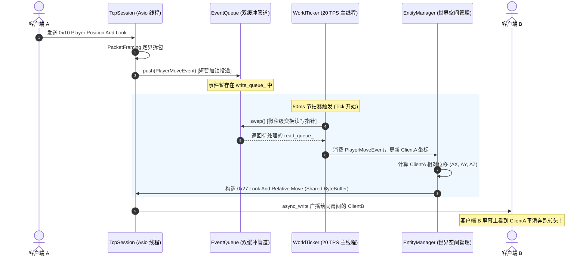

# Sprint 3 保姆级实战开发教程：玩家移动同步、同屏实体可见性与双向聊天系统 (Movement, Entity Visibility & Chat Multicast)

> **目标协议**：**Minecraft Java Edition 1.12.2（Protocol Version: 340）**  
> **前置里程碑**：Sprint 0（基础组件）、Sprint 1（网络基座与 Server List Ping）、Sprint 2（登录鉴权与 5x5 区块空间渲染）已全部验收通过。  
> **本阶段核心目标**：从“孤身一人静态世界”跃迁至“多玩家动态同步联机与大厅社交”！彻底解耦网络 I/O 线程与游戏逻辑主线程；设计基于双缓冲的 MPSC 跨线程任务通道与精准 20 TPS 物理节拍器；消费客户端位移与朝向数据包，广播同屏人物模型生成、增量相对位移与转头动作；打通聊天多播与快捷指令分流管道！  
> **教学设计原则**：**透彻讲清“是什么、为什么、怎么做”**。恪守四层架构红线，零裸写魔数，零未受控并发竞态。  
> **预估工期**：3 ~ 4 天 | **核心任务数**：5 个微任务

---

## 目录

- [一、 心智模型跃迁与架构原理（是什么与为什么）](#一-心智模型跃迁与架构原理是什么与为什么)
  - [1.1 为什么严禁网络线程直接读写游戏世界？（并发安全深度解析）](#11-为什么严禁网络线程直接读写游戏世界并发安全深度解析)
  - [1.2 为什么采用单写入者主循环（Actor 模式）+ 外部 MPSC 管道？](#12-为什么采用单写入者主循环actor-模式--外部-mpsc-管道)
  - [1.3 什么是 20 TPS 节拍器？为什么简单 sleep 会导致灾难性漂移？](#13-什么是-20-tps-节拍器为什么简单-sleep-会导致灾难性漂移)
  - [1.4 状态同步模型：为什么在局域网/互联网中必须使用增量编码？](#14-状态同步模型为什么在局域网互联网中必须使用增量编码)
- [二、 空间数学与二进制底层协议硬核推演（协议物理详解）](#二-空间数学与二进制底层协议硬核推演协议物理详解)
  - [2.1 同屏可见性铁律：为什么跳过 Player List Item 会导致“隐形人”？](#21-同屏可见性铁律为什么跳过-player-list-item-会导致隐形人)
  - [2.2 相对位移定点数运算（1/4096 方块）与 8.0 格临界溢出推导](#22-相对位移定点数运算14096-方块与-80-格临界溢出推导)
  - [2.3 视角量化（Angle 字节）与绝对朝向规范](#23-视角量化angle-字节与绝对朝向规范)
  - [2.4 聊天消息协议（ChatComponent JSON AST 与快捷指令分流）](#24-聊天消息协议chatcomponent-json-ast-与快捷指令分流)
- [三、 严格四层架构拓扑与模块职责划分](#三-严格四层架构拓扑与模块职责划分)
  - [3.1 跨线程读写管道与数据流向时序图](#31-跨线程读写管道与数据流向时序图)
  - [3.2 单 Tick 核心流水线（Tick Pipeline）](#32-单-tick-核心流水线tick-pipeline)
  - [3.3 新增/修改模块文件蓝图](#33-新增修改模块文件蓝图)
- [四、 任务逐步实现指南（怎么做：接口契约与代码落地）](#四-任务逐步实现指南怎么做接口契约与代码落地)
  - [TASK-3.1: 跨线程 MPSC 任务队列与双缓冲交换 (`EventQueue.h`)](#task-31-跨线程-mpsc-任务队列与双缓冲交换-eventqueueh)
  - [TASK-3.2: 精准 20 TPS 物理节拍器与漂移补偿 (`WorldTicker.h/.cc`)](#task-32-精准-20-tps-物理节拍器与漂移补偿-worldtickerhcc)
  - [TASK-3.3: 客户端移动包解析与坐标合法性校验 (`PlayHandler.cc`)](#task-33-客户端移动包解析与坐标合法性校验-playhandlercc)
  - [TASK-3.4: 玩家进出视野广播与实体生命周期 (`EntityManager.h/.cc`)](#task-34-玩家进出视野广播与实体生命周期-entitymanagerhcc)
  - [TASK-3.5: 聊天多播与快捷指令路由系统 (`ChatHandler.h/.cc`)](#task-35-聊天多播与快捷指令路由系统-chathandlerhcc)
- [五、 工业级避坑指南与高频面试核心考点](#五-工业级避坑指南与高频面试核心考点)
- [六、 验收门禁与端到端联调规范 (DoD)](#六-验收门禁与端到端联调规范-dod)

---

## 一、 心智模型跃迁与架构原理（是什么与为什么）

### 1.1 为什么严禁网络线程直接读写游戏世界？（并发安全深度解析）

* **是什么**：
  在 Asio 异步架构中，`io_context::run()` 通常运行在独立的 I/O 线程池中。当客户端上传移动数据包时，网络库触发 `TcpSession::doRead()`，完成定界拆包。
* **为什么（痛点与危害）**：
  新手最容易犯的致命错误是：在网络回调中直接调用 `world.update_player_position(player_id, x, y, z)` 并遍历其他在线玩家发送广播包。
  ```
  [错误示范：并发读写导致未定义行为]
  I/O 线程 1 ──► 正在遍历在线玩家列表广播移动包 ──────────────┐ (内存冲突！)
  I/O 线程 2 ──► 另一个玩家恰好断开连接，正在执行 erase() ──┴─► 迭代器失效 / SIGSEGV 崩溃！
  ```
  1. **数据竞态（Data Race）**：多线程并发修改同一个 `std::unordered_map` 或实体对象，引发未定义行为（UB）；
  2. **死锁与锁竞争泥潭**：若为了线程安全给 `World` 加一把大读写锁（`std::shared_mutex`），当在线人数升高时，多个网络线程频繁争抢互斥锁，导致 I/O 线程大面积阻塞挂起，Asio 的异步吞吐优势彻底丧失。

---

### 1.2 为什么采用单写入者主循环（Actor 模式）+ 外部 MPSC 管道？

* **是什么**：
  **单写入者原则（Single-Writer Principle）**：整个游戏世界的状态（玩家坐标、实体列表、世界时间、计分板）**有且仅由一个唯一的逻辑主线程负责修改**。
  网络线程只负责“解包”，解出纯数据结构后作为事件投递到外部管道。
* **为什么（优势）**：
  1. **完全消除业务加锁**：逻辑主线程在执行游戏逻辑时，世界数据是 100% 线程私有的，不需要加任何互斥锁，CPU 缓存命中率（L1/L2 Cache）极高；
  2. **确定性与可复现性（Determinism）**：逻辑帧以固定顺序推进，杜绝多线程时序错乱导致的幽灵位移或状态不一致；
  3. **架构解耦**：网络层退化为纯粹的 I/O 适配器，即使未来更换网络库（如从 Asio 换为 io_uring），游戏世界逻辑一行都不用改。

---

### 1.3 什么是 20 TPS 节拍器？为什么简单 sleep 会导致灾难性漂移？

* **是什么**：
  Minecraft 的物理时间以 **TPS（Ticks Per Second，每秒刻数）** 计量。标准节拍为 **20 TPS**，即每个游戏物理刻的间隔必须严格维持在 **50 毫秒（50,000,000 纳秒）**。
* **为什么不能直接 `sleep_for(50ms)`**：
  ```cpp
  // 错误示范：累积漂移崩塌
  while (running) {
      auto start = steady_clock::now();
      tick(); // 假设业务消耗了 5ms
      std::this_thread::sleep_for(50ms); // 实际一个循环耗时 55ms！
  }
  ```
  如果每次循环都 sleep 固定的 50ms，那么加上 `tick()` 自身的计算耗时以及操作系统的线程调度延迟，实际每 Tick 都会比 50ms 多出几毫秒。运行一小时后，世界时间会比真实物理时间慢几分钟，导致移动插值卡顿、心跳超时踢出！
* **怎么做（漂移消除算法）**：
  采用**基于单调时钟（`std::chrono::steady_clock`）与时间累加器（Accumulator）的高精度追帧算法**，实时计算补偿，并在帧超时时保护不陷入死亡螺旋（见后文实现）。

---

### 1.4 状态同步模型：为什么在局域网/互联网中必须使用增量编码？

* **是什么**：
  状态同步通常有两种形式：
  - **全量同步（Absolute State）**：每次都下发完整的绝对坐标 $(X, Y, Z, Yaw, Pitch)$（每个坐标 Double 占 8 字节，Float 占 4 字节，单包载荷 $>30$ 字节）；
  - **增量同步（Delta Encoding）**：仅下发相对于上一次状态的差值 $(\Delta X, \Delta Y, \Delta Z)$。
* **为什么**：
  在大厅中，若有 100 名玩家同屏奔跑，每秒产生 20 次位移广播：
  - 若使用全量包：$100 \times 100 \times 20 \times 34\text{ bytes} \approx 6.8\text{ MB/s}$（上行带宽直接被打爆！）；
  - 若使用 1.12.2 的定点数增量包：增量仅占 Short（2 字节），结合变长整型 EID，单包体积缩小 70% 以上，极大缓解网络拥塞。

---

## 二、 空间数学与二进制底层协议硬核推演（协议物理详解）

---

### 2.1 同屏可见性铁律：为什么跳过 Player List Item 会导致“隐形人”？

在开发 MC 服务端时，很多初学者实现完“玩家加入下发 `Spawn Player (0x05)`”后，进服却发现**屏幕上空无一人**，但服务端日志明明显示发包成功。

* **是什么（底层原因）**：
  Notchian 官方客户端（Java 原版 Client）在接收到 `Spawn Player (0x05)` 时，内部会执行如下断言检查：
  ```java
  // 官方客户端 net.minecraft.client.network.NetHandlerPlayClient 源码逻辑
  NetworkPlayerInfo networkplayerinfo = this.playerInfoMap.get(packetIn.getUniqueId());
  if (networkplayerinfo == null) {
      // 客户端本地找不到该 UUID 的 Profile 信息（皮肤、游戏模式、用户名）！
      // 客户端将直接丢弃该实体的渲染，不抛出异常，静默失败！
      return;
  }
  ```
* **协议铁律**：
  **向客户端下发 `Spawn Player (0x05)` 之前，必须先下发携带该玩家 UUID 的 `Player List Item (0x2E, Action=0)`！**
  
```
┌────────────────────────────────────────────────────────────────────────┐
│ 客户端接收数据包严格时序                                                  │
├────────────────────────────────────────────────────────────────────────┤
│ 1. 0x2E Player List Item (Action: 0 Add Player, 携带 UUID 与用户名)     │
│    └─► 客户端将玩家存入本地 playerInfoMap                               │
│ 2. 0x05 Spawn Player (携带相同 UUID 与初始坐标 XYZ)                     │
│    └─► 客户端成功匹配 playerInfoMap，并在对应坐标生成渲染人物模型！        │
└────────────────────────────────────────────────────────────────────────┘
```

#### 数据包物理二进制结构速查：
1. **`0x2E Player List Item (Clientbound)`**：
   - `Action`: **`VarInt(0)`**（`0 = Add Player`）
   - `Number of Players`: **`VarInt(1)`**
   - 玩家条目数据：
     - `UUID`: **`16 Bytes`**（原始二进制 UUID，大端存储）
     - `Name`: **`String`**（玩家用户名，如 `"Steve"`）
     - `Number of Properties`: **`VarInt(0)`**（皮肤属性，无皮肤时填 0）
     - `Gamemode`: **`VarInt(1)`**（`1 = Creative`, `2 = Adventure`）
     - `Ping`: **`VarInt(5)`**（延迟毫秒数）
     - `Has Display Name`: **`Boolean(false)`**
2. **`0x05 Spawn Player (Clientbound)`**：
   - `Entity ID`: **`VarInt`**（全服自增唯一正整型 EID）
   - `Player UUID`: **`16 Bytes`**
   - `X`: **`Double`**（8 字节大端 IEEE 754 浮点）
   - `Y`: **`Double`**
   - `Z`: **`Double`**
   - `Yaw`: **`Byte`**（Angle 字节）
   - `Pitch`: **`Byte`**（Angle 字节）
   - `Entity Metadata`: **`Byte(0xFF)`**（固定以 `0xFF` 结束符表示无附加元数据）

---

### 2.2 相对位移定点数运算（1/4096 方块）与 8.0 格临界溢出推导

* **是什么**：
  在 Minecraft 1.12.2 中，为了压缩带宽，`Entity Relative Move (0x26)` 中的位移量并不是 Float，也不是 1.8 时代的 Byte，而是 **有符号 16 位短整型（`int16_t` / `Short`）定点数**。
  其度量单位为：**$\frac{1}{4096}$ 个方块**。

* **数学转换公式**：
  设玩家当前帧坐标为 $X_{\text{curr}}$，上一帧坐标为 $X_{\text{prev}}$，位移物理量为 $\Delta X = X_{\text{curr}} - X_{\text{prev}}$。
  编码为协议整数：
  $$\Delta X_{\text{encoded}} = \text{static\_cast}<\text{int16\_t}>\left( \Delta X \times 4096.0 \right)$$
  客户端解码物理量：
  $$\Delta X = \frac{\Delta X_{\text{encoded}}}{4096.0}$$

* **为什么存在 8.0 格临界溢出？**
  `int16_t` 的数值范围是 $[-32768, 32767]$。
  计算单轴能够表示的最大物理位移：
  $$\Delta X_{\max} = \frac{32767}{4096.0} \approx 7.999755859375 \text{ 方块} < 8.0 \text{ 方块}$$
  $$\Delta X_{\min} = \frac{-32768}{4096.0} = -8.0 \text{ 方块}$$
  
  > ⚠️ **关键防御规则**：
  > 如果玩家单 Tick 位移的绝对值 **$|\Delta X| \ge 8.0$、或 $|\Delta Y| \ge 8.0$、或 $|\Delta Z| \ge 8.0$**（例如发生传送、被敲击击退、或者网络卡顿后积攒的大跨步）：
  > **如果强行将截断值填入 0x26，会导致高位溢出翻转符号，玩家在其他客户端屏幕上会发生严重的“闪回反向抽搐”！**
  > **正确做法**：单轴位移 $\ge 8.0$ 格时，**必须降级下发绝对坐标包 `0x4C Entity Teleport`**！

#### 物理封包对比速查：
* **`0x26 Entity Relative Move`**：
  - `Entity ID`: `VarInt`
  - `Delta X`: `Short (int16_t)`
  - `Delta Y`: `Short (int16_t)`
  - `Delta Z`: `Short (int16_t)`
  - `On Ground`: `Boolean`
* **`0x4C Entity Teleport`（降级绝对包）**：
  - `Entity ID`: `VarInt`
  - `X`: `Double`, `Y`: `Double`, `Z`: `Double`
  - `Yaw`: `Byte Angle`, `Pitch`: `Byte Angle`
  - `On Ground`: `Boolean`

---

### 2.3 视角量化（Angle 字节）与绝对朝向规范

* **是什么**：
  客户端上行的偏航角（Yaw）和俯仰角（Pitch）是 32 位浮点数（Float，单位：度 $0.0 \sim 360.0^\circ$）。
  但在下行实体朝向包中，为了节约带宽，Mojang 将其压缩为 **单字节整数 `uint8_t`（协议称之为 Angle）**。

* **数学量化算法**：
  一个圆周 $360^\circ$ 被均匀划分为 256 份。
  $$\text{Angle} = \text{static\_cast}<\text{uint8\_t}>\left( \frac{\text{degrees}}{360.0f} \times 256.0f \right)$$
  - 精度损失：$\frac{360^\circ}{256} \approx 1.406^\circ$。人眼在屏幕上观察远距离模型时，无法感知到 $1.4^\circ$ 的细微阶梯，完全具备视觉平滑性。
* **数据包说明**：
  - `0x28 Entity Look`：仅朝向改变，位移未变（`Entity ID: VarInt` + `Yaw: Angle` + `Pitch: Angle` + `On Ground: Bool`）；
  - `0x27 Entity Look And Relative Move`：朝向与位移同时改变。
  - **重要细节**：无论是 0x28 还是 0x27，其携带的 **Yaw 与 Pitch 均是绝对朝向**，不是增量！

---

### 2.4 聊天消息协议（ChatComponent JSON AST 与快捷指令分流）

* **是什么**：
  - **上行包 `0x02 Chat Message (Serverbound)`**：
    载荷为 `VarInt` 定界的 UTF-8 字符串（长度 $1 \sim 256$ 字符）。
  - **下行包 `0x02 Chat Message (Clientbound)`**：
    载荷为：
    1. `JSON Data`: `String`（Minecraft 标准富文本格式）
    2. `Position`: `Byte`（`0 = 聊天框 Chat Box`, `1 = 系统消息 System Message`, `2 = 快捷栏上方 Actionbar`）

* **JSON 规范与颜色样式**：
  原版客户端不接受裸纯文本，必须是合法的 JSON 对象：
  ```json
  {"text": "<Steve> 大家好，欢迎来到跑酷大厅！", "color": "yellow", "bold": false}
  ```
* **快捷指令分流机制**：
  如果玩家输入的内容以斜杠 `'/'` 开头（如 `/lobby`, `/maps`, `/stats`）：
  - 服务端**绝对不能将其广播给同房间的其他玩家**（否则会污染公屏聊天）；
  - 应当由 `CommandRouter` 拦截解析，并单播回传执行结果：
    ```json
    {"text": "[系统] 当前可用跑酷地图: 1. 经典入门 2. 螺旋高空", "color": "green"}
    ```

---

## 三、 严格四层架构拓扑与模块职责划分

---

### 3.1 跨线程读写管道与数据流向时序图

整个 Sprint 3 的核心数据流转严格遵循以下时序，任何跨层越权都是架构红线：



---

### 3.2 单 Tick 核心流水线（Tick Pipeline）

在 `WorldTicker::tick()` 的 50ms 周期内，逻辑严格划分为以下**四大阶段**，顺序不可颠倒：

1. **阶段 1：事件收取与消费（Event Ingestion）**
   - 交换 `EventQueue`，处理所有外部投递的事件：玩家登入、玩家断开、玩家位移、玩家聊天；
2. **阶段 2：世界状态更新（World Simulation）**
   - 更新实体坐标与朝向，更新大厅与房间计时器；
   - 校验防作弊速度上限（若单 Tick 位移 $> 15.0$ 格，判定非法瞬移并触发拉回）；
3. **阶段 3：空间观察者与增量广播（AOI & Delta Multicast）**
   - 遍历产生位移的玩家，计算其与同房间观察者的相对位移；
   - 序列化生成增量包（`0x26`/`0x27`/`0x28` 或降级 `0x4C`）；
   - 使用 `shared_ptr<ByteBuffer>` 将数据包推入各目标会话的发送管道；
4. **阶段 4：心跳保活与超时清理（KeepAlive & Cleanup）**
   - 每 15 秒向空闲玩家发送 `KeepAlive (0x1F)`；清理连续 30 秒无响应的死连接。

---

### 3.3 新增/修改模块文件蓝图

```
src/
├── common/
│   └── EventQueue.h           # [核心] MPSC 双缓冲无锁/低锁任务队列
├── game/
│   ├── WorldTicker.h/.cc      # [核心] 20 TPS 物理主循环与单调时钟漂移补偿
│   ├── EntityManager.h/.cc    # [核心] 玩家实体生命周期、坐标管理与位移广播
│   └── ChatHandler.h/.cc      # [核心] 聊天 JSON 序列化、富文本多播与指令路由
├── protocol/
│   ├── PlayHandler.cc         # [修改] 增加 0x0E/0x0F/0x10 移动包与 0x02 聊天包解码
│   └── PacketTypes.h          # [修改] 补齐 0x05, 0x26, 0x27, 0x28, 0x2E, 0x32, 0x4C 数据包 ID
└── server.cc                  # [修改] 启动并挂接 WorldTicker 线程
```

---

## 四、 任务逐步实现指南（怎么做：接口契约与代码落地）

---

### TASK-3.1: 跨线程 MPSC 任务队列与双缓冲交换 (`EventQueue.h`)

#### 1. 为什么选择双缓冲（Double-Buffering）而不是标准 `std::queue + mutex`？
* 标准队列在高并发下，消费者每 Pop 一个元素都要加锁解锁一次；
* 双缓冲维护两个 `std::vector`（`write_buffer_` 与 `read_buffer_`）。网络线程 push 时只锁定极短几纳秒；主线程 Tick 阶段通过 `swap()` 一次性交换指针，随后在完全无锁状态下遍历整个 `read_buffer_`，彻底杜绝主线程与 I/O 线程的争抢！

#### 2. 头文件实现蓝图 (`src/common/EventQueue.h`)：
```cpp
#pragma once
#include <vector>
#include <mutex>
#include <variant>
#include <memory>
#include <cstdint>
#include <string>

namespace mcpe::game {

// 定义具体事件载荷
struct PlayerMoveEvent {
    int32_t session_id;
    double x, y, z;
    float yaw, pitch;
    bool on_ground;
    bool has_position;
    bool has_look;
};

struct PlayerChatEvent {
    int32_t session_id;
    std::string message;
};

struct PlayerJoinEvent {
    int32_t session_id;
};

struct PlayerLeaveEvent {
    int32_t session_id;
};

// 使用 std::variant 零开销多态包装
using GameEvent = std::variant<PlayerMoveEvent, PlayerChatEvent, PlayerJoinEvent, PlayerLeaveEvent>;

class EventQueue {
public:
    EventQueue() = default;

    // 网络线程并发调用：高吞吐推入
    void push(GameEvent event) {
        std::lock_guard<std::mutex> lock(mutex_);
        write_queue_.push_back(std::move(event));
    }

    // 逻辑主线程单一调用：微秒级交换并批量取出
    void swap(std::vector<GameEvent>& out_events) {
        out_events.clear();
        std::lock_guard<std::mutex> lock(mutex_);
        write_queue_.swap(out_events);
    }

private:
    std::mutex mutex_;
    std::vector<GameEvent> write_queue_;
};

} // namespace mcpe::game
```

---

### TASK-3.2: 精准 20 TPS 物理节拍器与漂移补偿 (`WorldTicker.h/.cc`)

#### 1. 核心数学与实现代码 (`src/game/WorldTicker.cc`)：
```cpp
#include "game/WorldTicker.h"
#include <thread>
#include <chrono>
#include <spdlog/spdlog.h>

namespace mcpe::game {

WorldTicker::WorldTicker(EventQueue& event_queue)
    : event_queue_(event_queue), running_(false) {}

WorldTicker::~WorldTicker() {
    stop();
}

void WorldTicker::start() {
    running_.store(true, std::memory_order_release);
    worker_thread_ = std::thread(&WorldTicker::run, this);
    spdlog::info("[WorldTicker] 20 TPS 物理节拍器主线程已启动！");
}

void WorldTicker::stop() {
    if (running_.exchange(false, std::memory_order_acq_rel)) {
        if (worker_thread_.joinable()) {
            worker_thread_.join();
        }
        spdlog::info("[WorldTicker] 物理主线程安全退出。");
    }
}

void WorldTicker::run() {
    using namespace std::chrono;
    constexpr nanoseconds kTickInterval(50'000'000); // 严格 50ms (20 TPS)
    constexpr nanoseconds kMaxAccumulator(250'000'000); // 防死亡螺旋阈值: 250ms (最多追 5 帧)

    auto last_time = steady_clock::now();
    nanoseconds accumulator(0);

    while (running_.load(std::memory_order_relaxed)) {
        auto current_time = steady_clock::now();
        accumulator += (current_time - last_time);
        last_time = current_time;

        // 避免宿主机严重卡顿后无限追帧导致崩溃
        if (accumulator > kMaxAccumulator) {
            spdlog::warn("[WorldTicker] 检测到严重单帧卡顿，重置时间累加器以防死亡螺旋！");
            accumulator = kMaxAccumulator;
        }

        // 恒定步长物理循环
        while (accumulator >= kTickInterval) {
            tick();
            accumulator -= kTickInterval;
        }

        // 动态计算精准休眠余量
        auto elapsed = steady_clock::now() - current_time;
        if (elapsed < kTickInterval) {
            std::this_thread::sleep_for(kTickInterval - elapsed);
        }
    }
}

void WorldTicker::tick() {
    // 1. 批量收取并消费 MPSC 队列事件
    std::vector<GameEvent> current_events;
    event_queue_.swap(current_events);

    for (const auto& ev : current_events) {
        std::visit([this](auto&& arg) {
            handleEvent(arg);
        }, ev);
    }

    // 2. 调度实体管理器广播增量移动
    getEntityManager().updateAndBroadcast();
}

} // namespace mcpe::game
```

---

### TASK-3.3: 客户端移动包解析与坐标合法性校验 (`PlayHandler.cc`)

客户端跑跳时以 20Hz 频率发送上行移动包。服务端在 `PlayHandler` 中进行精准定界提取。

#### 1. 解码实现要点：
* **`0x0E Player Position`**：
  ```cpp
  double x = packet.readDouble();
  double feet_y = packet.readDouble();
  double z = packet.readDouble();
  bool on_ground = packet.readBool();
  ```
* **`0x0F Player Look`**：
  ```cpp
  float yaw = packet.readFloat();
  float pitch = packet.readFloat();
  bool on_ground = packet.readBool();
  ```
* **`0x10 Player Position And Look`**：
  依次读取 `x, feet_y, z, yaw, pitch, on_ground`。
* **投递事件**：
  将数据组装为 `PlayerMoveEvent`，直接调用 `event_queue_.push(std::move(event))`。

---

### TASK-3.4: 玩家进出视野广播与实体生命周期 (`EntityManager.h/.cc`)

#### 1. 实体管理器接口设计 (`src/game/EntityManager.h`)：
```cpp
#pragma once
#include <unordered_map>
#include <memory>
#include <cstdint>
#include <string>

namespace mcpe::game {

struct PlayerEntity {
    int32_t session_id;
    int32_t entity_id;       // EID
    std::string username;
    uint8_t uuid[16];

    double x = 0.0, y = 64.0, z = 0.0;
    float yaw = 0.0f, pitch = 0.0f;
    bool on_ground = true;

    // 上一次同步给网络的历史坐标（用于差分计算）
    double last_synced_x = 0.0;
    double last_synced_y = 64.0;
    double last_synced_z = 0.0;
    float last_synced_yaw = 0.0f;
    float last_synced_pitch = 0.0f;
    bool dirty = false;
};

class EntityManager {
public:
    void addPlayer(int32_t session_id, const std::string& name, const uint8_t uuid[16]);
    void removePlayer(int32_t session_id);
    void updatePlayerPosition(int32_t session_id, double x, double y, double z, float yaw, float pitch, bool on_ground);

    // 每 Tick 触发一次：全量扫描脏标记并广播
    void updateAndBroadcast();

private:
    std::unordered_map<int32_t, PlayerEntity> players_;
};

} // namespace mcpe::game
```

#### 2. 新玩家连入时互相广播（进服互见）：
```cpp
void EntityManager::addPlayer(int32_t session_id, const std::string& name, const uint8_t uuid[16]) {
    // 1. 创建新实体并分配自增 EID
    PlayerEntity new_player;
    new_player.session_id = session_id;
    new_player.entity_id = allocateNextEID();
    new_player.username = name;
    std::memcpy(new_player.uuid, uuid, 16);

    // 2. 关键时序：先向现有玩家下发新玩家的 0x2E，再发 0x05！
    auto add_list_pkt = buildPlayerListItemPacket(new_player);
    auto spawn_pkt = buildSpawnPlayerPacket(new_player);

    for (const auto& [other_sid, other_player] : players_) {
        // 向既有玩家展示新玩家
        sendPacketTo(other_sid, add_list_pkt);
        sendPacketTo(other_sid, spawn_pkt);

        // 向新玩家展示既有玩家
        sendPacketTo(session_id, buildPlayerListItemPacket(other_player));
        sendPacketTo(session_id, buildSpawnPlayerPacket(other_player));
    }

    players_[session_id] = std::move(new_player);
}
```

#### 3. 增量位移广播算法与溢出防御：
```cpp
void EntityManager::updateAndBroadcast() {
    for (auto& [sid, p] : players_) {
        if (!p.dirty) continue;

        double dx = p.x - p.last_synced_x;
        double dy = p.y - p.last_synced_y;
        double dz = p.z - p.last_synced_z;

        bool move_changed = (dx != 0.0 || dy != 0.0 || dz != 0.0);
        bool look_changed = (p.yaw != p.last_synced_yaw || p.pitch != p.last_synced_pitch);

        if (!move_changed && !look_changed) {
            p.dirty = false;
            continue;
        }

        // 检查 8.0 格溢出边界
        bool overflow = (std::abs(dx) >= 8.0 || std::abs(dy) >= 8.0 || std::abs(dz) >= 8.0);

        std::shared_ptr<ByteBuffer> broadcast_pkt;
        if (overflow) {
            // 降级下发绝对瞬移包 0x4C Entity Teleport
            broadcast_pkt = buildEntityTeleportPacket(p);
        } else if (move_changed && look_changed) {
            // 下发 0x27 Look And Relative Move
            broadcast_pkt = buildLookAndRelMovePacket(p, dx, dy, dz);
        } else if (move_changed) {
            // 下发 0x26 Relative Move
            broadcast_pkt = buildRelMovePacket(p, dx, dy, dz);
        } else {
            // 下发 0x28 Entity Look
            broadcast_pkt = buildEntityLookPacket(p);
        }

        // 多播给除自己以外的所有玩家 (COW 零拷贝浅共享)
        for (const auto& [other_sid, _] : players_) {
            if (other_sid != sid) {
                sendSharedPacket(other_sid, broadcast_pkt);
            }
        }

        // 更新同步基准
        p.last_synced_x = p.x;
        p.last_synced_y = p.y;
        p.last_synced_z = p.z;
        p.last_synced_yaw = p.yaw;
        p.last_synced_pitch = p.pitch;
        p.dirty = false;
    }
}
```

---

### TASK-3.5: 聊天多播与快捷指令路由系统 (`ChatHandler.h/.cc`)

#### 1. 聊天与指令处理流程：
```cpp
void ChatHandler::handleMessage(int32_t sender_sid, const std::string& raw_msg) {
    if (raw_msg.empty()) return;

    // 1. 指令分流判断
    if (raw_msg[0] == '/') {
        handleCommand(sender_sid, raw_msg);
        return;
    }

    // 2. 普通聊天富文本 JSON 格式化
    auto sender_name = getEntityManager().getPlayerName(sender_sid);
    std::string json_chat = fmt::format(
        "{{"text":"<{}> {}","color":"white"}}", 
        sender_name, escapeJson(raw_msg)
    );

    auto chat_packet = buildChatPacket(json_chat, /*position=*/0);

    // 3. 广播给同房间全体成员 (包含发送者自己)
    multicastToRoom(chat_packet);
}

void ChatHandler::handleCommand(int32_t sender_sid, const std::string& cmd_line) {
    if (cmd_line == "/lobby") {
        sendSystemMessage(sender_sid, "§a[系统] 您已经在主大厅中！");
    } else if (cmd_line == "/maps") {
        sendSystemMessage(sender_sid, "§e[地图列表] 1. 新手跑酷 (输入 /join 1)  2. 螺旋跑酷 (输入 /join 2)");
    } else {
        sendSystemMessage(sender_sid, "§c[错误] 未知指令，请输入 /maps 查看支持的指令。");
    }
}
```

---

## 五、 工业级避坑指南与高频面试核心考点

### 5.1 避坑指南（踩坑血泪经验）
* ⚠️ **Angle 强转的越界与符号错误**：
  * 计算 Yaw 的 Angle 字节时：`(uint8_t)((yaw / 360.0f) * 256.0f)`。
  * 若误用带符号 `int8_t` 且未做正数归一化，当角度为负数时，强转为无符号网络包可能导致朝向向后翻转 $180^\circ$。
* ⚠️ **`Spawn Player` 里的 EID 必须为正整型且全局自增**：
  * Minecraft 客户端底层用 EID 作为哈希表的 Key。如果 EID 为 0、负数，或者与自己的 EID 冲突，客户端会立即出现视角抖动甚至丢弃渲染。
* ⚠️ **玩家断开时必须发送 `0x32 Destroy Entities`**：
  * 玩家下线不仅要从服务端数据结构移除，**必须向其他在线玩家下发 `0x32 Destroy Entities`**。
  * 若漏发该包，其他玩家屏幕上会永远残留一个不会动、无法交互的“幽灵替身（Ghost Model）”！

### 5.2 高频面试核心考点与标准作答
* **Q1：为什么不在网络线程加锁直接更新游戏世界？**
  * **作答**：加锁会导致细粒度锁竞争剧烈，破坏 Asio Reactor 线程的高并发吞吐，甚至产生难以排查的死锁。采用 Actor 单写入者模型，通过 MPSC 双缓冲队列批量投递，彻底消除了业务主线程的锁开销，保证了世界模拟的确定性。
* **Q2：相对位移同步为什么限定在 8.0 格以内？**
  * **作答**：1.12.2 协议为了极致节省带宽，将相对位移量压缩为 16 位 Short 定点数（单位 $\frac{1}{4096}$ 方块）。Short 的最大值 32767 除以 4096 约为 7.999 格。当单次位移超限时，强行填入会导致有符号整数溢出翻转，造成客户端严重瞬移错位，因此必须动态降级下发绝对坐标包 `Entity Teleport (0x4C)`。
* **Q3：高并发多播广播如何优化内存开销？**
  * **作答**：当大厅有 500 人时，直接为每人序列化一份数据包会引发 500 次堆分配。我们利用支持 COW（写时复制）的 `ByteBuffer` 与 `std::shared_ptr`，在主线程仅序列化一次，向 500 个会话发送管道推入共享指针，底层通过浅拷贝共享内存，吞吐量提升显著。

---

## 六、 验收门禁与端到端联调规范 (DoD)

在宣布 Sprint 3 完成前，必须通过以下全部验收条件：

1. **编译门禁**：GCC 14 `-Wall -Wextra -Wpedantic` 零告警通过编译；
2. **单元测试**：`ctest` 自动化测试通过（覆盖 `EventQueue` 交换测试、定点数转换测试、Angle 量化测试）；
3. **真实多端实机联调**：
   - 启动两个 Minecraft 1.12.2 官方客户端 A（`Steve`）和 B（`Alex`）同时连入服务器；
   - A 在草方块上奔跑、起跳、转头，B 屏幕上的 A 实体动作平滑连贯，转头视角实时同步；
   - A 在聊天框输入 `hello from Steve`，B 的聊天栏实时弹出白色文字 `<Steve> hello from Steve`；
   - A 输入 `/maps`，A 屏幕显示系统绿色提示，B 屏幕不受任何影响；
   - 关闭客户端 A，客户端 B 屏幕上的 A 实体应在当前帧立即消失，且 Tab 列表中 A 的名字被移除。
