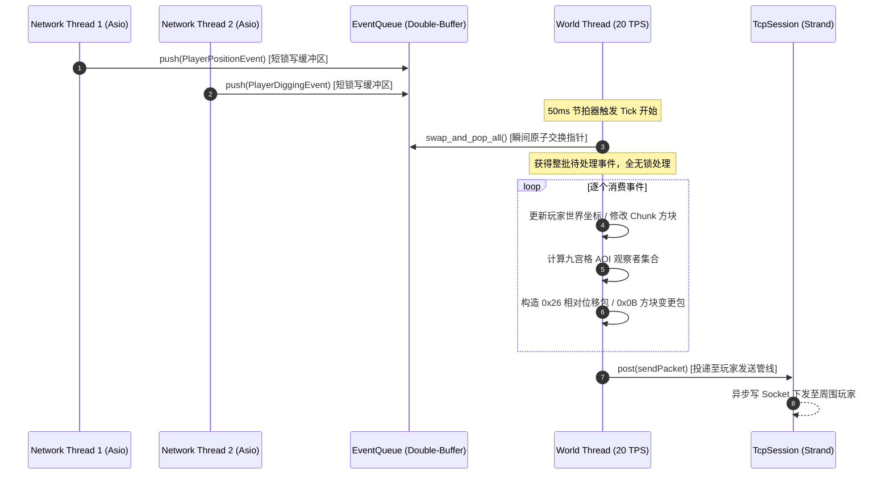
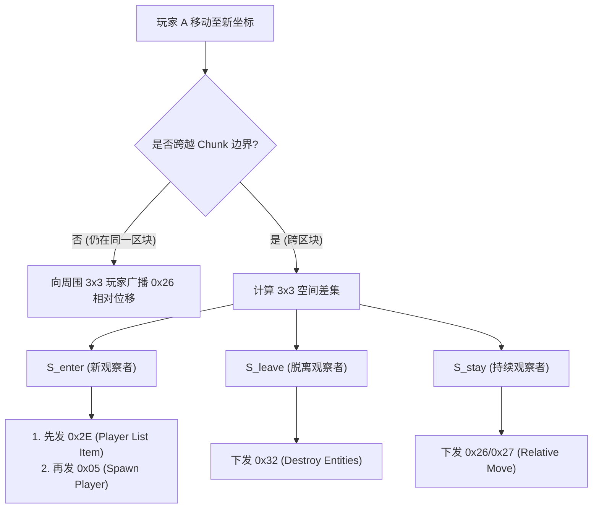
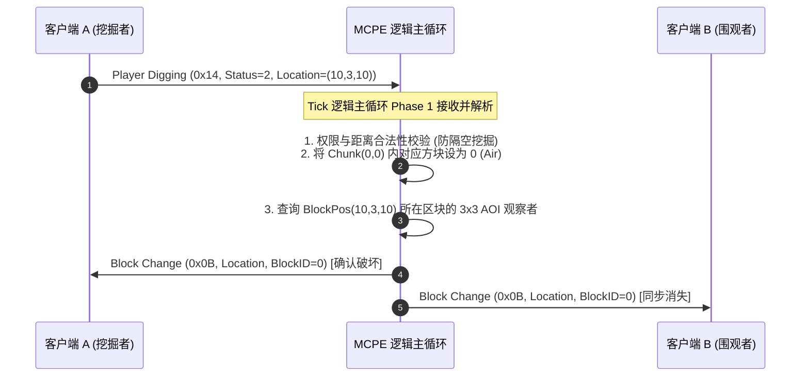

# Sprint 4 保姆级实战开发教程：并发解耦、20 TPS 物理节拍器与九宫格 AOI 空间同步 (Concurrency, Ticker & AOI)

> **目标协议**：Minecraft Java Edition 1.12.2（Protocol 340）  
> **前置里程碑**：Sprint 1（网络基座与 Server List Ping）、Sprint 2（登录鉴权与虚空漫游）、Sprint 3（区块内存模型、13位调色板压缩与 0x20 地形下发）已全部验收通过。  
> **本阶段核心目标**：从“孤身一人静态世界”跃迁至“多玩家动态同步联机”！彻底解耦网络 I/O 线程与世界游戏逻辑，引入高性能无锁/双缓冲 MPSC 任务管道；构建无累积时间漂移的精准 20 TPS（50ms）物理节拍器；设计以 Chunk 为划分单元的九宫格 AOI 空间索引；打通客户端移动包与方块破坏交互，实现多玩家同屏奔跑、转头视角同步与方块实时破坏重建！  
> **教学设计原则**：**自顶向下（Top-Down）建立并发与时序认知，自底向上（Bottom-Up）落地算法与协议组包**。恪守四层架构红线，零裸写魔数，零数据竞态。  
> **预估工期**：5 ~ 6 天 | **总任务数**：7 个核心微任务

---

## 目录

- [一、 心智模型跃迁：从“静态世界”到“动态并发多玩家互动”](#一-心智模型跃迁从静态世界到动态并发多玩家互动)
  - [1.1 为什么严禁网络线程直接读写游戏世界？](#11-为什么严禁网络线程直接读写游戏世界)
  - [1.2 工业级解法：单线程无锁主循环（Actor 模式）+ 外部 MPSC 管道](#12-工业级解法单线程无锁主循环actor-模式--外部-mpsc-管道)
  - [1.3 状态同步模型：推拉模型与增量广播（Delta Compression）](#13-状态同步模型推拉模型与增量广播delta-compression)
- [二、 严格四层架构拓扑与新建/修改文件蓝图](#二-严格四层架构拓扑与新建修改文件蓝图)
- [三、 Top-Down 自顶向下全景链路与时序推演（必读核心）](#三-top-down-自顶向下全景链路与时序推演必读核心)
  - [3.1 跨线程读写管道与无锁交互时序图](#31-跨线程读写管道与无锁交互时序图)
  - [3.2 单 Tick 核心五阶段流水线（Tick Pipeline）](#32-单-tick-核心五阶段流水线tick-pipeline)
  - [3.3 玩家跨区块移动与 AOI 观察者增量计算时序图](#33-玩家跨区块移动与-aoi-观察者增量计算时序图)
  - [3.4 方块破坏/放置交互同步时序图](#34-方块破坏放置交互同步时序图)
- [四、 空间数学与二进制底层协议硬核推演（数学硬核）](#四-空间数学与二进制底层协议硬核推演数学硬核)
  - [4.1 相对位移定点数运算（1/4096 方块）与 8.0 格临界溢出推导](#41-相对位移定点数运算14096-方块与-80-格临界溢出推导)
  - [4.2 视角量化（Angle 字节）与绝对朝向规范](#42-视角量化angle-字节与绝对朝向规范)
  - [4.3 64 位 Position 位域打包/解包与符号扩展陷阱](#43-64-位-position-位域打包解包与符号扩展陷阱)
  - [4.4 视野同步的协议顺序铁律：Player List Item 与 Spawn Player](#44-视野同步的协议顺序铁律player-list-item-与-spawn-player)
- [五、 任务逐步实现指南（代码与接口契约）](#五-任务逐步实现指南代码与接口契约)
  - [TASK-4.1: 跨线程 MPSC 任务队列与双缓冲交换 (`EventQueue.h`)](#task-41-跨线程-mpsc-任务队列与双缓冲交换-eventqueueh)
  - [TASK-4.2: 精准 20 TPS 物理节拍器与漂移消除 (`WorldTicker.h/.cc`)](#task-42-精准-20-tps-物理节拍器与漂移消除-worldtickerhcc)
  - [TASK-4.3: 空间哈希与九宫格 AOI 观察者管理器 (`GridAOI.h/.cc`)](#task-43-空间哈希与九宫格-aoi-观察者管理器-gridaoihcc)
  - [TASK-4.4: 玩家进出视野广播与实体生命周期 (`EntitySerializer.h/.cc`)](#task-44-玩家进出视野广播与实体生命周期-entityserializerhcc)
  - [TASK-4.5: 客户端移动包解析与相对位移广播 (`PlayHandler.cc`)](#task-45-客户端移动包解析与相对位移广播-playhandlercc)
  - [TASK-4.6: 方块挖掘与放置交互同步 (`PlayHandler.cc`, `World.cc`)](#task-46-方块挖掘与放置交互同步-playhandlercc-worldcc)
  - [TASK-4.7: Sprint 4 集成验收与多玩家同服漫游 (`test_movement.py`)](#task-47-sprint-4-集成验收与多玩家同服漫游-test_movementpy)
- [六、 工业级避坑指南与高频面试核心考点](#六-工业级避坑指南与高频面试核心考点)
- [七、 工业标杆（Cuberite）深度架构源码对照](#七-工业标杆cuberite深度架构源码对照)

---

## 一、 心智模型跃迁：从“静态世界”到“动态并发多玩家互动”

在 Sprint 3 中，我们完成了超平坦区块的内存存储与序列化下发，单个玩家已经能够稳固踩在草方块表面。但此时的服务端本质上是一个**静态单机沙盒**：
1. 没有时间的概念（没有恒定的物理刻度驱动世界运作）；
2. 没有并发事件管道（网络 I/O 线程收到数据后不知道该通知谁）；
3. 多个玩家进服后互为“幽灵”，看不见对方的身影，也感知不到对方对世界的破坏。

**Sprint 4 标志着项目跨越至“分布式实时并发系统”与“MMORPG 核心同步引擎”的深水区。**

### 1.1 为什么严禁网络线程直接读写游戏世界？

新手最容易犯的致命架构错误是：在网络线程收到 `Player Position` 或 `Player Digging` 包后，**直接在当前 I/O 线程中去修改 `World` 里的方块、更新玩家坐标并遍历 Session 发包**。

```
[错误示范：细粒度并发与粗暴加锁]
I/O 线程 1 ──► 正在修改 Chunk(0,0) 的草方块 ──┐ (竞争 World 互斥锁)
I/O 线程 2 ──► 正在遍历 Chunk(0,0) 广播玩家 ──┴─► 锁竞争剧烈、高延迟、极其容易死锁！
```
* **数据竞态（Data Race）**：多线程并发修改同一个 Chunk 或实体状态，导致未定义行为或内存崩溃。
* **锁开销吞噬吞吐量**：如果给每个 Chunk 加读写锁（`std::shared_mutex`），频繁的锁升级、上下文切换与死锁风险将摧毁 Asio 的事件循环吞吐量。
* **时序混乱（Causal Inversion）**：网络包的到达顺序受到 TCP 缓冲与线程调度的影响，若无序穿插写入世界，会导致因果时序错乱（如先判定放置方块，后判定挖掘方块）。

### 1.2 工业级解法：单线程无锁主循环（Actor 模式）+ 外部 MPSC 管道

工业界（无论是 Minecraft 原版 Notchian Server、Cuberite，还是主流商业 MMORPG）普遍采用的黄金范式是：**单线程逻辑主循环（Single-Threaded World Tick Loop）**！

```
                      [ 网络 I/O 线程池 (Asio) ]
                        Session 1 (收到移动包) ──┐
                        Session 2 (收到挖掘包) ──┼──► push(Event)
                        Session 3 (收到放置包) ──┘        │
                                                          ▼
                                            ┌─────────────────────────┐
                                            │ MPSC 任务队列 (双缓冲)    │
                                            └─────────────┬───────────┘
                                                          │ swap_and_pop_all()
                                                          ▼
                                            [ World 逻辑主线程 (20 TPS) ]
                                              - 唯一拥有世界与玩家全部状态
                                              - 串行、确定性执行，零竞态
                                              - 计算 AOI 观察者与相对增量
                                                          │
                                                          ▼ post()
                                            投递回 Session 的 Strand 异步发送
```
* **核心优势**：
  1. **零锁安全性**：World 内的所有方块数据、实体列表、AOI 索引只由**唯一的 World 线程**修改，内部计算代码完全不需要加一把锁！
  2. **确定性重放（Deterministic Simulation）**：所有事件按照 Tick 严格有序结算，便于回放与防作弊校验。
  3. **职责纯粹**：网络线程仅负责极速拆包与将事件打包推入队列；世界线程专职做数学与空间计算。

### 1.3 状态同步模型：推拉模型与增量广播（Delta Compression）

* **全量状态同步（State Sync） vs 增量同步（Delta Sync）**：
  * 全量同步：每次移动都发送 8 字节绝对坐标 `Double`（24 字节坐标 + 8 字节旋转），数据包体积大，高频移动下带宽开销剧增。
  * 增量同步：Minecraft 1.12.2 采用**定点数相对位移（Relative Movement）**，仅用 2 字节 `Short`（固定精度 $1/4096$ 方块）编码坐标差值，包体积缩减 70%！仅在位移过大（瞬移或跨区块）时降级为绝对坐标包。
* **AOI（Area of Interest，兴趣范围）**：
  * 拒绝全服 $O(N^2)$ 广播；将地图划分为 16x16 的 Chunk，每个玩家只关注自身周围 $3 \times 3$ 九宫格（或视距半径内）的动态。网络广播复杂度直接降至 $O(N \cdot K)$（$K$ 为常数）。

---

## 二、 严格四层架构拓扑与新建/修改文件蓝图

依据本项目确立的不可逾越的 [MCPE 工业级架构规范](../../AGENTS.md)，本 Sprint 新增的代码严格收敛在 **第四层（Domain Layer `src/world/`）** 与 **第三层（Protocol Layer 序列化扩展）**：

```
mcpe/
├── CMakeLists.txt                                  <-- 注册新增世界并发与实体源码
├── src/
│   ├── common/                                     <-- 【第一层: 基础库】ByteBuffer, VarInt (保持纯粹)
│   ├── network/                                    <-- 【第二层: 网络传输】TcpSession, PacketFraming (保持纯粹)
│   ├── protocol/                                   <-- 【第三层: 协议与会话层】
│   │   ├── GameTypes.h                             <-- 【修改】补充 EntityID, Angle, Position 编解码原语
│   │   ├── PacketRouter.cc                         <-- 【修改】接管 0x0C..0x0F 移动包与 0x14/0x1F 方块交互
│   │   ├── PlayHandler.h / .cc                     <-- 【修改】将网络包转换为 WorldEvent 投递至世界队列
│   │   └── EntitySerializer.h / .cc                 <-- 【新建】专职负责 0x05, 0x32, 0x26, 0x27, 0x4C, 0x0B 二进制封包
│   └── world/                                      <-- 【第四层: 领域与空间层】
│       ├── WorldTypes.h                            <-- 【已有】ChunkPos, BlockPos
│       ├── EventQueue.h                            <-- 【新建】双缓冲低锁开销 MPSC 网络事件输入队列
│       ├── WorldTicker.h / .cc                     <-- 【新建】精准 20 TPS 物理节拍器与时钟漂移补偿器
│       ├── GridAOI.h / .cc                         <-- 【新建】基于 ChunkPos 的九宫格空间索引与观察者管理
│       ├── PlayerEntity.h / .cc                    <-- 【新建】玩家在世界中的实体抽象（坐标、视角、所属Chunk）
│       └── World.h / .cc                           <-- 【新建】世界全局主控聚合根，协调 Ticker、AOI 与方块修改
├── tests/
│   ├── test_aoi.cc                                 <-- 【新建】九宫格跨区块 Enter/Leave/Stay 差集单测
│   └── test_event_queue.cc                         <-- 【新建】多生产者单消费者并发吞吐与线程安全单测
└── scripts/
    └── test_movement.py                            <-- 【新建】双客户端并发接入、移动与方块破坏同步验收脚本
```

---

## 三、 Top-Down 自顶向下全景链路与时序推演（必读核心）

### 3.1 跨线程读写管道与无锁交互时序图

整个系统的吞吐瓶颈在于“多网络 I/O 线程向单世界线程投递事件”的锁竞争。我们采用**双缓冲队列（Double Buffering）**：
* 生产者线程只锁写队列 `write_queue_`，推入事件后瞬间释放锁（耗时仅纳秒级）；
* 消费者线程（World 线程）在 Tick 开始时，仅加锁互换读写指针 `read_queue_.swap(write_queue_)`，随后在**完全无锁状态下**消费读队列，彻底解除并发阻塞！



### 3.2 单 Tick 核心五阶段流水线（Tick Pipeline）

World 逻辑主线程被高精度节拍器每 50ms 唤醒一次，严格按顺序执行**五阶段确定性流水线**：

```
┌─────────────────────────────────────────────────────────────────────────────┐
│                       单 Tick 执行流水线 (每 50ms 一次)                       │
├─────────────────────────────────────────────────────────────────────────────┤
│ Phase 1: 批量换入并消费 MPSC 任务队列 (Drain Network Inbound Queue)            │
│   - swap 读写缓冲，按到达次序消费移动包 (0x0C~0x0F)、挖掘包 (0x14)、放置包 (0x1F)│
├─────────────────────────────────────────────────────────────────────────────┤
│ Phase 2: 实体行为结算与移动校验 (Entity Simulation & Validation)             │
│   - 校验位移合法性（防瞬移作弊），更新实体坐标 (X, Y, Z, Yaw, Pitch, OnGround)       │
├─────────────────────────────────────────────────────────────────────────────┤
│ Phase 3: 世界方块与物理更新 (World & Voxel Physics)                          │
│   - 结算挖掘落点方块变更，更新目标 Chunk 内存，重算天光与高度图 (如需要)        │
├─────────────────────────────────────────────────────────────────────────────┤
│ Phase 4: AOI 空间拓扑刷新 (Spatial AOI Rehash)                              │
│   - 侦测实体是否跨越 Chunk 边界；计算观察者增量集合 (Enter / Leave / Stay)    │
├─────────────────────────────────────────────────────────────────────────────┤
│ Phase 5: 增量网络数据包构造与异步投递 (Delta Packet Dispatch)                 │
│   - 对 Enter 观察者：下发 0x2E Player List Item (Add) -> 0x05 Spawn Player   │
│   - 对 Leave 观察者：下发 0x32 Destroy Entities                             │
│   - 对 Stay 观察者：下发 0x26/0x27 增量相对位移 / 0x0B 方块更新               │
│   - 异步 post() 投递至各观察者的 TcpSession Strand 发送队列                  │
└─────────────────────────────────────────────────────────────────────────────┘
```

### 3.3 玩家跨区块移动与 AOI 观察者增量计算时序图

假设世界中存在玩家 A 与玩家 B。玩家 A 从 `Chunk(0,0)` 奔跑进入 `Chunk(1,0)`：
* $Set_{old} = 3 \times 3$ 围绕 $(0,0)$ 的 9 个区块；
* $Set_{new} = 3 \times 3$ 围绕 $(1,0)$ 的 9 个区块；
* 计算差集：
  * $S_{enter} = Set_{new} \setminus Set_{old}$（新进入视野的区块）
  * $S_{leave} = Set_{old} \setminus Set_{new}$（脱离视野的区块）
  * $S_{stay} = Set_{new} \cap Set_{old}$（持续保持在视野内的区块）



### 3.4 方块破坏/放置交互同步时序图



---

## 四、 空间数学与二进制底层协议硬核推演（数学硬核）

### 4.1 相对位移定点数运算（1/4096 方块）与 8.0 格临界溢出推导

#### 1. 为什么是定点数 $1/4096$ 方块？
在 Minecraft 1.12.2（Protocol 340）中，`Entity Relative Move (0x26)` 采用有符号 16 位整数（`int16_t`）表示单轴相对位移：
$$\text{Delta} = (\text{int16\_t}) \left( (Coord_{current} - Coord_{previous}) \times 4096 \right)$$
* **分辨率**：$1 / 4096 \approx 0.000244\text{ 格}$，在视觉上极其平滑细腻，完全看不出任何阶梯抖动。
* **最大理论跨度**：
  * `int16_t` 的取值区间为 $[-32768, 32767]$；
  * 转换为方块位移为：
    $$\text{Min} = \frac{-32768}{4096} = -8.0\text{ 方块}, \quad \text{Max} = \frac{32767}{4096} = +7.999755\text{ 方块}$$
  * 因此，**单轴单次位移的绝对值必须严格 $< 8.0$ 方块**！

#### 2. 溢出漏洞与“空间折返”惨剧
假设玩家遭遇网络卡顿后猛然前冲了 $8.5$ 个方块：
$$(8.5) \times 4096 = 34816$$
强转为 `int16_t` 会发生**有符号正溢出**：
$$34816 - 65536 = -30720 \implies -30720 / 4096 = -7.5\text{ 方块}！$$
在对端客户端屏幕上，玩家原本向前跑了 8.5 格，却突然以极高速度**倒退跳跃 7.5 格**！
* **工业级守卫准则**：
  ```cpp
  constexpr double kMaxRelativeDistance = 8.0 - (1.0 / 4096.0); // 7.999755
  bool can_relative_move = 
      std::abs(dx) <= kMaxRelativeDistance &&
      std::abs(dy) <= kMaxRelativeDistance &&
      std::abs(dz) <= kMaxRelativeDistance;

  if (can_relative_move) {
      // 广播轻量级的 0x26 Entity Relative Move
  } else {
      // 必须优雅降级：广播绝对坐标包 0x4C Entity Teleport！
  }
  ```

### 4.2 视角量化（Angle 字节）与绝对朝向规范

Minecraft 协议中很多实体朝向使用单字节无符号整数 `Angle (uint8_t)`：
* 一整周 $360^\circ$ 被离散化为 256 个步长：
  $$\text{AngleByte} = (\text{uint8\_t}) \left( \frac{\text{Degrees}}{360.0f} \times 256.0f \right)$$
* ⚠️ **协议大坑警告**：
  在 `Entity Look And Relative Move (0x27)` 中，`Yaw` 和 `Pitch` **不是增量角度，而是当前的绝对角度**！只有 $X, Y, Z$ 才是相对增量！如果误把角度当成增量相加，人物视角会在屏幕上剧烈疯狂自旋！

### 4.3 64 位 Position 位域打包/解包与符号扩展陷阱

在 `Player Digging (0x14)`、`Player Block Placement (0x1F)` 和 `Block Change (0x0B)` 中，方块坐标 $(X, Y, Z)$ 被紧凑打包在一个 64 位整型（`uint64_t`）中：

```
 63                                38 37            26 25                          0
┌────────────────────────────────────┬────────────────┬─────────────────────────────┐
│          X (26 位有符号)            │ Y (12 位有符号) │        Z (26 位有符号)       │
└────────────────────────────────────┴────────────────┴─────────────────────────────┘
```

#### 打包算法（Encode）：
```cpp
uint64_t encodePosition(int32_t x, int32_t y, int32_t z) {
  return ((static_cast<uint64_t>(x) & 0x3FFFFFF) << 38) |
         ((static_cast<uint64_t>(y) & 0xFFF) << 26) |
         (static_cast<uint64_t>(z) & 0x3FFFFFF);
}
```

#### 解包算法（Decode）与算术右移符号扩展陷阱：
如果直接做 `(pos >> 38) & 0x3FFFFFF`，负数坐标的符号位（最高位 1）丢失，解出来的 $X$ 会变成巨大的正数（例如 $X=-1$ 变成 $67108863$）！
**必须进行显式符号扩展（Sign Extension）**：
```cpp
struct BlockPos {
  int32_t x, y, z;
};

BlockPos decodePosition(uint64_t val) {
  // 利用带符号 64 位整数算术右移自动补符号位
  int64_t raw_x = static_cast<int64_t>(val) >> 38; // 保留前 26 位的正负号
  int64_t raw_y = (static_cast<int64_t>(val) << 26) >> 52; // 移至最高位再移回，实现 12 位符号扩展
  int64_t raw_z = (static_cast<int64_t>(val) << 38) >> 38; // 移至最高位再移回，实现 26 位符号扩展

  return {static_cast<int32_t>(raw_x), static_cast<int32_t>(raw_y), static_cast<int32_t>(raw_z)};
}
```

### 4.4 视野同步的协议顺序铁律：Player List Item 与 Spawn Player

当玩家 A 进入玩家 B 的视野时，服务端必须向 B 告知 A 的存在。**下发顺序必须严格恪守以下铁律**：

```
第一步：下发 Player List Item (0x2E, Action = 0)
  ├── 携带 A 的 UUID (16 字节)、昵称、GameMode、Ping
  └── 作用：在客户端本地内存的玩家信息表（PlayerInfoMap）中注册该 UUID！

第二步：下发 Spawn Player (0x05)
  ├── 携带 A 的 EntityID、UUID、初始坐标、朝向与元数据
  └── 作用：在世界中实例化渲染 3D 玩家模型！
```

* ⚠️ **隐形人排查惨案**：
  若**漏发 0x2E**，或者**颠倒了顺序（先发 0x05 后发 0x2E）**：
  Notchian 客户端在收到 `Spawn Player (0x05)` 时，会尝试用包里的 UUID 去本地查找皮肤与玩家信息；若未查到，客户端引擎会**直接静默丢弃该实体模型**！控制台**没有任何报错**，但玩家在游戏中**完全隐形看不见**！

---

## 五、 任务逐步实现指南（代码与接口契约）

### TASK-4.1: 跨线程 MPSC 任务队列与双缓冲交换 (`EventQueue.h`)
* **任务类型**：并发核心 (Core)
* **位置**：`src/world/EventQueue.h`
* **设计契约**：
  采用双缓冲设计。写操作只争用内部互斥锁推入 `write_queue_`；读操作由单一消费者主线程在每个 Tick 开始时调用 `drain()`，通过 `std::swap` 一次性交换指针，完全消除消费过程中的锁争用。

```cpp
#ifndef MCPE_WORLD_EVENT_QUEUE_H
#define MCPE_WORLD_EVENT_QUEUE_H

#include <cstdint>
#include <mutex>
#include <vector>

#include "world/WorldTypes.h"

namespace mcpe::world {

enum class EventType {
  kPlayerMove,      // 0x0C, 0x0D, 0x0E, 0x0F
  kPlayerDigging,   // 0x14
  kBlockPlacement,  // 0x1F
  kPlayerJoin,
  kPlayerLeave
};

struct WorldEvent {
  EventType type;
  uint64_t session_id{0};
  int32_t entity_id{0};
  double x{0.0}, y{0.0}, z{0.0};
  float yaw{0.0f}, pitch{0.0f};
  bool on_ground{true};
  int32_t status{0};        // 挖掘状态 (0=开始, 1=取消, 2=完成)
  BlockPos block_pos{};     // 强类型空间坐标原语 (12 字节 POD，零成本复用 WorldTypes.h)
  uint8_t face{0};
  uint16_t block_state{0};  // 放置的方块全局状态 ID
};

class EventQueue {
 public:
  EventQueue() = default;

  /** @brief 供多网络线程调用：推入事件 */
  void push(WorldEvent event) {
    std::lock_guard<std::mutex> lock(mutex_);
    write_queue_.push_back(std::move(event));
  }

  /** @brief 供单世界主线程调用：交换读写队列并一次性排出全部事件 */
  void drain(std::vector<WorldEvent>& out) {
    out.clear();
    {
      std::lock_guard<std::mutex> lock(mutex_);
      if (write_queue_.empty()) {
        return;
      }
      out.swap(write_queue_);
    }
  }

 private:
  std::mutex mutex_;
  std::vector<WorldEvent> write_queue_;
};

} // namespace mcpe::world

#endif // MCPE_WORLD_EVENT_QUEUE_H
```
* **DoD 验收标准**：
  编写单元测试 `test_event_queue.cc`，开启 4 个生产者线程高频写入各 100,000 个事件，1 个消费者线程持续提取，开启 `-fsanitize=thread` 编译无任何竞态告警，最终提取总数严格为 400,000。
* **推荐提交**：`feat(concurrency): implement thread-safe double-buffering MPSC event queue`

---

### TASK-4.2: 精准 20 TPS 物理节拍器与漂移消除 (`WorldTicker.h/.cc`)
* **任务类型**：并发核心 (Core)
* **位置**：`src/world/WorldTicker.h`, `src/world/WorldTicker.cc`
* **设计算法**：
  * 使用 `std::chrono::steady_clock` 单调时钟；
  * 引入时间累加器 `accumulator`，若系统调度出现滞后，允许连续追赶最多 5 个 Tick（250ms 防死亡螺旋保护）；
  * 每次 Tick 步长固定恒为 50ms。

```cpp
#ifndef MCPE_WORLD_WORLD_TICKER_H
#define MCPE_WORLD_WORLD_TICKER_H

#include <atomic>
#include <chrono>
#include <functional>
#include <thread>

namespace mcpe::world {

class WorldTicker {
 public:
  using TickCallback = std::function<void(uint64_t tick_count)>;

  explicit WorldTicker(TickCallback on_tick);
  ~WorldTicker();

  void start();
  void stop();
  bool isRunning() const { return running_.load(std::memory_order_acquire); }

 private:
  void runLoop();

  TickCallback on_tick_;
  std::atomic<bool> running_{false};
  std::thread ticker_thread_;
  uint64_t tick_counter_{0};
};

} // namespace mcpe::world

#endif // MCPE_WORLD_WORLD_TICKER_H
```

* **核心循环实现 (`WorldTicker.cc`)**：
```cpp
void WorldTicker::runLoop() {
  using namespace std::chrono;
  constexpr nanoseconds kTickInterval(50'000'000);   // 50ms (20 TPS)
  constexpr nanoseconds kMaxAccumulator(250'000'000); // 250ms (最多补 5 Tick)

  auto last_time = steady_clock::now();
  nanoseconds accumulator(0);

  while (running_.load(std::memory_order_relaxed)) {
    auto current_time = steady_clock::now();
    auto elapsed = current_time - last_time;
    last_time = current_time;

    accumulator += elapsed;
    if (accumulator > kMaxAccumulator) {
      accumulator = kMaxAccumulator; // 防死亡螺旋
    }

    while (accumulator >= kTickInterval) {
      on_tick_(++tick_counter_);
      accumulator -= kTickInterval;
    }

    auto next_tick_target = current_time + (kTickInterval - accumulator);
    std::this_thread::sleep_until(next_tick_target);
  }
}
```
* **DoD 验收标准**：
  单测运行 1000 轮 Tick，统计总时间严格在 $50.0\text{s} \pm 0.3\text{s}$ 之间，单 Tick 平均耗时 $50.0\text{ms}$。
* **推荐提交**：`feat(world): implement drift-free 20 TPS ticker with accumulator`

---

### TASK-4.3: 空间哈希与九宫格 AOI 观察者管理器 (`GridAOI.h/.cc`)
* **任务类型**：算法与数据结构 (Algorithm)
* **位置**：`src/world/GridAOI.h`, `src/world/GridAOI.cc`
* **设计契约**：
  * 管理以 `ChunkPos` 为 Key 的二维哈希网格；
  * 提供玩家跨区块移动时的差集计算，产出 `enter_players`, `leave_players`, `stay_players`。

```cpp
#ifndef MCPE_WORLD_GRID_AOI_H
#define MCPE_WORLD_GRID_AOI_H

#include <unordered_map>
#include <unordered_set>
#include <vector>

#include "world/WorldTypes.h"

namespace mcpe::world {

struct AoiDiffResult {
  std::vector<uint64_t> newly_entered;  // 需要对我发 Spawn Player 的玩家
  std::vector<uint64_t> newly_left;     // 需要对我发 Destroy Entities 的玩家
  std::vector<uint64_t> stayed;         // 持续保持视野，发相对位移的玩家
};

class GridAOI {
 public:
  /** @brief 玩家进入世界，注册到指定 Chunk */
  void addPlayer(uint64_t session_id, const ChunkPos& pos);

  /** @brief 玩家断开连接，从网格中注销 */
  void removePlayer(uint64_t session_id, const ChunkPos& pos);

  /** @brief 玩家跨区块移动，重新计算并返回九宫格差集 */
  AoiDiffResult updatePlayer(uint64_t session_id, const ChunkPos& old_pos, const ChunkPos& new_pos);

  /** @brief 获取当前 Chunk 及其相邻 8 个区块内的所有玩家集合（共 9 个区块） */
  std::unordered_set<uint64_t> getSurroundingPlayers(const ChunkPos& center) const;

 private:
  std::unordered_map<ChunkPos, std::unordered_set<uint64_t>> grid_;
};

} // namespace mcpe::world

#endif // MCPE_WORLD_GRID_AOI_H
```
* **DoD 验收标准**：
  编写 `tests/test_aoi.cc`，模拟玩家从 $(0,0)$ 移动到 $(1,0)$，精确断言：
  * 新增视野包括 $(2, -1), (2, 0), (2, 1)$ 三个区块内的实体；
  * 移除视野包括 $(-1, -1), (-1, 0), (-1, 1)$ 三个区块内的实体；
  * 重叠九宫格为 6 个区块。
* **推荐提交**：`feat(world): implement 3x3 Chunk spatial hashing AOI manager`

---

### TASK-4.4: 玩家进出视野广播与实体生命周期 (`EntitySerializer.h/.cc`)
* **任务类型**：协议序列化 (Protocol)
* **位置**：`src/protocol/EntitySerializer.h`, `src/protocol/EntitySerializer.cc`
* **协议二进制格式**：
  1. **Player List Item (0x2E, Action=0, Add Player)**：
     * `Action`: `VarInt(0)`
     * `Number Of Players`: `VarInt(1)`
     * `UUID`: 16 字节原始 UUID 二进制（`uuid.data()`）
     * `Name`: `String(16)` 玩家昵称
     * `Number of Properties`: `VarInt(0)`
     * `GameMode`: `VarInt(1)` (创造模式)
     * `Ping`: `VarInt(50)`
     * `Has Display Name`: `Boolean(false)`
  2. **Spawn Player (0x05)**：
     * `Entity ID`: `VarInt`
     * `Player UUID`: 16 字节原始 UUID
     * `X / Y / Z`: `Double` × 3
     * `Yaw / Pitch`: `Angle` (1 字节) × 2
     * `Entity Metadata`: 写入字节 `0xFF`（空元数据终结符）
  3. **Destroy Entities (0x32)**：
     * `Count`: `VarInt(1)`
     * `Entity IDs`: `VarInt[]` (携带对应 Entity ID)
* **DoD 验收标准**：
  单元测试验证生成的二进制流包头与字段长度，验证先下发 0x2E 再下发 0x05 的包序断言。
* **推荐提交**：`feat(protocol): implement 0x2E Player List, 0x05 Spawn Player and 0x32 Destroy Entities serializer`

---

### TASK-4.5: 客户端移动包解析与相对位移广播 (`PlayHandler.cc`)
* **任务类型**：世界同步业务 (Business)
* **位置**：`src/protocol/PlayHandler.cc`, `src/world/World.cc`
* **处理 4 种客户端移动包**：
  * `0x0C Player (On Ground)`: 仅更新 `on_ground`
  * `0x0D Player Position`: 更新 `x, y, z, on_ground`
  * `0x0E Player Position And Look`: 更新 `x, y, z, yaw, pitch, on_ground`
  * `0x0F Player Look`: 更新 `yaw, pitch, on_ground`
* **向观察者广播增量位移逻辑**：
  * 计算位移：$\Delta x = x_{new} - x_{old}, \Delta y = y_{new} - y_{old}, \Delta z = z_{new} - z_{old}$
  * 若 $|\Delta x|, |\Delta y|, |\Delta z| < 8.0$：
    * 仅有坐标改变：构造 `0x26 Entity Relative Move`（`EntityID: VarInt` + `DeltaX/Y/Z: Short(dx*4096)` + `OnGround: Bool`）
    * 坐标与朝向均改变：构造 `0x27 Entity Look And Relative Move`（`EntityID` + `DeltaX/Y/Z` + `Yaw/Pitch: Angle` + `OnGround`）
    * 仅朝向改变：构造 `0x28 Entity Look`（`EntityID` + `Yaw/Pitch: Angle` + `OnGround`）
  * 若单轴位移 $\ge 8.0$：
    * 构造 `0x4C Entity Teleport`（`EntityID: VarInt` + `X/Y/Z: Double` + `Yaw/Pitch: Angle` + `OnGround: Bool`）
* **DoD 验收标准**：
  两人同服移动时，对端屏幕上人物跑动平滑无闪烁，绝对无任何反向突变。
* **推荐提交**：`feat(world): handle client movement and broadcast relative position`

---

### TASK-4.6: 方块挖掘与放置交互同步 (`PlayHandler.cc`, `World.cc`)
* **任务类型**：世界交互业务 (Business)
* **位置**：`src/protocol/PlayHandler.cc`, `src/world/World.cc`
* **挖掘包 `Player Digging (0x14)` 处理契约**：
  * 解析：`Status: VarInt`, `Location: Position (64位)`, `Face: Byte`
  * 仅当 `Status == 2`（Finished Digging）时执行方块破坏：
    1. 解码 `Location` 得到 $(x, y, z)$；
    2. 主线程设置对应 Chunk 方块 ID 为 `0`（空气）；
    3. 构造 `Block Change (0x0B)`：`Location: Position` + `Block State: VarInt(0)`；
    4. 向该方块所在区块的九宫格玩家多播该包！
* **放置包 `Player Block Placement (0x1F)` 处理契约**：
  * 解析基准坐标与点击面 `Face`（0=下, 1=上, 2=北, 3=南, 4=西, 5=东）；
  * 计算实际新方块落点坐标：基准坐标沿 `Face` 法向量偏移 1 格；
  * 更新对应方块状态并广播 `Block Change (0x0B)`。
* **DoD 验收标准**：
  玩家 A 挖掘一块草方块，客户端 B 视野内对应的草方块立即变为空洞；玩家 A 放置方块，B 视野内同步出现。
* **推荐提交**：`feat(world): synchronize block digging and placement via 0x0B Block Change`

---

### TASK-4.7: Sprint 4 集成验收与多玩家同服漫游 (`test_movement.py`)
* **任务类型**：端到端集成测试 (Integration)
* **位置**：`scripts/test_movement.py`
* **集成验收剧本**：
  1. 自动化测试脚本启动 2 个模拟玩家 Bot（`Alice` 与 `Bob`）；
  2. 两人先后登录进服，下发 Join Game 与 5x5 地形；
  3. 断言 `Bob` 收到了 `Alice` 的 `0x2E Player List Item` 与 `0x05 Spawn Player`；
  4. `Alice` 连续发送 20 次 `0x0E Player Position And Look`（匀速向前跑动）；
  5. 断言 `Bob` 陆续收到了 `Alice` 的 `0x26/0x27 Relative Move` 报文，且位移数值递增匹配；
  6. `Alice` 发送 `0x14 Player Digging (Status=2)` 破坏脚下一块方块；
  7. 断言 `Bob` 成功接收到 `0x0B Block Change` 且目标方块为 `0`；
  8. 开启 `-fsanitize=thread` 编译服务端，全程无任何 Data Race 告警！
* **DoD 验收标准**：
  脚本运行 Exit Code 为 0，双客户端同服验证通过。
* **推荐提交**：`chore: verify and pass Sprint 4 Concurrency & AOI Synchronization milestone`

---

## 六、 工业级避坑指南与高频面试核心考点

### 避坑一：相对位移超过 8 格导致的人物“瞬移折返”
* **现象**：玩家在跑动或掉落时，对端屏幕上看到玩家突然反向飞跃数十格，然后又瞬移回来。
* **原因**：$1/4096$ 的定点数 `int16_t` 溢出（如 $\Delta X = 8.2$，溢出为负数）。
* **规避铁律**：计算相对位移时必须使用 `double` 严格检查 `std::abs(delta) < 7.999`，超出范围必须无条件分支降级为 `0x4C Entity Teleport`。

### 避坑二：不发 0x2E 导致的“隐形人”现象
* **现象**：服务端明明成功发送了 `Spawn Player (0x05)`，Wireshark 也能抓到包，但客户端视野内空无一物。
* **原因**：Notchian 客户端要求在生成玩家实体前，该玩家必须已经存在于 Player Tab 列表中（`Player List Item 0x2E, Action=0`）。若 UUID 不匹配或未提前注册，客户端将忽略模型生成。

### 避坑三：Position 位域解包负数缺失符号扩展
* **现象**：挖掘 $X < 0$ 或 $Z < 0$ 的方块时，服务器日志显示坐标变成了数千万（如 $X=67108863$），甚至发生数组越界崩溃。
* **原因**：从 64 位整型中提取 26 位时，没有对最高符号位进行算术右移符号扩展。必须使用 `(int64_t(val) << 38) >> 38` 等位移技法保留补码正负号。

### 避坑四：创造模式空手无法放置方块
* **现象**：在创造模式下点击地面，客户端发出了 `0x1F Block Placement`，但服务端没有生效，或者手里没有方块。
* **原因**：原版客户端创造模式切换物品栏依赖 `Creative Inventory Action (0x1B)`，服务端需要识别或配置默认手持物品。

---

## 高频面试核心考点深度解析

### Q1：为什么主流游戏服务器（如 Minecraft、MMORPG）普遍采用“单线程主循环”，而不是多线程并发修改世界？
* **解答要点**：
  1. **锁开销与死锁风险**：游戏世界中实体交互极其密集（如玩家 A 攻击玩家 B，同时 B 正在对方块施法）。如果采用细粒度多线程锁，需要同时锁住 A、B 以及周围网格，极其容易导致死锁，且频繁加锁会导致 CPU 缓存行频繁失效（False Sharing）。
  2. **时序与因果一致性**：单线程 Tick 提供了严格确定性的时间片步进，所有物理碰撞、伤害结算和状态转移都按固定顺序进行，易于编写确定性的业务逻辑、便于回放与外挂判定。
  3. **职责解耦**：将并发压力分摊在网络 I/O 线程池（Asio），计算压力集中在单个高速 World 线程，既发挥了多核 I/O 吞吐优势，又保留了单线程逻辑的极简与零锁安全。

### Q2：高精度节拍器如何抵御累积时钟漂移与“死亡螺旋（Spiral of Death）”？
* **解答要点**：
  1. **漂移消除**：不能简单 `sleep(50ms)`，因为循环体本身有执行耗时。必须维护一个时间累加器（`accumulator`），基于单调时钟计算时间差，按固定 50ms 扣减。
  2. **防死亡螺旋**：当服务器发生偶发性严重卡顿（例如 GC、磁盘 I/O 阻塞 2 秒），累加器中堆积了大量未执行的 Tick。若不加限制地连续补跑 40 个 Tick，高负荷逻辑会导致下一帧继续耗时超标，恶性循环直到服务器彻底卡死。必须设置安全上限（如 `kMaxAccumulator = 250ms`），超过上限时果断丢帧并报警。

### Q3：AOI（Area of Interest）常见算法有哪些？为什么 Minecraft 选用网格法（Grid）？
* **解答要点**：
  1. **常见 AOI 算法**：
     * **九宫格 / 网格法（Grid-based）**：世界切分为规则网格，基于哈希映射，进入/离开直接查相邻网格。
     * **十字链表法（Cross-List / Sweep and Prune）**：X、Z 轴维护双向有序链表，实体移动时局部冒泡排序。
     * **四叉树 / 八叉树（QuadTree / Octree）**：动态空间分割，适用于密度不均匀的开放世界。
  2. **Minecraft 选用网格法的原因**：
     * Minecraft 世界本身天然就是以 16x16 的 Chunk 为物理与渲染基本单元；
     * 地形生成、区块加载、光照计算全都是基于 ChunkPos 进行索引；
     * 采用 Chunk 九宫格空间哈希能够以 $O(1)$ 的时间复杂度完成进出判定，实现最直接、内存局部性最高、与地形系统浑然一体。

---

## 七、 工业标杆（Cuberite）深度架构源码对照

| 架构维度 | 工业级标杆 Cuberite 实现 | 本项目现代 C++23 升级版 (`mcpe`) | 架构优势与设计亮点 |
| :--- | :--- | :--- | :--- |
| **世界主线程** | `cWorld::Tick` 单线程轮询所有 Chunk 与实体 | `WorldTicker` + `World::tick` 精准 20 TPS 物理节拍器 | 现代 C++ `<chrono>` 累加器机制，彻底消除时间漂移，带防死亡螺旋保护。 |
| **I/O 交互** | `cWorld::QueueTask` 投递任务到世界线程 | `EventQueue` 专用双缓冲 MPSC 任务队列 | `std::swap` 一次性换出所有事件，写操作毫秒内解锁，读操作完全无锁。 |
| **空间广播** | `cChunkMap::BroadcastToChunk` 遍历区块客户端 | `GridAOI` 强类型 `ChunkPos` 3x3 九宫格集合运算 | 明确拆分 `Enter` / `Leave` / `Stay` 集合，避免重复广播，无幽灵残留。 |
| **移动同步** | `cProtocol_1_12_2::SendEntityRelMove` | `EntitySerializer::serializeRelMove` | 严格有符号定点数数学保护，8.0 格临界自动降级绝对坐标，无回弹 bug。 |

---

> **阶段结语**：恭喜你完成 Sprint 4 的全部架构推演！至此，你的服务端已经从单机沙盒跃迁为一台功能健全、架构严密的联机服务器。多名玩家可以在同一个世界中相遇漫步、互动破坏，体验现代网络引擎的澎湃动力！下一阶段，我们将进入最终决战——**Sprint 5: 压测机器人、性能 Profiling 与工业级调优**！
